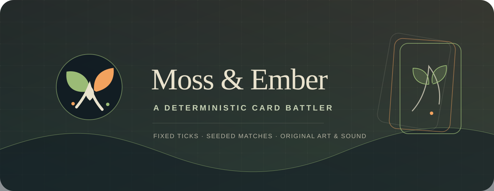
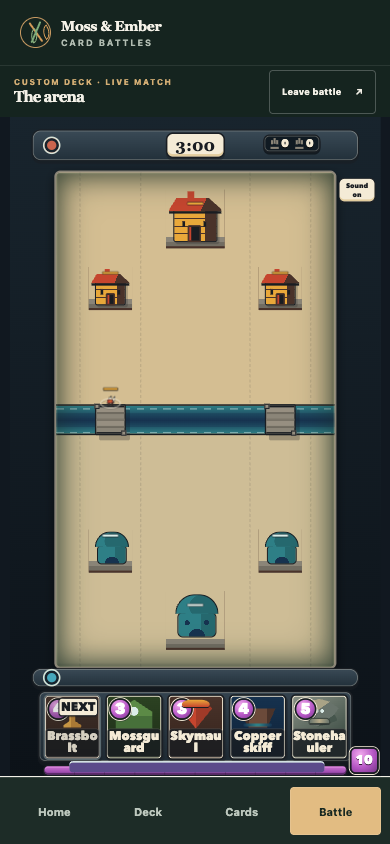

<p align="center">
  
</p>

<h1 align="center">Moss &amp; Ember</h1>

<p align="center">An original real-time card battler.</p>

<p align="center">
  
</p>

Play against a computer opponent. Build an eight-card deck from the sixteen-card
collection, then choose from your hand and spend elixir, which refills during
the match, to deploy units in the arena. They move and fight on their own. Take
tower crowns before time runs out to win.

<p align="center">
  
</p>

Moss &amp; Ember is an independent project inspired by the rules of Clash Royale
before March 2023. It is not affiliated with Supercell. The game uses original
names, art, and sound. This is an active prototype, not a complete recreation;
some cards and arena rules are still being worked out.

The same starting conditions and player choices replay the same match. A small
code interface can control the same game, so developers can experiment with
strategies and bots; see the [RL environment guide](docs/rl-api.md).

## Play locally

Requires Node.js 22.12 or later and Playwright's Chromium browser.

```sh
git clone https://github.com/ThatXliner/clash-royale-clone.git
cd clash-royale-clone
npm ci
npx playwright install chromium
npm run preview:release
```

Open [http://127.0.0.1:4173/public/index.html](http://127.0.0.1:4173/public/index.html).
For Linux setup and development commands, see [Development](docs/development.md).

## Learn more

- [Development and test commands](docs/development.md)
- [World and card lore](docs/lore.md)
- [RL environment guide](docs/rl-api.md)
- [Verification evidence and limits](docs/verification.md)
- [GitHub Pages publishing](docs/publishing.md) — the site is not live yet
- [Contribution guide](CONTRIBUTING.md)

Project-authored code and original brand assets are licensed under
[GNU AGPL-3.0-only](LICENSE). Some authored audio and shipped icons have their
own CC0-1.0 notices. See [NOTICE](NOTICE) for asset and comparison-corpus
provenance, and [the brand guide](docs/brand.md) for the Moss &amp; Ember identity.
