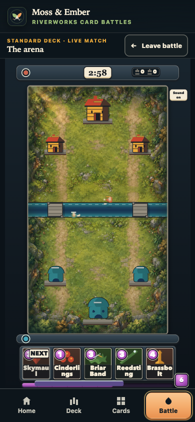
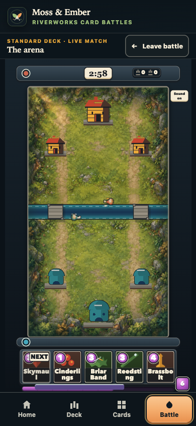
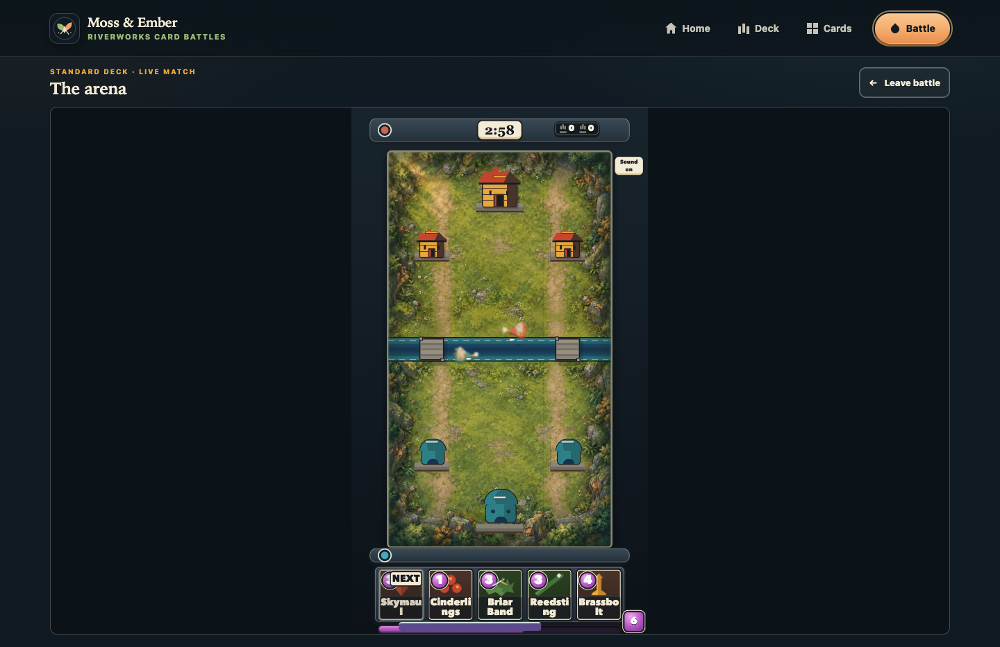
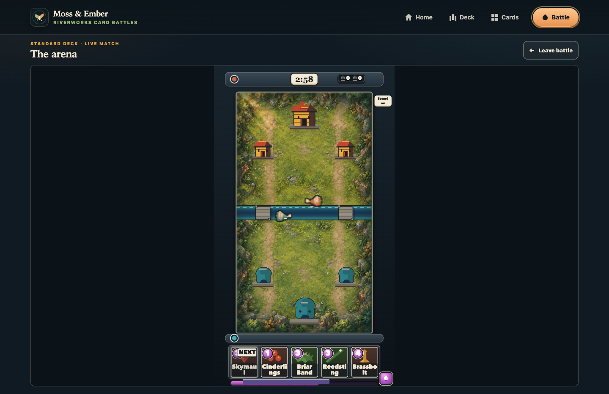

PIECE: APP-REDESIGN-COPPER-001 round3 — native contrast/readability
VERDICT: PASS

EVIDENCE:

The selected C atlas reads more clearly than the R2 A atlas at the required native presentation sizes. I compared fresh full-game 1× captures at 390×844 (13 CSS-pixel body) and 1440×933 (26 CSS-pixel body), with both variants reaching the same horizontal contact tick. C's crisp sample and one-pixel `#191D22` perimeter give the pale hull a visible boundary over the grass and river. C in the fresh capture has the same SHA-256 as the shipped candidate asset (45ee8feefc4c4dc94ea7e94a8cac1e4b6e69c723fb730fb34a9866098dd7485a); the 256×256 RGBA PNG is 12,094 bytes. Copperskiff is original art, so the A/C captures compare the R2 baseline with this candidate rather than an authentic Copperskiff sprite from the comparison game.

Fresh phone comparison:

| R2 baseline A | Selected candidate C |
|---|---|
|  |  |

Fresh desktop comparison:

| R2 baseline A | Selected candidate C |
|---|---|
|  |  |

The untouched eight-case browser gate ran in full-matrix mode. Raw Node output:

```text
TAP version 13
# Subtest: Copperskiff renders through the shipped GameSession browser at phone and desktop size
ok 1 - Copperskiff renders through the shipped GameSession browser at phone and desktop size
  ---
  duration_ms: 46553.305292
  type: 'test'
  ...
1..1
# tests 1
# suites 0
# pass 1
# fail 0
# cancelled 0
# skipped 0
# todo 0
# duration_ms 46872.938292
```

The report contains eight combinations (two headings × two viewports × normal/reduced motion). All eight have no page, console, or request errors; session, browser, input-bridge, and audio continuation bytes match on restore; each before/after screenshot is pixel-identical (0 changed pixels); and all 120-tick future continuations match. Restart reached terminal session tick 1590, then tick 0 with restart count 1. The full raw report is [full-eight-case-report.json](full-eight-case-report.json), and the two native-sized candidate renders from the gate are also in [the complete run directory](/Users/me/.codex/clash-qualification/20261020-copperskiff-readability-r3/candidate/artifacts/app-redesign-copper-001-builder/browser/actual-game/attempt-20261021T063402966289Z-109bb017e17f).

Focused results: sprite contract 6/6, shipping isolation 13/13, release build 24/24, and post-release manifest 6/6 passed. The release fixture was freshly seeded from canonical Git blob `a8a36f49cae7977f6c001ba64a40fa8bed215f75`, byte-identical in both pinned commits; the new release evidence hash is `51181432bd0d2821394b86783471676aca5aa0e5f056530915082e4dc4c90cc1`. Prior fixture bytes remain in `pre-focused-release-fixture/`.

Source-freeze checks passed before and after: 189 files checked, 183 pinned unowned, zero failures. The immutable browser test remains SHA-256 `df5c179fb8641ff7c6150414ae3c4add0b0ea330d24d0d4b75193120ec758a2b`. Temporary dependency and reference symlinks were removed after the runs; the reference corpus was neither copied nor bundled.

BIGGEST GAP: At the 13 CSS-pixel phone presentation, the hull's interior color detail remains too small to read, so recognition relies on the clear outer contour; the stated bar requires that contour to separate the boat from grass and water, which C does.
