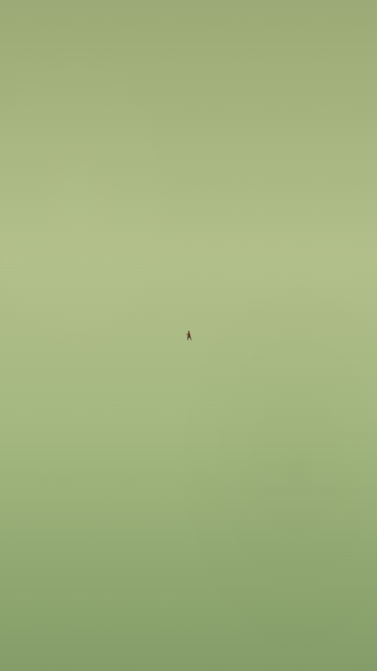
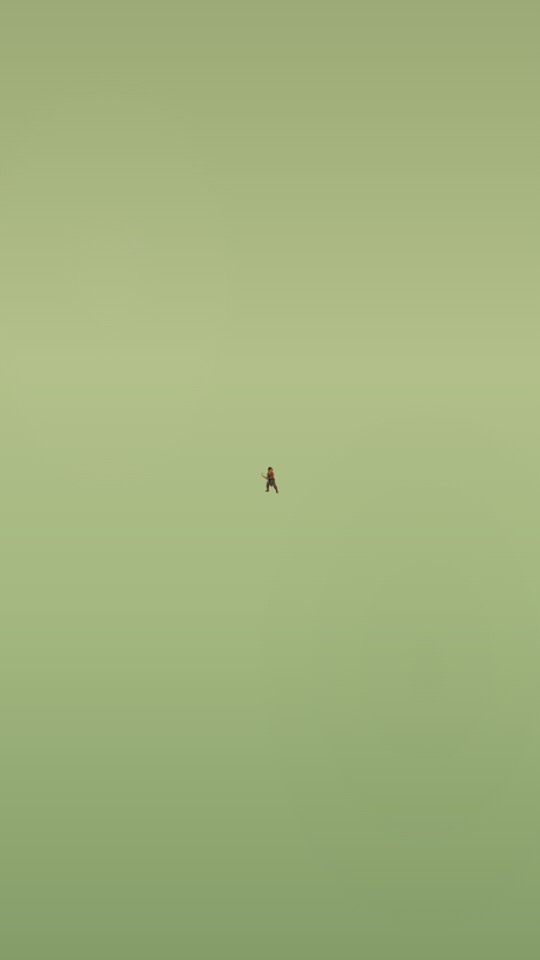

PIECE: ART-022B Original Brackenwheel battle cutout
VERDICT: FAIL

EVIDENCE:

The art is original and consistent with the accepted Brackenwheel portrait: the full source PNG is 1254×1254 RGBA (1,009,789 bytes), and the shipped WebP is 512×512 RGBA (47,854 bytes) with verified SHA-256 values in `receipts/asset-audit.json`. Re-encoding the source with cwebp 1.6.0 and the recorded settings produced a byte-identical WebP. The prompt, tool, license, input and output hashes, dimensions, encoding settings, and one new manifest entry are recorded; removing that entry reproduces the prior manifest byte-for-byte. The manifest test reports 6/6 passes, including zero byte overlap with `reference/` and provenance checks.

I rendered the shipped WebP independently in Chrome 155.0.8059.40 at DPR 1 on a 540×960 arena-tone surface. Its ≥128-alpha body bounds are 323×492 of 512×512, so the browser’s quantized 13.515625 px image frame yields a 12.99×8.53 CSS px body. In the actual native capture the figure is a tiny speck: the head, apron, sickle, and boots do not resolve as a coherent readable silhouette. At a 26 px body it reads as a person holding a curved tool. The 8× image is diagnostic only.

The candidate changes only the visual asset manifest in runtime source; it changes no `reference/` files and makes no gameplay or historical-parity claim. `npm ci` completed with Node 22.22.3/npm 10.9.8. The prescribed suites passed: manifest 6/6, shipping-isolation guard 13/13, release build 22/22, and shipping-isolation release 4/4, each with direct exit 0. Release artifacts were absent before and after. The release-isolation test rewrote five tracked evidence JSON files; their diff is retained in `receipts/test-side-effects.patch` and each file was restored to its frozen-commit hash.

BIGGEST GAP: At the required 13 CSS px body size, the figure is only about 8.5 px wide and its head, apron, sickle, and feet merge into an unreadable speck; the details become legible only at 26 px or in the enlarged diagnostic.
