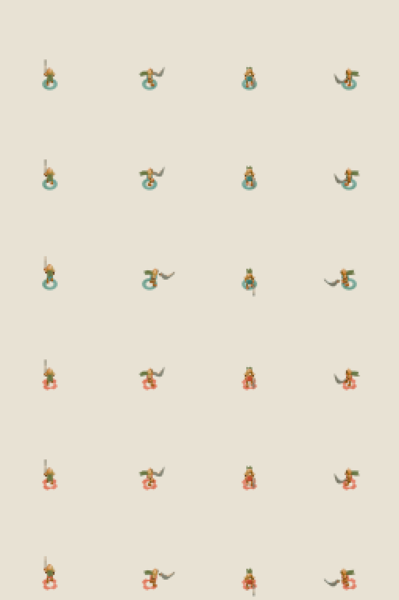
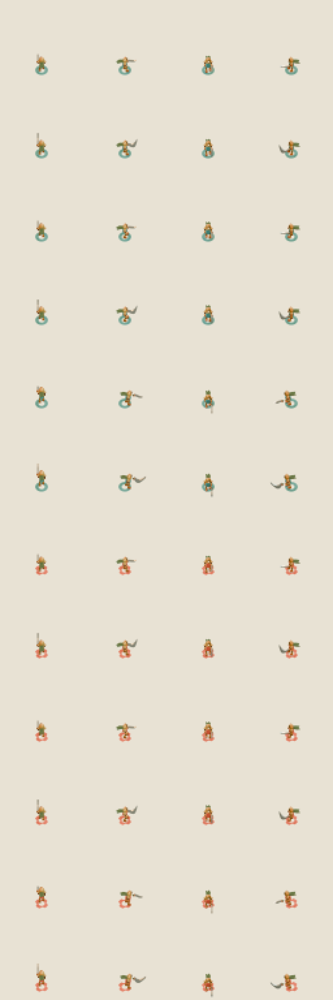

# Astra Coilblade R2 — standalone blade critique

**PIECE:** Coilblade’s crescent saber in the R2 standalone model and native sprites  
**VERDICT:** **FAIL**

**EVIDENCE:** I inspected the actual fresh 64 px native color sheet and its 4× view, the fresh 512 px portrait, and the carried R1 comparison cells. The R2 native sheet covers both teams, all four headings, and idle/walk/contact. Its side-facing poses show a more curved hook than R1’s short straight bar, but at the 13 px body scale the weapon still reads as a small pale appendage; north/south are mostly edge-on slivers. In the R2 portrait, the new concavity is visible, yet the blade is so broad that it covers roughly a torso’s width and much of the upper leg, reading as a crescent plate or shield rather than the canonical thin sweeping saber. The copper bell, single eye, and moss scarf still identify the character.

The native-output receipt reports 32 fresh 64 px outputs: 24 color poses (2 teams × 4 headings × 3 poses) and 8 team masks, plus one fresh portrait. All 32 native PNG hashes and the portrait hash matched the receipt. The 24 R1 control cells in the comparison sheet are carried forward and are not counted as fresh. The wrapper and both Blender steps exited 0. The model manifest records a 16-point, 32-vertex, 60-triangle blade mesh, 1,704 total triangles, 34 unchanged meshes, an unchanged body/pose/camera preservation hash, and no reference import.

I used the original portrait atlas at /Users/me/.codex/clash-qualification/20261020-coil-moss-native-r1-critic/canonical-portrait-atlas.webp and the explicit handoff description “thin upright fencer with a long bright crescent blade” as comparison criteria. The handoff marks itself as a proposal that is not accepted, so I treated it as guidance rather than prior approval.

**BIGGEST GAP:** The saber’s curve improved, but its portrait silhouette is too broad and its native-scale profile too short to read as Coilblade’s long, thin crescent sword.

**SCOPE:** This verdict is only for the R2 Coilblade blade/readability gap; it does not rejudge Mossguard or claim live-game integration.

## Selected evidence

R2 native color, 4× view:

R1 control and R2 candidate comparison (carried R1 cells are not fresh):

Portraits: [R2](evidence/r2-portrait.png) · [R1](evidence/r1-portrait.png)
