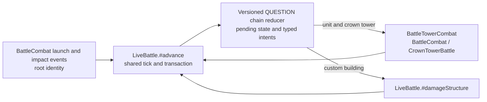

# Shared chain host continuation: architecture grounding

**Pins and scope.** This note rechecks the requested accepted source pin `1a72b361a608745b066a05b140aac87566dad3f5` and the unadopted factory extraction `ffdaab6299f34308776cd2568f1d9f34903ecf14`. Earlier grounding files name `4a6e9f6171ae1042a03f7c8268863df9a97920e` as accepted; the ownership facts below were checked directly against the task-specified pin. This is file-only inspection; no tests, runtime, build, or browser check was run.

## Overview

The actual host seam is `LiveBattle.#advance()` in `src/sim/battle-continuation-kernel.js`. It reads the shared pre-boundary tick, routes due contacts, advances the composite battle once, records host events, then commits the candidate through `step()`/`stepMany()` clone-and-adopt. Chain pending state and history belong in this transaction, so a rejected step cannot partially mutate them. [`battle-continuation-kernel.js:8003-8013, 8073-8111, 8250-8271, 7395-7416, 9360-9429 @ 1a72…`]

The `ffda…` candidate extracts the `BattleCombat` factory into `src/sim/battle-combat-runtime.js`; `LiveBattle` and its boundary remain in `battle-continuation-kernel.js`. HTJC lists HTJX as a dependency. Treat that separate, unadopted factory gate as a source-location dependency; it does not transfer unit health ownership or justify a second damage system. [`battle-combat-runtime.js:39 @ ffda…`; `battle-continuation-kernel.js:9, 4886, 6116, 6375-6441 @ ffda…`; `PLAN.md:233 @ 1a72…`]

## Key Concepts

- **Root identity comes from combat.** `BattleCombat` mints the four-field identity `{attackSequence, direction, projectileId, sourceId}` at projectile launch and copies it onto launch, impact, and damage/contact events. Chain hops should retain this root and add continuation metadata; they must not mint replacement root IDs. [`battle-continuation-kernel.js:3001-3029, 3095-3100, 3161-3174 @ 1a72…`; extracted equivalent: `battle-combat-runtime.js:1487-1492, 1553-1565 @ ffda…`]
- **Health has three existing owners.** `BattleCombat` applies unit damage through its `DamageSystem`; `CrownTowerBattle` applies tower damage through `BattleTowerCombat`'s joined boundary; `LiveBattle.#damageStructure()` owns custom-building hitpoints and destruction. The composite explicitly preserves the first two authorities. [`battle-continuation-kernel.js:3238, 3870-3938, 4976-4980, 5395-5475, 9178-9197 @ 1a72…`]
- **Tower and building are distinct target types.** Both are projected to combat as `kind: "structure"`; crown towers carry their tower ID, while custom buildings use `structureId: "building:<id>"`. A chain intent therefore needs an internal `unit | crown-tower | building` discriminator plus the stable host ID. [`battle-continuation-kernel.js:4599-4624, 9158-9169 @ 1a72…`]

## How It Works

The first three caller sites for a design sketch are:

1. `LiveBattle.#advance()` observes the host-minted launch/impact events and owns pending-hop state under the current `tick`; only an explicit chain policy enables this reducer path. The ordinary projectile runtime currently records identity receipts and QUESTION results, rejects scheduling a QUESTION mechanic, and cannot mint roots, advance time, or touch health. [`battle-continuation-kernel.js:8262-8271 @ 1a72…`; `session-troop-projectile-runtime.js:817-822, 922-970 @ 1a72…`]
2. Due `unit` and `crown-tower` contact intents enter the existing `externalHits` / `externalTowerHits` boundary and are committed by `BattleTowerCombat` through their existing owners. Keep the current shared tick and event order. [`battle-continuation-kernel.js:8073-8111, 8250-8256, 5395-5475 @ 1a72…`]
3. Due `building` intents validate against `LiveBattle.#structures` and apply once through `#damageStructure()`. The chain reducer returns contacts; it does not mutate any health itself. [`battle-continuation-kernel.js:8296-8305, 9178-9197 @ 1a72…`]

## Where Things Live

`PLAN.md:233 @ 1a72…` defines HTJC as actual `LiveBattle` launch/hop identity, tick, eligibility, health, history, canonical receipts, exact restore/chunk/fork, and absent-policy legacy bytes. It explicitly keeps historical values as QUESTION and says “No24thadmission.” The chain field inventory is exactly `attackerCancellationRule`, `candidateDeathRule`, `damagePerHop`, `eventOrderRule`, `hopDelayTicks`, `hopRangeMillitiles`, `lethalHopRule`, `rangeRule`, `selectionRule`, `targetCap`, and `targetEligibilityRule`; each remains non-authoritative, unverified, and QUESTION. [`session-troop-projectile-profiles.js:501-509 @ 1a72…`; `special-projectiles-chain.js:25-59, 338-347 @ 1a72…`]

The profile's `sharedHostIntegration` is still `pending-shared-host-integration`, and the private `ChainEncounter` owns static fixture candidates, its own tick/history, and a private `DamageSystem`; neither is host opt-in or host execution. The existing addendum resolves the earlier report's open policy question: HTJC authorizes an explicit, exact, versioned host QUESTION receipt to execute provisional fixtures while leaving every field QUESTION. Keep that receipt separate from the profile's pending status; absent policy and sidecar-only/profile-only setup must not enable it. [`session-troop-projectile-profiles.js:59-77, 82-89, 1332-1344 @ 1a72…`; `special-projectiles-chain.js:362-400 @ 1a72…`; `question-policy-addendum.md`, “Decision” and “Minimum policy/admission shape”]

`LiveBattle.serialize()` currently adds witnesses only for enabled features and derives the legacy version from those features. When chain policy is absent, add no chain key and preserve the exact existing canonical snapshot bytes. When present, version and validate its exact policy, pending state, and transcript during restore. Chain state must also be copied by `#runtimeClone()` and adopted with the rest of the candidate. [`battle-continuation-kernel.js:7438-7556, 7559-7597, 9360-9429 @ 1a72…`]

## Gotchas

Do not infer authoritative hop timing, damage, range, selection, eligibility, event ordering, or cancellation from the fixture values. A policy's explicit opt-in means those values are executable assumptions, not source-backed facts. Do not convert a receipt, the profile's positive source binding, or `ChainEncounter` into a 24th playable-card admission. Keep root identity and health authority in their existing owners; add only chain continuation state and typed intents at the shared `LiveBattle` transaction boundary.
