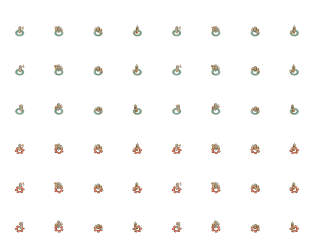
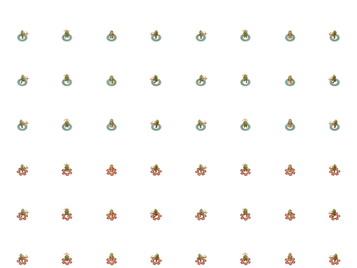
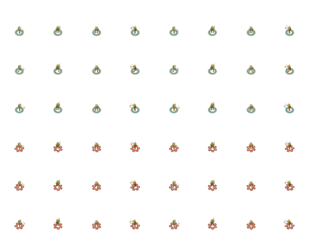

PIECE: APP-REDESIGN-ATLAS-002 — Skymaul, Brassbolt and Reedsting fixed-frame atlas pack
VERDICT: PASS

EVIDENCE

The two fresh builds returned the same outputs:

```text
skymaul: skymaul-battle-sprite.png 256x384 21223 bytes sha256=adff736da56f4cf2925b105ff0a8b8a340b2389c8315e2bc03d9e5a051f33649
brassbolt: brassbolt-battle-sprite.png 256x384 20634 bytes sha256=c628afe371a4a876038dc712998f7df25836863b47d1724ef06f96cfda83b48d
reedsting: reedsting-battle-sprite.png 256x384 20399 bytes sha256=675d54c55c3431ce2813a973d45d62eb1a88a1363f5a10ce262c22aeda5e2481
provenance.json: 123417 bytes sha256=412b1612650a70a61de9eee6caf787f0713de5e34506433ce9e90fc4d626472c
```

The submitted validator ran unmodified from a byte-checked review copy and reported:

```text
PASS: 72 atlas cells exactly match approved native64 RGBA
PASS: two clean builds have byte-identical PNGs and provenance
PASS: copied-source SHA mutation rejected before atlas output
validation: .../20261020-next-three-atlas-critic/validation.json 33869 bytes sha256=2d3c0822c5b3c9ef0da787c361fec81c1613ebad5926490d6e2110a256bbb9b6
```

The independent stdlib audit read the canonical references from Git commit `f8f6cfe35f8b7756f169225eea57b20ed25720a9` and compared inputs with the immutable native run under `20261020-astra-sky-brass-reed-models/attempts/native-r1`. All 72 raw 256×256 PNG copies and 72 approved native64 PNG copies match their own pinned originals byte-for-byte; source-map and manifest card/team/direction/pose, dimensions, renderer, frame, and path/hash metadata match the actual render receipts. The three copied render receipts and `.blend` identities match the canonical Git receipt/model blobs. The accepted art report, model artifact index, and included `LICENSE` also match their canonical Git blobs. `SHA256SUMS.txt` covers 170 package files with zero mismatches; the 160 source/input/metadata files in the pre-run sandbox snapshot match the submitted package after the review.

An independent PNG decoder verified the fixed named axes and every output cell against the native64 RGBA pixels: columns East, North, South, West; rows River idle/walk/contact followed by Ember idle/walk/contact; pivot (32,54). The largest atlas is 21,223 bytes against a 1,048,576-byte cap. Fresh A/B atlas PNGs and provenance are byte-identical to each other and to the submitted clean-a/clean-b outputs. Raw and native PNG files were each verified against their own exact originals; their ancillary profile chunks were not compared across sizes.

The separate mutation run flipped one byte in a copied raw input. Actual generator output:

```text
error: .../inputs/raw-256/skymaul/skymaul-river-east-idle-color.png: source sha256 changed (7aaa59d523abe9103542b308edac8c2fa3434756a56b5d99d4647efc02085052)
```

Exit code was 1 and the output directory contained zero files.

The 512×384 comparison sheets show the atlas on the left and direct approved native64 pixels on the right at 1:1. The named row and column axes above apply to both halves.







Repository identity remained unchanged: HEAD `f8f6cfe35f8b7756f169225eea57b20ed25720a9`, Git index SHA-256 `8e79bb09cef07999afb8d2c991c3f1a9b5562528a82d74eef865a39582def914`, and index tree `501c500480eeb012c504ec9d53fca3ce96c8db53` before and after.

BIGGEST GAP: These atlases remain standalone packing outputs; live registration and runtime motion for the three characters are still unqualified and are outside this round’s bar.
