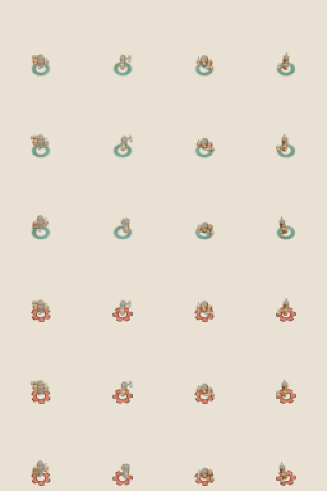
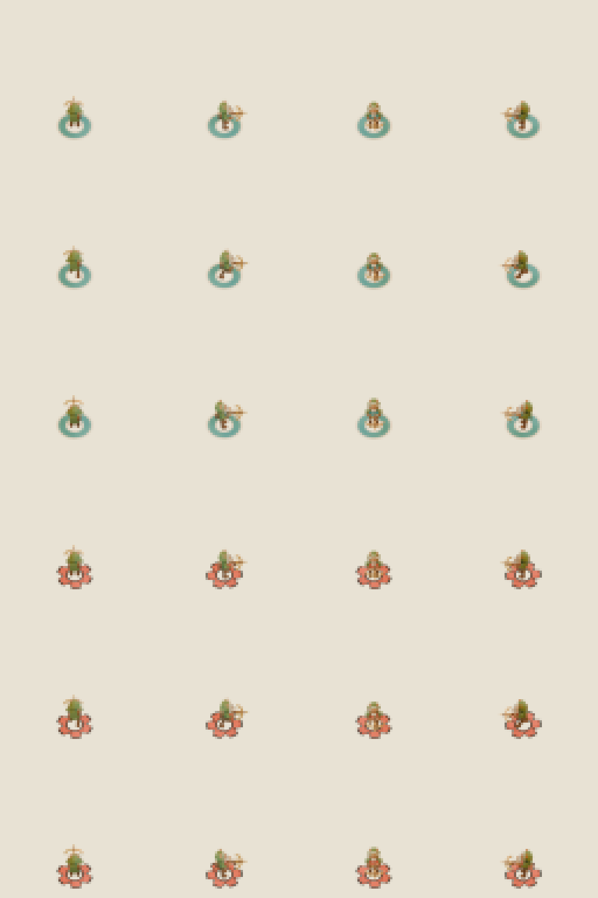
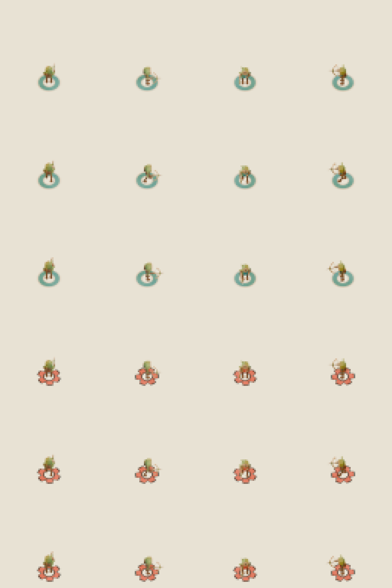
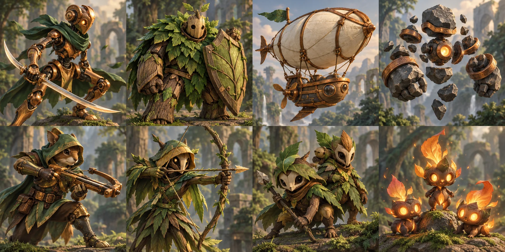

# Astra native R1 — independent model critique

**SCOPE:** ART-3D-SKY-001 Skymaul, ART-3D-BRASS-001 Brassbolt, and ART-3D-REED-001 Reedsting only. This is a standalone native-art review. It does not accept live-game integration, runtime motion, all-cast coverage, or foundation scope.

**VERDICT:** **PASS** for each candidate as standalone native art, with the signed-zero representation caveat below. No heavier saved-model render is needed: the existing reopened-.blend renders are fresh and sufficient for visual judgment.

## Shared evidence

I reviewed the original portrait atlas, each fresh native color, grayscale, silhouette, team-mask and body-only sheet, each fresh portrait, and the per-character saved-model render and geometry evidence. The body-only measurements span 11.72–13.78 px across the four headings, with no per-view crop or rescale. The receipts record the common 50° camera, ortho scale 8.025 and ground anchor (32,54); the native images retain at least 4 px clear margin. East/west projection deltas point right/left and north/south deltas point up/down, matching the actor-facing labels. River and Ember remain distinguishable in color and in grayscale via their different ring treatments.

In the actual native sheets, idle, walk and contact show pose changes in body/weapon placement; contact is the clearest state, while some idle/walk changes are restrained at 12–14 px. I did not infer motion from the different pixels or from exported animation clips.

All 37 fresh PNG hashes per candidate (36 native outputs plus portrait) match the render receipts. The seven build/reopen-render/measurement commands exit 0 and the source-package freeze reports unchanged. The editable `.blend` and standalone `.glb` hashes match their build receipts; read-only GLB inspection confirms no embedded images or external buffers and stays under the 3,000 evaluated-triangle cap:

| Candidate | Evaluated tris | Editable meshes | Body height N/E/S/W (px) | Visual read |
| --- | ---: | ---: | --- | --- |
| Skymaul | 1,136 | 26 | 12.10 / 12.20 / 11.72 / 13.78 | PASS; narrowest weapon margin |
| Brassbolt | 1,248 | 39 | 13.49 / 12.59 / 12.47 / 12.29 | PASS |
| Reedsting | 1,258 | 45 | 13.25 / 11.73 / 12.55 / 13.72 | PASS |

## Candidate findings

**Skymaul — PASS.** Its low-poly stone mass, separated lower stones, copper bindings and warm chest core carry the original portrait identity at native scale. The added hammer is visible as a block head and short shaft in lateral headings, but is the tightest weapon read of these three: it can collapse into a small projection in the front/back headings. The body remains identifiable in all four headings, and contact gives the clearest raised-hammer pose.

**Brassbolt — PASS.** The hooded animal face, upright ears and compact body read as the original character. The brass crossbow and amber bolt make a clear lateral extension at native scale; the weapon foreshortens in the front/back headings as expected. Idle/walk are the least separated poses of the three, with small leg/crossbow shifts; contact remains visually distinct in the actual cells.

**Reedsting — PASS.** The wooden mask and reed hood preserve the original archer identity. The slender curved bow remains visible beside the body in lateral headings, though it is a narrow few-pixel line at native size. Idle/walk changes are modest; contact changes the bow/arm placement and is visually distinguishable in the cells.

The original character portraits and all three fresh model portraits are available for direct comparison:

Portraits: [Skymaul](evidence/portraits/skymaul-portrait.png) · [Brassbolt](evidence/portraits/brassbolt-portrait.png) · [Reedsting](evidence/portraits/reedsting-portrait.png)

## Exact-preservation evidence

Each `after-save-proof.json`, `after-export-proof.json`, and `render-restoration-proof.json` reports `exact_equal: true`, with no float rounding or normalization. I independently parsed the saved canonical states and reproduced all after-state digests by changing only the sign of exact-zero Y rotations: Skymaul’s body/head/left arm (3 object fields plus 318 sampled frame fields), Brassbolt’s body/crossbow/head/left leg/quiver/right leg (6 plus 636 sampled fields), and Reedsting’s body (1 plus 106 sampled fields). The reconstructed hashes match every recorded after digest, while Python numeric equality remains true. No nonzero geometry, material, pivot, or pose value changed.

This satisfies the bar’s exact **numerical** preservation requirement without rounding. The serialized sign bit is not identical (`+0.0` became `-0.0`), so the saved-state SHA-256 values differ and bitwise state identity is not claimed. The independent reconstruction is in [signed-zero-reconstruction.json](evidence/receipts/signed-zero-reconstruction.json).

**BIGGEST VISUAL GAP:** Skymaul’s lore-added hammer has the weakest native-scale weapon recognition; Brassbolt and Reedsting rely on lateral headings for their weapon silhouettes. Pose changes are visible in the rendered cells but restrained at this scale.

## Selected evidence

`evidence/` contains copied source atlas, direct native and portrait outputs, measurement data, provenance, and bounded per-character build/render/preservation receipts. Its `review-manifest.json` records the source path, size and SHA-256 for each copied item. The source models remain at the external path recorded in that manifest; no source or model file was changed.
