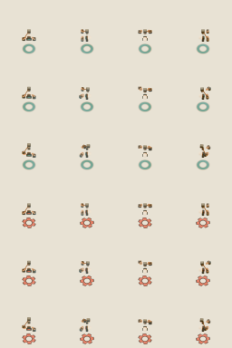
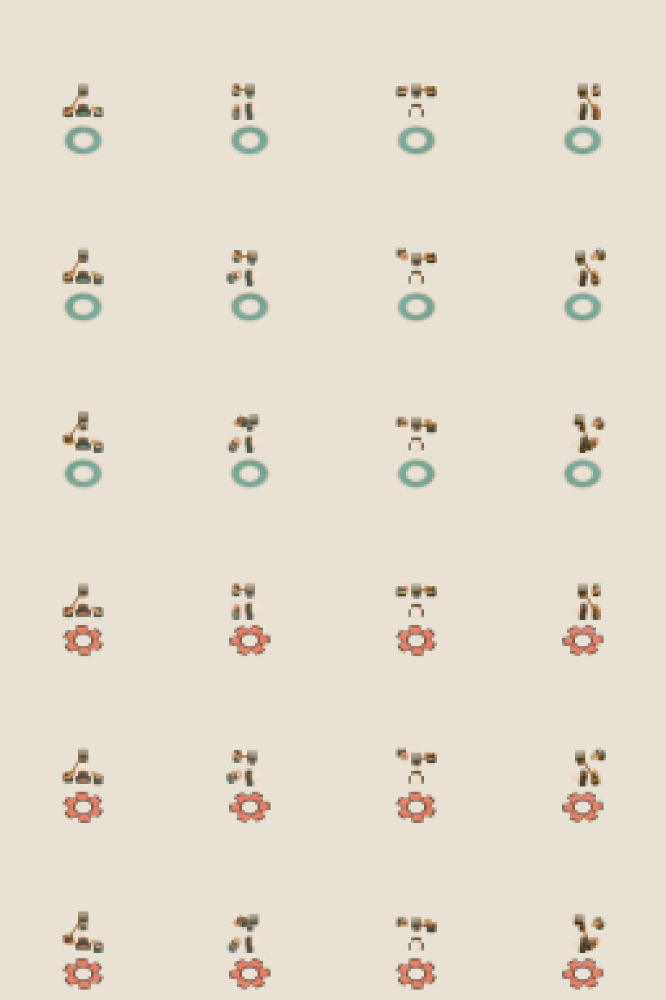
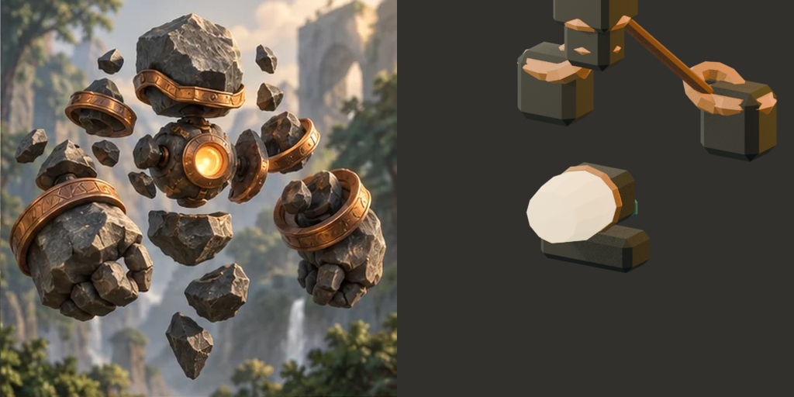

PIECE: ART-3D-SKY-002 round 2 — attempt-05
VERDICT: FAIL

EVIDENCE:

- I rendered the saved attempt-05 `skymaul.blend` independently in Blender 5.1.2. The fresh run wrote 384 color renders and 336 semantic masks. `render-receipt.json` confirms the source `.blend` stayed at 726,424 bytes and SHA-256 `c85a2a93f15f6e3367019063fef680b18b8611706be4bda8b35374d0c83f42e1` before and after. I inspected the native 1× sheet, its 4× sheet, and an isolated 64×64 cell: [native sheet](measurements/native-color.png), [4× sheet](measurements/native-color-4x.png), [single native cell](measurements/critic-river-north-idle-1x.png), [4× nearest-neighbor cell](measurements/critic-river-north-idle-4x-nearest.png).

- The pinned quantitative suite reports **286/286 required gate instances pass** and zero required failures; its 28 remaining records are diagnostics (16 pose alpha-XOR and 12 gap records). It reports 848 crop samples with zero failures and minimum margin 4.166275 px. I also directly projected the loaded saved `.blend` over two teams × four headings × frames 1–106: all 848 rows pass, same minimum margin, native camera elevation 49.999994°, ortho 8.0249996, anchor approximately (32,54). The actor-to-placement offset is exactly one value across all frames, `(0,0,1.399999976)`, the placement root remains identity, and every animated object retains idle 1–31, walk 41–71, attack 90–106. Evidence: [metrics JSON](measurements/metrics.json), [direct saved-Blend audit](projection-audit.json).
- The fresh native sheet shows River and Ember variants in all four headings and idle/walk/contact rows. Team separation remains visible as teal circular vs orange-red notched rings, including grayscale. The hammer’s canonical parent is `ME_SBR_R1_skymaul_right_arm`, consistent with the source-verified right-hand ownership. Contact is measurably distinct; walk remains subtle at native size. The core meets the numeric brightness/2×2 gates but reads pale ivory against the intended warm-gold portrait hue.
- The portrait addendum’s exact fixed translation was used; there was no post-hoc camera fit. The newly rendered nonshipping diagnostic portrait is 512×512, SHA-256 `f3cdad8ea583e0010c43e60eae724061b19029fa37003d9da45900b5ddbc3ea4`. Its alpha bounds are `(154,0)-(491,353)`, with 112 nontransparent pixels touching the top edge. In the [unlabeled comparison](portrait-comparison-unlabeled.png), the intact painted Skymaul portrait is on the left and the fresh diagnostic render on the right: the render cuts through the upper boulder/head at the canvas boundary, leaving the identity composition incomplete. The preview is nonshipping, but the pinned bar still requires the independent critic to compare portrait identity; this visual gate does not pass.

- I independently parsed all five full before/after state pairs (post-export, post-save, fresh-load, mask-restoration, final-render): zero numeric and structural differences, but **byte identity is false** and all 535 equal-value token changes are `0.0` → `-0.0`. No rounding, epsilon, or signed-zero normalization was used. Those token differences are preserved and disclosed in [integrity audit](independent-integrity-audit.json).
- Native camera objects and intrinsics match the accepted Git baseline exactly (0 numeric, token, or structural differences). Both ring variants’ meshes/object transforms and the three shared materials match the pinned accepted-ring reference exactly (0 numeric, token, or structural differences). The standalone result does not establish atlas/live UI/simulation acceptance; the pinned bar reserves those as later gates.
- Candidate immutability check: all 1,238 files present in my pre-render attempt-05 snapshot are unchanged in the post-review snapshot; no files were removed or modified. The only new file is `attempt-05/seal.json`, added when the parent sealed the candidate after my initial snapshot. `.blend` and `.glb` SHA-256 values remain `c85a2a…42e1` and `9dfe23…72b3`. The root worktree HEAD and index hashes still equal the earlier closure receipt (`81d181e…68d5`; `8e79bb…f914`); I made no repository/index writes. See [hash diff](hash-diff.json).

BIGGEST GAP: The fixed portrait camera still clips through Skymaul’s upper boulder at the top canvas edge (112 alpha pixels touch that edge), so the required portrait identity comparison shows an incomplete character rather than the intact floating-stone silhouette.
