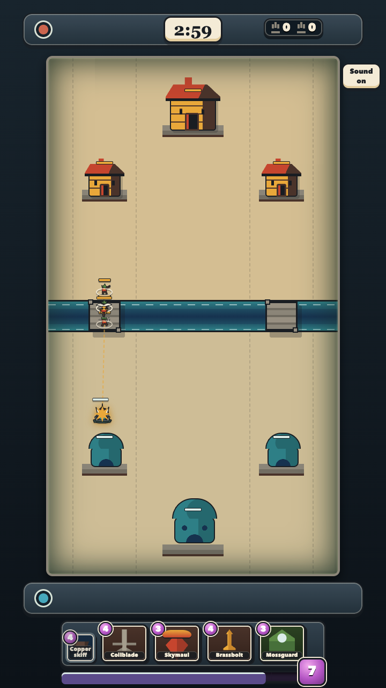
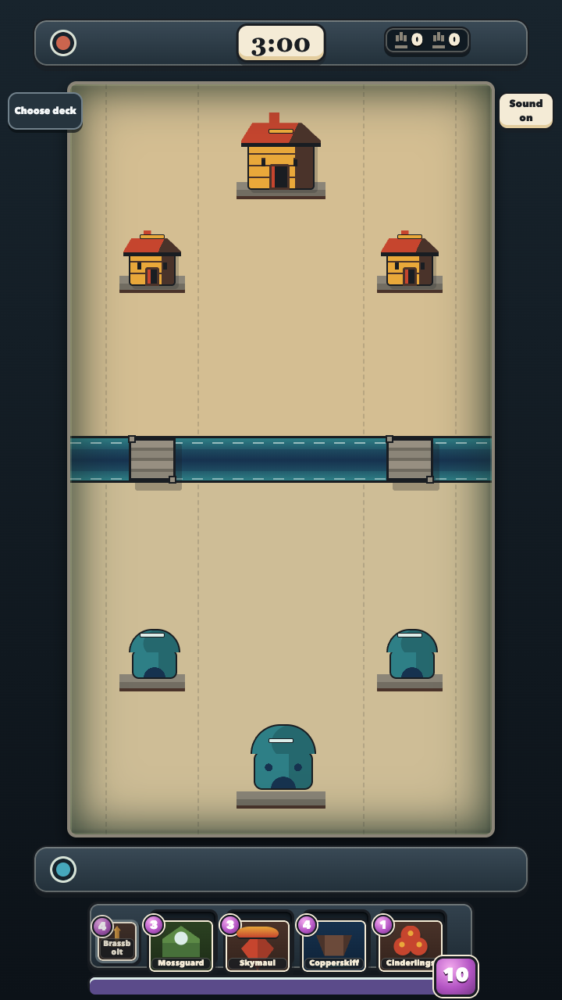
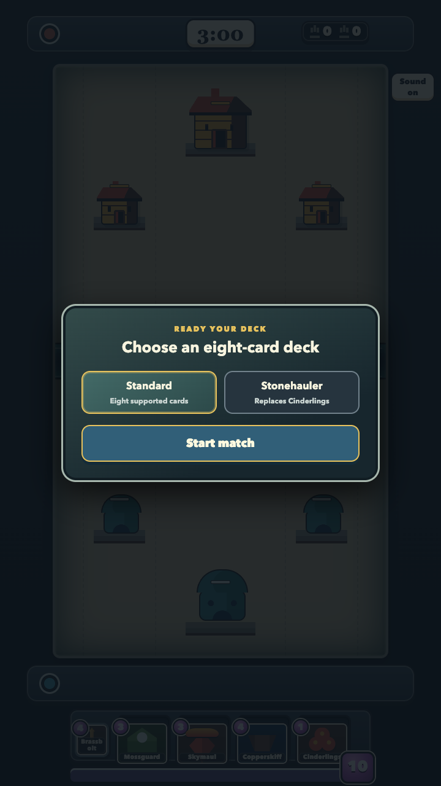
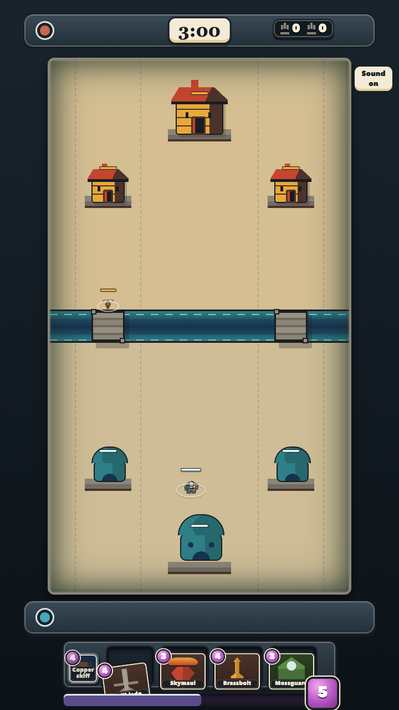

# Gauntlet Rounds

## Round 438 — 2026-10-13

PIECE: COVERAGE-004 — Current release evidence guide, round 1

VERDICT: FAIL

EVIDENCE: Independent clean candidate 2a9ce31 has 18 resolving links; catalog extraction reproduces 56/61 admitted, 62/67 claimed and QUESTION5. Fresh live Chrome confirms20 choices with generic Kilnkeeper fallback, portrait/lore0, errors0; main dbd7afe and workflow38501010696 successful. Guide scopes ninef endurance away from current runtime. Included checker exits1 at line34 with TypeError reading missing editablePoolIds from legacy app001 eight-card receipt; committed success does not reproduce. Exact stdout/stderr and independent raw rechecks retained in artifacts/coverage004-round-1/critic/. Failed guide stays candidate only.

BIGGEST GAP: Correct the checker browser-evidence input/schema and regenerate its success receipt from the immutable archive.

## Round 437 — 2026-10-13

PIECE: ART-020B — Original Rivet Runners battle cutout
VERDICT: PASS

EVIDENCE: In fresh Google Chrome 155.0.8059.40 at DPR 1, the 512×512 WebP renders at exactly 13×13 and 26×26 CSS pixels on both light and dark arena-like backgrounds; the fresh native captures are pixel-identical to the builder captures. At 13px the otter's cream muzzle/face, teal vest, copper mallet head with its darker rootwood handle, and two separated feet remain identifiable as a melee unit; all parts are clear at 26px. The 1254×1254 RGBA source is 1,890,785 bytes, SHA-256 `1eb0f74862d3ec768e1fcfac727d20be8d7fd0fa2c5b88e93207ae296349663e`, with alpha 0–255. The 512×512 WebP is 78,170 bytes, SHA-256 `0a9d033f894bd19178871a2927117cf66bb7f42c0b65dc224e11cecca0b4ce53`, with alpha 0–254; cwebp 1.6.0 re-encoding with the recorded settings reproduced its hash exactly. Provenance records the V1/V2/V3 source history, prompts, input hashes, dimensions, sizes, tool, license and encoding. All 15 earlier provenance records and 42 earlier art files are byte-identical to the parent; the manifest has exactly one new record. The visual-asset-manifest test passed 6/6. The frozen Pages build produced 51 release files totaling 5,960,997 bytes; all 51 hashes passed, the new WebP appears once, and no protected paths or full-source image hashes appear in the output.

BIGGEST GAP: Integrate the accepted asset through CARDS-020I and verify it in the real 540×960 arena, since this verdict covers only the isolated cutout.

Evidence: `fresh-native-browser-evidence.json`, the four `fresh-chrome-css-*-dpr1.png` captures, `independent-audit.json`, `manifest-test.log`, and `pages-build.log` in this directory.

## Round 436 — 2026-10-13

PIECE: ART-020B — Original Rivet Runners battle cutout, round 1

VERDICT: FAIL

EVIDENCE: Independent immutable6402dd6 freshChrome155 DPR1 render overlight/darkarena-colored backgrounds:26x26otter/malletclear;13x13vest/feet mergeintobrownbody, malletlosescoppercap/head-and-handle distinction. Manifest6/6 andPages51files pass, releasehashesallverified/newWebPonce/protectedpathsabsent. Genuinealpha/provenance/re-encodingSHA match. All3224trackedarchivefilesmatch. Failedpublicsprite/manifestnotadoptedintoHEAD; exactcandidate retainedcodex/art020b-battle-candidate, fullV1/V2PNGunderdemo inthatcandidate. Evidence artifacts/art-020b-round-1/critic/.

BIGGEST GAP: Regenerate the cutout with a brighter teal vest and clearer separation of the muzzle, mallet, and both feet at13px.

## Round 435 — 2026-10-13

PIECE: ART-020P — Original Rivet Runners collection portrait, round 1

VERDICT: PASS

EVIDENCE: Independent immutable7fa4bc3 freshGoogleChrome155 DPR1 exact64/128CSSpx renders: two originalotter faces andmalletshapes readable. Preserved1254sqPNG2819557B sourceSHA b84c733e475b50d746d955ec805d0c5da1e998ca4e2fc9f76305f661ce942de0;512sqWebP76868B SHA6df560ccabb6c7f7347225bdb4c0fe2f9eadbb3aa1f769b6b540cd6f96c35b77 reproducedbyteequalwithcwebp1.6.0. Prompt/builtinimagegen/styleinput/source/output/license/encoding provenance matches. Exactlyone11-line manifestrecord, oldrecordsbyteequal. Assettest6/6;Pages50files5882827B includesexactWebPonce/excludesprotectedsourcehash/reference/docs/provenance/demo/tests/artifacts/node_modules. Originalname/lore2sentences verified. Evidence artifacts/art-020p-round-1/critic/. No gameplay/livearena/fullcharacterintegrationclaim.

BIGGEST GAP: The mallet heads have little frame margin at64px, though their silhouettes remainreadable; no blocking portrait-stage gap.

## Round 434 — 2026-10-13

PIECE: GAME-001MS — Shared-session squad materialization verification, round 1

VERDICT: PASS

EVIDENCE: Independent clean immutable15a9889 full npm run test:game-session completed naturally9/9, exit0,82172ms. Test-only delta; src tree byte-identical parentff7 andaccepted151f. All8defaultroles each commit player+actualAI proposal, spend once/cycle once, unique causal members andpre/postbirthboundary counts. BriarBand globalbirth offsets0/6/12/18/24/30; Cinderlings instant exception. Latercombat retains damage/death/towerdamage assertions andall8othergates. Source100ms intervalsupports6ticks; observedfirstonset/memberorder/orientation/formation remainQUESTION. Prior8/9 instantcount failure retained. Raw evidence artifacts/game001ms-round-1/critic/.

BIGGEST GAP: No remaining gate gap on accepted151f source; new H1 runtime requires its own verification and historical formation/onset calibration remains open.

## Round 433 — 2026-10-13

PIECE: CARDS-019K — Source-bounded Kilnkeeper shared splash core, round 2

VERDICT: PASS

EVIDENCE: Independent immutable6cc8656 full RL12/12 (108947ms), fullaudit6/6 (432397ms), profiles26/runtime6, ordinary21/source11/editor12/schema20, guards10+13/release4/host1. Audit d7e64a47fe3fead14b3bb07f0a636dd0ddb8f4ade8d120a2c087d01e6fff7bed; twofullsweepsmatch andold66bindingsunchanged. Actual AI spends5/cyclesonce; actualunit/building/towercontacts281once; pending/damagedrestore+fork bytes/events exact. Boundary1500included,1501outside/friendly/dead/untargetableexcluded; movedoutsideprimary nothit. Eighteen provenance/confidence mutationsreject. Old8seed0/23setup/session/replayhashesequalbaseline0cbd. All510sourcehashesunchanged; kernel523929<=524288. Evidence56files hashverified in artifacts/cards019-core-round-2/critic/. Broadgame-session8/9 staleimmediate-squadassertion failsidenticallyonbaseline, separatelyGAME001MS. No UI/current20-cardendurance/fullhistoricalhomingclaim.

BIGGEST GAP: No remaining bounded splash-core gap; historical homing remains CARDS019H and preexisting shared-session squad assertion is GAME001MS.

## Round 432 — 2026-10-13

PIECE: CARDS-019K — Source-bounded Kilnkeeper shared splash core, round 1

VERDICT: FAIL

EVIDENCE: Independentexact562 fullRL12/12 (114656.8ms/naturalterminaltests completed), profiles11/ordinary21/editable12/schema20/shipping13+4 pass. AIcost5/decksequence+1/cardreceipt1/exact63298Brestore; pending134473B anddamaged135097B restore/fork/impact exact; default8 seed0/23 archivedhashes match. Adjacentprojectileprofiles/runtime suites bothfailimport atsession-troop-projectile-profiles.js:801: newauthoritativeexport absentSOURCE_BINDINGS; strictcache9vs10 rejection. Nondeterminism9/10 oldinventory; directguard46files/probed/0violations. Fullaudit450235ms5/6 executes67covered/62IDs/5QUESTION/tworunhashesequal thenoldpinFAIL: actuale6dc0251fa427ec0f629fedb554f32cea2c5053bcdb6324524f9b960861bb750 vs009ed7e778379a105792dcf32d8ff37bd72bf13c42c442bae28d48f3d7f144fc. Damage281 stillgenericruntimeestimateQ, missingcanonicalpinnedlinked-projectiledamage_per_level[8] binding. Rawartifacts `artifacts/cards019-core-round-1/critic/`.

BIGGEST GAP: Existing shared projectile consumers cannot import because the new authoritative source factory is missing from the source-binding map; repair that producer without weakening the cache-completeness check.

## Round 431 — 2026-10-13

PIECE: ART-019B — Kilnkeeper combat cutout readability repair, round 2

VERDICT: PASS

EVIDENCE: Independentexact1ba freshcandidateWebPChromeDPR1 render measures13/26CSSpx; face, solidtealapron, side-separatedlauncher andfeet distinctat13. WebP512square47138B, genuinealpha0–254/transparentcorners, source/input/provenance/hash/encoding/license continuity verified, V1source/approvedportraitunchanged. Non-targetmanifestrecords unchanged. Assettests6/6/Pages49files5781112B pass; independentoutputscan excludes source/provenance/reference/demo/artifacts/docs/node_modules. Evidence `artifacts/art019b-round-2/critic/`.

BIGGEST GAP: No remaining isolated asset-stage gap; live540x960 arena andcardUI integration remain unverified andbelongtoCARDS019I.

## Round 430 — 2026-10-13

PIECE: ART-019B — Original Kilnkeeper combat cutout, round 1

VERDICT: FAIL

EVIDENCE: Independent exactaa7 WebP512square/67816B, input/source/outputhashes andprovenance/realalpha/manifestoldrecords match. Assettests6/6 andPages49files pass; shippedWebPincluded, source/inputPNG/provenance/reference/artifacts/demoexcluded. FreshHeadlessChromeDPR1 native13/26CSSrenders inspected:13pxface andkeycolorcues blend,26readsbetter. Evidence `artifacts/art019b-round-1/critic/`.

BIGGEST GAP: At13px the face, tealapron andcopperlauncher merge into indistinctpixels; simplify andseparate the silhouette withoutincreasing the required display size.

## Round 429 — 2026-10-13

PIECE: ART-019P — Kilnkeeper portrait asset-registration repair, round 2

VERDICT: PASS

EVIDENCE: Independent clean c23ca7e manifest6/6, Pages48files/5733974B; allreleasefiles hashes/sizes match, all20priorassetrecords unchanged. Correct512square65626BWebP/SHA/license/authorship/path registered. PNG/WebP/provenance/lore/builderscreens bytes equal87da, criticnative64/128captures verified/inspected; face, tealapron, launcher andfiringmouth remain distinct. Output excludesreference/sourcePNG/provenance/lore/artifacts/demo. Evidence `artifacts/art019p-round-2/critic/`.

BIGGEST GAP: No remaining asset-stage gap; actual Kilnkeeper card UI and arena display require a separate integration piece and have not been verified.

## Round 428 — 2026-10-13

PIECE: ART-019P — Original Kilnkeeper collection portrait, round 1

VERDICT: FAIL

EVIDENCE: Independent exact87da native64/128 DPR1 renders show expressiveface, tealapron andcopperlauncher/firingmouth distinguishable at64. PNG1254square andWebP512square/65626B hashes/dimensions matchprovenance; builtinimagegen prompt/license/encoding andexactlytwo original grounded lore sentences verified. No livearena/cardUI claimed. Evidence `artifacts/art019p-round-1/critic/`; archiveexternal/tmp with compactreceipt retained.

BIGGEST GAP: The shipped WebP has no visualassetmanifest entry; character-creation requires its path, dimensions, bytecount, license, authorship andSHA256 registration.

## Round 427 — 2026-10-13

PIECE: GAME-001GPR6 — Exact shipped presentation strict browser endurance

VERDICT: PASS

EVIDENCE: Clean `9f64011378d3ce1c6281d9292950a7b52f11fd2c` archive: 3,003/3,003 Git blobs and all144runtime/sixharness hashes match. Full command exit0 TAP2/2, main997382.6ms;67segments reach18000. Setup306bb30; actual600→300→600 restore browser/direct session/input/audio continuation, terminal18000/restart0. Initialization158ms≤300; drive/restore/terminal/restart/screens/finaldrain0 under50; console/resource/unhandled/pendingempty. Fresh artifacts and verdict `artifacts/game001gpr6-round-1/critic/`.

BIGGEST GAP: Pause/resume assertions establish browser/direct parity after both lifecycle calls, not unchanged transcript bytes across the boundary; this scopeddefault8 performance proof does not cover subsequent Kilnkeeper runtime changes or allcustomdecks.

## Round 426 — 2026-10-13

PIECE: CARDS-018I — Ember Basin browser integration and release snapshot

VERDICT: PASS

EVIDENCE: Independent clean archive `7f8baee2922a7eff197f43d1804a526ffacacd22`: browser 1/1, asset manifest 6/6, shipping guard 13/13, Pages 5/5; build 47 files / 5,668,348 bytes. Trusted custom deck and actual phone/desktop normal/reduced screenshots; splash event ticks126/222, two222-point targets with concurrent tower damage reconciled; exact per-mode restore pixels, expiry event1800/state1801 and same-deck restart. Evidence `artifacts/cards018-browser-round-1/critic/`. Builder final repeat cadence fixture startup race retained separately; independent exact candidate passed.

BIGGEST GAP: No remaining gap on this bounded integration dimension; full-length performance for this presentation and all custom decks, and historical profile parity, remain unverified.

## Round 425 — 2026-10-13

PIECE: CARDS-018K — Editable defensive splash structure and RL visibility, round 3 documentation example repair

VERDICT: PASS

EVIDENCE: Independent exact `b33302a` archive runs bothliteralguide snippets exit0 and freshbounded1/1. Actualaction256/version2/2305actionspace reaches tick1:elixir10→6, SquallreplacesEmber, nextMossguard, reward0; costreceipt4/high/authoritative whilelifetime/profile remainQUESTIONs. StructureHP1356/lifetime/attack, JSONsafety/detachment, checkpointfuturecontinuation andv1reject pass. All499checkedblobs equald209 andsrc/tests diffempty; earlier26API+75focused/guardchecks validatedbyreceiptchecksums, notrerun. Evidence `artifacts/cards018-core-round-3/critic/`.

BIGGEST GAP: No remaining gap on the core/API/documentation dimension. Existingbuildingprofile/lifetime stillunverified; original browser presentation isCARDS018I andthisdoesnotestablishhistoricalidentity/parity.

## Round 424 — 2026-10-13

PIECE: CARDS-018K — Editable defensive splash structure and RL visibility, round 2 documentation repair

VERDICT: FAIL

EVIDENCE: Independent `7a510b5` exact `5b26c1d` cleanarchive2908/2908 blobs match. Both literalguide snippets and mixedexample exit0; fresh14/14 example and12/12 independentAPI probes pass. Guidecorrectlydocumentsversion2/structures/checkpointv1rejection. Actualdeployment tick0elixir10/Emberinhand/nextSquall →tick1elixir6/Squallinhand/nextMossguard,reward0. Prior52focused+23guards checksumverified,src/tests trees unchangedfromd209; noheavytrajectoryrerun. Evidence `artifacts/cards018-core-round-2/critic/`.

BIGGEST GAP: Guideexample doesnotdisplay/assertthe4-elixir spend orhand/next changes afterdeployment. Showactualcost/cycle in executedexample; runtime/provenance/parity checks remain green. This differs from round1's wrongschema/version explanation.

## Round 423 — 2026-10-13

PIECE: CARDS-018K — Editable defensive splash structure and RL visibility, round 1

VERDICT: FAIL

EVIDENCE: Independent `0f2095b` exact `d20938f` cleanarchive2854/2854 blobs match, focused52/52 andguards23/23 pass. Actual default8 setup/state/120ticks/replay matchesparent atseeds0/23. Probes retain20BriarconfidenceQUESTIONs, reject4hostileprovenance edits, observeEmber1185/1356HP after171damage attick120; queued222damage totargetIDs3/4/5 attick127; deadid2 remainsobservable0HP/lifetime0. Currentcatalog55admitted60occ/61claimed66occ. Retained `4b03f24`, `artifacts/cards018-core-round-1/critic/`.

BIGGEST GAP: `docs/rl-api.md` omits structures from observations and stilldescribescheckpointversion1; APIobservations/actionspace/checkpoints areversion2 andrestore rejectsolderversions. Documentactualcompatibility andexecuteupdatedexamples. No runtime/parity failureclaimed; browserpresentation remainsCARDS018I.

## Round 422 — 2026-10-13

PIECE: ART-018P — Original Ember Basin portrait asset, round 2

VERDICT: PASS

EVIDENCE: Independent `376ff88` exact `a3ebdb1` rerendered fixture and inspected native64×64/128×128 captures: raised channel, copperrails,pivot andbraces identify a defensive launcher. Audit7/7, source1254square2717595B SHA3429f3eb…afe7490, WebP512square74608B SHAfbeb95f3…038c87a; v1inputhash preserved, provenance/toolprompt/license/encoding and2concrete lore sentences valid. Retained `0cc47cd`, `artifacts/art018p-round-2/critic/`.

BIGGEST GAP: Some darksupport/channel edges blend into the detailedbackground at64px, butbright rails/diagonals remain readable. Asset-stage pass only; realapp and13px arena integration remainsCARDS018I.

## Round 421 — 2026-10-13

PIECE: ART-018P — Original Ember Basin portrait asset, round 1

VERDICT: FAIL

EVIDENCE: Clean exact `82cd25a` browser fixture exited0; reviewerTAP3/3 metadata/render/lore checks passed. Actual1254×1254PNG2743443B and512×512WebP71726B hashes/dimensions/bytes/toolprompt/license match; exactly2lore sentences. Fresh64×64 and128×128 DPR1 renders inspected, crop intact and nonhumanoid original paintedpalette. Independent evidence retained `4f6dcba` in `artifacts/art018p-round-1/critic/`.

BIGGEST GAP: At64px the broad bowl and glowing ember read as a brazier or cauldron; the rear projection is too small to identify as a launch channel, obscuring defensive function. Revise silhouette, not metadata. Asset-only scope; no liveintegration claim.

## Round 420 — 2026-10-13

PIECE: GAME-001GPR5 — Corrected default-squad runtime strict endurance, second recorded critique (artifact round 3)

VERDICT: PASS

EVIDENCE: Independent `fa7fa47` reviewed exact `5ba4002` with `env -u GAME_BROWSER_ENDURANCE_TICKS npm run test:game-browser-endurance`: exit0, TAP2/2, 987818ms main / 990051ms total. Fresh JSON records67segments through18000, setup306bb30,40accepted physical E2 decisions matching preflight including6state-aware interventions. Exact600→300→600 session/input/audio parity, terminal18000 and same-deck restart0 pass. Initialization197ms under300; all noninit LongTask categories0 under50; no resource/console/unhandled/pending errors. Fresh three screenshots inspected;144runtime and4harness hashes unchanged,2808archive blobs match. Bounded exact-candidate suite separately4/4. Evidence: `artifacts/game001gpr5-round-3/critic/`.

BIGGEST GAP: Pause/resume add two canonical transcript events, so assertion wording about unchanged bytes across that boundary is too broad; exact browser/direct mirror parity and restored continuation pass. This scope establishes the normal seed-zero/default-eight legal state-aware workload, not all decks or109historical-card parity.

## Round 419 — 2026-10-13

PIECE: GAME-001GPR5P — Terminal-aware endurance planning and explicit duration failure, round 1

VERDICT: PASS

EVIDENCE: Independent425c3c8 frozen2d6 executed focused1/1 and provenance/adversarial probe: browserJSON→copiedinput hashesmatch, twoexactreplayoutputs byte-identical, allsixderivedcheckpointhashesverified. Restored13200actualCinderlings slot0 (14500,5500) plan matches original; recordedterminal yieldsnoplan andexplicitrequired18000failure. Fake terminaltick18000doesnoteraseearlyresult; exactendactivegateallow verified. All10frozenruntimehashesunchanged; caps andinput/restore/audio/terminal/restart assertions preserved. Probe-only format/assertAPI/hashformat errors retained separately, not product defects. ActualTAP/checks in `artifacts/game001gpr5p-round-1/critic/`.

BIGGEST GAP: No legitimate currentseed-zero/default8 workload has yetcompleted18000 andfreshfullbrowsercontinuation gates.

DISPOSITION: Accept terminalplanning correctness only; fullGAME001GPR5 remainsFAIL andactivecalibration continues withoutengine/cap changes.

## Round 418 — 2026-10-13

PIECE: GAME-001GPR5 — Corrected default-squad runtime strict endurance, round 1

VERDICT: FAIL

EVIDENCE: Exact frozen6c7 original command `env -u GAME_BROWSER_ENDURANCE_TICKS npm run test:game-browser-endurance` exits1 after572618ms, TAP1/2. Independent99e04bf retains46segments through13352; nextphysicalgesture24→24 bridge deliveries where25required. Lastaccepted Cinderlings slot0 (14500,5500) at13200. Fresh JSON/TAP/activePNG andmtime/hash/source receipts retained; oldterminal/restart images excluded. Init195ms≤300 andpartialdriven/restore metrics do not prove full18000/lifecycle gates. Failedplan/terminalstate notserialized byoriginalprobe, independentoffline reconstruction unfinished andexplicitlynot claimed. Actual evidence in `artifacts/game001gpr5-round-1/critic/`.

BIGGEST GAP: The full workload must legitimately reach18000 and exercise all continuation gates with corrected Briar physics; current input plan continues after the recorded run stops at13352.

DISPOSITION: Separate builder reproduces checkpoint fromexactcommands (reportsnorthsuddendeath13351/terminal13352) and repairs terminal-aware harness plus legitimate sustainedseed0/default8 defense. Preserve originalfailure/naturaltermination regression, full18000/50ms/300ms/restore/audio/input/restart bars andenginephysics. New workload scope must be explicit; no earlierproof substitution.

## Round 417 — 2026-10-13

PIECE: CARDS-017T — Remaining source-backed playable squad intervals, round 2

VERDICT: PASS

EVIDENCE: Independent frozen6c7 critic4a96c2f executed fullintegrationaudit6/6 in406651ms with two actual equal run hashes009ed7e778379a105792dcf32d8ff37bd72bf13c42c442bae28d48f3d7f144fc; focused45/45, determinism10/10, shipping13/13, total74/74. Independently generated exact3 changed squad bindings and63unchanged;66claimedoccurrenceartifacts61IDs distinguishedfrom60admitted55IDs; published42claim+5QUESTIONselectors unchanged47union. Runtime/browserfiles byte-identical toc981 validate priortrustedphone/desktop1..6birthwitness hashes. Actual receipts/TAP/hashchecks in `artifacts/cards017-stagger-round-2/critic/`. Round1 failures preserved.

BIGGEST GAP: Changed default Briar physics requires fresh18000 browser endurance; historical geometry, memberorder and first-onset remain QUESTION.

DISPOSITION: Accept relative sourced intervals and repaired exact fixture closure. Start separate GAME-001GPR5 fullendurance with unchanged caps and all continuation gates; no fullhistoricalparity claim.

## Round 416 — 2026-10-13

PIECE: PUB-004 — Published-state verification documentation, round 2

VERDICT: PASS

EVIDENCE: Independent b41e7c2 verifies origin/main and branch API ae4a63e, workflow38431846142 and actual github-pages deployment success; HTTPS landing/game/manifest/runtime/roster HTTP200, manifest byte/hash matches,18 unique choices including both airswarm roles. Exact Cloudflare injected script distinguished from release template. Published runtime/build inputs unchanged from796 endurance source; actual retained2/2,18000ticks811580ms/init197≤300/noninit50caps, scopedseed0/default8. Eight frozen local links resolve. Actual receipts/checker in `artifacts/ship-current-round-2/critic/`.

BIGGEST GAP: Seed-zero default-eight endurance does not establish performance or historical parity for every deck or the109-card target.

DISPOSITION: Accept accurate publication docs; local c981 five-squad/defaultBriar timing explicitly excluded from both live publication and prior endurance.

## Round 415 — 2026-10-13

PIECE: CARDS-017T — Remaining source-backed playable squad intervals, round 1

VERDICT: FAIL

EVIDENCE: Independent frozen c981 critic d990971 executed focused12/12, related60/61 and RL/guards/admission37/41:109/114, five failures. Editable natural AI expects2 immediate members but gets1; occurrence adapter expects all6 Coppershade at first tick; three mixed admission fixtures omit required Briar QUESTION records. Additional natural terminal1/1 passes. Actual trusted phone720x1280/desktop1440x900 show1..6 Briar members at ticks1,7,13,19,25,31; exact restore and no app errors. Offscreen desktop probe failure preserved and diagnosed as harness scrolling error. Actual TAP, browser receipts/screens and hashes in `artifacts/cards017-stagger-round-1/critic/`.

BIGGEST GAP: Old integration fixtures must model sourced staggered births and carry the complete typed QUESTION closure before this candidate passes review.

DISPOSITION: Separate builder repairs only affected tests/fixtures; runtime timing and strict receipt admission remain intact. Fresh18000 endurance remains required after functional review because default Briar timing changed.

## Round 414 — 2026-10-13

PIECE: COVERAGE-003 — Versioned eighteen-card historical roster mapping, round 1

VERDICT: PASS

EVIDENCE: Independent frozena8 critic885bf76 verifies109rows78/13/18,18editable/default8,55catalog60occ,12declarationcandidates6unjoined,26typedQUESTIONs andbyte-identical11/16 baselineartifacts. Six semantic mutationclasses and9 independentactualJSON tamper cases reject;107 relevantfrozen tests pass. ActualChromium productionqualification/manifest audit passes44files5443443B, manifestSHA6f28489c8dd4c5ab934dd7422298926e03e6cc268417c298416d6fbb2f091c0d, unchangedcaps/noinventory/private/reference leaks. Logs/verdict under `artifacts/coverage018-round-1/critic/`.

BIGGEST GAP: Zero fullhistoricalcard executions orparity established; newerstagger mechanics are outside thisfrozenmapping.

DISPOSITION: Accept versionedroster accounting only. Preserve prior11/16 artifacts; continue unsupported/source-dependent mechanics asQUESTIONs.

## Round 413 — 2026-10-13

PIECE: GAME-001GPR4 — Current eighteen-choice runtime strict endurance, round 1

VERDICT: PASS

EVIDENCE: Independent exact796 critic629b42e runs `env -u GAME_BROWSER_ENDURANCE_TICKS npm run test:game-browser-endurance` on originalsession17088, exit0/TAP2/2. Main811580.134ms/total813794.130ms, actualterminaltick18000. Unchanged300ms initcap/max197ms; unchanged50ms lifecyclecap/allnoninitlongtaskcategories0. Maxsimulation slice35.8ms/audio presentation38.4ms. Exact600→300 restore with37778B cut/zero restorelongtasks;42/42 plannedinputs normalize/accept withzeromismatch. Terminal/audio/layers18000, visibleoverlay anddisposedresources; restartsession/layers0/count1, zeroactive/scheduledaudio/pendingresources. Resource/unhandled/console/stderr/environmenterrors empty. FreshTAP/JSON/PNGs/mtime-hashes under `artifacts/game001gpr4-round-1/critic/`.

BIGGEST GAP: This proves one seed-zero/default8 workload, not everydeck/commandcombination orfull109-card historicalparity.

DISPOSITION: Accept current-runtime performance/continuation gate. Continue roster/mechanics/evidence work; no fullgoalcompletion claim.

## Round 412 — 2026-10-13

PIECE: CARDS-016T — Source-backed relative air-swarm deployment interval, round 2

VERDICT: PASS

EVIDENCE: Independent frozen796 critic a1a69f7 actual ordinary16/16 and focused16/16 pass. Strict per-tick counts and birth IDs verify100ms/six-tick intervals for both roles, preserving other ordinary troops. Hash continuity covers181 runtime/assets,13 scripts and345 tests with onlyordinary changed; prior61 requested gates and six full default8 snapshot comparisons are retained, not recounted as reruns. There are77 distinct scoped checks (61 original plus16 ordinary); sourcekernel524275B remains belowunchanged524288cap. Logs, continuity manifest and verdict under `artifacts/cards016-stagger-round-2/critic/`.

BIGGEST GAP: None for relative deployment interval; formation geometry/memberorder/first-onset remain separate QUESTIONS.

DISPOSITION: Accept sourced relative birth timing. Fresh current-engine strict18000 is separately GAME001GPR4, with exclusiveCPUwindow and unchangedcaps; no fullhistoricalparity or goalcompletion claim.

## Round 411 — 2026-10-13

PIECE: CARDS-016T — Source-backed relative air-swarm deployment interval, round 1

VERDICT: FAIL

EVIDENCE: Independent frozen09b critic focused16/16, nondeterminism10/10, shipping13/13, editable10/10 andrealChrome1/1 pass. All six full default8 GameSession serializations for seeds0/23 at0/120/900 matcha8 byte-for-byte. The additional selected ordinary-troops test fails0/1 on `coppershade-flock materialized count`, actual1/expected6 immediately afterdeployment, tests/game-roster-troops-ordinary.test.js:677. Actualcritic61 requestedpreflight checks pass; extra selectedordinary0/1FAIL. TAP andfullsnapshots retained in3c19377 under `artifacts/cards016-stagger-round-1/critic/`; no critic sourceedits.

BIGGEST GAP: Replace stale same-boundary squad-count expectations with exact source-aware sequential-birth checks in the ordinary suite.

DISPOSITION: Narrow second builder round on ordinary tests; do not skip assertions or alter other troop behavior. Full current18000 endurance remains held until complete preflight passes. Formation geometry/order/first-onset QUESTIONS remain explicit.

## Round 410 — 2026-10-13

PIECE: CARDS-016I — Two air-swarm choices in player and RL decks, round 2

VERDICT: PASS

EVIDENCE: Independent exacta8c39bc critic980730f executes six suites58/58: browser1/1, focused13/13, editable10/10, RL11/11, nondeterminism10/10 and shipping13/13. Actual trusted Gloamwing5-member2-elixir and Coppershade6-member5-elixir deployments, airborne projectile contact, typed QUESTIONS and exact in-flight restore/replay pass. Editable choices18/default8, actual390x844 and1440x933 screens withoutoverflow, phoneiframe370.7x659. Receipt/TAP/screens under `artifacts/cards016-integration-round-2/critic/` retained from980730f.

BIGGEST GAP: None for editable integration; historical geometry and spawn timing remain separately CARDS016D/T.

DISPOSITION: Accept both additional player/JS-RL choices. Public deployment remains verified16-card snapshot; full109-card objective remains active. Next implement newly source-confirmed relative deployment interval without inventing formation geometry/onset.

## Round 409 — 2026-10-13

PIECE: ART-016 — Original light and projectile air-swarm portraits, round 1

VERDICT: PASS

EVIDENCE: Independent clean6ec critic30725fc renders both original portraits in collection/detail at390x844 and1440x933. Matching portrait, original two-sentence lore, seven stat cells, visible phone navigation/Cards control and no horizontal overflow pass. Exact desktop detail captures include the collection beside the selected card. Screenshot hashes and verdict under `artifacts/cards016-integration-round-1/critic/`, retained on currentbranch e703827.

BIGGEST GAP: None for original artwork display; separate CARDS016I browser deployment coverage remains incomplete.

DISPOSITION: Accept art screen gate only. No historical footage parity or complete roster claim; candidate remains undeployed until gameplay integration passes.

## Round 408 — 2026-10-13

PIECE: CARDS-016I — Two air-swarm choices in player and RL decks, round 1

VERDICT: FAIL

EVIDENCE: Independent clean6ec critic executes integration/swarm13/13, editable10/10 and RL11/11. Actual Chrome app-shell exits1,0/1: `ReferenceError: stonehaulerDeployment is not defined`, tests/app-shell.test.js:1112, after60200ms. Phone390x844 and desktop1440x933 collection/detail portrait/lore/seven-stat checks pass; Gloamwing trusted selection/deployment and exact restore pass. Coppershade trusted browser deployment is absent. Captured critic logs/screens are retained for this candidate; builder's earlier616x1095 iframe failure did not reproduce in the independent run.

BIGGEST GAP: Complete the evidence writer and execute the missing Coppershade trusted browser deck/deployment flow.

DISPOSITION: Start a narrow second builder round on browser test/evidence coverage; preserve viewport assertions, source QUESTIONS, default8 and deterministic behavior. Integration remains under review and is not deployed.

## Round 407 — 2026-10-11

PIECE: PUB-004 — Publish current playable prototype, round 1

VERDICT: PASS

EVIDENCE: Main pushed; unchanged GitHub Pages workflow38176273703 build/deploy succeeds on8e24c1e. Independent liveChrome at https://bryanhu.com/clash-royale-clone/ verifies exact embedded source ref and44-file5443302B manifest, collection16/lore, unique8-slot deck replacement, trusted hand selection/field placement and natural AI deployment. Public JS/RL reset-step-restore is exact. All59 first-party requests stay in project prefix; zero first-party asset response errors, page errors or reference-tree requests. Host-injected Cloudflare RUM is blocked by existing self-only CSP; no policy relaxation. Current7cb full18000 endurance2/2 and separate8e packaging44/44 PASS receipts are retained under `artifacts/ship-current-round-1/critic/` and `artifacts/ship-preload-round-1/critic/`.

BIGGEST GAP: None for user-requested current prototype publication. Complete109-card roster, source-confidence questions and historical visual parity remain open pieces.

DISPOSITION: Ship the current16-card browser game and JS/RL interface under AGPL. README and repository homepage link the verified HTTPS site; later evidence/docs-only main commits do not change the deployed runtime.

## Round 406 — 2026-10-11

PIECE: RELEASE-PRELOAD-001 — Generated preload helper source provenance, round 3

VERDICT: PASS

EVIDENCE: Independent exact8e24c1e criticbd34e02 executes release22/22, shipping guard13/13, shipping-release4/4 and publicationPages5/5 (44/44). Additional40 authored-helper AST-escape probes all reject. Actual prefixed production Pages has44 release files/5443302bytes, all17 canonical assets byte-identical,59 successful in-manifest requests and no runtime errors. Unchanged remote Actions38176273703 succeeds through build/deploy on exact8e SHA. Full logs, prior failures and receipt under `artifacts/ship-preload-round-1/critic/`.

BIGGEST GAP: None in scoped release packaging; live public gameplay/API smoke remains PUB003.

DISPOSITION: Accept narrow helper provenance and flat generated asset naming. Original canonical assets, source isolation, manifest audit and existing file/size/hash assertions remain intact.

## Round 405 — 2026-10-11

PIECE: RELEASE-PRELOAD-001 — Generated preload helper source provenance, round 2

VERDICT: FAIL

EVIDENCE: Independent clean eeb0fab shipping guard13/13 passes; release-build21/22 fails solely on actual Chromium request assets/public/assets/css-url.svg (unmanifested404). Authored helper negative matrix, production release and inline literal/template dynamic-import positives pass. Remote Actions38175320200 reproduces the same failure and skips deployment. Critic logs under `artifacts/ship-preload-round-1/critic/` retain actual failure. Moving the CSS fixture source did not fix the emitted URL bug.

BIGGEST GAP: Generated grouped CSS names contain nested directories, but Vite computes relative asset URLs from the flat naming pattern. Make generated asset naming and URL calculation agree.

DISPOSITION: Builder reproduces staged output and repairs generated naming; canonical copied asset paths, strict manifest audit and size limits remain unchanged. New candidate49ba9d1 has targeted legacy Chromium1/1; separate full critique and actual deployment pending.

## Round 404 — 2026-10-11

PIECE: ART-016P — Original air-swarm portrait assets and lore, round 2

VERDICT: PASS

EVIDENCE: Independent clean7cb criticd95d19e executes art2/2 and manifest6/6 and inspects actual native64px Coppershade thumbnail: six separate copper birds in3x2 arrangement. Original source/output provenance and unchanged atlas remain valid. Receipt and native PNG in `artifacts/ship-current-round-1/critic/`.

BIGGEST GAP: None for asset-only acceptance; public phone/desktop editable integration remains separately ART016.

DISPOSITION: Accept revised original portrait preparation; no public18-card claim.

## Round 403 — 2026-10-11

PIECE: CARDS-016K — Two additional classic air-swarm runtime roles, round 2

VERDICT: PASS

EVIDENCE: Independent clean7cb criticd95d19e air-swarm8/8 and ordinary16/16 pass. Direct GameSession hostile admission probes8/8 reject missing/forged/dangling/wrong-value confidence metadata. All six default8 serialized baseline comparisons match6dc exactly. Fresh strict18000-tick Chrome journey passes2/2 with unchanged50ms lifecycle/300ms init caps, terminal18000/restart0 and exact restore/audio continuation; evidence under `artifacts/ship-current-round-1/critic/`.

BIGGEST GAP: Historical numeric, formation and timing QUESTIONS remain unresolved; these two new roles are not editable/RL choices yet.

DISPOSITION: Accept core confidence closure. Public prototype remains16-card; future integration and full109 objective remain open.

## Round 402 — 2026-10-11

PIECE: RELEASE-PRELOAD-001 — Generated preload helper source provenance, round 1

VERDICT: FAIL

EVIDENCE: Actual GitHub Pages Actions [38174293624](https://github.com/ThatXliner/clash-royale-clone/actions/runs/38174293624) on main764e108 passes shipping-isolation guard, then release-build19/20 fails the legacy Chromium manifest audit at tests/release-001b.test.js:268. The release resolver rejects Vite-generated `\0vite/preload-helper.js` as a bare authored dependency. Deployment skipped; no live-public success claimed.

BIGGEST GAP: Distinguish generated helper provenance from authored internal-module impersonation without weakening source boundaries.

DISPOSITION: Narrow builder repair and separate independent critique before deployment retry. Prior RELEASE-TEST001 scoped33/33 receipt remains valid for its tested cases; current publication is held.

## Round 401 — 2026-10-11

PIECE: RELEASE-TEST-001 — Current production isolation test qualification, round 2

VERDICT: PASS

EVIDENCE: Independent clean1872eb9 runs28 guard/release/host tests plus separately dispatched Pages5/5, total33/33. Original9 source-edge probes and8 additional probes all meet expected outcomes. ActualChrome CSP eval/Function/off-manifest traffic remains blocked; prefixedbrowserRL reset/step/restore passes. Canonical15 assets match, duplicatehashes/protectedpaths absent, unchanged8MiB cap. Separate release42files/5358095bytes and Pagesgame42files/5363799bytes receipts preserved. Servers/browsers/tempcleanup complete. Receipt9af101d includedoncurrentbranchf6c203b under `artifacts/release-test-round-2/critic/`.

BIGGEST GAP: None on scoped source-boundary/isolation qualification; no fresh endurance or full109-card claim.

DISPOSITION: Accept source-isolation fix. User-requested current prototype publication is separately PUB003 with clean currentruntime qualification and actualremote deployment evidence.

## Round 400 — 2026-10-11

PIECE: ART-016P — Original air-swarm portrait assets and lore, round 1

VERDICT: FAIL

EVIDENCE: Independent clean5acec5b portrait/provenance2/2 and manifest6/6 pass. Actual512/256px portraits are readable/countable; native64px Coppershade flock does not reliably separate six birds. Five Gloamwing forms remain more distinguishable. Full source/output hashes and cwebp1.6.0 byte-identical reencoding pass, original1774x887 atlas unchanged. Actual native-scale contact sheet, tests and verdict in `artifacts/cards-expansion-round-4/art-asset-critic/`, commits8915aa4/8dae8f4. No public editable screen claim or live handles.

BIGGEST GAP: Give Coppershade six distinct silhouettes at native64px thumbnail size.

DISPOSITION: Original art builder revises only Coppershade composition in round2, preserving Gloamwing and default atlas. Separate public phone/desktop ART016 gate remains required after CARDS016I.

## Round 399 — 2026-10-11

PIECE: CARDS-016K — Two additional classic air-swarm runtime roles, round 1

VERDICT: FAIL

EVIDENCE: Independent frozen e3413fd focused80/80 (84990ms) and guards23/23 pass. Shared GameSession probes verify five/six bodies, both sides, exact spend/cycle, seeded natural AI, four air/ground trades, malformed delivery-policy rejection and in-flight/post-death exact continuation. Default8 snapshots are byte-identical to6dc for seeds0/23 at ticks0/120/900. Editable roster remains15 troops plus Squall=16; new roles are rejected by public/RL deck boundaries. Catalog55 admitted IDs60occ is admission only. All mapped source values match, but unverified combat fields lack typed runtime QUESTION closure despite prose disclosures. Evidence a723dce/ac76a85 in `artifacts/cards-expansion-round-4/core-critic/`; no fresh full18000 run.

BIGGEST GAP: Runtime witness must preserve explicit low-confidence HP/damage/cadence/first-hit/deploy/range/sight/speed/targets/count QUESTIONS for both swarms.

DISPOSITION: Separate cards016_confidence_builder starts round2 with unchanged values and source admission. Formation/stagger remains QUESTION, and art/public integration awaits accepted core.

## Round 398 — 2026-10-11

PIECE: RELEASE-TEST-001 — Current production isolation test qualification, round 1

VERDICT: FAIL

EVIDENCE: Independent clean c3601c3 standard suites pass32/32 (release3, host1, Pages5, guards23). Actual production qualification42 files/5361828bytes preserves15 canonical assets, no duplicate hashes, working prefixed browser/RL arena. Independent nine policy probes meet only2/9 expected outcomes: bare package rejects and benign comments/strings pass; used/unused reference imports, used/unused relative/absolute package imports and inline Vite export-from are wrongly accepted. Used reference/package markers appear in emitted chunks. Actual inputs/manifests/outputs and verdict are preserved in `artifacts/release-test-round-1/critic/`. Pages bytes differ by7068 from prior6dc package; receipts remain separate. No fresh full endurance is claimed.

BIGGEST GAP: Check every resolved authored source edge before tree-shaking, including export-from edges, so protected reference/package inputs and authored Vite internals cannot enter the source graph.

DISPOSITION: FAIL overrides green standard suites. Separate release_test002_builder owns source boundary and faithful regression tests in round2; isolation rules and size/performance caps remain unchanged.

## Round 397 — 2026-10-11

PIECE: COVERAGE-002 — Versioned current historical roster mapping, round 2

VERDICT: PASS

EVIDENCE: Independent clean source6dcf64b with artifact2a98613 passes write/check/selftest with identical JSON SHA256674aa632…6118b. Actual109 rows (78/13/18),16 editable/default8,53 admitted IDs58occ,12 declaration-backed comparator candidates,2 QUESTION-only fixture mentions and4 unjoined identities; no QUESTION-field mismatches. All six mutation classes are rejected, including Cinder fixture promotion and evidence line999999. Focused tests67/67 pass; legacy61378-byte baseline hash remains unchanged. Actual production42 files/5354760bytes were scanned against all20 reference files: no inventory/reference markers or protected paths. Receipt and executable audits: `artifacts/completion-inventory-current-16-round-2/critic/verdict.md`.

BIGGEST GAP: Zero of109 historical cards has full historical execution coverage; this PASS establishes frozen mapping and packaging only, not card parity or release completion.

DISPOSITION: Accept versioned16-card inventory at frozen6dc. The newer55-ID core remains separately under review and is not covered by this inventory.

## Round 396 — 2026-10-11

PIECE: COVERAGE-002 — Versioned current historical roster mapping, round 1

VERDICT: FAIL

EVIDENCE: Independent clean6dc source with20f2 artifact passes generator check/self-test and write/check reproducibility (SHA256674aa632…6118b). Actual inventory109 historical rows,16 editable IDs/default8,53 admitted IDs/58 occurrences,12 declared comparator candidates,2 QUESTION fixtures and4 unjoined IDs; all unverified fields match source. Legacy11 baseline remains61378bytes, hash unchanged. Focused comparison tests67/67 pass. Independent semantic probes reject missing/duplicate rows, duplicateeditable ID and unknown comparator (4/6), but accept Cinder Host→Skeleton Army fixture promotion and declaration/mapping evidence lines999999. Saved JSON tamper and frozen-source drift are rejected. Publication exclusion is static only, not an executed build. Actual logs/probes/verdict committed a575d586 and23f54b9b under `artifacts/completion-inventory-current-16-critic/`.

BIGGEST GAP: Validator accepts promoting a QUESTION-only fixture to a comparison declaration instead of binding relationship status and evidence lines to actual frozen source declarations.

DISPOSITION: Generated data is retained as an unaccepted versioned candidate. Separate original builder must correct the semantic checks and truthful selftest documentation, then another independent round executes the full bar.

## Round 395 — 2026-10-11

PIECE: GAME-001GS — Short authentic browser match journey, round 3

VERDICT: PASS

EVIDENCE: Independent immutable6dcf64b short Chrome journey passes1/1: trusted controls, deterministic tick600 repeat, authentic terminal1590 north3–1 with32 events and exact restart, zero console/unhandled errors. Evidence4663c20 under `artifacts/release-asset-round-1/critic/game-browser-journey/`. The same critic compares source hash inventories to1464219: simulation42, combat/input/projection22, audio8, motion8, full harness4 and short harness3 all match. Thus previous full57/57 evidence is retained, not re-executed.

BIGGEST GAP: None for the current short journey; full109-card execution and fresh full-candidate testing remain outside this verdict.

DISPOSITION: GAME-001G scoped umbrella now passes current short journey plus explicitly retained full endurance. This does not establish complete roster or public release readiness.

## Round 394 — 2026-10-11

PIECE: RELEASE-ASSET-001 — Canonical imported asset deduplication, round 1

VERDICT: PASS

EVIDENCE: Clean frozen6dcf64b passes guards23/23, publication Pages5/5 and short journey1/1. Production42 files/5354760bytes; independent42/42 manifest size/hash verification,15 identical canonical source/output assets, zero redundant hashed aliases, duplicate canonical hashes or protected paths, unchanged8MiB cap. Actual prefixed JS/RL qualification59 requests passes exact reset/step/restore and arena attachment; actual painted probe27 requests shows6 Briar markers and decoded1254² sprite,941×1672 arena and1774×887 portrait atlas, all with nonzero painted pixels and no errors. Servers/browsers close. Evidence4663c20, `artifacts/release-asset-round-1/critic/`.

BIGGEST GAP: No new full18000 run on this candidate; matching runtime/harness hashes retain the previous1464219 full57/57 result explicitly.

DISPOSITION: Accept canonical asset delivery only. Reproduced production release/host isolation failures are separately scoped in RELEASE-TEST-001; full109-card release remains open.

## Round 393 — 2026-10-11

PIECE: ART-015 — Original ranged-pair and flying-trio portraits, round 2

VERDICT: PASS

EVIDENCE: Independent frozen6dcf64b actual app-shell test passes1/1 in59.26s. All16 portrait mappings decode; both Sunthread Pair and Duskwing Trio show original portraits/lore/seven stats at1440×933 and390×844. Phone portrait64×64, panels right378/bottom653 and622, document390px, visible44px back control and navigation y777–844, title focus and unique IDs. Original source/output hashes match provenance. Chrome87176/server87173 exited. Evidence5bb0c6f, `artifacts/cards-expansion-round-3/portrait-critic/`.

BIGGEST GAP: None on the scoped original portrait/details dimension; historical calibration remains QUESTION.

## Round 392 — 2026-10-11

PIECE: GAME-001GPR — Restore transaction throughput, round 3

VERDICT: PASS

EVIDENCE: Immutable146421973672c512ae82e27e32bbf140c7948ffc clean archive passes55/55 preflight and strict unoverridden endurance2/2, total57/57. Full18000 ticks completes in800278.113542ms with61 segments. Exact600→300→600 session/input/layers/E2/futureaudio continuation passes; restore snapshot37778bytes and walltime10156ms. Unchanged50ms non-init/300ms init caps pass: initialization154ms, no qualifying longtasks in driven/restore/terminal/restart/drain/screenshots. Terminal tick18000 crowns2–3, six towers, visible520×428 overlay, renderer disposed/zero voices; restart tick0, count1, overlayhidden and all layers tick0. Console/resource/unhandled/pending/serverstderr empty, serverExited true and recorded processes gone. Actual TAP/JSON/screenshots committed463013b under `artifacts/game-001gpr-round-3/critic/`.

BIGGEST GAP: None on the default8/candidate16 restore/endurance bar; complete109-card execution remains open.

DISPOSITION: GAME-001GP round9 and GAME-001GPVT round6 retain the relevant workload/classifier coverage from this SAME independent execution; no additional runs are claimed. Current combined6dc short authentic journey/source-retention review remains pending.

## Round 391 — 2026-10-11

PIECE: ART-015 — Original ranged-pair and flying-trio portraits, round 1

VERDICT: FAIL

EVIDENCE: Independent frozen9b5 production53-file package qualifies; actual Sunthread Pair and Duskwing Trio information views are captured at1440×933 and390×844 with zero console/page/request errors. Original portraits decode512×512 in the collection; desktop selection keeps each portrait beside its details. Both phone panels show correct lore/statistics and fit (Sunthread x12/y83/w366/bottom633; Duskwing bottom602), but each selected detail view hides the collection grid and has no portrait inside the panel. Thus2/4 portrait-bearing information views meet the scoped visual bar. Receipt and screenshots: `artifacts/cards-expansion-round-3/critic/review-notes.md` and `browser-review.json`, frozen in f6f6e6f.

BIGGEST GAP: The390×844 information panel must show its selected original portrait after the collection grid is hidden.

DISPOSITION: A separate portrait builder owns app-shell rendering/CSS/test updates; prepared edits may proceed, but browser checks wait for the exclusive full endurance run to finish. Asset bytes and simulation remain unchanged.

## Round 390 — 2026-10-11

PIECE: CARDS-015 — Ranged pair and flying trio choices, round 1

VERDICT: PASS

EVIDENCE: Independent immutable9b5 archive passes63/63 core/API tests plus1/1 focused RL integration. Actual packaged UI admits16 mixed identities (15 troops plus Squall Orb) and preserves the default8. Both new squads have typed player/opponent deployments, seeded natural AI selection, legal RL masks and exact deck receipts; sourced projectiles trade across ground/estimated-air layers and replay in-flight checkpoints exactly. Production53files/8134132bytes qualify with53 local requestsHTTP200 and no runtime errors. Actual desktop/phone controls, lore and current-game stat wording pass; reference unverified fields and speed/layer QUESTIONs remain non-authoritative. Evidence: `artifacts/cards-expansion-round-3/critic/`, committed f6f6e6f.

BIGGEST GAP: None on scoped playable runtime/agent/deck behavior; the separate ART-015 phone portrait gap remains open.

DISPOSITION: This accepts the two implemented estimates, not full historical parity, full109-roster coverage, endurance or release completion. The old frozen app-shell expectation was stale; separate1464219 updates it and fresh endurance preflight now passes that actual16-card fixture independently.

## Round 389 — 2026-10-11

PIECE: GAME-001GPR — Combat art asset delivery, round 2

VERDICT: FAIL

EVIDENCE: Independent immutable `e97dfde5b52635e59b6cb326dee10df9d93388e0` passes sprite units10/10, UI11/12, visual combat2/3, visual manifest6/6 and prefixed source browser1/1: 30/32 scoped tests. UI fixture still searches the old literal atlas URL; the visual contact sheet places entity26 at negative y and correctly fails source bounds validation before art assertions. Actual source browser requests `/packaged/public/assets/briar-runner-painted-sheet.png`, receives200 and decodes1254×1254 with zero request/page/console errors. Independently assembled Pages qualification passes; all53 manifest files match size/hash, totaling8127210 bytes. Qualification does not deploy painted art, so the transformed production sprite path and actual pixels remain unverified. Full18000 is held until valid preflight and production delivery evidence. Independent logs are in the critic archive `/tmp/game-001gpr-round2-critic.JA3kd2/artifacts/game-001gpr-round-2/critic/` pending final production capture and evidence freeze.

BIGGEST GAP: The assembled production game has no actual painted deployment evidence proving the transformed sprite URL stays under the Pages prefix and decodes.

DISPOSITION: Builder-only fixture correction `d109d90` subsequently passes12/12 UI and3/3 visual checks, without source changes or weakened assertions. A subsequent independent actual production probe of the same immutable e97 Pages artifact deploys Briar Band through the real shell/controller: six painted entities at tick120, atlas HTTP200 at `/clash-royale-clone/game/assets/briar-runner-painted-sheet-GjQaSmoe.png`, decoded1254×1254, 987565 bytes, nonzero opaque/colored pixels in both team frame crops, and zero browser/page/console/request errors. The suspected transformed path escape is disproved by runtime evidence. Receipt: `artifacts/game-001gpr-round-2/critic/pages-painted-sprite-production.json`. Frozen preflight remains30/32 FAIL; a fresh combined candidate still needs independent valid preflight and full18000 endurance.

## Round 388 — 2026-10-11

PIECE: CARDS-013 — Full swarm and heavy melee choices, round 2 copy review

VERDICT: PASS

EVIDENCE: Independent frozen `ce3beba` app-shell Chrome suite passes 1/1. Targeted renders inspect Cinder Host and Ironroot at desktop 1440×933 and phone 390×844. A corrected fresh Cinder Host viewport capture places the actual detail panel at x=12, y=83, width=366, height=534.6, entirely onscreen. Both summary and statistics state the same implemented ground/melee/ground-target classification with provisional historical wording; both original portraits decode at 512×512, lore is present, and the default deck remains eight cards. The earlier offscreen full-page phone capture is not used as proof of visible detail. Evidence-only commit `3f5b89c`, `artifacts/cards-expansion-round-2/copy-critic/`. Combined acceptance retains the earlier 85/85 core evidence and this one passing browser review.

BIGGEST GAP: None on the scoped two-card classification bar. A separate global notice still says “eleven-card collection” beside fourteen visible cards; its correction is included in the next roster/UI batch.

DISPOSITION: This closes the scoped card-info contradiction, not full historical parity, sprite/endurance qualification or release completion.

## Round 387 — 2026-10-11

PIECE: GAME-001GPR — Restore transaction throughput, round 1

VERDICT: FAIL

EVIDENCE: Independent frozen `9e667a1`, archived at `/tmp/game001gpr-critic.fRaCFu`, passes audio checks 30/30 and source/shipping guards 23/23. The unoverridden full Chrome endurance passes its delayed-entry classifier, reaches tick 18000 in 61 segments (511737 ms), verifies exact 600→300→600 session/input/HUD/layer/audio continuation, terminal at 18000, and seed-zero restart at tick/DOM 0. Initialization max is 165 ms against 300; driven, restore, terminal, restart and out-of-segment long-task maxima are 0 against the unchanged 50 ms cap. The actual endurance test nonetheless FAILS its final console assertion at line 1284: 122 missing-resource errors, all for `/tests/assets/briar-runner-painted-sheet.png`. The server exits and the browser closes. Scope ratio: 30 audio + 23 guard + 1 classifier pass, one endurance failure. The earlier shared-checkout release checks are nonfrozen and are not qualification evidence.

BIGGEST GAP: The live combat sprite uses a document-relative asset URL that resolves under the endurance fixture's `/tests/` path, leaving the intended painted sprite unloaded.

DISPOSITION: Timing and continuation evidence is retained, but the whole qualification remains FAIL. Fix asset URL resolution without hiding console/resource errors, then repeat the full unchanged journey on an immutable candidate.

## Round 386 — 2026-10-11

PIECE: CARDS-013 — Full swarm and heavy melee choices, round 1

VERDICT: FAIL

EVIDENCE: Independent frozen `bccd0a9` core suites pass 85/85. The separate coexistence probe deploys Cinderlings and Cinder Host as 3 and 15 bodies with distinct IDs and a shared archetype. A separate real production Chrome probe renders both new 512×512 portraits, lore and statistics at 1440×933 and 390×844; an edited deck deploys Cinder Host as IDs 2–16 for 3 elixir and Ironroot as ID 17 for 7 elixir, with exact snapshot restore and no console errors. The first probe omitted advancing the paused simulation after a trusted gesture; the corrected probe advances the required tick and passes. However, both visible summaries say “Ground unit · melee attacks · targets ground.” while their statistics panels say “Targets ground. Attack type and whether it flies are not listed.” Core evidence: `2308c6b`, `artifacts/cards-expansion-round-2/critic/`. Browser evidence: `50f024b`, `artifacts/cards-expansion-round-2/critic-browser/`. The plan ratio combines 85 passing core tests and one failed browser review.

BIGGEST GAP: Describe the actual ground/melee behavior consistently across card summary and statistics, while preserving the explicitly provisional source classification.

## Round 385 — 2026-10-11

PIECE: GAME-SPELL-001 — Full radius spell through player and agent decks, round 1

VERDICT: PASS

EVIDENCE: Independent frozen `bccd0a9` passes requested runtime suites 41/41, app-shell Chrome 1/1 and visual asset manifest 6/6. A real editable Squall deck uses trusted arena point input, spends 4 elixir and cycles, restores a pending impact exactly, then applies 689 damage with visible radius preview/impact. A separate live probe confirms friendly units and off-radius units are excluded. Legacy receipt and snapshot assertions remain exact. Evidence is committed as `50f024b` under `artifacts/spell-runtime-round-1/critic/`. The frozen source-size guard separately fails 9/10 at 526174 bytes; the later `46c08c9` repair independently passes guards and the same actual browser cast path. This spell verdict covers the explicit radius-damage policy, not flight, knockback, historical parity or release completion.

BIGGEST GAP: Projectile flight and knockback remain excluded; publisher evidence resolves one-tile displacement but not activation, travel, eligibility or interruption order.

## Round 384 — 2026-10-11

PIECE: RELEASE-GUARD-001 — Preserve source and asset guard admission, round 1

VERDICT: FAIL

EVIDENCE: Independent frozen `46c08c9` passes nondeterminism guard 10/10, shipping isolation 13/13, spell runtime/compact authority 19/19, sprite unit tests 10/10, visual asset manifest 6/6, sprite browser render 1/1 and app-shell browser 1/1. The kernel is 522226 bytes against the unchanged 524288-byte limit. Root builds and qualifies the assembled Pages artifact from a clean frozen archive: 48 files, 6929315 bytes. The critic verifies every package manifest size/hash and both registered Briar asset hashes. The required full `npm test -- game-browser-endurance`, with tick override unset, passes its classifier but fails the real journey after two 300-tick segments. Initialization max is 155 ms under 300; exact rewind 600→300 has one restore long task `{duration:51,name:"self",startTime:17802}` over the unchanged 50 ms cap. Terminal is null; tick 18000 and restart were not reached. Evidence-only commit `95fef0c`, `artifacts/release-guard-round-1/critic/`.

BIGGEST GAP: The real 600→300 restore exceeds the strict non-initialization cap by 1 ms and prevents the required full-match verification.

DISPOSITION: Source and asset guard causes are fixed without weakened caps. Restore throughput is split into GAME-001GPR for measured diagnosis and a separate full-journey critic; the goal remains active.

## Round 383 — 2026-10-11

PIECE: PROGRESS-001 — Complete live piece inventory, round 1

VERDICT: PASS

EVIDENCE: Independent frozen `fb06624` generator review with PLAN at `8ba1c38` passes `node --test tests/render-progress.test.js` 1/1. Isolated full generation renders all 210 valid piece rows with exact IDs, state, pass rate, round count and gap, including card, art, app, publication, skill, progress and release-guard pieces. All 375 preexisting round trajectories remain present. An unknown valid `MOSS-007` probe renders, malformed rows reject, and the real progress page remains untouched during review. Evidence committed as `d9c0043` under `artifacts/progress-inventory-round-1/critic/`.

BIGGEST GAP: None on the scoped inventory and trajectory bar.

## Round 382 — 2026-10-04

PIECE: SKILL-CHAR-001 — Reusable original character creation, round 1

VERDICT: PASS

EVIDENCE: Independent frozen `45b1947` validates with quick_validate.py; frozen, worktree and installed skill hashes match. Executed concept-only dry run returns only an original name, role and two lore sentences without assets or runtime edits. Executed planning-only flying-character dry run uses actual repo files, air identity, standalone portrait mapping, sprite paths, provenance/manifest limits, tick-driven reduced-motion/exact-restore checks and separate review, without image generation or source changes. Evidence: `artifacts/character-skill-round-1/critic/`.

BIGGEST GAP: Planning-only versus asset-creation wording could be clearer; both explicit planning and concept boundaries were honored in the actual forward tests.

## Round 381 — 2026-10-02

PIECE: CARDS-011 — Classic melee squad collection expansion, round 1

VERDICT: PASS

EVIDENCE: Independent frozen `42bcf09` focused tests pass 73/73 in 76.819 seconds; app-shell passes 1/1 in 59.176 seconds; visual asset manifest passes 6/6. Actual desktop and 390×844 phone screenshots show original Thornscouts and Forgeguard portraits and stories, with no browser errors. Both squads deploy through custom eight-card decks with correct four/five counts and exact restore/replay. Default eight-card setup remains unchanged; collection has eleven choices. Encoded portrait assets match manifest hashes at 213,794 and 268,352 bytes. Root assembled Pages qualification also passes: 42 release files, 6,521,600 bytes; preview updated at port4194. Evidence: `artifacts/cards-expansion-round-1/critic/`.

BIGGEST GAP: Historical combat stats have incomplete independent corroboration in the pinned reference corpus; collision/delivery/layer estimates retain their explicit QUESTION policies. No historical-parity claim.

## Round 380 — 2026-10-02

PIECE: LORE-001 — Original world and card lore, round 1

VERDICT: PASS

EVIDENCE: Independent frozen `e235a0f` app-polish test passes 1/1 in 18.8 seconds. Actual browser inspection at 1440×933 and 390×844 verifies all nine visible Story blocks against their original text, separate from mechanics and statistics. Zero horizontal overflow and zero final-stat/fixed-navigation overlap across all nine phone details. No failed app requests or page errors; packaged app-polish has no console errors. Source Vite emits one automatic `/favicon.ico` 404 unrelated to lore. World guide and README link resolve. Evidence: `artifacts/lore-round-1/critic/`. Root assembled Pages build also passes after the lore integration (38 release files, 5,544,281 bytes).

BIGGEST GAP: None on the scoped original lore integration bar.

## Round 379 — 2026-10-02

PIECE: ART-005S — Painted troop animation in playable battle, round 3

VERDICT: PASS

EVIDENCE: Independent frozen `217b210` focused suite passes 51/51. Actual source-hosted battle at 720×1280 and 390×844 has no browser errors or missing paths. Normal and reduced-motion restore PNGs match byte-for-byte at both sizes. Reviewer inspected final-scale 13.3377px phone sprites: opposing red/teal baseplates are distinguishable; one overlapped north marker retains only two color pixels. The unchanged 987,565-byte original atlas matches its manifest hash; no simulation/state changes. Evidence: `artifacts/sprite-art-round-4/critic/`.

BIGGEST GAP: No blocking gap on scoped sprite integration. Individual identity under overlap remains weaker. Packaged-release, endurance and historical-parity certification are outside this source-hosted verdict. Towers and other troop artwork remain unfinished in the wider art pass.

## Round 378 — 2026-10-02

PIECE: ART-005C — Painted portraits across playable screens, round 3

VERDICT: PASS

EVIDENCE: Independent frozen `686b6ee` full app-shell test passes 1/1 in 58.4 seconds, including deployment, deck replacement, restore/replay, terminal and restart. Independently built Pages package under `/clash-royale-clone/` renders all nine Cards portraits and Home/Deck rotation at 1440×933 and 390×844. Stonehauler replacement renders in Home/Deck at both sizes. Portrait hashes match source assets; no HTTP/browser errors, no horizontal overflow, and zero phone navigation overlap. Actual captures and output: `artifacts/card-art-round-3/critic/`.

BIGGEST GAP: No remaining portrait, framing or packaging gap observed against the scoped bar.

## Round 377 — 2026-10-02

PIECE: RELEASE-001B — Standards-based production dependency graph, round 2

VERDICT: PASS

EVIDENCE: Independent frozen `3d18d45` release suite 20/20 and Pages suite 5/5 pass. Two clean builds produce byte-identical manifests: 38 files, 5,541,603 bytes, SHA-256 `be5959cfcb8798cfffcaf27190a842a3c26eff167a2ebec7601d0067aabbab51`. Actual Chromium under `/moss-and-ember` navigates Home to Battle with 46 manifest-bound HTTP 200 requests and no browser errors; attached active controller and RL reset/step/serialize/restore pass. Exact Pages stage under `/clash-royale-clone/` qualifies before publication; 52 requests succeed. Graph fixtures and prior-artifact byte preservation pass. Evidence: `artifacts/release-001b-round-2/critic/`.

BIGGEST GAP: None on the scoped successor bar. Power-loss transaction fault injection, predecessor dependency-free tooling, remote deployment, endurance and historical parity are outside this verdict.

## Round 376 — 2026-10-02

PIECE: ART-005S — Painted troop animation in playable battle, round 2

VERDICT: FAIL

EVIDENCE: Independent frozen `ddf50e2` source-hosted app at 720×1280 and 390×844 passes 28/29 focused checks with no browser errors or missing paths. Final phone marker crops retain only 2 red and 1 teal team-color pixels, despite local/offscreen counter reporting 8. Fresh decoded RGBA comparison finds 5 real changed pixels at x=105, y=700–704, maximum channel delta 3, for reduced-motion phone restore. Normal restore at both viewports and reduced-motion desktop restore are exact. Evidence: `artifacts/sprite-art-round-3/critic/`.

BIGGEST GAP: Team color remains hard to distinguish at actual phone scale; enlarge or reposition its persistent area so it survives final iframe scaling. The separate strict reduced-motion restore mismatch also remains open.

## Round 375 — 2026-10-02

PIECE: ART-005A — Painted terrain in playable arena, round 2

VERDICT: PASS

EVIDENCE: Independent frozen `42da2ef` shell7/7, visual-arena6/6 including actual720×1280Chrome render, manifest6/6:19/19. ArenaCSS and390,962byteWebP hashes exactly match independently rendered R1; prior390×844 actual app trusted south deployment/unclipped frame remains valid unchanged-artifact evidence. Provenance accepts only manifest-bound canonical local terrain with verifiedbytes/hash. Output `artifacts/arena-art-round-2/critic/`.

BIGGEST GAP: None on scoped terrain integration bar; historical visual parity remains unverified without licensed footage.

## Round 374 — 2026-10-02

PIECE: ART-005S — Painted troop animation in playable battle, round 1

VERDICT: FAIL

EVIDENCE: Independent frozen `e4e47df` source-hosted app actual desktop720×1280 and phone390×844 render. Sprite/UI/browser22/22, visual-combat3/3 and manifest6/6 pass; no browser errors/missing paths. Desktop/phone restored screenshots match byte-for-byte. Phone displayed marker13.3377px, persistent team-color dot approximately1.57px while both teams share body colors. Atlas987,565bytes/hashmatches. Evidence `artifacts/sprite-art-round-2/critic/`. Scope source-hosted game only, not packaged release or endurance/historical parity.

BIGGEST GAP: Team identity collapses to a roughly1.57px dot at phone marker size; enlarge persistent team-color area.

## Round 373 — 2026-10-02

PIECE: ART-005C — Painted portraits across playable screens, round 2

VERDICT: FAIL

EVIDENCE: Independent frozen `b62cf22` release build completes with 123 files but omits both portrait WebPs. Actual desktop Cards1440×933 and phone Cards/Home/Deck390×844 render blank wells: requests for `/public/assets/card-portraits-painted.webp` and `/public/assets/stonehauler-painted.webp` return404; sampled images naturalWidth0. Source manifest6/6, deck7/7 and editable-deck4/4 pass. App-shell test stops at stale entrypoint assertion; separate live Battle probe finds controller defined and tick advancing. Evidence `artifacts/card-art-round-2/critic/`.

BIGGEST GAP: The release dependency graph omits both portrait files, leaving empty portrait wells across the shipped Cards, Home, and Deck views.

## Round 372 — 2026-10-02

PIECE: ART-005A — Painted terrain in playable arena, round 1

VERDICT: FAIL

EVIDENCE: Independent frozen `5c81b556bb5cd949c59b92399f01ec624d95ca17` desktop Chrome geometry render passes. Actual 390×844 app shows complete shell, no overflow, six towers and live HUD; trusted south Mossguard deployment spends 3 elixir. Original registered WebP is 390,962 bytes; manifest 6/6 passes. Shell 5/7 and visual-arena 5/6 fail stale stylesheet SHA pin and blanket local-image provenance prohibition. Actual captures and TAP: `artifacts/arena-art-round-1/critic/`.

BIGGEST GAP: Reconcile frozen CSS pins and provenance assertion with the manifest-registered original terrain, then rerun both shell suites.

## Round 371 — 2026-10-02

PIECE: ART-005C — Painted portraits across playable screens, round 1

VERDICT: FAIL

EVIDENCE: Independent critic ran the frozen `1bb43e1` candidate. Asset manifest passed 5/6 checks: public/assets contains 6 files but declares 8; `assets/briar-runner-painted-sheet.png` and `assets/moss-ember-arena-painted.webp` are absent. Both portrait binaries are committed and match declared hashes. Isolated release build passed, deck 7/7 and editable-deck 4/4 passed. Browser review was deferred until the frozen asset snapshot is complete. Exact output: `artifacts/card-art-round-1/critic/`.

BIGGEST GAP: The frozen candidate declares two shipped assets that are absent, so the required manifest check fails.

## Round 370 — 2026-10-02

PIECE: PUB-003 — Reader-first README and separate engineering guides, round 2

VERDICT: PASS

EVIDENCE: Independent critic inspected immutable `af2fea7372ef656409a4a9305c1da37b0ac33cda`. README explicitly names the computer opponent; 18/18 relative Markdown links and 3/3 image targets resolve. Relocated engineering and verification guides are unchanged from round 1. Extracted RL example and runtime hashes are identical to the executed round-1 sample, which advanced tick 0 to 30 with reward 0 and both done flags false. Evidence: `artifacts/pub-003-round-2/critic/`.

BIGGEST GAP: None on the judged documentation bar.

## Round 369 — 2026-10-02

PIECE: PUB-003 — Reader-first README and separate engineering guides, round 1

VERDICT: FAIL

EVIDENCE: Independent critic inspected immutable `10df234fa17451abe4301ac472178098bd6ec61f`: 18/18 relative Markdown links and all three README image targets resolve. The relocated RL example exited 0 with initialTick 0, tick 30, reward 0, terminated false and truncated false. Detailed API/test/verification material was retained in the linked guides. `rg` found no mention of the computer opponent in the README. Evidence: `artifacts/pub-003-round-1/critic/`.

BIGGEST GAP: A lay reader cannot tell that matches are played against a computer opponent.

## Round 368 — 2026-10-02

PIECE: RELEASE-001B — Standards-based production dependency graph, round 1

VERDICT: FAIL

EVIDENCE: Evaluated the frozen built-only artifact at
`/var/folders/7l/qx4ns2fn79n6g7l7c1b5p0100000gp/T/r001b-build-Jakzxu/artifact`
under source HEAD `f6203fd4b36b5b77b212029ce5777d24d275bf50`. Its manifest lists
26 files totaling 1,435,406 bytes; a critic-side check verified every file's
size and SHA-256 against the manifest. The manifest SHA-256 is
`d06d40e7cab58b0255af451406040d37814a31109ad13820e72cb0a3a09dc39f`; the
sorted path/size/hash inventory SHA-256 is
`5ef5228156783b0965d1bf8a6d80ca4d8f1c0a919ee773cb7cfcb586fcd4d980`. Build
identity is Vite 8.3.2, zero runtime dependencies, entrypoint
`public/index.html`, and declared standalone module `src/rl/environment.js`.

Real Chrome 154.0.8037.97 loaded
`http://127.0.0.1:51181/moss-and-ember/public/index.html` via a temporary
prefix-stripping proxy to the unchanged `scripts/serve-release.js`
`createReleaseServer` manifest host. All 17 browser requests returned HTTP 200;
no failed or off-manifest request was observed. One uncaught startup error then
occurred before the app-shell module finished initializing:

```text
TypeError: Cannot read properties of undefined (reading 'length')
    at cr (http://127.0.0.1:51181/moss-and-ember/assets/game-runtime~public/index~public/ui-arena-shell~src/rl/environment-C5PN67-o.js:1:63507)
    at kr (http://127.0.0.1:51181/moss-and-ember/assets/game-runtime~public/index~public/ui-arena-shell~src/rl/environment-C5PN67-o.js:1:77837)
    at H (http://127.0.0.1:51181/moss-and-ember/assets/game-runtime~public/index~public/ui-arena-shell~src/rl/environment-Z_IItUnP.js:1:115794)
    at http://127.0.0.1:51181/moss-and-ember/assets/game-runtime~public/index~public/ui-arena-shell~src/rl/environment-Z_IItUnP.js:1:189795
```

The static Home document rendered, but its deck did not initialize. The test
stopped at that decisive error; game interaction and standalone RL import/reset/
step were not verified and are not claimed. Durable evidence, including the
actual request/response log, screenshot, exact manifest, and checked artifact
identity, is in `artifacts/release-001b-round-1/critic/`.

BIGGEST GAP: A built runtime chunk throws during startup before app
initialization, so neither the playable game nor the standalone RL behavior is
verified.

## Round 367 — 2026-10-02

PIECE: GAME-001HSPF — Corroborated periodic movement-slow facts, round 2

VERDICT: PASS

EVIDENCE: Independently evaluated immutable candidate
`af1b1ee3eb01c9cad96f8acffda0b01aa3da7cc9` from the clean archive at
`/tmp/hspf-r2-critic-af1b1ee3`. The five required commands passed sequentially:
`npm test -- combat-status-slow` 23/23, `spells-periodic` 22/22,
`combat-status-rage` 17/17, `game-roster-admission` 7/7, and
`integration-audit` 6/6 (the integration two-sweep case took 382,405.709 ms;
suite 386,151.464 ms). The durable TAP footer summary is
`artifacts/game-001hspf-round-2/critic/focused-tap-results.txt`.

The integration receipt pins manifest SHA-256
`3f48a3de26bf31d1c04438ac0486dcd6ed30f28ed4e76ffce2557eab82a734bf` and verifies
all 58 occurrences, 53 unique supported IDs, 46 runner streams, five QUESTION
exports, hostile mutation cases, and two fresh identical sweeps. The only
binding changes are the intended Blight Ring and Fault Pulse catalog artifact
hashes; Gravity Well is unchanged, the manifest validator is unchanged, and
the aggregate expected hash matches.

The cutoff-backed fixtures preserve Blight Ring's −15% movement modifier and
Fault Pulse's −50% modifier with unchanged attack work, exact numeric movement,
and chunk/restore continuation. Generic legacy slow behavior is covered by the
semantic rage regression. The independent probe was rerun against this
candidate: GameSession and LiveBattle each rejected Blight Ring, Fault Pulse,
and Gravity Well with the explicit QUESTION guard. All six serialized hashes
were unchanged; GameSession route/deck/elixir state and LiveBattle event,
history, and pending-spell state also remained unchanged. The probe script and
output are preserved at
`artifacts/game-001hspf-round-2/critic/periodic-execution-rejection-probe.mjs`
and `artifacts/game-001hspf-round-2/critic/periodic-execution-rejection-output.txt`.

BIGGEST GAP: None on this isolated movement-slow fixture and occurrence-pin
contract. Shared periodic composition remains blocked; activation, refresh,
pull, rounding, and ordering policies remain QUESTION. This result does not
claim complete executable profiles for any periodic spell.

## Round 366 — 2026-10-02

PIECE: GAME-001HSPF — Corroborated periodic movement-slow facts, round 1

VERDICT: FAIL

EVIDENCE: Evaluated immutable commit
`d32b6dfd85b03f7670736ce3789184587c1513d9` from the clean archive at
`/tmp/hspf-critic-d32b6df`. `npm test -- combat-status-slow` passed 23/23
(3,456.629 ms); its source-derived movement-only profile test holds attack work
at 20/20 and verifies exact restored continuation, while the generic defaults
remain legacy-shaped. `npm test -- spells-periodic` passed 22/22 (33,370.996
ms). It maps the pinned cutoff JSON values to Blight Ring movement 17/20 from
raw modifier −15 and Fault Pulse movement 10/20 from raw modifier −50; both
retain attack work 20/20, and exact chunk/restore continuation passes. The
fixture tests keep slow composition and refresh as QUESTION, consistent with
the cutoff source's unresolved activation, refresh, ordering, and rounding
limits.

The admission check did not pass: `npm test -- game-roster-admission` produced
6/7 passing tests and failed the manifest/binding test at
`scripts/integration-audit.js:634` with
`createPeriodicSpellCatalog/blight-ring mechanic binding mismatch`. A bounded
direct call to `getSessionCardAdmissionRecord` returned `global_effect`
catalog metadata for both `blight-ring` and `fault-pulse`, with costs 4 and 3.
That metadata alone does not establish an executable spell profile; the dated
follow-up below corrects the original inference. The integration audit remains
red.

BIGGEST GAP: The integration audit's pinned
`createPeriodicSpellCatalog/blight-ring` mechanic binding no longer matches.

FOLLOW-UP ADDENDUM — 2026-10-02: The Round 366 verdict remains FAIL, but the
initial interpretation of `getSessionCardAdmissionRecord` as executable
admission was incorrect. Its `kind`, cost, and `global_effect` placement fields
are catalog/routing metadata; actual execution still requires an exact sourced
spell profile. A bounded probe in the immutable `d32b6df` archive attempted
`GameSession.submitPlayerCommand(type="spell")` and `LiveBattle.scheduleSpell`
for Blight Ring, Fault Pulse, and Gravity Well, each with a live north Mossguard
target. All six attempts rejected with the explicit
`admitted-effect-without-exact-executable-profile` QUESTION guard. The probe
script and captured output are committed at
`artifacts/game-001hspf-round-1/critic/periodic-execution-rejection-probe.mjs`
and `artifacts/game-001hspf-round-1/critic/periodic-execution-rejection-output.txt`.

For each GameSession rejection, serialized bytes were unchanged; prior route
history stayed 1→1 (the existing north deployment), south deck sequence stayed
0→0, and south elixir stayed 10→10. For each LiveBattle rejection, serialized
bytes, events, and history were unchanged and pending spell intents stayed at
zero. The exact before/after serialized SHA-256 values are:

| Periodic effect | GameSession before = after | LiveBattle before = after |
| --- | --- | --- |
| `blight-ring` | `4f6a460ab713e85542f56548aa01ac8983ee417755acabd81b7002a699e0768c` | `84b57f40151455e40ee9ffbdd4b9b0868d4e179a44e5210be1501ca8a40af42e` |
| `fault-pulse` | `8f9d43a200cb6c8e9a56c3087f02effdf2c4f0cc6c5b8a9929213db7be994642` | `31d94e7bf85246dd2df1b7a57fe40a910f73dbfe7f2a997ad704cd84f1d27776` |
| `gravity-well` | `711b09ba310e7cbe51f02653acaaf6fa9008518c4b2aaf57048d6f0bdb37c2c7` | `1ad0a9bd0fd54d81a5492cc98765ec803c2cdcea0a3ecb3b9499392cd645affc` |

This clears the executable-admission concern from the original gap statement;
the pinned occurrence-binding failure remains the only gap recorded for this
round, and the verdict stays FAIL pending an independent check of a later
candidate.

## Round 365 — 2026-10-02

PIECE: VIS-003HR — Exact frame restore after a long rendered branch, round 2

VERDICT: PASS

EVIDENCE: Evaluated immutable commit
`948eb63d3cbc4c5e18ae6ac0c1c535c10cca79c4` in the clean archive at
`/tmp/vis003hr-r1-critic-948eb63`. Sequential source/contract checks passed:
`npm test -- ui-arena-shell` 7/7 in 61.248 ms; `npm test -- visual-arena-art`
6/6 in 4,286.109 ms, including the real 720×1280 Chrome render; and
`npm test -- browser-frame-restore` 1/1 in 6,722.578 ms. The frame-restore
report has exact full-viewport checkpoint/repeat/restore/repeat PNGs for the
standard opening and deployed Bulwark targeting a live unit at tick 114,
forward 140 ticks to 254. Session/browser/paint/arena/layer/HUD/input state is
exact, and the Bulwark art crop has zero changed pixels.

`npm test -- game-browser-building-choice` passed 1/1 in 47,423.021 ms. Its
real 720×1280 Bulwark checkpoint, restored viewport, and repeated restored
capture share one SHA-256 and have zero changed pixels; browser/session/DOM/
HUD/input/paint state, restored art, and same-deck restart are exact.

The required `npm test -- game-browser-endurance` ran once with the tick
override unset and passed 2/2, including the synthetic delayed-entry
classifier and actual full Chrome journey. The journey reached tick 18,000
across 61 segments in 816,491.631 ms (outer test duration 818,683.726625 ms),
under the 20-minute cap. Initialization's maximum long task was 172 ms under
300 ms; drive, restore, terminal observation, restart, screenshots, final
observer drain, and out-of-segment collections contained zero long tasks under
the unchanged 50 ms cap. Final observer drain observed two entries, drained
zero pending entries, added none, and recorded no long tasks.

At terminal, the browser matched direct session serialization at tick 18,000
(319,566 bytes); all display layers reached that tick, audio cursor/events
were 3,513, terminal audio was disposed without fault, and no resources were
pending. The restore cut rewound tick 600 to 300, then replay to tick 600
reproduced exact session, loop/input snapshot, bridge, layers, and audio
continuation. Terminal restart returned the exact seed-zero session at tick
0. There were no console, resource, or unhandled errors, and the server exited.
Host metadata reports a largest segment body of 22,404.509 ms from tick 300
and an intersegment gap of 14.5885 ms at tick 15,300; these host-phase timings
are separate from the browser long-task caps.

Durable review evidence is committed under
`artifacts/vis-003hr-round-2/critic/frame-restore/` (restore report and
checkpoint/forward/restored/repeated PNGs),
`artifacts/vis-003hr-round-2/critic/building-choice/` (browser evidence and
checkpoint/restored PNGs), and
`artifacts/vis-003hr-round-2/critic/endurance/` (full result JSON and
terminal/restart PNGs). The source run archive remains at
`/tmp/vis003hr-r1-critic-948eb63`.

BIGGEST GAP: None on the judged strict restore, geometry/source-pin,
presentation, or endurance dimensions. The earlier two-pixel mismatch remains
documented as Round 360's historical failure.

## Round 364 — 2026-10-02

PIECE: GAME-001GPVT — Terminal and restart long-task attribution, round 3

VERDICT: PASS

EVIDENCE: Evaluated immutable commit `3bf8ae61d03b03810d0696f45b98f1cf5cecd2a0`
from the clean source archive at `/tmp/game001gpvt-r3-critic-3bf8ae6`. The
single required command, `npm test -- game-browser-endurance`, completed with
TAP 2/2 passing: the delayed-entry classifier and the actual full Chrome
journey. The journey reached tick 18,000 across 61 browser segments in
812,729 ms (outer test duration 815,049.590541 ms), below the 20-minute cap.

Initialization's largest long task was 197 ms under the 300 ms cap. The
drive, restore, terminal-observation, restart, screenshots, final observer
drain, and out-of-segment collections each contained zero long tasks; the
classifier's delayed-entry and 76 ms unclassified-tail regression passed.
Terminal browser bytes matched the direct GameSession serialization at tick
18,000 (319,566 bytes), with 3,513 audio events and a disposed, fault-free
terminal audio renderer. The 600→300 restore matched canonical session and
input-bridge state, and replay to tick 600 reproduced exact loop/input
snapshot, session bytes, layers, bridge, and audio continuation. The terminal
restart returned the exact seed-zero session at tick 0 with its overlay
cleared. Final observer drain saw two tasks, drained zero pending entries,
added none, and had no long tasks. There were no console, resource, or
unhandled errors; Chrome and the journey server exited cleanly.

Host phase telemetry's largest segment body was 22,245.718 ms from tick 300;
the largest intersegment gap was 9.513 ms at tick 17,400. These are host
timings, distinct from the browser long-task caps. Screenshots and full
telemetry are preserved in
`/tmp/game001gpvt-r3-critic-3bf8ae6/artifacts/game-001gp-browser-endurance/`.

BIGGEST GAP: None on the judged terminal/restart attribution, lifecycle,
restore, audio, input, and 18,000-tick endurance dimensions. The separate
VIS-003HR full-viewport pixel mismatch remains a tracked failure.

## Round 363 — 2026-10-02

PIECE: PUB-002 — GitHub Pages landing and demo artifact, round 1

VERDICT: PASS

EVIDENCE: Evaluated immutable commit
`46527870c882a50b810053ffef622aefd4778e03` from the fresh archive at
`/tmp/pub-review-4652787-W7rTv4`. `npm ci` completed with zero reported
vulnerabilities. `npm run test:publication-pages` passed 5/5 in 22,036.617 ms;
`npm run build:pages` produced 121 files totaling 2,690,138 bytes. The built
Pages preview ran at
`http://127.0.0.1:4181/clash-royale-clone/`; no remote publication was run.

Actual Chrome renders at 1440×1000 and 390×844 had no horizontal overflow and
loaded the original logo, gameplay capture, banner, CSS and game entry under
the repository prefix. The skip link was the first keyboard stop, followed by
the project navigation link; RL documentation links pointed to the expected
repository docs/source, and all seven local assets/entry/license paths returned
200. From the landing CTA, the real app opened Home → Deck (eight cards) →
Cards (nine available) → Coilblade details with health 1,361 and damage 720 per
attack → Battle. A trusted click selected Mossguard and placed it on the south
arena: the combat layer showed the new south-side unit, the hand cycled to
Brassbolt, and elixir changed from 10 to 7. The browser imported
`/clash-royale-clone/game/src/rl/environment.js`; reset/step returned tick 0 →
30, reward 0, and both terminal flags false, with no page or console errors.
Captures are `artifacts/critic-pub-001-002/landing-1440.png`,
`landing-390.png`, `game-card-info-1440.png`, and `game-battle-attempt.png` in
the archive.

BIGGEST GAP: None on the judged Pages packaging, accessible navigation,
responsive rendering, RL link, and playable-flow dimensions.

## Round 362 — 2026-10-02

PIECE: PUB-001 — Branded GitHub repository documentation, round 1

VERDICT: PASS

EVIDENCE: Evaluated immutable commit
`46527870c882a50b810053ffef622aefd4778e03` in the clean extracted archive at
`/tmp/pub-review-4652787-W7rTv4`. `npm ci` installed the locked dependencies
with zero reported vulnerabilities. `npm run test:content-schema` passed
20/20; `npm run build` produced 121 release files totaling 2,690,138 bytes.
The explicit release host `node scripts/serve-release.js --port 4175` served
`http://127.0.0.1:4175/public/index.html`; Chrome loaded the game Home view
with no errors. The README's documented RL example printed initial tick 0,
tick 30, reward 0, and `terminated=false`, `truncated=false`. Every README
relative link and documented package script resolved; no private machine paths
were found. `LICENSE` is labeled AGPL-3.0-only and its SHA-256
`0d96a4ff68ad6d4b6f1f30f713b18d5184912ba8dd389f86aa7710db079abcb0` matches
the provenance in `NOTICE`. `.gitignore`, contribution/publishing guidance,
and issue/PR templates are present; the templates reinforce original-content
and `reference/` isolation rules. The original logo/banner rendered in
`artifacts/critic-pub-001-002/landing-1440.png` and `landing-390.png`; the
release capture is `artifacts/critic-pub-001-002/quickstart-release-4175.png`.

The focused `npm run test:rl-environment` runner was started but intentionally
interrupted after more than 60 seconds with only a TAP header; its natural
engine-completion loop is outside this documentation bar and is not claimed as
passing evidence. The documented one-step example above completed successfully.

BIGGEST GAP: None on the judged documentation, installation/quickstart,
licensing/provenance, repository-hygiene, and original-brand dimensions.

## Round 361 — 2026-10-02

PIECE: GAME-001GPVT — Terminal and restart long-task attribution

VERDICT: FAIL

EVIDENCE: Evaluated immutable commit
`700feed3ffd12f1f317c6da1922ae721a8f2220c` in the clean archive at
`/tmp/game-001gpvt-r2-critic-700feed3-nXwex3`. The scoped contract checks ran
once outside the performance run: `npm test -- game-browser-audio` passed
11/11 in 801.762 ms, and `npm test -- game-audio-runtime` passed 11/11 in
4,969.742 ms.

The required full command, `npm test -- game-browser-endurance`, ran once.
The delayed timestamp-classifier subtest passed 1/1. The actual Chrome journey
was cancelled by the Node test timeout: `test timed out after 1260000ms`, with
subtest duration 1,298,998.586541 ms. TAP ended with 2 tests, 1 pass, 0 fail,
1 cancelled, and total duration 1,318,073.528 ms. No shortened journey or
retry was substituted.

The preserved telemetry at
`/tmp/game-001gpvt-r2-critic-700feed3-nXwex3/artifacts/game-001gp-browser-endurance/endurance-result.json`
records `durationMilliseconds: 1299124`, 48 segment records, and a last
completed browser tick of 14,100. The last segment advanced ticks 13,800–
14,100; its drive interval ended at 1,195,854 ms. The run also failed its
20-minute overall-cap assertion at `tests/game-browser-endurance.test.js:952`.
The telemetry has a 37,778-byte restore cut at tick 300, then cancellation
disposed the browser drive. `terminal` is null: no terminal observation,
terminal audio cleanup, restart, or final 18,000-tick result was reached.

Long-task attribution did not record a non-initialization breach in the
partial journey: initialization tasks measured 111 ms at 145.6 ms and 184 ms
at 281.6 ms, both below the 300 ms cap. Maximum measured long task was 184 ms;
driven, restore, screenshot, terminal-observation, restart, final-drain, and
out-of-segment long-task collections were empty. The post-cancellation final
observer drain at 1,297,974.9–1,297,996.6 ms observed two entries, added zero,
and had no long tasks. Console errors, unhandled errors, pending resources,
and resource errors were empty; the test server exited.

BIGGEST GAP: The full Chrome journey exceeded the overall time cap and was
cancelled at tick 14,100, before terminal observation or restart. The 18,000-
tick lifecycle and terminal/restart caps remain unverified in this run.

## Round 360 — 2026-10-02

PIECE: VIS-003HR — Exact frame restore after a long rendered branch

VERDICT: FAIL

EVIDENCE: Evaluated immutable commit
`e984d0345dd4393bf2c270962dc76434bf2cbbe7` in the clean archive at
`/tmp/vis-003hr-r1-critic-e984-m0NrNK`. The required commands ran
sequentially. `npm test -- browser-frame-restore` passed 1/1 in 7,006.230 ms.
At 720×1280 in Chrome 153.0.8010.53, both the standard arena and deployed,
targeting Bulwark Needle scenario passed exact checkpoint/repeat/restore PNG
hashes and exact browser/session/arena DOM/layer DOM/HUD/input checks; restored
captures were stable. The Bulwark case advanced 114 ticks before restore.

Then `npm test -- game-browser-building-choice` failed 1/1 in 6,843.187 ms on
the real 140-tick Bulwark forward branch. Browser snapshot and session bytes,
combat/effects/feedback DOM, policy notice, hand, input slots, focus, target
links, and markers matched at the restored checkpoint. The cropped Bulwark art
was pixel-identical and two consecutive restored full-viewport captures were
byte-identical to one another. However, the restored full viewport did not
match its checkpoint: checkpoint SHA-256
`f623b7ac6fabdddf08d4ba3366263d2d6cfdc1aaba8ed2128bd68814571d316a`, restored
SHA-256 `31d39f784166db05224f6a7890660ea420755e029559e75665c0393959ba8a29`.
The raster comparison measured 2 changed pixels at 720×1280, maximum channel
delta 1, mean channel delta `0.0000018084490740740741`, and zero pixels over
channel delta 8. Strict full-viewport equality is required, so the two-pixel
difference fails the bar despite stable restored captures and exact visible
game state. Evidence is preserved at
`artifacts/visual-003h-round-1/restore-evidence.json` and
`artifacts/game-001huib-round-2/building-choice-evidence.json` in the archive.

BIGGEST GAP: The 140-tick building-choice branch changes two full-viewport
pixels after restore. The short restore suite is exact, but long-branch PNG
equality is not.

## Round 359 — 2026-10-02

PIECE: GAME-001GPVT — Terminal and restart long-task attribution

VERDICT: FAIL

EVIDENCE: Evaluated immutable commit
`aab3c53f66941c0396272d328c7a83aa6e117ab0` in the clean archive at
`/tmp/game-001gpvt-critic-aab3c53-kBqBJz`. The synthetic delayed-entry
classifier check passed 1/1. The required full command,
`npm test -- game-browser-endurance`, ran once and finished exit 1 after
810,755.591 ms (browser subtest 808,531.291 ms; telemetry duration
808,405 ms). Overall TAP was 1/2 passed, 1 failed.

Chrome reached tick 18,000 across 61 segments. Restore/replay, terminal
observation, screenshots, audio cleanup, and restart completed: terminal
audio had zero active voices, and restart returned to the exact seed-zero
tick-0 setup with the terminal overlay hidden. The failure came at final
observer drain. The restart interval was `[807083.8999999762,
807298.7999999523]`; the delayed observer delivered one task
`{name:"self", startTime:807116, duration:76}`, wholly within that interval.
It was correctly attributed to restart, but violated the unchanged 50 ms
non-initialization cap. Final drain interval was
`[807299.6999999285,807304.6000000238]`, with one newly observed task;
`restartLongTasks` held the 76 ms entry and `outOfSegmentLongTasks` was empty.
Initialization max was 166 ms under its 300 ms cap; driven, restore,
terminal-observation, screenshot, and final-drain maxima were 0 ms. Console,
unhandled, and resource errors were empty. Telemetry is preserved at
`/tmp/game-001gpvt-critic-aab3c53-kBqBJz/artifacts/game-001gp-browser-endurance/endurance-result.json`.

BIGGEST GAP: Restart contains a measured 76 ms main-thread task, exceeding
the required 50 ms cap. The task is now correctly captured and classified;
it is not an observer-attribution escape.

## Round 358 — 2026-10-02

PIECE: RL-001 — Deterministic JavaScript training environment, round 3

VERDICT: PASS

EVIDENCE: Evaluated immutable commit
`da76d10cc8f845b74e7dacfe0846ab9382bfa473` in the clean archive at
`/tmp/rl-001-r3-critic-da76d10-fJuDOd`. The only command run was the focused
Node selection:

`node --test --test-name-pattern='(wait-only seed 2 reaches|horizon clipping truncates)' tests/rl-environment.test.js`

The TAP result was 2/2 passed, 0 failed, in 48,901.997334 ms. Horizon clipping
passed in 152.742959 ms. The wait-only seed-2 episode passed in 48,580.892916
ms: its preterminal snapshot at tick 2,400 restored to the same observation,
and every later transition matched the uninterrupted episode. The run pinned
the real GameSession result at tick 4,899 (endedAtTick 4,898): north won 3–0
by `central_destroyed`, with one sparse reward of −1. Its final stride advanced
99 ticks; the episode was `terminated=true`, `truncated=false`, before the
18,000-tick horizon. The distinct seed-4 horizon test advanced to tick 7, then
clipped at tick 10 as `truncated=true`, restored that observation exactly,
and rejected later steps. Commit `da76d10` changes only
`tests/rl-environment.test.js`; no API or runtime files changed.

BIGGEST GAP: None on the judged natural-completion, restored-continuation, and
horizon-distinction dimensions.

## Round 357 — 2026-10-02

PIECE: RL-001 — Deterministic JavaScript training environment, round 2

VERDICT: PASS

EVIDENCE: Evaluated immutable commit `fbedfc2` from the fresh archive at
`/tmp/rl-001-round2.9Ca2GD`. `npm test -- rl-environment` passed 8/8 in
67,463.293792 ms. Running checkpoint continuation matched exactly; horizon-
truncated and naturally terminated checkpoints restored their exact terminal
observations and remained sealed. The natural episode produced one sparse
terminal reward before the 18,000-tick horizon. The suite does not pin the
exact natural terminal tick.

Independent engine-generated canonical checkpoints containing a pause only,
a pending deploy only, and both together were all rejected with the intended
`TypeError`. The temporary release build emitted 121 files / 2,690,077 bytes.
Its Node ESM trajectory reported
`{"actionCount":2305,"initialTick":0,"firstTick":2,"resumedSuffixMatches":true,"status":"running","tick":4}`.
The provided browser smoke page imported the emitted ESM module in the Codex
In-app Browser and reported the same trajectory with
`resumedSuffixMatches: true`.

BIGGEST GAP: None on the judged deterministic wrapper, episode lifecycle, and
checkpoint-admission dimensions.

## Round 356 — 2026-10-02

PIECE: RL-001 — Deterministic JavaScript training environment, round 1

VERDICT: FAIL

EVIDENCE: Evaluated immutable commit `86df3ef` from `/tmp/rl001-critic-WlMnPv`.
`npm test -- rl-environment` passed 7/7 in 35,528.500583 ms; the test named
“natural engine completion reports one sparse reward and seals the episode”
ran a real seeded GameSession to natural termination. `npm run test:release-build`
passed 18/18 in 21,842.670667 ms. `npm run test:shipping-isolation-release`
passed 3/3 in 63,171.721167 ms, including Chrome manifest-only delivery.
The terminal summaries were:

```
1..7
# tests 7
# suites 0
# pass 7
# fail 0
# cancelled 0
# skipped 0
# todo 0
# duration_ms 35528.500583

1..12
# tests 18
# suites 0
# pass 18
# fail 0
# cancelled 0
# skipped 0
# todo 0
# duration_ms 21842.670667

1..3
# tests 3
# suites 0
# pass 3
# fail 0
# cancelled 0
# skipped 0
# todo 0
# duration_ms 63171.721167
```

`npm run build` emitted 121 files / 2,689,888 bytes to the temporary archive.
The emitted Node ESM import reported
`{"actionCount":2305,"initialTick":0,"firstTick":2,"resumedSuffixMatches":true,"seedLeaked":false,"status":"running","tick":4}`.
The provided browser smoke page imported the emitted module and rendered
`{"actionCount":2305,"initialTick":0,"firstTick":2,"resumedSuffixMatches":true,"status":"running","tick":4}`.
`node examples/rl-rollout.mjs` reported
`{"benchmark":{"elapsedSeconds":0.343425791,"stepsPerSecond":11.647348873690154,"ticksPerSecond":349.4204662107046},"reward":0,"status":"truncated","trace":[{"actionId":1,"status":"running","tick":30},{"actionId":0,"status":"running","tick":60},{"actionId":0,"status":"running","tick":90},{"actionId":0,"status":"truncated","tick":120}]}`.

An independent canonical-checkpoint probe used the real `GameSession` API to
submit a valid deploy and pause the session before wrapping its snapshot. The
wrapper accepted the transcript `submit` then `pause` with one pending command;
its observation reported `running` with wait legal, while `step(0)` reported
`ticksAdvanced: 0`, tick `0 → 0`, and status `running`. The wrapper cannot emit
this state because it submits and advances synchronously. Per
`reference/stats/SOURCES.md`, exact arena coordinates and deployment boundaries
remain low-medium confidence; this verdict concerns checkpoint consistency.

BIGGEST GAP: `RLEnvironment.restore()` accepts paused or pending-command
GameSession states that the wrapper cannot emit, allowing an episode to report
`running` while every step makes no progress.

## Round 355 — 2026-10-02

PIECE: APP-004 — Readable hand and next-card HUD in packaged Battle, round 2

VERDICT: PASS

EVIDENCE: I rendered and exercised the immutable archive at commit `30f4d9c`
in `/tmp/app004-r2-critic-HaEeky`. The two requested test commands ran
sequentially:

`npm test -- battle-hand-polish`:

```
> original-card-battler@0.0.0 test
> node tests/content-schema-runner.js battle-hand-polish

TAP version 13
# Subtest: packaged battle hand stays readable, selectable, and cycle-accurate
ok 1 - packaged battle hand stays readable, selectable, and cycle-accurate
  ---
  duration_ms: 14684.596458
  type: 'test'
  ...
1..1
# tests 1
# suites 0
# pass 1
# fail 0
# cancelled 0
# skipped 0
# todo 0
# duration_ms 14746.662125
```

`npm test -- app-shell`:

```
> original-card-battler@0.0.0 test
> node tests/content-schema-runner.js app-shell

TAP version 13
# Subtest: player shell renders roster-derived cards and launches a paused shared battle frame
ok 1 - player shell renders roster-derived cards and launches a paused shared battle frame
  ---
  duration_ms: 55907.657125
  type: 'test'
  ...
1..1
# tests 1
# suites 0
# pass 1
# fail 0
# cancelled 0
# skipped 0
# todo 0
# duration_ms 56049.841833
```

An independent production Chrome read at 720×1280 measured the packaged
iframe at `{x:52.03125,y:117,width:615.9375,height:1095}` with its own
720×1280 coordinate space. Elixir measured
`{left:660,top:1224,right:715.609375,bottom:1276}`; its 2px outline ends at
x=717.609375 and its 4px vertical shadow reaches y=1280, inside the frame.
The fourth card measured `{left:545,top:1121,right:657,bottom:1249}` (112×128),
leaving 3px between its box and the badge. The outer viewport boxes were
96×109.5px for card four and 47.57×44.48px for the badge, with a 2.57px gap.
The screenshot is
`/tmp/app004-r2-critic-HaEeky/evidence/independent-app-shell-720x1280.png`;
the isolated packaged battle render is
`/tmp/app004-r2-critic-HaEeky/evidence/independent-battle-720x1280.png`.

Focused production renders at 390×844, 720×1280 and 1280×720 measured name
fonts at 12.3563px, 20.5313px and 10.2773px; costs measured 15.4453px,
25.6641px and 12.8467px. Each card and next name fits its face without text
overflow, the original Stonehauler portrait remains present, and every
selection target is at least 44×44px. At 1280×720 the fourth target is
47.9609×54.8125px. Trusted selection and legal deployment of slots one and
four passed, with the expected Mossguard→Brassbolt→Briar Band→Reedsting cycle.
The direct arena retained its 720×1280 shell, `{left:86,top:104,width:548,
height:968}` arena, unchanged 540×960 playfield, and four 88×72 input slots.

BIGGEST GAP: No bar failure remains; at 1280×720, names clear the 10px floor
by 0.277px and costs clear the 12px floor by 0.847px.

## Round 354 — 2026-10-02

PIECE: APP-004 — Readable hand and next-card HUD in packaged Battle, round 1

VERDICT: FAIL

EVIDENCE: I rendered and exercised the immutable UI artifact from commit
`d9cf4698a047a9e7bc61e31aea848d2a449ee165` in a clean archive at
`/tmp/app004-critic-d9cf469-SJxhnB`. The three requested commands ran in order:

`npm run test:battle-hand-polish` passed 1/1 in 14.97 seconds, and
`npm run test:ui-arena-shell` passed 7/7. `npm run test:app-shell` failed 0/1
at `tests/app-shell.test.js:270`. Its Chrome geometry reported an elixir badge
at `left=668`, `width=55.609375` (right `723.609375`) in a 720px battle
viewport. The frame was at `{x:52.03125,y:117,width:615.9375,height:1095}`;
the last card ended at x=657 and the other reported controls fit.

The focused production Chrome render saved screenshots and fresh measurements
under `artifacts/app-004-round-1/` in the archive. At 390×844, rendered hand
and next names were 12.3563px, costs 15.4453px, and each target measured
57.6625×65.9px. At 720×1280 they were 20.5313px, 25.6641px, and
95.8125×109.5px. At 1280×720 they were 10.2773px, 12.8467px, and
47.9609×54.8125px. All five labels fit within their card faces without text
overflow or overlap. The original Stonehauler portrait remained present.

The app-frame playfield retained `{left:90,top:108,width:540,height:960}` and
arena bounds `{left:86,top:104,width:548,height:968}`. Direct arena rendering
kept the 720×1280 shell, the same arena bounds, a tray at
`{left:112,top:1154,width:496,height:88}`, four 88×72 input slots, 10px names
and 15px costs. Trusted browser selection and replay receipts passed for the
first Mossguard and fourth Stonehauler slots; each `south/session-deployed`
receipt named the selected card and had a legal point with `y<15000`. The
recorded cycle was Mossguard/Skymaul/Copperskiff/Stonehauler with Brassbolt
next; after those plays, Briar Band and then Reedsting rotated into the
expected slots/next preview.

Follow-up commit `c7dab97fd4fd4a1b1e1cfc6d937ed1550bc1696b` only registers the
focused selector in the main test dispatcher; the builder reported
`npm test -- battle-hand-polish` passing 1/1 there. It does not change the UI
artifact judged above.

BIGGEST GAP: At 720×1280, the packaged battle viewport clips the elixir badge
3.609375px past its right edge.

## Round 353 — 2026-10-02

PIECE: APP-003 — Deck and card-info interaction polish, round 2

VERDICT: PASS

EVIDENCE: The critic used a clean git archive of immutable commit e9adae2 at
/tmp/app003-r2-critic-e9adae2, isolated from concurrent APP-004 checkout
changes. The requested checks ran sequentially.

APP_POLISH_ARTIFACTS=/tmp/app003-r2-evidence node
tests/app-polish-runner.js app-polish:

    # Subtest: mobile app controls scroll clear of navigation and retain deck and card feedback
    ok 1 - mobile app controls scroll clear of navigation and retain deck and card feedback
    1..1
    # tests 1
    # suites 0
    # pass 1
    # fail 0

npm run test:app-shell:

    # Subtest: player shell renders roster-derived cards and launches a paused shared battle frame
    ok 1 - player shell renders roster-derived cards and launches a paused shared battle frame
    1..1
    # tests 1
    # suites 0
    # pass 1
    # fail 0

An independent production Chrome audit at 320×568 and 390×844 used trusted
Tab and Shift+Tab input across all 16 visible Inspect and Replace controls.
Both directions matched document order and reverse order. Every focused target
was at least 44px high, stayed fully above the fixed navigation, and received
the center-point hit. At 320×568 the lowest focused target ended at y=492.5625
with navigation starting at y=501. At 390×844 the lowest target ended at
y=768.5625 with navigation starting at y=777. The audit output reported
result PASS and 31 trusted Tab keydowns. A first immediate geometry read landed
before Chrome completed its normal focus scroll; after the runner's two-frame
settle, all focus rectangles cleared the navigation.

The browser regression also passed no-overflow checks at 320×568, 390×844,
720×1280 and 1440×900; 44px phone targets; visible replacement confirmation;
empty-search recovery; legible card detail view and return focus; reduced-motion
settings; and custom-deck launch, restore and restart. The release contained
120 files and public/index.html as its sole entrypoint. The recorded
replacement status was “Stonehauler replaced Cinderlings. Average elixir 3.63.”
and the updated marker read “Updated”. Captures are in
/tmp/app003-r2-evidence. No historical footage parity claim was made.

BIGGEST GAP: None on the judged dimension.

## Round 352 — 2026-10-02

PIECE: APP-003 — Deck and card-info interaction polish, round 1

VERDICT: PASS

EVIDENCE: The critic ran a clean archive of immutable commit
`15cda7963254e5d91962a394ae15e33fbf5910fb` at
`/tmp/app003-critic-15cda79.BGoXUQ`. All requested regressions passed:
`npm run test:app-polish` (1/1), `npm run test:app-shell` (1/1),
`npm run test:release-runtime` (1/1), and
`npm run test:shipping-isolation-release` (3/3), for 6/6 checks. The first
app-shell invocation timed out under concurrent release builds; its isolated
rerun passed in 58.2 seconds.

An independent production Chrome audit at 320×568, 390×844, 720×1280 and
1440×900 found document and body widths equal to the viewport at every view.
After native smooth scrolling settled, actual Tab traversal had zero focused
controls intersecting the fixed navigation at any size. Last-slot Replace
rectangles were 423.5625–467.5625 with nav top 501 at 320×568,
716.5625–760.5625 with nav top 777 at 390×844, and
788.375–832.375 with nav top 1213 at 720×1280; each trusted center hit passed.
The 1440×900 layout uses a side-by-side detail panel; its navigation does not
intersect focused controls. All visible phone controls were at least 44px high.

At all viewports, trusted pointer clicks opened the last-slot replacement,
selected Stonehauler, and exposed the `Updated` slot marker and
`Stonehauler replaced Cinderlings. Average elixir 3.63.` status. Trusted Clear
search restored all 9 cards and focus to the search field. At phone sizes the
card detail title received focus, the 44px Back button had a valid center hit,
and returning focus was verified by the app-polish regression. The suite also
confirmed reduced-motion transitions resolve to `1e-05s` and scroll behavior
to `auto`. The app-shell regression passed custom-deck launch, byte-exact
snapshot restore/replay, terminal completion, and same-deck restart with the
selected order preserved.

Inspected production captures include
`/tmp/app003-critic-15cda79.BGoXUQ/independent-browser-evidence/deck-last-320x568.png`
and `/tmp/app003-critic-15cda79.BGoXUQ/artifacts/app-003-round-1/after-details-390x844.png`.
The initial slot-8 row requires ordinary scrolling to enter the viewport; once
focused or clicked after that scroll settles, its controls clear the navigation.
This round makes no historical footage parity claim. `progress.html` was
updated manually to preserve the existing per-piece histories because the
checked-in progress renderer omits APP pieces.

BIGGEST GAP: None on the judged dimension.

## Round 351 — 2026-10-02

PIECE: APP-002 — Editable eight-card deck and match launch, round 1

VERDICT: PASS

EVIDENCE: The critic used a clean `git archive` of immutable commit
`25f7482323241ea1540003520662e5e4ba69bde3` at `/tmp/app002-critic.g8fbf5`.
`npm test -- app-shell editable-deck ui-arena-shell game-browser-deck-choice
release-build shipping-isolation-release` exited 0. TAP totals were editable
setup 4/4, browser deck choice 1/1, arena shell 7/7, app shell 1/1, release
build 18/18, and shipping isolation 3/3 (34/34 combined). `npm run build`
reported `release artifact: /private/tmp/app002-critic.g8fbf5/dist (120 files,
2671541 bytes)`. The release entrypoint is `public/index.html`; the source
provenance in `reference/stats/SOURCES.md` was read, and no historical visual
parity claim was made.

The real Chrome production probe at 390×844 measured slot 8's Replace button
at y=756.5625–783.5625 against fixed navigation starting at y=777. After a real
76px scroll, keyboard Tab reached the same button at y=680.5625–707.5625,
fully above navigation with a passing center hit-test; Enter opened
`Replace slot 8 · Cinderlings`. A real pointer click also opened slot 8 and
exposed exactly `stonehauler`; replacing the card yielded order
`coilblade, mossguard, copperskiff, skymaul, brassbolt, reedsting, briar-band,
stonehauler` and average elixir `3.63`. The exact order entered the production
GameSession setup. Same-origin duplicate and unsupported deck messages, plus a
same-origin self-source message with a different valid order, preserved the
serialized live session bytes and its paused state.

The app-shell browser evidence records a custom deck that survives view
navigation, pause/resume, exact snapshot restore and terminal restart:
`exactAtRestore: true`, `replayExact: true`, `restartCount: 1`, `sessionTick: 0`,
with the full selected order preserved. Its trusted Stonehauler deployment was
`(9000, 6642)`. At 1440×900, the production Battle frame occupied
409.5703×728.125px; arena, cards, hand, next card, elixir, and timer all mapped
inside the viewport. An actual Chrome `pointerup` reported `isTrusted: true`
and produced a south-side session deployment. The existing app-shell run also
asserted all battle controls inside the 720×1280 frame and the 390×844 scaled
frame. Viewport captures inspected: `/tmp/app002-critic.g8fbf5/slot8-before-scroll-390x844.png`,
`/tmp/app002-critic.g8fbf5/slot8-pointer-390x844.png`, and
`/tmp/app002-critic.g8fbf5/battle-desktop-1440x900.png`.

BIGGEST GAP: At 390×844 the initial fixed navigation covers 6.5625px of slot
8's Replace button; a 76px scroll fully clears it, and keyboard and pointer
activation both work.

## Round 350 — 2026-10-02

PIECE: APP-001 — Player-facing home, collection and card mechanics info, round 1

VERDICT: PASS

EVIDENCE: The critic evaluated an isolated `git archive` of immutable commit
`1c1c4cdea802dbed472167145c9b1e54dfd86da4`. All required commands passed:
`npm test -- app-shell` (1/1), `npm test -- release-build` (18/18),
`npm test -- release-runtime` (1/1), and
`npm test -- shipping-isolation-release` (3/3). The production build reported
`release artifact: /private/tmp/app001-critic-rN3Ppd/dist (119 files,
2657048 bytes)`. Its entrypoint is `public/index.html`; the emitted manifest
contains no reference/tests paths, and the protected identity scan found no
benchmark names. The release isolation suite also passed its emitted-byte,
custom-exports, and real-Chrome manifest-host checks.

The real-Chrome app-shell run rendered Home, Deck, Cards and Battle at
720×1280; a deployed Battle at 390×844; and card details at a 1440×900 desktop
viewport. I inspected the Home, Deck, Briar Band details, and both Battle
screenshots. All 8 card profiles matched their admitted runtime fields:

| Card | Cost | Runtime facts shown per component: count × name; HP; damage; hit speed; range; targets; movement |
| --- | ---: | --- |
| Coilblade | 4 | 1 × Coilblade; 1361; 720; 1.6 s; 0.8 tiles; ground; 1.5 tiles/s |
| Mossguard | 3 | 1 × Mossguard; 1766; 202; 1.2 s; 1.2 tiles; ground; 1 tile/s |
| Copperskiff | 4 | 1 × Copperskiff; 614; 171; 1.1 s; 6 tiles; ground and air; 1.5 tiles/s |
| Skymaul | 3 | 1 × Skymaul; 837; 311; 1.6 s; 1.6 tiles; ground and air; 1 tile/s |
| Brassbolt | 4 | 1 × Brassbolt; 720; 218; 1 s; 6 tiles; ground and air; 1 tile/s |
| Reedsting | 3 | 1 × Reedsting; 260; 131; 0.7 s; 6.5 tiles; ground and air; 2 tiles/s |
| Briar Band | 3 | 3 × Briar Runner; 202; 120; 1.1 s; 0.5 tiles; ground; 2 tiles/s. 3 × Briar Darter; 133; 81; 1.7 s; 5 tiles; ground and air; 2 tiles/s |
| Cinderlings | 1 | 3 × Cinderling; 81; 81; 1 s; 0.5 tiles; ground; 1.5 tiles/s |

The independent browser probe confirmed 4 navigation buttons, keyboard
activation of the collection and card, polite live card details, and Enter on
the detail Back button returning focus to Coilblade. A real Chrome pointerup
reported `isTrusted: true`; Mossguard deployed on the south side at
`(9000, 6642)`. The same battle tick held at 20 while away, then resumed to
31 on return. At 390×844 the scaled Battle frame measured 370.7×659 pixels;
the production suite confirmed all four cards, next card, elixir, timer, and
field stayed visible at both phone sizes. The `reference/stats/SOURCES.md`
provenance was considered; no historical footage parity was claimed.

BIGGEST GAP: None on the judged APP-001 product, card-information, accessibility,
and release-packaging dimensions.

## Round 349 — 2026-10-02

PIECE: APP-002D — Deterministic editable-deck setup, round 1

VERDICT: PASS

EVIDENCE: Critic checkout was a clean `git archive` of immutable commit
`32df2f93cda157e6bec7b8f8b7ed7f7ba2f0fd48`. The focused command
`node --test tests/editable-deck.test.js` produced:

```text
# Subtest: editable deck setup admits every eight-card subset and closes QUESTION records
ok 1
# Subtest: editable deck setup preserves the shipped standard setup and selected order
ok 2
# Subtest: editable Stonehauler deployment survives deterministic restore continuation
ok 3
# Subtest: editable deck rejects malformed, duplicate, unsupported, and noncanonical setups
ok 4
1..4
# tests 4
# pass 4
# fail 0
```

Roster and live-admission regressions also passed: playable roster 9/9,
GameSession roster admission 7/7, real-browser Stonehauler witness/deploy/
restore/restart 1/1, GameSession 9/9, and restart 3/3. The browser witness
reported `ok 1 - game browser roster witness: real page deploys, restores,
and restarts Stonehauler`.

Independent probes reported nine of nine ordered subsets; 272 exact QUESTION
records across those subsets; byte-identical default setups at seeds 0, 23,
42, and 20,261,002; identical 90-tick and 13+29+48-tick serialized sessions
for every subset; and identical restore continuations after 42+48 ticks.
Seed 1 deployed Stonehauler at tick 61. The returned witness graph was deeply
frozen, changing the caller's input array did not alter setup bytes, a hostile
deck getter ran zero times, and duplicate, unsupported, and sparse decks
rejected. The exact independent output was:

```json
{
  "subsetCount": 9,
  "questionRecordsAcrossSubsets": 272,
  "exactDefaultSeeds": [0, 23, 42, 20261002],
  "determinism": "90 ticks equals 13+29+48 for all subsets",
  "restore": "42+48 continuation exact for all subsets",
  "stonehaulerSeed": 1,
  "stonehaulerDeployedAtTick": 61,
  "frozenWitness": "deep frozen",
  "inputMutation": "does not alter setup bytes",
  "getterReads": 0,
  "invalidDecks": "duplicate/unsupported/sparse rejected",
  "tamperedQuestionValueAccepted": true
}
```

The last probe rewrote canonical GameSession setup JSON and its matching
roster-witness string; generic setup admission honored the changed answer while
retaining its unverified QUESTION status. That is caller-authored estimate
behavior outside this generator and frozen-witness contract.

```json
{"questionKey":"stonehauler.body-radius-millitiles","originalValue":500,"changedValue":1000,"accepted":true,"serializedSetupUsesChangedValue":true}
```

BIGGEST GAP: None on the judged editable-deck generator contract; generic
GameSession admission still honors caller-rewritten estimates as explicitly
unverified QUESTION values.

## Round 348 — 2026-10-02

PIECE: GUARD-002H — Manifest-only local release host, round 1

VERDICT: PASS

EVIDENCE: `npm test -- shipping-isolation-host` passed 1/1. The actual
`serve-release.js` CLI bound to `127.0.0.1`; a fresh production artifact loaded
in Chrome with status 200 and all 116 normal browser requests on manifest paths.
Five same-origin fetches for an unlisted path, the manifest itself,
`reference/stats/cards.json`, and encoded traversal returned empty 404 responses
and were logged by the host. `npm test -- shipping-isolation-release` passed
3/3; its two fresh builds were byte-identical at 116 files and 2,604,431 bytes,
with manifest SHA-256
`a22fa4aac4b8806d792b502a6f3b3a8fc618ba522ede2b61b81000ae98de0f2b`.
`auditReleaseArtifact` checked all 116 files against their manifest, compared
18 reference files, and found no protected/reference bytes or paths.

The focused TAP output was:

```text
ok 1 - local release host serves manifest bytes and rejects same-origin paths outside it
1..1
# tests 1
# pass 1
# fail 0
```

Independent startup probes rejected malformed JSON, unsupported schema,
`reference/` and `../` manifest paths, a missing entrypoint, duplicate paths,
and incorrect total bytes. Live requests denied direct and encoded traversal,
reference paths, off-manifest files, a final-file symlink, and a parent symlink
escaping the artifact root. POST returned 405 with `Allow: GET, HEAD`; malformed
percent encoding and a changed manifest-listed file returned 404. An in-root
parent symlink did serve its explicit manifest-listed alias, but only with the
listed size and hash; `auditReleaseArtifact` rejected that artifact tree with
`symbolic link in release artifact: alias`.

BIGGEST GAP: None on manifest-bound delivery in the audited release pipeline; the host alone follows an in-root parent symlink for a manifest-listed, hash-matching alias, which the artifact audit rejects before release.

## Round 347 — 2026-10-02

PIECE: GUARD-002R — Actual release-artifact isolation boundary, round 1

VERDICT: PASS

EVIDENCE: At builder commit `6c99614`, the focused command ran from a clean
`git archive` copy, preserving the shared checkout's existing generated-file
changes. `npm test -- shipping-isolation-release` passed all three tests:

```text
1..3
# tests 3
# suites 0
# pass 3
# fail 0
```

Two fresh production builds were byte-identical: 116 artifact files,
2,604,431 bytes, and manifest SHA-256
`a22fa4aac4b8806d792b502a6f3b3a8fc618ba522ede2b61b81000ae98de0f2b`.
The post-emission audit compared 18 reference files and rejected protected
paths, copied reference bytes, protected card identities, extra files, and
manifest mismatches. The custom-exports package fixture was rejected as a
bare import. In Chrome, the emitted policy blocked `eval`, `Function`, and an
aliased `Function` constructor with three `EvalError` results and three
`script-src` violations. It recorded a cross-origin fetch attempt before CSP
evaluation and its `connect-src` violation even though neither Playwright nor
the artifact server received that blocked request. All 116 normal production
requests stayed on manifest paths; a deliberately aborted in-manifest CSS
request was recorded as failed. The test-only CSS/SVG/WAV fixtures were built
in a separate temporary fixture and did not enter the production manifest.

An independent Chrome probe also tried
`fetch("/__same_origin_off_manifest__")` under the emitted CSP. Chrome issued
the request with no policy violation, and the manifest-only server logged it
and returned 404. This confirms that exact-path enforcement comes from the
server's manifest allowlist; the emitted CSP is origin-scoped. No static
universal-safety claim is needed for the observed production artifact.

BIGGEST GAP: None on the judged dimension; same-origin off-manifest requests
must continue to pass through a manifest-only server for exact-path denial.

## Round 346 — 2026-09-24

PIECE: INTEGRATION-001RP — Reconcile canonical integration manifest after later rounds, round 1

VERDICT: PASS

EVIDENCE: `npm test -- integration-audit` passed 6/6 with zero failures. The
runtime audit covered 58/58 occurrences (53 unique supported IDs), five
QUESTION exports, and 46 runners; its two fresh sweep hashes matched each
other and the manifest SHA-256 `7eeeab122b45e8815e5c456bcf74f4a61de2d0b746cab794b9dfe57c8e00cd31`.
The last passing pin at `778bb4e` is
`022ee978fedade9bdab3a1a0efb9c05bbd7acea64da57ce4e9b64da3428d8f5d`, which
was reconstructed from the current canonical bytes by changing only
`runners[selector=buildings-defensive].tap.pass/tests` from 24 to 23; the
flattened field diff contains only those two counter changes. Commit `eb57e2e`
added the 24th defensive-building test, “runtime policy keeps exact corpus
provenance beside estimates,” at `tests/buildings-defensive.test.js:134`.

BIGGEST GAP: None on the manifest-reconciliation dimension.

## Round 345 — 2026-09-24

PIECE: UI-001AP — Reconcile arena source-byte pins after policy UI and compositor changes, round 1

VERDICT: PASS

EVIDENCE: `npm test -- ui-arena-shell visual-arena-art` completed with actual
TAP summaries of 7/7 and 6/6 (13/13 total, zero failures). Independently
hashed `getArenaShellMarkup()` and `src/ui/arena-shell.css`: markup
`51dd05f9eea755f24e9db13e676e681fce67e189a6327e209310aa14ff17a680`, CSS
`913e4ac772c5d481cabb74e944e892b2fc12b738cb755caa92c4b08425d94802`; both
hashes occur in each selector, covering all four updated pins. Diff from the
prior art baseline through the audited source head contains only four shell
source commits: deck chooser markup/styles, its third-column layout, the
restore compositor `translateZ(0)`, and the hidden QUESTION status notice.
The real 720×1280 Chrome probe rendered west/east bridges at
(165,558,60×60)/(495,558,60×60), north tower pads at
(300,138,120×120), (150,288,90×90), and (480,288,90×90), and south pads at
(300,918,120×120), (150,798,90×90), and (480,798,90×90). All six towers
generated twelve visible pseudo-art layers; the combat marker stacked at
z=20 above tower pads z=5 and river z=2. Provenance checks kept the shell
art locally authored with no external/reference assets, and the shipped
asset manifest matched every file.

BIGGEST GAP: None on the pin-reconciliation dimension; bridge and tower
footprints remain low-medium coordinate estimates as marked in `SOURCES.md`.

## Round 344 — 2026-09-24

PIECE: GAME-001HB — Unified-session building roster mechanics, round 3

VERDICT: FAIL

EVIDENCE: `npm test -- game-roster-buildings` passed 10/10 with no failures.
The selector proves all eight admitted structure IDs use one kind-correct
GameSession route/spend/materialization; defensive, resource, underground
travel, and Cinder death-effect outcomes share the host state; Aether grants
are once-only in `ElixirMatch`; and direct, chunked, and restored runs have
identical session/replay bytes. The identity-only Bramble Cage and Ember Roost
claims reject before session mutation. HBP round 1 passed 3/3 and established
that admitted QUESTION policy metadata is retained; the 160 ordinary Cinder
attack remains separate from 200 QUESTION death damage. However, the shared
runtime admits only `defensive`, `resource`, `travel`, and `death-effect`
classes. It has no spawner class. Bramble Cage and Ember Roost are only
`{id, displayName}` identity exports and cannot be admitted; Burrow Rig's
emergence emits `travel-emergence-spawn-question` and creates no unit. The
`BUILDING-002` isolated spawner encounter therefore cannot verify the bar's
periodic/death-spawn behavior in the authoritative GameSession graph.
`SOURCES.md` also states that the corpus does not cover the full recursive
death-spawn/summon graph. No provisional defensive/resource/travel/death
effect policy is being treated as source-backed.

BIGGEST GAP: No source-backed spawner identity is admitted to GameSession, so
periodic/death-spawn mechanics have no shared-session execution witness.

## Round 343 — 2026-09-24

PIECE: GAME-001HBP — Nondefensive building policy provenance, round 1

VERDICT: PASS

EVIDENCE: `npm test -- game-building-policy` passed all 3/3 focused tests;
`npm test -- game-roster-buildings` passed 10/10 shared-session tests. A direct
projection/receipt/live-structure probe showed Aether Well's generation amount
1, cadence 510, and lifetime 4,200; Burrow Rig's travel speed 1,500,
emergence delay 12, and lifetime 1,800; and Cinder Reliquary's death damage
200, radius 2,000, and tower modifier 35% all remain
`authoritative:false` / `disposition:"question"` in live structures. The source
catalog policy records are byte-equivalent to the projected profiles. An
independent admission probe rejected 45/45 attacks across all nine fields:
stripped field, forged authoritative flag, contradictory policy value,
omitted policy, and contradictory executed value. The focused suite also
proved direct one-step, chunked, and restored sessions have identical
serialized bytes, replay bytes, and state, while the seed-zero standard deck
stays exact. Cinder's source card attack remains 160; its separate death
damage is 200 QUESTION, and the provisional 35% tower modifier yields 70
QUESTION tower damage. `SOURCES.md` places death damage and crown-tower
multipliers outside the common schema, and no field was promoted to
source-backed status.

BIGGEST GAP: None on the judged dimension; the resource, travel, and death
effects remain explicitly QUESTION-provisional.

## Round 342 — 2026-09-23

PIECE: GAME-001HUIB — In-app defensive-building witness, round 5

VERDICT: FAIL

EVIDENCE: At HEAD `eb57e2e`, the requested focused command ran from an isolated
`git archive` copy, leaving the shared source, test, and artifact files
untouched. The actual TAP summaries were:

```text
1..15
# tests 15
# pass 15
# fail 0
# duration_ms 14375.854

1..10
# tests 10
# pass 10
# fail 0
# duration_ms 20614.133125

1..1
# tests 1
# pass 1
# fail 0
# duration_ms 46285.550708
```

The runtime suite specifically passed `Bulwark provenance reaches the live
structure and cannot be stripped`, `fresh admission pins every profile leaf,
shape, and card identity`, `hostile fresh inputs are non-observing at all three
boundaries`, and `hostile structure routes fail atomically before host
authority commit`. The roster suite confirms the QUESTION estimates still
reach shared attacks. The real Chrome browser selector confirms Standard keeps
seed-zero exact and hidden chooser controls cannot focus. The Bulwark notice is
visible with `disposition: "question"`, lists the absent/unverified fields,
and is byte-exact through browser restore. At 720×1280, checkpoint, repeat,
and restored full-viewport captures hash to
`e6ea0d11bd710482892595509d07267464dcf1ab9fbe0353dc2955cd1fbffc86`; the
restored viewport has 0 changed pixels.

However, the same live browser run reports six real structure attacks. Its
first attack is 212 damage at tick 113, and the target has 311 HP after combat.
The canonical Bulwark profile still executes `firstHitTicks: 0` even though
the Cannon source record has no first-hit value (`null`); its damage 212, HP
824, deploy 60 ticks, range 5,500, and ground target policy are unverified in
`reference/stats/cards.json`. Receipt integrity and the visible warning now
work, but the session still promotes the estimates into actual combat.

BIGGEST GAP: Bulwark must not deploy into live combat with `firstHitTicks: 0`
and unverified Cannon-derived damage, HP, deploy, range, and target values; a
visible QUESTION label does not source those mechanics.

## Round 341 — 2026-09-23

PIECE: GAME-001HUIB — In-app defensive-building witness, round 4

VERDICT: FAIL

EVIDENCE: At HEAD `a2f32ff`, I ran both required browser selectors from a clean
`git archive HEAD` copy so their generated files did not touch the existing
dirty artifact tree. Both launched Google Chrome 153.0.8010.53 at 720×1280
with device scale factor 1. The actual TAP results were:

```text
> original-card-battler@0.0.0 test
> node tests/content-schema-runner.js game-browser-building-choice

TAP version 13
# Subtest: game browser building choice: Bulwark Needle deploys and defends through the shared session
ok 1 - game browser building choice: Bulwark Needle deploys and defends through the shared session
1..1
# tests 1
# suites 0
# pass 1
# fail 0
```

```text
> original-card-battler@0.0.0 test
> node tests/content-schema-runner.js game-browser-deck-choice

TAP version 13
# Subtest: game browser deck choice: trusted pre-match choice drives both supported decks
ok 1 - game browser deck choice: trusted pre-match choice drives both supported decks
1..1
# tests 1
# suites 0
# pass 1
# fail 0
```

The browser witness selects an eight-card Bulwark deck and the trusted
placement creates one south-side shared structure at `(3366, 9933)`, spends
3 elixir (10→7), and creates no placeholder troop. Its distinct
`bulwark-needle` vector art renders 10 paths; in the shared battle it targets
`unit:4`, records six structure attacks, and leaves 311 HP. Standard remains
seed-zero exact with hidden chooser controls unfocusable. The adjacent deck
selector deploys Standard for 3 elixir and Stonehauler for 5, then proves
Bulwark and Stonehauler same-deck restart exact, plus Stonehauler restore
exact.

The exact visual restore itself passes: session and browser snapshot bytes,
combat DOM, HUD, input, marker paint state, and the full 720×1280 PNG match;
checkpoint, repeated checkpoint, and restored viewport all hash to
`36ddb37c0f7a1f3e50140e36228ee79fcd522356688f939919341ccedb0687db` with
zero changed pixels. The separate 66×66 art clip differs in 769 pixels, with
maximum channel delta 2, mean delta 0.0824, and no pixel above delta 8. The
test treats that crop as a supplemental visual-similarity check, while the
PLAN requires exact full-viewport restore, so the crop does not fail that bar.

The remaining bar failure is source confidence. The reference identifies
Cannon as a building costing 3 elixir, and `SOURCES.md` gives identity fields
high confidence; it independently spot-checks Cannon's 0.9-second hit speed.
The Cannon record has `first_hit_seconds: null` and flags hitpoints, damage,
deploy time, range, sight range, targets, and count as unverified. The
canonical Bulwark witness nevertheless executes
`buildingRuntime.firstHitTicks: 0`, damage 212, HP 824, and range 5500. Its
serialized roster keeps `firstHitTicks: null` while its nested runtime profile
sets the active value to 0. The profile marks the policy as
`disposition: "question"`, but
`session-card-catalog.js` strips that field before the profile enters
GameSession; the 12 serialized QUESTION records cover troop geometry and
projectile speed, not the building. Thus the cost and identity are admitted,
while the live combat timing and several mechanics remain estimates and are
not source-backed behavior.

BIGGEST GAP: Preserve the Bulwark building profile's QUESTION status through
GameSession or withhold its first-hit and low-confidence combat estimates;
the current session executes `firstHitTicks: 0` although the reference
first-hit value is null.

## Round 340 — 2026-09-23

PIECE: VIS-003H — Exact browser frame restore boundary, round 1

VERDICT: PASS

EVIDENCE: Reviewed commit `1e5f6bd` against the VIS-003H acceptance row, then
ran the browser selectors in installed Google Chrome 153.0.8010.53 at
720×1280 (device scale factor 1). The actual TAP output for the required
restore selector was:

```text
> node tests/content-schema-runner.js browser-frame-restore
TAP version 13
# Subtest: browser frame restore: full viewport PNG and visible bytes restore exactly
ok 1 - browser frame restore: full viewport PNG and visible bytes restore exactly
1..1
# tests 1
# suites 0
# pass 1
# fail 0
# cancelled 0
# skipped 0
# todo 0
```

The unchanged strict building-choice regression passed 1/1, and the nearby
real-browser journey passed 1/1. The standard arena stayed frozen at tick 0;
its checkpoint, consecutive, and restored PNGs each have SHA-256
`6e328c2e207c407576f90d991334645c2c8536dd92c69e9f246a51f882ebdd4d`.
The deployed Bulwark Needle was targeting `unit:4` at tick 114; its three
PNGs each have SHA-256
`36ddb37c0f7a1f3e50140e36228ee79fcd522356688f939919341ccedb0687db`.
Both scenarios report 0 changed pixels, max channel delta 0, and true for
strict consecutive/restore PNG equality plus exact browser/session state,
frozen tick, arena DOM, projected layer DOM, HUD, and input bytes. Console
and page errors are empty. The test compares screenshot buffers byte-for-byte
and also checks exact pixel deltas; the harness never changes layer visibility
or applies a tolerance. The only CSS change promotes existing browser layers with
`transform: translateZ(0)`. No reference paths or assets are imported, and no
gameplay timing code changed.

BIGGEST GAP: None on the exact restore dimension; historical screenshot parity
remains unmeasured and belongs to VIS-001/VIS-002.

## Round 339 — 2026-09-23

PIECE: GAME-001HUIF — Keyboard-complete pre-match deck chooser, round 1

VERDICT: PASS

EVIDENCE: Reviewed commit `ef98e2a` against the GAME-001HUIF acceptance row.
The isolated selector launched the installed Google Chrome executable at the
required 720×1280 viewport and passed. All three adjacent regression selectors
also passed: deck choice and pointer selection, the standard browser journey,
and restart. The actual TAP outputs were:

```text
> node tests/content-schema-runner.js game-browser-deck-keyboard
TAP version 13
# Subtest: game browser deck keyboard: trusted focus, selection, cancellation, and start
ok 1 - game browser deck keyboard: trusted focus, selection, cancellation, and start
1..1
# tests 1
# suites 0
# pass 1
# fail 0
# cancelled 0
# skipped 0
# todo 0

> node tests/content-schema-runner.js game-browser-deck-choice
TAP version 13
# Subtest: game browser deck choice: trusted pre-match choice drives both supported decks
ok 1 - game browser deck choice: trusted pre-match choice drives both supported decks
1..1
# tests 1
# suites 0
# pass 1
# fail 0
# cancelled 0
# skipped 0
# todo 0

> node tests/content-schema-runner.js game-browser-journey
TAP version 13
# Subtest: game browser journey: real Chrome plays, fights, terminates, restarts, and repeats
ok 1 - game browser journey: real Chrome plays, fights, terminates, restarts, and repeats
1..1
# tests 1
# suites 0
# pass 1
# fail 0
# cancelled 0
# skipped 0
# todo 0

> node tests/content-schema-runner.js game-restart
TAP version 13
# Subtest: game restart: terminal click atomically replaces the whole graph with exact seed zero
ok 1 - game restart: terminal click atomically replaces the whole graph with exact seed zero
# Subtest: game restart: hostile cleanup aggregates and cannot create split authority
ok 2 - game restart: hostile cleanup aggregates and cannot create split authority
# Subtest: game restart: shipped selector, dependency seam, and deterministic guards are exact
ok 3 - game restart: shipped selector, dependency seam, and deterministic guards are exact
1..3
# tests 3
# suites 0
# pass 3
# fail 0
# cancelled 0
# skipped 0
# todo 0
```

The keyboard evidence records the actual focus order as
`standard → stonehauler → bulwark-needle → deck-start → standard → deck-start`
for four Tabs and one Shift+Tab, exercising both wrap boundaries. Opening
leaves the standard session at seed zero, tick 0 and stopped; selecting
Stonehauler via Enter records a trusted browser click while the session stays
byte-identical. Escape returns focus to Choose deck, leaves all four chooser
buttons unfocusable, and preserves the stopped seed-zero session at tick 0.
Starting with Enter records a trusted click, focuses the visible audio control,
and installs the exact standard seed-zero session. Chrome reported no console
or page errors. The adjacent deck-choice evidence reports
`startMatchedSeedZero: true` and `restartExact: true` for Stonehauler; the
journey and restart selectors both pass their full exact-session checks.

BIGGEST GAP: None on the judged dimension.

## Round 338 — 2026-09-23

PIECE: GAME-001HUIB — In-app defensive-building witness, round 3

VERDICT: FAIL

EVIDENCE: At HEAD `d630cd6`, `npm run test:game-browser-building-choice`
ran unchanged in an isolated archive so its output stayed out of the shared
evidence directories.
It reached the final full-viewport assertion after the browser/session/DOM/
HUD/input restore, combat continuation, terminal, and same-deck restart checks,
then failed 0/1:

```text
not ok 1 - game browser building choice: Bulwark Needle deploys and defends through the shared session
error: restored full viewport must be pixel-identical:
{"checkpoint":"1d222695e97dfc5d0764a8d9d9c39e6baf3961eeff9edaf567da0761844379a6",
 "restored":"0e1479d1e783596eca4d89e282146ae8bf8956e5619308529f1357f2073023ba",
 "viewportRaster":{"changedPixels":42049,"height":1280,"maxChannelDelta":8,
 "meanChannelDelta":0.07966507523148147,"pixelsOver8":0,"width":720}}
# tests 1
# pass 0
# fail 1
```

The evidence-only arena-layer promotion probe temporarily applied
`.arena { transform: translateZ(0) }` and then reverted it. With the strict test
unchanged, the probe reduced the mismatch to 9,265 of 921,600 pixels and a
maximum channel delta of 2, but `strictViewportExact` remained false. The probe
also reports exact checkpoint repeat, browser/session bytes, DOM, HUD, input,
and computed paint state. The production tree has no retained change.

BIGGEST GAP: After arena layer promotion, 9,265 full-viewport pixels still
change on restore, so the exact raster bar remains unmet.

DISPOSITION: The same exact-viewport restore gap failed all three rounds. This
piece is wrong-shaped at the capture/restore boundary: DOM and simulation
restoration are exact, while the assertion also depends on Chrome compositor
raster history. Keep pixel equality strict and mark the piece QUESTION until a
canonical paint-surface approach can prove it; do not lower the threshold or
start another round on the same unit.

## Round 337 — 2026-09-23

PIECE: GAME-001HUIB — In-app defensive-building witness, round 2

VERDICT: FAIL

EVIDENCE: Ran `npm test -- game-browser-building-choice` against commit
`9105ce9` in a disposable archive. Real Chrome at 720×1280 reached the final
restore assertion after the chooser, Bulwark deployment, defensive combat,
restore-state, continuation, terminal, and same-deck restart checks. The test
failed 0/1 at `restored full viewport must be pixel-identical`:

```text
# tests 1
# pass 0
# fail 1
restored full viewport must be pixel-identical:
{"checkpoint":"1d222695e97dfc5d0764a8d9d9c39e6baf3961eeff9edaf567da0761844379a6",
 "restored":"0e1479d1e783596eca4d89e282146ae8bf8956e5619308529f1357f2073023ba",
 "viewportRaster":{"changedPixels":42049,"height":1280,"maxChannelDelta":8,
 "meanChannelDelta":0.07966507523148147,"pixelsOver8":0,"width":720}}
```

The screenshot at the checkpoint repeats byte-for-byte. Browser/session bytes,
combat, effects and feedback DOM, HUD, input, focus, markers, and the 140-tick
restored continuation match exactly; same-deck restart also passes. The live
Bulwark spends 3 elixir (`10 → 7`), places at `(3366, 9933)`, targets unit 4
at tick 113, launches six attacks, and ends that combat slice at 311 HP. The
committed before/after Bulwark crop PNGs have matching SHA-256, while this fresh
run reports `bulwarkArtPixelExact: false` (its tolerant crop assertion passes).
There are no console or page errors. The full viewport still has 42,049 changed
pixels, so the exact visual restore bar is unmet.

BIGGEST GAP: The restored 720×1280 viewport is not pixel-exact: 42,049 pixels
change under Chrome, so exact visual restore remains unproved.

## Round 336 — 2026-09-23

PIECE: GAME-001HUIB — In-app defensive-building witness, round 1

VERDICT: FAIL

EVIDENCE: `npm test -- game-browser-building-choice` passed 1/1 in real Chrome
at 720×1280. The chooser opens before the match, preserves the seed-zero
session until selection, and starts the legal eight-card Bulwark Needle deck.
`reference/stats/cards.json` identifies its matching pre-cutoff Cannon record
at 3 elixir; `reference/stats/SOURCES.md` rates the pinned roster and identity
fields high. The trusted card gesture spends 3 (`10 → 7` elixir), creates one
shared south-side structure at `(3366, 9933)`, and creates no placeholder unit.
The rendered Bulwark art has 10 authored paths. Its live target is `unit:4`,
the structure target link is visible, the real shared session records six
structure attacks (first at tick 113), and structure HP falls from 824 to 311.
The browser/session snapshot bytes, combat DOM, effects/feedback DOM, HUD,
input slots, focus, marker state, target link, and 66×66 Bulwark art crop all
restore exactly; the 140-tick continuation and same-deck restart are byte exact.
The full viewport is not: the checkpoint and restored PNG SHA-256 values are
`1d222695e97dfc5d0764a8d9d9c39e6baf3961eeff9edaf567da0761844379a6` and
`0e1479d1e783596eca4d89e282146ae8bf8956e5619308529f1357f2073023ba`.
Independent pixel comparison found 42,049 of 921,600 pixels changed, maximum
channel delta 8 and mean delta 0.079665; every difference is in the arena
background, with no changed HUD pixels. The test accepts this under
`maxChannelDelta <= 8`, so it proves a close raster match rather than the
PLAN's exact full-visual restore.




Adjacent selectors passed: deck choice 1/1 (Standard and Stonehauler, with
exact selected-deck restart), Stonehauler browser witness 1/1, default browser
journey 1/1 (terminal/restart/repeat), arena shell 7/7, combat state 11/11,
and visual interface art 9/9.

BIGGEST GAP: Full-viewport restore is not pixel-exact: 42,049 pixels change
under Chrome even though the test permits channel differences up to 8, leaving
the PLAN's exact visual restore requirement unproved.

## Round 335 — 2026-09-23

PIECE: GAME-001HUIR — In-app supported-deck choice, round 2

VERDICT: PASS

EVIDENCE: Both requested browser suites pass in real Chrome at 720×1280:

```text
> npm test -- game-browser-journey
# Subtest: game browser journey: real Chrome plays, fights, terminates, restarts, and repeats
ok 1 - game browser journey: real Chrome plays, fights, terminates, restarts, and repeats
# tests 1
# pass 1
# fail 0

> npm test -- game-browser-deck-choice
# Subtest: game browser deck choice: trusted pre-match choice drives both supported decks
ok 1 - game browser deck choice: trusted pre-match choice drives both supported decks
# tests 1
# pass 1
# fail 0
```

The round-2 journey snapshot records `mountedControlCount: 6` and only one
exposed control, `audio-toggle`; the hidden chooser has `display: none`,
`hidden: true`, an unexposed opener, and `[false, false, false]` results when
its three buttons are directly focused. The regular Standard opening is
captured at 720×1280 in
`artifacts/game-001huir-round-2/deck-choice/standard-opening.png`; its visible
Choose deck opener is clicked successfully, and the open pre-match chooser is
captured in `artifacts/game-001huir-round-2/deck-choice/pre-match-choice.png`.
That presentation fills 720×1280, holds at tick 0, and retains the exact
seed-zero session. Standard selection still matches the seed-zero setup, the
default journey terminates and restarts byte-exactly to seed zero, and the
Stonehauler session reaches a real terminal and restarts byte-exactly to its
selected eight-card setup. The journey result reports empty `consoleErrors`
and `unhandled` arrays; deck choice reports empty `consoleErrors` and
`pageErrors` arrays.




BIGGEST GAP: Keyboard focus entry and containment after the deck chooser opens remain untested; this round verifies that closed chooser buttons cannot receive focus.

## Round 334 — 2026-09-23

PIECE: GAME-001HUIR — In-app supported-deck choice, round 1

VERDICT: FAIL

EVIDENCE: `npm test -- game-browser-deck-choice` passed 1/1 in real Chrome at
720×1280. The rendered chooser and Stonehauler deployment are shown below.
The session reports no console or page errors. Selecting Stonehauler produces
the legal eight-card deck
`stonehauler, coilblade, mossguard, copperskiff, skymaul, brassbolt,
reedsting, briar-band`; Cinderlings is absent. The HUD hand equals the
session-derived `id/name/cost` hand, and input slots equal those same session
hand IDs. Stonehauler costs 5; the real south-side deployment spends 5
(`10 → 5` elixir), creates one shared unit, and renders original art with
11 SVG paths. Body-radius, delivery, and layer policies remain QUESTION.
The browser checkpoint is 43,672 bytes; restore bytes and the replayed
180-tick continuation are exact. The selected deck reaches a terminal at tick
6,298, then same-deck restart returns byte-for-byte to the selected opening
session. The standard setup is byte-identical to seed zero and its
Mossguard deployment succeeds.





`reference/stats/cards.json` agrees on the 5-elixir value for the matching
pre-cutoff Giant record; `elixir_cost` is not listed in
`unverified_fields` under `reference/stats/SOURCES.md`. The focused browser
test leaves unknown Stonehauler policies as QUESTION and the shipping
isolation guard passes 13/13, including its reference and protected-identity
adversarial checks.

The adjacent checks `npm test -- game-restart` (3/3),
`npm test -- ui-arena-shell` (7/7), and
`npm test -- game-presentation-journey` (1/1) pass. The latter runs the
unchanged default browser session to tick 23 before controlled input.
However, `npm test -- game-browser-journey` fails at its strict control-list
assertion before gameplay:

```text
not ok 1 - game browser journey: real Chrome plays, fights, terminates, restarts, and repeats
error: Expected values to be strictly deep-equal
expected: [{ hidden: false, ui: "audio-toggle" }, { hidden: true, ui: "restart" }]
actual:   [{ hidden: false, ui: "audio-toggle" }, { hidden: true, ui: "deck-choice-open" },
          { hidden: false, ui: null }, { hidden: false, ui: null },
          { hidden: false, ui: "deck-start" }, { hidden: true, ui: "restart" }]
location: tests/game-browser-journey.test.js:187:12
```

The option/start nodes are descendants of the hidden
`[data-ui="deck-choice"]` dialog, and the opener is itself hidden. The selector
checks each node's own `hidden` property without checking its hidden ancestor,
so it counts controls that are not rendered in this profile.

BIGGEST GAP: The standard browser journey selector fails before exercising its
default path because its exact control inventory counts the hidden deck opener
and controls inside the hidden, inactive choice dialog.

## Round 333 — 2026-09-23

PIECE: VIS-003C — Combatant, projectile, and effect assets, round 5

VERDICT: PASS

EVIDENCE: `npm test -- visual-combat-assets` passed in real Chrome:

```text
# Subtest: visual combat assets: every original silhouette mounts at game scale, restores exactly, and hides diagnostic links
ok 1
# Subtest: visual combat motion: authenticated tick435 pose restores and chunks identically
ok 2
# Subtest: visual combat motion: death lifetime uses canonical death tick across restore and chunks
ok 3
# tests 3
# pass 3
# fail 0
```

The generated render evidence contains 20 nodes: all 10 registered kinds in
north order followed by the same 10 kinds in south order. It reports
`restored: true` and `linksHidden: true`; for every kind, the body path geometry
matches across teams and exactly one body fill changes from north `#C6452E` to
south `#2E7F86`. Each side has 10 distinct silhouette path sets. Measured sprite
widths are 25.9–44.3 CSS pixels, heights are at least 25.9 pixels, and all
health bars are 4 pixels high. The gameplay-scale output is visible in
`artifacts/visual-003c-round-3/contact-sheet.png`; exact serialized evidence is
in `artifacts/visual-003c-round-3/render-evidence.json`.

BIGGEST GAP: None on the judged both-team identity, silhouette, faction-color,
and deterministic restore dimensions; historical captured-game parity remains
outside this round.

## Round 332 — 2026-09-23

PIECE: VIS-003D — Card, hand, HUD, and match-feedback art, round 5

VERDICT: PASS

EVIDENCE: The prior full-suite failure was `initial.png must be byte-identical
across four fresh Chrome captures`, with `2 !== 1` distinct hashes. The previous
single-frame settle is now three animation frames after `document.fonts.ready`;
the timing source of the original pixel difference was not isolated. The fresh
selector passed 9/9, including the four-fresh-Chrome capture test. It required
equal full-PNG SHA-256 hashes for
all five captures across four processes; `initial.png` was
`b26c10926e5c9370ec5eb41a4f8887e015cfea1cb9792e45f6928a77d66871fe`,
`card-selected.png` was
`bf3f22fab232864763206a7028d1ea0eb9544dd56696bf3c4612f8a040f89f79`,
`insufficient-elixir.png` was
`bbdce8cd1095fbc6603d6ac1a57a0844dfea51a41ce1150c6a5f19c64abd48c8`,
`winner-overlay.png` was
`904a821cf1e5b585257a1e629dfb330e763c56b12c2b08b9752147c4b2d4bc22`, and
`restart.png` was
`d3b3b0ce9d85374c60167c1909ac79760008c077ceecc29d1142044ac1cd9476`.
The mask inventory contains seven exact moving-combat/effect selectors and
zero fixed regions; the bridge ornament mutation changed 100 screenshot
pixels, confirming that bridge art remains visible. The comparison metadata
calls these RGB-pixel hashes, while the implementation hashes whole PNG files.
Evidence: `artifacts/visual-003d-round-4/visual-interface-evidence.json`.

BIGGEST GAP: None on the judged capture-stability and mask-scope dimension.

## Round 331 — 2026-09-23

PIECE: VIS-003C — Combatant, projectile, and effect assets, round 4

VERDICT: FAIL

EVIDENCE: The prior full-suite failure was the stale assertion `20 !== 18`;
`COMBAT_ART_ARCHETYPES` now drives both the expected count and uniqueness bound.
`npm test -- visual-combat-assets` passed 3/3. The generated evidence
contains 20 art nodes for the 10 current `COMBAT_ART_ARCHETYPES`; the contact
sheet visibly renders all 10 on both red and teal teams, and the serialized
art IDs repeat the same 10-kind list for the second team. The new test checks
`art.length === archetypes.length * 2` and ten unique path sets only in
`art.slice(0, archetypes.length)`. It neither associates result entries with
their teams nor checks the second team's art IDs/fills, so a second-team
reassignment or duplicate can still pass. Evidence:
`artifacts/visual-003c-round-3/render-evidence.json` and
`artifacts/visual-003c-round-3/contact-sheet.png`.

BIGGEST GAP: The test does not assert that the second team's rendered markers
preserve all ten archetype identities and team-specific colors.

## Round 330 — 2026-09-23

PIECE: GAME-001HUIK — Nondefault troop witness in shipped browser, round 1

VERDICT: PASS

EVIDENCE: Fresh critic ran the real Chrome witness selector (1/1),
`game-restart` (3/3), and default `game-browser-journey` (1/1). The page
showed Stonehauler in the source-backed hand, physical deployment spent
5 elixir and created one shared south unit, and an original 11-path SVG
marker rendered. Snapshot restore and continuation bytes matched exactly;
terminal click restarted the same witness deck. Evidence:
artifacts/game-001huik-round-1/critic-verdict.md and browser captures.

BIGGEST GAP: Stonehauler's body-radius, delivery and layer policies remain
QUESTION, so this browser path does not establish exact historical combat.

## Round 329 — 2026-09-23

PIECE: GAME-001GPV — Browser endurance long-task attribution, round 2

VERDICT: PASS

EVIDENCE: Fresh critic ran the synthetic delayed-entry test and a real
900-tick Chrome run, both pass. Entries from an earlier drive (51 ms) and
restore interval (52 ms) remain bound to their measured intervals despite
later delivery and both fail the unchanged 50 ms cap. Browser run exercised
four drive/replay intervals, initialization max 211/300 ms, no driven or
restore long tasks, and final observer drain. Evidence:
artifacts/endurance-default-suite-investigation/critic-verdict-round-2.md.

FOLLOW-UP: The unchanged full `npm test -- game-browser-endurance` passed
2/2 in 804.2 s. It completed 61 segments through tick 18,000, with zero
driven long tasks, initialization maximum 176/300 ms, no console/resource/
unhandled errors, and exact terminal/restart. Full output and telemetry:
artifacts/endurance-default-suite-investigation/full-18000/.

BIGGEST GAP: None on timing attribution or the full endurance bar;
captured-game balance and other roster coverage remain separate pieces.

## Round 328 — 2026-09-23

PIECE: INTEGRATION-001R — Static occurrence binding refresh, round 2

VERDICT: PASS

EVIDENCE: The full default test run found eight stale artifact pins across
three periodic spells and five defensive buildings. Builder checked current
catalog records and defining events before refreshing those pins and the
aggregate manifest hash. Fresh critic ran `npm test -- game-roster-admission`
(7/7) and `npm test -- integration-audit` (6/6), recalculated a Blight Ring
source mutation and confirmed its static pin rejects it. Two audit runs
reproduced the same manifest hash. Evidence:
artifacts/integration-audit-binding-refresh-2026-09-23/critic-verdict.md.

BIGGEST GAP: These bindings prove current facade causality, while periodic
mechanic values remain QUESTION for historical gameplay parity.

## Round 327 — 2026-09-23

PIECE: GAME-001GPV — Browser endurance long-task attribution, round 1

VERDICT: FAIL

EVIDENCE: Fresh critic ran the bounded 900-tick browser test: 1/1 pass,
57.9 s test duration. The revised harness correctly kept a startup long
task out of a driven segment, but delayed observer delivery can place an
earlier driven task into an unchecked later bucket. Restore lacks interval
matching and there is no final drain. Evidence:
artifacts/endurance-default-suite-investigation/critic-verdict.md.

BIGGEST GAP: Driven tasks over 50 ms can escape the assertion when their
observer records arrive after the segment's first read.

## Round 326 — 2026-09-23

PIECE: GAME-001PHR — Battle movement history runtime cost, round 1

VERDICT: PASS

EVIDENCE: Fresh critic ran `npm test -- battle-movement-history` (23/23)
and `npm test -- battle-movement-kernel` (5/5). The 1,024-command snapshot
remained byte-identical at 97,035 bytes. Its serialize/restore times fell
from 2.26/2.28 s to 0.55/0.57 s on the measured workload. The existing
complexity gate was unchanged. Evidence:
artifacts/history-runtime-investigation/critic-verdict.md.

BIGGEST GAP: This improves a costly replay path but does not solve the
parent GAME-001PH global minimality QUESTION.

## Round 325 — 2026-09-07

PIECE: GAME-001HSS — Status spell source supplement (no runtime verdict)

VERDICT: PASS for reference evidence; GAME-001HSS remains BLOCKED

EVIDENCE: Fresh critic independently fetched the pinned February 18, 2023
source and matched all 61 selected raw fields and full upstream SHA-256.
Extractor regeneration is byte-identical. Publisher announcement date and
coming-soon caveat match. Fixture comparison confirms the unsourced 7/4 rage
multiplier conflicts with raw 135 values. Shipping isolation passed 13/13.
Evidence: artifacts/game-001hss-evidence-review-1/verdict.md and
reference/research/status-spells-cutoff.md.

BIGGEST GAP: Complete shared spell profiles still need activation, refresh,
reset classes, same-boundary ordering and damage-rounding evidence. The
friendly buff and enemy damage area relationship is now explicitly sourced.

## Round 324 — 2026-09-07

PIECE: GAME-001HSQO — Spell occurrence and fixture-context accounting, round 1

VERDICT: PASS

EVIDENCE: Fresh critic ran `npm test -- game-roster-spell-occurrences`:
4 tests, 4 pass, 0 fail. Independent imports confirmed 13 occurrences across
10 identities, 11 admitted occurrences across eight identities, and two
identity-only QUESTIONs. Four Squall catalogs return identical data; the
single existing receipt claims isolated direct damage facts only. The audit
records zero complete card profiles and changes no production code.
Evidence: artifacts/game-001hsqo-round-1/critic-verdict.md.

BIGGEST GAP: Parent GAME-001HSQ still needs sourced activation, travel,
impact order, knockback eligibility and damage-modifier rounding. This
verdict closes occurrence accounting only.

## Round 323 — 2026-09-07

PIECE: GAME-001HSP — Periodic source-evidence supplement (no runtime verdict)

VERDICT: PASS for reference evidence; GAME-001HSP remains BLOCKED

EVIDENCE: Independent critic re-ran the extractor and independently fetched
the pinned upstream source. All78 raw fields across three area/buff records
and upstream SHA-256 match; regeneration is byte-identical. Publisher dates
and movement behavior claims match the cited2020/2021 notes. Comparison with
the existing generic slow and modifier QUESTION fixtures is accurate. No
production source or admission behavior changed. Evidence:
reference/research/periodic-spells-cutoff.md and
artifacts/game-001hsp-evidence-review-1/verdict.md.

BIGGEST GAP: The shared spell composition still lacks proven activation,
refresh/expiry, modifier rounding and pull integration rules. Known raw fields
must not be confused with a complete executable profile.

## Round 322 — 2026-09-07

PIECE: RELEASE-001W — Shipped runtime projection wiring, round 1

VERDICT: PASS

EVIDENCE: Fresh critic `npm test -- release-runtime`: 1 test, 1 pass,
0 fail,46.1s. Twelve real720×1280 captures from a freshly built distribution
show synchronized session/HUD/combat/audio ticks, projectile/impact, actual
tower destruction, terminal freeze, exact seed0 restart and idempotent cleanup.
All69 successful app request paths are manifest-listed; zero reference/tests
requests and zero browser errors. Terminal records31 actual WebAudio source
scheduling observations. Evidence: artifacts/release-001w-round-1/ and
artifacts/release-001w-critic-round-1/.

BIGGEST GAP: Terminal uses the documented bounded profile; this proves
runtime wiring, not standard balance, captured-game parity or full release.

## Round 321 — 2026-09-07

PIECE: GAME-001GP — Sustained browser-match throughput, round 6

VERDICT: PASS

EVIDENCE: Fresh critic ran protocol11/11 and effects10/10, then one unchanged
default Chrome endurance attempt: 1 test, 1 pass, 0 fail. Reached terminal and
DOM tick18000, restarted to tick0/count1, and passed exact mirror, rewind/replay,
physical input and audio assertions. Measured workload829.8s, longest segment
10.409s, initialization169/300ms, maximum simulation slice35.2/40ms.
No driven long-task entries, no environment-audit exemptions, and no console,
resource or unhandled errors. Terminal audio consumed3513/3513 records,
disposed cleanly, and left zero voices. Evidence:
artifacts/game-001gp-browser-endurance/round-6-result.json and
round-6-terminal.log. Production code0269fed; later changes during the run
were limited to independent release-test setup and tracking.

BIGGEST GAP: No failing gap on this bar; audio presentation peaked at39.2ms,
which is remaining headroom to watch rather than a failed threshold.

DISPOSITION: GAME-001GP and GAME-001G pass. This also clears the remaining
performance dependency of VIS-003G and the original-presentation VIS-003
umbrella; captured-game visual parity remains blocked on absent footage.

## Round 320 — 2026-09-07

PIECE: GAME-001GP — Sustained browser-match throughput, round 5

VERDICT: FAIL

EVIDENCE: One default run on presentation build5296f1a failed0/1 after
802.667s at tick16200. Browser tasks55ms and51ms exceed the unchanged50ms
cap. Initialization179/300ms, maximum simulation slice34.8/40ms,
maximum segment10.398/30s. Restore600→300→600, continuation/session/view/input/
audio and presentation transactions passed. Zero console/resource/unhandled
errors. Terminal18000 and restart not reached. Evidence:
artifacts/game-001gp-browser-endurance/continuation-final-result.json and
continuation-final-terminal.log.

BIGGEST GAP: Late-match browser responsiveness still exceeds50ms; both
reported tasks precede the final segment, so input/presentation profiling is
needed to distinguish their cause from simulation and audio work.

## Round 319 — 2026-09-07

PIECE: VIS-003G — Integrated production-polish browser journey, round 1

VERDICT: PASS on captured visual dimension; full piece BLOCKED on GAME-001GP

EVIDENCE: Independent `npm test -- game-presentation-journey`: 1 test,
1 pass, 0 fail, 45.9s. Fresh critic inspected all twelve real Chrome captures,
including standard controls/effects and public bounded-profile terminal/restart.
No blocking visual defect, debug artifact, unreadable state or console error.
Bridge contact is visible in the impact frame. Evidence:
artifacts/visual-003g-critic-round-1/verdict.md.

BIGGEST GAP: Dedicated bridge frame captures traversal; contact is evidenced
by the impact frame. Sustained throughput remains a separate pending gate.

## Round 318 — 2026-09-07

PIECE: VIS-003E — Deterministic animation and interaction polish, round 2

VERDICT: PASS

EVIDENCE: Fresh independent `npm test -- visual-motion-polish`: 6 tests,
6 pass, 0 fail. Normal RAF completes at presentation age24, session tick1590,
zero terminal simulation step calls, no scheduled frame left. Ages0/6/12/24
restore exactly with unchanged session bytes; scale .88/.91/.94/1,
translation28/21/14/0, opacity .45/.5875/.725/1. Reduced motion at age0 has
transform:none and opacity:1. Restart removes overlay and resets age0.
No browser errors. Evidence: artifacts/visual-003e-critic-round-2/.

BIGGEST GAP: Historical transition timing cannot be calibrated without the
missing reference footage; deterministic motion contract passes.

## Round 317 — 2026-09-07

PIECE: VIS-003E — Deterministic animation and interaction polish, round 1

VERDICT: FAIL

EVIDENCE: Independent visual-motion-polish passed5/5, with fresh actual
Chrome deploy1,movement61,anticipation425,attack435,recoil438. Real tower
collapse819/830,rubble842/878 restored exactly; card arrival,reduced-motion
and actual Play again passed. At terminal4399, panel transform:none,
animation:none,transition:0s; stepMany24 leaves the same frozen tick/HTML.
Evidence: artifacts/visual-003e-critic-round-1/.

BIGGEST GAP: Terminal panel appears instantly; implement a deterministic
terminal presentation timeline with verified intermediate/restored frames.

DISPOSITION: Clarified the bar to use bounded serialized presentation ticks
for post-terminal motion, because authoritative match ticks must stay frozen.
Simulation determinism and exact browser restoration remain required.

## Round 316 — 2026-09-07

PIECE: GAME-001GP — Sustained browser-match throughput, round 4

VERDICT: FAIL

EVIDENCE: Fresh default18000-tick Chrome endurance on stable0bcedce failed
after417.6s at tick9600; last passing boundary9300. Segment9300→9600 had
two51ms browser tasks over unchanged50ms cap. Overall simulation slices
max21.6ms, initialization174ms, segments max10.371s. Restore600→300→600
passed exact session/input/presentation/audio continuation with no restore
long task, and15 subsequent commands accepted. No console/resource/unhandled
errors. Terminal18000 and restart not reached. Telemetry preserved at
artifacts/game-001gp-browser-endurance/continuation-9600-failure.json.

BIGGEST GAP: Sustained browser presentation exceeds the long-task cap before
terminal; profiling the100-tick presentation transaction is underway.

## Round 315 — 2026-09-07

PIECE: VIS-003C — Combatant, projectile, and effect assets, round 3

VERDICT: PASS

EVIDENCE: Fresh independent Chrome720×1280 visual-combat-assets passed3/3
in17.128s. Nine original default-roster archetypes appear in both factions,
25.90625–40.5px wide, with diagnostic links hidden. Frame435 attacks with
contact tick434 targeting south:lane:west; frame443 has no contact. Brassbolt
is live413, fallen414/419, cleared432, with no corpse health/live identity/
pointer region. Canonical residual impact and exact restored combat/effects
DOM pass. Evidence: artifacts/visual-003c-round-3/.

BIGGEST GAP: Authorized pre-Evolutions gameplay captures are needed before
claiming captured-game visual parity; full motion polish remains VIS-003E.

## Round 314 — 2026-09-07

PIECE: VIS-003B — Arena, river, bridges, and tower art, round 4

VERDICT: PASS

EVIDENCE: Fresh independent critic ran visual-arena-art 6/6, inspected
720×1280 initial/combat renders, and found all six visible tower bodies,
overlapping roofs, shaded planes and grounded bases. Tower centers north
(360,198),(195,333),(525,333), south(360,978),(195,843),(525,843) match
simulation mapping; bridges center(195,588),(525,588), each60×60px.
Combat/tower/river z-order20/5/2 remains readable; no browser errors.
Evidence: artifacts/visual-003b-critic-round-4/.

BIGGEST GAP: Missing captured gameplay reference footage prevents verification
of visual parity with the comparison target; original-production-art bar passes.

## Round 313 — 2026-09-07

PIECE: VIS-003C — Combatant, projectile, and effect assets, round 2

VERDICT: FAIL

EVIDENCE: Independent critic ran visual-combat-assets 2/2 and real Chrome
720×1280. Tick430 anticipates; tick435 attacks with one contact; tick442
has none. Direct/chunk/restore/delayed-spawn DOM matches. Standard seed2
Brassbolt id1 drops from66HP frame413 to0HP frame414 and vanishes with an
empty effects frame. Evidence: artifacts/visual-003c-critic-round-2/.
Coordinator then confirmed canonical closed-feed death event58 at tick413
already exists; presentation can consume it without new simulation authority.

BIGGEST GAP: A shipped Brassbolt dying at tick414 vanishes without any death
visual, so the required canonical death cue remains missing.

## Round 312 — 2026-09-07

PIECE: VIS-003B — Arena, river, bridges, and tower art, round 3

VERDICT: FAIL

EVIDENCE: Fresh independent critic ran visual-arena-art 6/6 and inspected
720×1280 initial/combat renders. All 12 tower pseudo-elements now have
generated content, opacity 1 and positive dimensions. All six tower centers
and both bridge centers pass within 1px; combat marker center is exact.
North tower bodies still read as flat brown rectangles with red oval emblems
inside dominant square pads, without readable roof/side planes.
Evidence: artifacts/visual-003b-critic-round-3/.

BIGGEST GAP: Give north tower bodies readable architectural volume so they
appear as buildings rather than emblems mounted on flat pads.

## Round 311 — 2026-09-07

PIECE: VIS-003B — Arena, river, bridges, and tower art, continuation review

VERDICT: FAIL

EVIDENCE: Independent Chrome render at 720×1280 showed six flat tower pads.
All six towers had computed ::before content:none and ::after content:none,
so authored body/roof styles produced no visible geometry. visual-arena-art
passed 5/6; its marker assertion used fixed 14px half-width, while the new
33.46875px marker's actual center exactly matched expected (135,684).
Landmark checks passed. Evidence: artifacts/visual-003b-continuation-critic/.

BIGGEST GAP: All six authored tower bodies and roofs are invisible because
their pseudo-elements lack generated content, leaving flat placeholder pads.

## Round 310 — 2026-09-07

PIECE: VIS-003C — Combatant, projectile, and effect assets, round 1

VERDICT: FAIL

EVIDENCE: Independent critic executed visual-combat-assets 1/1,
ui-combat-state 11/11 and ui-combat-effects 9/9, and rendered Chrome at
720×1280. Nine recognizable original silhouettes and readable team colors
were present. Actual shipped melee attack at tick 434 dealt 720 damage;
at tick 435 the marker reaction remained idle and impacts were zero.
Nine consecutive attacks through tick 1302 had the same missing cue.
Runtime evidence: artifacts/visual-003c-critic-round-1/runtime.json and runtime.png.
No captured reference footage was available.

BIGGEST GAP: Canonical melee attacks deal 720 damage while the attacker
remains visually idle and no impact appears; map attack/contact state to a
visible attack pose and impact cue in the shipped renderer.

## Round 309 — 2026-09-06

PIECE: UI-002CV — Causal combat-effect view projection, round 3

VERDICT: PASS

EVIDENCE: Independent critic reviewed HEAD `460c6e5` and executed
ui-combat-effects 9/9, game-ui-projection 26/26, game-browser-loop 12/12,
ui-match-feedback 15/15, and game-browser-journey 1/1. At the actual seed-2
terminal transition from tick 1589 to 1590, throwing getters for session
replay, replayBytes, state, events, and snapshot.replay received zero reads;
the overlay reported `central_destroyed`. Canonical matchFeedback produced
identical feedback bytes; altered replay bytes, noncanonical snapshot encoding,
and an omitted event rejected. A mounted feedback commit that mutated then
threw restored exact prior child identities across every layer, and retrying
the terminal frame succeeded. Real Chrome completed play, combat, terminal,
restart, and repeat. Recovery injection used the DOM test double; the real
browser journey separately passed. No critic source edits were made.

BIGGEST GAP: No blocking gap found within the stated piece. This verdict does
not establish completion of production combat art, motion, full endurance,
or the final integrated presentation journey.

## Round 308 — 2026-09-01

PIECE: UI-002CV — Causal combat-effect view projection, round 2

VERDICT: FAIL

EVIDENCE: UI combat effects passed 9/9, game UI passed 25/25, browser loop
passed 12/12, protocol passed 9/9, GameSession passed 9/9, shipping isolation
passed 13/13 and nondeterminism passed 10/10. Independent hostile DOM execution
proved exact bytes, ticks, child order and child identities after four
recoverable commit failures, exact prior-empty recovery, a successful next
frame, and deterministic rejection of later writes after restoration itself
failed. A separate real terminal GameSession prefix at tick 1,590 installed
counting or throwing getters on every raw authority. Snapshot replay, events and
replayBytes stayed at zero, as did producer replayBytes, events and state, but
the frame read producer `session.replay` once and threw `FORBIDDEN producer
replay` through the terminal tower/match-feedback path.

BIGGEST GAP: Derive terminal tower and match feedback from admitted projection
data without reading `session.replay` or another producer-private authority.

## Round 307 — 2026-08-30

PIECE: UI-002CV — Causal combat-effect view projection, round 1

VERDICT: FAIL

EVIDENCE: UI combat effects passed 9/9, game UI passed 18/18, browser loop
passed 12/12, protocol passed 9/9, GameSession passed 9/9, nondeterminism
passed 10/10 and shipping isolation passed 13/13. Independent hostile feed
probes rejected schema, ordering, lineage, lifecycle, payload, canonical-byte,
bound and future-record forgeries. Authentic projectile prefixes, direct
restore, fork and terminal projections reproduced exact bytes. A throwing
getter nevertheless recorded one read of `snapshot.replay` in the shipped
`createGameUiFrame` path. A separate mounted-DOM probe supplied a
`replaceChildren` implementation that replaced the live children and then
threw; the renderer left tick 4 candidate nodes visible over the prior tick 5
nodes, with different DOM bytes and child identities.

BIGGEST GAP: Remove the raw replay read from the shipped frame path and restore
the exact prior combat DOM when the host mutates during commit and then throws.

## Round 306 — 2026-08-30

PIECE: UI-002CP — Closed combat-effect feed export, round 5

VERDICT: PASS

EVIDENCE: The registered protocol selector passed 9/9. Independent hostile
execution reproduced the prior two-due boundary with 2,602 roots and 1,048,488
feed bytes, then forced a second-contact failure at 1,048,268 bytes. Both
rejected operations preserved feed, state, replay, serialization and fork bytes
exactly. Separate feed-bound witnesses failed during lethal death and ordinary
close with 647 bytes remaining. Synthetic impact and close failures preserved
the same invariants, while one fewer future root or a one-byte-shorter source
identity completed the corresponding operation. Focused projectile, area,
shipping-isolation and nondeterminism suites also passed 8/8, 11/11, 13/13 and
10/10.

BIGGEST GAP: No correctness gap remains in the transactional projectile
boundary; UI-002CV can now consume the frozen feed.

## Round 305 — 2026-08-30

PIECE: UI-002CP — Closed combat-effect feed export, round 4

VERDICT: FAIL

EVIDENCE: Protocol 9/9 plus focused area, projectile, travel,
nondeterminism and shipping selectors passed. An independent actual
ProjectileCombat witness launched two tick-zero projectiles plus 2,519 future
roots, including ten long 16-digit source IDs. Before `step(0)` the feed held
2,521 records. The first due contact appended, then the second contact's
per-contact capacity guard threw `RangeError: combat effect projectile
operation exceeds its feed byte bound`. The rejected step left mechanics
serialize/state/replay unchanged but changed public feed bytes and record count
from 2,521 to 2,522. Round-3 dotted identity and reversed-area-history attacks
were closed successfully.

BIGGEST GAP: ProjectileCombat validates feed capacity per contact instead of
staging the entire due boundary, so a later capacity failure exposes an earlier
partial visual record.

## Round 304 — 2026-08-30

PIECE: UI-002CP — Closed combat-effect feed export, round 3

VERDICT: FAIL

EVIDENCE: The protocol selector passed 9/9; area 11/11, projectile 8/8 and
traveling-line 15/15 also passed. Independent hostile identity construction
proved two distinct admitted tuples collide: `sourceId="a.sfoo", effectId="bar"`
and `sourceId="a", effectId="foo.sbar"` both derive
`projectile.travel.sa.sfoo.sbar.none.none`. The first root appends, while the
second is rejected as a duplicate, violating injectivity for concurrently
valid effects. Literal dots survive `encodeURIComponent` and are
indistinguishable from the root's field delimiters. Separately, reversing a
valid Area v3 history's candidate order from `[1,2]` to `[2,1]` restored and
self-serialized with identical feed and mechanics. Restore replayed the
candidates canonically, then replaced that derived history with the forged
input order. Other round-2 travel, lineage, legacy and maximum-Unicode probes
rejected or continued as intended.

BIGGEST GAP: Root identity encoding is not injective for dot-containing
admitted strings, and Area restore does not retain its replay-derived canonical
history.

## Round 303 — 2026-08-30

PIECE: UI-002CP — Closed combat-effect feed export, round 2

VERDICT: FAIL

EVIDENCE: The registered protocol selector passed 8/8. Focused real producers
passed area 11/11, projectile 8/8, return 27/27, pierce 28/28, pellets 30/30,
returning spell 15/15 and traveling-line spell 15/15. Game battle 11/11,
projection 18/18, browser loop 12/12, nondeterminism 10/10 and shipping
isolation 13/13 were also green. Independent execution nevertheless found an
authentic `TravelingLineSpellEncounter` cast at tick 0 and explicit cancel at
tick 1 that throws at `stepMany(6)`: the protocol rejects its valid open-to-close
pre-contact cancellation. A separate canonical v3 area snapshot with empty
history/feed accepted `nextEffectId:2`, then emitted effect/root ID 2, proving
the lineage can skip an unrecorded effect. A permitted unplayed v1 snapshot
containing a combatant upgraded with empty `initialDamage`, then failed to
restore its own v3 bytes. Finally, four admitted 256-code-unit Unicode
identities derived a 9,245-character root and failed the protocol's 8,192 root
bound. Standard restored-write, forged-area and compatibility regressions did
reject as intended.

BIGGEST GAP: The tightened close state machine rejects an authentic traveling
spell cancellation before first contact; area lineage and derived identity
bounds are also not self-consistent.

## Round 302 — 2026-08-30

PIECE: AUDIO-002 — Authored original soundscape and mix polish, round 2

VERDICT: PASS

EVIDENCE: Production audio passed 5/5, GameAudioRuntime 11/11, browser audio
11/11, nondeterminism 10/10, combat-effect protocol 6/6 and shipping isolation
13/13. An independent standard session at tick 600 contained 24 unchanged
public records (SHA-256 `474fd2be8cc6161f`) and 28 audio-authority records
(`863d5b1e01a8406b`): four locomotion starts for four unique entities. Removing
those four records reproduced the public replay exactly. Each cue followed an
actual spawn displacement (`17500→17475`, `17500→17484`, `17500→17484`,
`17500→17467`); a stationary roster produced two deployments and zero
locomotion records. Direct, chunked and restored session bytes, public replay,
audio replay and cue bytes matched; pause added nothing. Hostile own
`audioReplay` and `replay` getters executed zero times. Real Chrome at 720x1280
scheduled four non-muted `soft-locomotion` voices, each with effective gain 71,
energy 15,199,876 and 2,400 samples. Two evidence runs reproduced JSON SHA-256
`8d66ef167d5141d53c4a3da8f49ffb58ac2857d10ba32e6ec9109789ec36425a`;
the unchanged WAV reproduced as
`a46dfcc2b4942b7ce073ed65dc52366f53d5f15ff3096be1ad8a379d9d378e9c`.

BIGGEST GAP: None on the judged dimension.

## Round 301 — 2026-08-30

PIECE: UI-002CP — Closed combat-effect feed export, round 1

VERDICT: FAIL

EVIDENCE: The orphaned direct protocol runner passed 6/6 and 168/168 focused
real-source checks passed, but the required `npm test -- combat-effect-protocol`
selector exited 1 as unknown. Independent hostile execution found deeper
failures. Filling a real ProjectileCombat feed to 2,708 roots / 1,047,902 bytes
then resolving one contact threw the byte-bound error after leaking two feed
records (2,708→2,710; 1,047,902→1,048,382 bytes), while raw mechanics bytes
remained unchanged. The exported append function successfully mutated a
restored feed. Area restore accepted a forged canonical effect at
`{x:9999,y:8888}` / tick 777 without changing raw bytes, and omitting the feed
dropped visual history. Open→close without impact, branched parents, and
reordered real Area ticks `[10,10,10,10,0,0,0,0]` all validated. Concurrent
real ProjectileCombat instances minted the same
`projectile.projectile.1.none.1.1` root; concurrent TravelingLine encounters
also collided. Standard orphan, cross-root, duplicate, event-order,
post-close, private-primitive, noncanonical and bound probes did reject, and
normal source chunk/restore/fork bytes remained deterministic.

BIGGEST GAP: The feed is not closed or atomic: restore exposes append
authority, source failures leak partial records, and lifecycle/root validation
admits forged, premature, branched, reordered and colliding histories.

## Round 300 — 2026-08-30

PIECE: VIS-003D — Card, hand, HUD, and match-feedback art, round 4

VERDICT: PASS

EVIDENCE: An isolated archive of `3a871f2` passed 161/161 relevant visual,
browser, UI, audio-integration, guard, and provenance checks. Four fresh Chrome
processes at 720x1280 reproduced exact full-PNG and state hashes for all five
states, byte-for-byte with the committed artifacts. The mask contains exactly
seven combat/effect selectors and no coordinate regions; only one moving 28x28
ground marker existed in the pinned frame. All arena, bridge, card, HUD, timer,
crown, health, elixir, audio-control, winner, and restart pixels remained
visible. Each bridge corner retained its 64 dark and 36 light pixels across all
four runs; mutating one ornament changed exactly 100 pixels. Briar Band retained
40.27% occupied area and 13.52% edge ratio while the prior thin mutation failed.
A real click selected `copperskiff` in both controller and DOM at tick 60, with
the elixir badge ending at y=1276. Exact comparison uses no tolerance, crop,
blur, or quantization.

BIGGEST GAP: None on the judged dimension.

## Round 299 — 2026-08-30

PIECE: VIS-003D — Card, hand, HUD, and match-feedback art, round 3

VERDICT: FAIL

EVIDENCE: A clean archive at `de7b891` passed visual interface 8/8 and
147/147 relevant browser, UI, guard, and provenance checks. Four fresh Chrome
processes at 720x1280 reproduced exact five-state screenshot and state hashes.
Real selection kept controller and DOM on `copperskiff`; the elixir badge
measured y=1224..1276. Briar Band now reads as a thorn crest at gameplay scale:
its 48x40 core measured 46.82% occupied area, 12.50% edge ratio, and 181.4
luminance range, while the prior thin mark and an independent dark mutation
both failed below 2% occupancy. All eight silhouettes remained distinct and a
visible HUD mutation changed 8,510 pixels. However, the evidence mask still
removes 284 pixels of static bridge-corner decoration. Those bridge pixels do
not animate, and a world-only mask already reproduced exactly in four fresh
processes.

BIGGEST GAP: Remove the static bridge ornamentation from the evidence mask and
regenerate the exact render proof with every reproducible bridge pixel visible.

## Round 298 — 2026-08-26

PIECE: AUDIO-002 — Authored original soundscape and mix polish, round 1

VERDICT: FAIL

EVIDENCE: Focused production, event, renderer, runtime, browser-audio,
browser-loop, journey, nondeterminism, shipping, and schema suites all passed.
The 17-recipe inventory has 17 distinct PCM hashes and covers every required
taxonomy family. The offline WAV reproduced byte-for-byte at SHA-256
`a46dfcc2b4942b7ce073ed65dc52366f53d5f15ff3096be1ad8a379d9d378e9c`:
mono 12kHz, 5.25s, peak -6.185 dBFS, RMS -16.052 dBFS, and zero clipped
samples. A 64-cue collision stayed below the mix ceiling and the 65th rejected
atomically. Real Chrome proved trusted unlock, scheduled PCM, gain/mute,
pause/resume, terminal disposal, restart, and re-unlock. However, a standard
shipped session produced 359 replay records and 15 deployments but zero
movement records or cues. The public replay strips underlying move events,
while the audio projection recognizes only synthetic `locomotion-start`, so
the authored movement sound is unreachable in real gameplay.

BIGGEST GAP: Export or derive one deterministic public movement-start signal
that makes the authored movement cue reachable through the shipped browser
path without inventing a second simulation.

## Round 297 — 2026-08-26

PIECE: VIS-003D — Card, hand, HUD, and match-feedback art, round 2

VERDICT: FAIL

EVIDENCE: At commit `122bd4b`, focused visual, browser-loop, input,
projection, restart, journey, nondeterminism, shipping, and asset-manifest
suites all passed. Real Chrome at 720x1280 proved the repaired live path:
controller and DOM selection agreed immediately after a card click; cancel,
illegal and legal placement, pause/resume, terminal suspension, and restart
remained coherent. A forced HUD projection fault rolled controller selection
back, left no selected DOM card, and failed the graph closed. The elixir badge
measured y=1224..1276 and was fully visible. However, a fourth fresh exact-tick
render changed three screenshot hashes despite identical state metadata;
pixel comparison found 584,932 one-channel differences. Gameplay-scale review
also found Briar Band effectively blank, with no legible silhouette.

BIGGEST GAP: Give Briar Band a readable gameplay-scale silhouette and make the
fixed-state evidence byte-reproducible across repeated fresh browser renders.

## Round 296 — 2026-08-26

PIECE: VIS-003D — Card, hand, HUD, and match-feedback art, round 1

VERDICT: FAIL

EVIDENCE: A clean detached clone at commit `0c927ca` passed
`npm run test:visual-interface-art` 7/7 on three runs, visual asset manifest
6/6, browser journey 1/1, UI input 18/18, nondeterminism guard 10/10, and
shipping isolation 13/13. The `ui-hud` and `placement-feedback` selectors do
not exist. In real Chrome, clicking Skymaul set the controller selection to
`skymaul`, but every card retained `data-selected="false"`; the selected-card
set was empty and the target and peer had identical borders and shadows. The
committed selected screenshot shows selection only because the test manually
rebinds the HUD. Actual measured controls did not overlap the arena and the
terminal overlay/restart were reachable, but the elixir badge ended at y=1282
in a 1280px viewport. Cycling reached all eight IDs, although Briar Band read
as a thin dash at gameplay scale. Five isolated tick-60 captures had the same
session-state hash but three screenshot hashes, with a live marker pixel near
(173,559) varying. Console and page errors were empty.

BIGGEST GAP: Forward `selectedCardId` into the live HUD projection on every
input update so an actually clicked card visibly enters the selected state
before placement.

## Round 295 — 2026-08-25

PIECE: GAME-001GP — Sustained browser-match throughput, round 3

VERDICT: PASS

EVIDENCE: Commit `fc06b84` gates the 40ms slice cap behind a quiescent
deterministic audit: an over-budget segment is re-measured in Node from its
pre-segment snapshot via restore + stepMany(1), retried once; unreproduced
overruns are recorded in telemetry.environmentAudits and pass, reproduced
overruns fail decisively. Three full endurance runs passed (~481s each,
worst slices 32.5–34.3ms, zero audits triggered); the critic's scratch
probes showed a fake one-off 114.8ms spike absorbed and recorded while a
forced reproduced overrun failed hard ("reproduced 56ms ... beyond the 40ms
target"). All deterministic restore/restart byte and transaction assertions
verified untouched; independent hard caps remain (30s segment wall clock,
50ms long-task observer); no src/ changes; guards 10/10 and 13/13.

BIGGEST GAP: A fully frozen RAF yield seam would hang page.evaluate until
the ~21-minute test timeout instead of a fast explicit failure — wrap
driveBrowserSegment in a Promise.race deadline.

## Round 294 — 2026-08-25

PIECE: GAME-001HTM — Shared troop movement and form mechanics, round 5

VERDICT: PASS

EVIDENCE: Commit `abd094a` replaces the flaky absolute ~3130ms restore bound
with a scaled guard: T_large(1024) <= min(32 x max(T_small(256), 1ms) +
250ms, 30s) on JIT-warmed median-of-3 measurements for both serialize and
restore. The critic independently measured the quadratic baseline (serialize
ratio 16.12x, restore 15.88x), confirmed a simulated cubic blowup fails by
more than 2x margin while the real workload passes with headroom, ran the
suite three times idle plus once under deliberate 2-core load (22/22 every
time), verified every non-timing assertion survived verbatim and only the
two absolute timing asserts were removed. Guards 10/10 and 13/13; commit
touches one file.

BIGGEST GAP: K=32 tolerates same-complexity constant-factor slowdowns up to
about 2x; tighten or add a midpoint ratio check if constant-factor
regressions ever matter.

## Round 293 — 2026-08-25

PIECE: VIS-003B — Arena, river, bridges, and tower art, round 1

VERDICT: PASS

EVIDENCE: Commit `5aa2677` replaces the prototype arena with code-authored
CSS production art following the frozen Rivermark bible: mottled ground with
lane shading and rim-light depth cues, teal gradient river with wake lines
and dark banks, plank-textured bolted bridges with cast shadows, and six
faction-distinct tower bodies (north Emberfall charred timber with gold-red
banners, south Tidewarden teal domes with portholes). `visual-arena-art`
passes 6/6 including a live Chrome render probe; ui-arena-shell 7/7,
ui-input 18/18, placement-feedback 14/14, journey 1/1, manifest 6/6, both
guards green. The critic's own playwright probe hand-computed expected rects
from arena constants: all nine landmarks within ≤1px, combat-marker
transform drift exactly zero, z-order marker(20) > tower pad(5) > bridge(4)
> river(2); fresh screenshots show no placeholder pads or debug artifacts;
every base hex is a bible palette color and derived shades match the
documented 0.18 ratio except two ad-hoc tints; no wall-clock animation; full
suite shows only the two known machine-load perf flakes which pass in
isolation at HEAD and HEAD~1. Delegation of this critic round was delayed by
a sustained provider outage; the verdict was produced once service returned.

BIGGEST GAP: The committed render evidence is not byte-reproducible —
`render-probe.json` marker y drifts across reruns because the harness races
auto-ticks before manual-step entry; pin manual-step entry before any auto
ticks or assert landmark-only stability.

## Round 292 — 2026-08-24

PIECE: BUILDING-001 — Defensive buildings, round 4

VERDICT: PASS

EVIDENCE: Coordinator reconciliation traced the persistent
`buildings-defensive` failure to commit `2a5bd7a`, which modified
`src/sim/attack-cycle.js` for shared status runtime without refreshing the
source-integrity pin in `tests/buildings-defensive.test.js`. Commit `651a0ab`
updates that single pin to the actual `add7bc5d…fcbb3` digest after
behavioral verification. The critic independently matched both pinned files
against `shasum`, confirmed 23/23 pass with all five archetypes and the Prism
ramp-contact differential genuinely executing (`[1/0, 2/1, 3/1, 4/2, 5/2]`
stage sequence plus reset), reviewed the `2a5bd7a` attack-cycle diff line by
line as purely additive status plumbing (new pause state keys, `stepPaused`,
snapshot passthrough; deadline math guarded but unchanged), found zero stale
digests repo-wide, resolved the integration-audit cascade (6/6, 294s) and
kept both guards green. Commit touches exactly one allowed file.

BIGGEST GAP: The newly pinned code paths (`stepPaused`/`statusWork`) have no
behavioral test coverage anywhere; add a paused-stepping differential so a
future attack-cycle change cannot slip through a refreshed pin unexercised.

## Round 291 — 2026-08-24

PIECE: GAME-001GS — Short authentic browser match journey, round 2

VERDICT: PASS

EVIDENCE: Coordinator reconciliation found `npm test -- game-browser-journey`
failing consistently since at least the August 12 merge: the shipped
`live-seed-2-terminal` profile deploys north Coilblade at tick ≈0–4, the
requestAnimationFrame observer froze the session immediately, and any tick
≤ 60 renders "3:00" (Math.ceil over 60 ticks/s against 10,800 regulation
ticks), making the old line-198 assertion a load race. Commit `67fa806`
de-races the harness: after observation it fast-forwards to exactly
`max(startTick, 90)` and asserts the HUD timer equals a recomputed clock
string from the shipped match constants. Four consecutive journey runs
passed in real Chrome at 720×1280; mutation probes confirmed the clock
assertion, console-error collection and seed-0 restart-prefix comparison all
bite; viewport and artifact PNGs verified exactly 720×1280; commit touches
only the journey test and its artifacts; guards passed 10/10 and 13/13.
Remaining full-suite failures are pre-existing machine flakes or an unrelated
buildings-defensive hash mismatch, both queued for their own rounds.

BIGGEST GAP: None on the judged dimension; endurance and movement-history
wall-clock bounds remain flaky on this machine and must not be attributed to
this piece.

## Round 290 — 2026-08-24

PIECE: VIS-003A — Original art direction and asset provenance, round 1

VERDICT: PASS

EVIDENCE: Commit `a478efe` ships a frozen original "Rivermark" visual bible
(palette, materials, silhouettes, tile-relative scale, typography, two
factions) plus a fail-closed original-asset manifest module, three
hand-authored CC0 SVG icons under `public/assets/icons/`, and the registered
`visual-asset-manifest` selector. Both `npm test -- visual-asset-manifest`
and the package script pass 6/6. The critic independently recomputed the
bible digest (`cfbfbd4b…b7bec`, matching the pin; a mutated bible copy
changes it), walked `public/assets` (exactly 3 files, byte-for-byte manifest
parity, zero phantoms), hashed all 8 reference-corpus files (non-vacuous,
zero digest intersection), ran 22 hostile admission probes (duplicate ids,
traversal, Proxy/accessor graphs, sparse arrays, cap violations — all
rejected atomically), validated all SVGs with xmllint, confirmed all colors
come from the bible palette, and found zero protected-game tokens in shipped
sources. Guards passed 13/13 and 10/10; full-suite failures
(game-browser-journey, buildings-defensive cascade) reproduce at HEAD~1.

BIGGEST GAP: None on the judged dimension; admission is shape-only by design,
with hash correctness enforced byte-for-byte against disk in the suite rather
than inside admission.

## Round 289 — 2026-08-24

PIECE: GAME-001HTM — Shared troop movement and form mechanics, round 4

VERDICT: PASS

EVIDENCE: Commit `6a2f26d` moves movement-history canonicalization into a
detached clone inside `BattleMovement.serialize()`, so observation never
rewrites live causal command history. All ten focused suites passed
(battle-movement-kernel 5/5, game-roster-troops-movement 16/16,
game-troop-runtime 7/7, ordinary 14/14, profiles 25/25, jump 15/15,
leap-knockback 18/18, nondeterminism 10/10, isolation 13/13;
battle-movement-history 21/22 with one pre-existing machine-speed timing
flake that fails identically at HEAD~1), plus `validate.py`, syntax and
clean-tree checks. An independent fresh-process probe rebuilt the Round 288
counterexample: control tick-200 sha256
`07525d6e712c40fe9c9bb473f173ae7604f224a04f67eef12c0a0d3fc319d02d` is now
byte-identical under a serialize-at-177 schedule and restores causally; cuts
at 177/199/200/201 converge by tick 320; every-tick serialization 96–199,
double serialize, chunked versus one-tick stepping and paused-step schedules
are all pure; truncated, non-canonical, tampered-witness and dropped-command
hostile snapshots still reject atomically. The relaxed battle-movement-history
assertions were judged a re-target, not a weakening: the old assertion encoded
the mutation side effect as contract, while the new tests add strictly
stronger live-history-immutability and never-serialized-twin byte-equality
guarantees. Full-suite failures (browser endurance/journey, integration-audit
cascade, buildings-defensive hash) all reproduce at HEAD~1 and are out of
scope.

BIGGEST GAP: None on the judged purity dimension; the new uncached serialize
path clones per call with no cost bound, which only matters if an every-tick
serialization schedule becomes a shipped pattern.

## Round 288 — 2026-08-22

PIECE: GAME-001HTM — Shared troop movement and form mechanics, round 3

VERDICT: FAIL

EVIDENCE: Battle movement history 21/21, movement kernel 5/5 and the full
GAME-001HTM selector 15/15 passed with the prior tick-121 counterexample
continuing through tick 320. A fresh independent process then deployed north
Cinderlings at tick 0 and south Cinderlings at tick 96. Calling `serialize()`
once at tick 177 and advancing to tick 200 produced control bytes of 64,073
with SHA-256
`10f4b50391fc6caa46727d87108744291769ef30a05f61f06e964fd654196bcb`;
both control and v4 restore rejected with `TypeError: live battle snapshot
witnesses are not causal`. Without the tick-177 serialization, the same
tick-200 control remained 64,073 bytes but SHA-256
`07525d6e712c40fe9c9bb473f173ae7604f224a04f67eef12c0a0d3fc319d02d`
and restored. Ticks 199 and 201 restored; tick 200 alone failed. The only
movement-witness difference was ID 2's second canonical target command moving
from tick 166 to tick 176 while all authority fields remained identical.

BIGGEST GAP: Make intermediate movement-history canonicalization preserve the
command tick required for LiveBattle replay, so serialization is pure and a
tick-177 serialize cannot create a noncausal tick-200 witness.

## Round 287 — 2026-08-22

PIECE: GAME-001HTM — Shared troop movement and form mechanics, round 2

VERDICT: FAIL

EVIDENCE: Movement 14/14, troop runtime 7/7, troop profiles 11/11,
ordinary 14/14, jump 15/15, leap-knockback 18/18, nondeterminism 10/10,
shipping isolation 13/13 and `reference/stats/validate.py` all passed. The exact
Mossguard/Coilblade diagonal probe advanced byte-identically; mixed sessions
issued exactly two flight receipts to Skymaul/Copperskiff and zero to ordinary
units; both flyer diagonal paths rejected byte-atomically; 20 hostile
command/setup/snapshot/receipt cases rejected with zero traps. The 78,025-byte
receipt retained SHA-256
`57a423d4e07a433c9ba677e0dc8a518176da45b2d1d986a02d68cf2c7bb4c57e`.
However, both v4 and pre-v4 control sessions that deploy north Cinderlings at
tick 0 and south Cinderlings at tick 96 match through tick 120, then both throw
`RangeError: battle movement command history has no canonical subsequence` at
tick 121. This blocks the required 320-tick serialize/restore/fork/chunk proof.

BIGGEST GAP: Fix ordinary multi-entity BattleMovement command-history
canonicalization so the Cinderlings redeploy scenario serializes and completes
the required continuation differential.

## Round 286 — 2026-08-22

PIECE: GAME-001HTM — Shared troop movement and form mechanics, round 1

VERDICT: FAIL

EVIDENCE: Declared selectors passed: movement 8/8, troop runtime 7/7, HTP
11/11, HTO 14/14, movement profiles 25/25, nondeterminism 10/10 and shipping
isolation 13/13. The HTMP manifest remained 67,284 bytes and the v4 receipt
78,025 bytes. An independent LiveBattle probe deployed only ordinary ground
Mossguard and Coilblade units on a legal diagonal target path. The control
advanced to tick 1; the identical setup with the v4 receipt threw
`RangeError: live battle troop flight target is outside the sourced
axis-aligned path` before tick 1 and retained byte-identical tick-0 state. The
flight-only guard was applied globally to every living source rather than only
the two admitted flight IDs.

BIGGEST GAP: Scope the sourced axis-aligned flight policy and movement intent
materialization strictly to Copperskiff and Skymaul so enabling the v4 receipt
cannot alter or reject ordinary ground movement.

## Round 285 — 2026-08-22

PIECE: GAME-001HTMP — Movement/form source-profile contract, round 12

VERDICT: PASS

EVIDENCE: The focused selector passed 25/25. Independent real Node
`--preserve-symlinks` probes rejected 80/80 encoded-alias entries across ten
roots, including nesting through depth 64, with zero hostile effects. A
synthetic module-URL probe rejected 210 raw/encoded delimiter cases and
accepted 22 unrelated/truncated encodings. The independent graph matrix
admitted exactly 6/6 same-domain pairs and rejected all 30 cross-domain pairs,
copies, frozen copies, Proxies, hostile arguments and nested splices with zero
traps. The manifest remained eight profiles, nine source pairs, 86 QUESTION
records and 67,284 bytes with SHA-256
`d4ad6e7684047fbd4194fd83a017700b56ecf4198aa7a39bd5bc01bc67388082`.
Troop profiles 11/11, ordinary 14/14, projectile profiles 26/26, projectile
runtime 6/6, nondeterminism 10/10, shipping isolation 13/13 and all
movement/form selectors passed.

BIGGEST GAP: None on the judged dimension.

## Round 284 — 2026-08-22

PIECE: GAME-001HTMP — Movement/form source-profile contract, round 11

VERDICT: FAIL

EVIDENCE: The focused selector passed 23/23; troop profiles 11/11, ordinary
troops 14/14 and nondeterminism 10/10 passed. Independent probes preserved the
exact 6/6 same-domain acceptance and rejected all 30 cross-domain plus copied,
frozen-copy, Proxy and hostile-argument graphs with zero traps. The manifest
remained eight profiles, nine source pairs, 86 QUESTION records and 67,284
bytes with SHA-256
`d4ad6e7684047fbd4194fd83a017700b56ecf4198aa7a39bd5bc01bc67388082`.
But real Node ESM under `--preserve-symlinks` loaded canonical plus `%3F` and
`%23` directory aliases as `%253F` and `%2523`; all three authorities differed,
all six sources routed to each duplicate, and every graph emitted the pinned
manifest/hash with zero hostile URL/helper effects.

BIGGEST GAP: Recognize arbitrarily nested percent encoding of query/hash
delimiter spellings in the primitive module-URL scan so `%253F`-style aliases
cannot instantiate a coherent duplicate authority.

## Round 283 — 2026-08-22

PIECE: GAME-001HTMP — Movement/form source-profile contract, round 10

VERDICT: FAIL

EVIDENCE: The focused selector passed 22/22; HTP 11/11, HTO 14/14,
projectile profiles 26/26, merged projectile 6/6, nondeterminism 10/10 and
shipping isolation 13/13 also passed. Fresh-process probes admitted exactly
6/6 same-domain graph pairs and rejected 30/30 cross-domain pairs plus 30/30
nested cross-domain splices with zero callbacks or Proxy traps. The canonical
manifest remained 67,284 bytes with SHA-256
`d4ad6e7684047fbd4194fd83a017700b56ecf4198aa7a39bd5bc01bc67388082`.
However, replacing `globalThis.URL` before a query-aliased import exposed
usable authority factories; URL subclass, constructor Proxy and fragment
variants succeeded 4/4. A coherent profile/source resolver rewrite then
admitted the full eight-profile manifest through the duplicate authority.

BIGGEST GAP: Parse `import.meta.url` without any mutable global or prototype
capability so query/fragment duplicate authority instances reject before
exports or trusted graph state become usable.

## Round 282 — 2026-08-22

PIECE: GAME-001HTMP — Movement/form source-profile contract, round 9

VERDICT: FAIL

EVIDENCE: The focused selector passed 22/22 and its 78 wrapper attacks reported
zero callbacks and traps. An independent cross-assertor probe found all 36/36
factory/assertor pairings accepted, including 30/30 cross-domain pairings. A
minimal resolver-only rewrite that appended one query alias to the authority
module for the profile and all six card sources admitted the duplicate graph
with zero callbacks/traps and exposed the exact 67,284-byte manifest, SHA-256
`d4ad6e7684047fbd4194fd83a017700b56ecf4198aa7a39bd5bc01bc67388082`.
A coherent one-card wrapper/fake-authority probe correctly rejected with zero
callbacks, getter reads or exposure.

BIGGEST GAP: Bind every admitted graph node to its exact mechanic domain and
make the authority module reject query/fragment duplicate instantiation so a
coherent resolver alias cannot replace the canonical authority graph.

## Round 281 — 2026-08-22

PIECE: GAME-001HTJ — Shared troop projectile mechanics, round 2

VERDICT: PASS

EVIDENCE: Independent authority probes ran in 40 fresh processes across import
order, query duplicates and direct/bind/proxy/wrapper/call/apply/Reflect
routes with zero callbacks and zero traps; canonical use remained valid. The
receipt was exactly 66,903 bytes with SHA-256
`d01b60123c2ac10a7cf8f3846a8c8fcd87eda22a65cb9166cb99d69f47fdb31d`;
113 altered receipts and 11 facade mismatch cases rejected. The guard audited
41 modules, deduplicated four realpath aliases to one module and rejected
out-of-root paths and a same-named content symlink. Required selectors passed
165/165: HTJ 6, HTJP 26, HTP 11, HTO 14, GAME-001TH 17, GameSession 9,
GameBattle 11, status 33, building 14, shared integration 1,
nondeterminism 10 and shipping isolation 13. Commit `c676abf`, tree
`90c5fe3cf1a5b3dea8d71b1a7532146fce602489`, syntax/diff checks and worktree
were clean.

BIGGEST GAP: None on the judged dimension.

## Round 280 — 2026-08-22

PIECE: GAME-001HTMP — Movement/form source-profile contract, round 8

VERDICT: FAIL

EVIDENCE: Both focused entry points passed 21/21, HTP passed 11/11 and HTO
14/14. Canonical factories produced the exact 67,284-byte manifest with
SHA-256
`d4ad6e7684047fbd4194fd83a017700b56ecf4198aa7a39bd5bc01bc67388082`.
The independent 60-case public-wrapper matrix rejected bind, proxy,
alias-proxy, callable/apply/call/Reflect, revoked, two-read and hostile-graph
attacks with zero callbacks, traps or exposure. However, replacing the
`factory` data property on `MOVEMENT_QUESTION_FACTORY_AUTHORITY` with an
accessor returning the original factory executed the accessor twice and was
accepted for all six sources. Coherently wrapping both the public export and
authority property also passed identity checking, invoked four callbacks per
source and emitted the exact manifest. Commit `4606073` remained clean.

BIGGEST GAP: The source module still supplies both sides of its own factory
identity check through an accessor-capable exported authority object; move
the trusted factory and graph authority behind an independent direct-binding
module and never read caller-controlled authority properties.

## Round 279 — 2026-08-22

PIECE: GAME-001HTJ — Shared troop projectile mechanics, round 1

VERDICT: FAIL

EVIDENCE: Fresh-process preemption at
`session-troop-projectile-runtime.js:984` succeeded through direct, bound,
proxy, wrapper, call, apply and Reflect callbacks. Every route returned an
internally minted plan and then blocked legitimate content registration with
`projectile runtime authority is already registered`. A forged `{}` plan was
accepted by LiveBattle and a real GameSession, producing launches, health
mutation and projectile history. The normal selectors still passed: HTJ 5/5,
HTJP 26/26, HTP 11/11, HTO 14/14 and GAME-001TH 17/17. Integrated commit
`752479a` and tree `9bb30aba6406ec76dc647b942af7fd84e7768bd7` remained clean.

BIGGEST GAP: Remove the public registrar and every generic plan-mint path so
only exact module-owned content authority can produce an accepted internal
projectile plan and no earlier importer can deny registration.

## Round 278 — 2026-08-22

PIECE: GAME-001HTS — Shared troop status, heal and visibility mechanics,
round 4

VERDICT: PASS

EVIDENCE: Registered and direct status runners passed 33/33. Independent
probes rejected 228/228 prior fields, 24/24 identity/component/formation
variants, 25/25 live QUESTION projections and 40/40 receipt-coherent target,
range, radius, count and spawn mutations before exposure. Exact Rime layer
1→2, alternate ordering, copied/rebranded receipts, 16 duplicate/swapped
QUESTION cases, accessor/Proxy/two-read drift and 8/8 stale setups rejected.
Bloom remained 240 and Dawnmender 120; six witnesses and 36 restore cuts
passed with exact hashes/events. Profiles 15/15, HTP 11/11, HTO 14/14,
GameSession 9/9, GameBattle 11/11, history 5/5, building 14/14, spell 10/10,
shared integration 1/1, nondeterminism 9/9 and shipping isolation 13/13 all
passed. Commit `a70e52e` remained clean.

BIGGEST GAP: None on the judged dimension.

## Round 277 — 2026-08-22

PIECE: GAME-001HTMP — Movement/form source-profile contract, round 7

VERDICT: FAIL

EVIDENCE: Both focused entry points passed 20/20. HTP passed 11/11, HTO
14/14, Projectile R6 26/26, nondeterminism 9/9, shipping isolation 13/13,
and all eight movement selectors passed. The manifest remained 67,284 bytes
with SHA-256
`d4ad6e7684047fbd4194fd83a017700b56ecf4198aa7a39bd5bc01bc67388082`.
Six factories produced 99 fresh frozen nodes; 470 scalar forgeries, 198 copied
nodes, 99 transparent proxies, 99 revoked proxies and six accessors all
rejected with zero traps. However, bind, an alias-built `globalThis.Proxy`,
and callable wrappers around an exported QUESTION factory were accepted and
emitted the manifest, executing four callbacks. A proxy returning a proxy
graph rejected only after two factory-apply callbacks.

BIGGEST GAP: Authenticate each QUESTION factory against its exact unwrapped
module-owned identity before invoking it, so bound, proxied and callable
wrappers cannot execute callbacks or enter admission.

## Round 276 — 2026-08-22

PIECE: GAME-001HTS — Shared troop status, heal, and visibility mechanics,
round 3

VERDICT: FAIL

EVIDENCE: The focused status runner passed 32/32, including 228 single-field
live-card mutations, 25 target rejections, all six witnesses at cuts
0/1/2/4/8/12 and exact replay/snapshot hashes. Bloom remained exactly 240 and
Dawnmender exactly 120. Status profiles passed 15/15, HTP 11/11, HTO 14/14,
GameSession 9/9, GameBattle 11/11 and history cap 5/5. An independent matrix
rejected 228/228 claimed mutations and 24/24 extra identity, component and
formation variants before GameSession exposure. However, coupling Rime
Adept's live entity layer change from ground to air with its still-correct
`rime-adept.layer` QUESTION value change from 1 to 2 admitted a GameSession
and emitted one slow status receipt. A unilateral layer mutation rejected.

BIGGEST GAP: Bind every profiled status QUESTION resolution and derived live
policy field to its pinned receipt value so matching-key coupled drift cannot
authorize altered live status sources.

## Round 275 — 2026-08-22

PIECE: GAME-001HTMP — Movement/form source-profile contract, round 6

VERDICT: FAIL

EVIDENCE: Both focused entry points passed 20/20, HTP 11/11, HTO 14/14,
Projectile R6 26/26 and the eight source suites 129/129. The manifest remained
67,284 bytes with SHA-256
`d4ad6e7684047fbd4194fd83a017700b56ecf4198aa7a39bd5bc01bc67388082`.
Independent probes rejected all eight aliases at fixture root and record level
with zero traps/exposure, 99/99 scalar source rebrands, six copied QUESTION
roots and six transparent proxies. However, exported
`constructMovementQuestionGraph` accepted a changed fixture with forged
`bonusDamage: 999999`. Passing a direct Proxy invoked one callback, and a real
transformed source using an alias-built `globalThis.Proxy` invoked one trap
before rejection.

BIGGEST GAP: Make QUESTION construction private and trap-zero so no exported
constructor can mint identity for altered data or inspect hostile source graphs.

## Round 274 — 2026-08-22

PIECE: GAME-001HTJP — Projectile source-profile contract, round 6

VERDICT: PASS

EVIDENCE: Clean commit `25b2fd4`; focused projectile profiles passed 26/26,
HTP 11/11 and HTO 14/14. Independent probes rejected 1,105/1,105
rebranded scalar and nested mutations across all eleven rows and five
consumers. The exact 132-case hostile family and an expanded 320-case matrix
both rejected with zero callbacks or Proxy traps; 32/32 microtask TOCTOU
probes preserved bytes and 8/8 authority-forgery, prototype and descriptor
attacks rejected. A public rebranded safe graph exposed damage 219 while the
closed authority remained 218. The canonical manifest remained 66,903 bytes
with SHA-256
`d01b60123c2ac10a7cf8f3846a8c8fcd87eda22a65cb9166cb99d69f47fdb31d`.
Movement 17/17, building 14/14, projectile history 17/17 and 5/5,
projectile kernel 8/8, schema 20/20, nondeterminism 9/9 and shipping isolation
13/13 passed; the critic worktree remained clean.

BIGGEST GAP: None on the judged dimension.

## Round 273 — 2026-08-22

PIECE: GAME-001HTS — Shared troop status, heal, and visibility mechanics,
round 2

VERDICT: FAIL

EVIDENCE: Status passed 23/23, profiles 15/15, GameSession 9/9, GameBattle
11/11, shared integration 1/1, history cap 5/5, building runtime 14/14,
nondeterminism 9/9 and shipping isolation 13/13. Independent probes passed
15 missing/wrong-side/wrong-kind session rejections, five structure-target and
five dead-target rejections, and all six valid continuation witnesses at cuts
0/1/2/4/8/12. However, a forged canonical GameSession setup changed Rime
Adept's live `targetMode` from the pinned status-profile source record's
`ground-and-air` to `ground`; parsing accepted it and the shared session still
emitted a normal slow receipt with duration 60 and rates 13/20.

BIGGEST GAP: Bind each live status source card's authoritative roster facts to
its pinned status-profile source record before allowing status admission.

## Round 272 — 2026-08-22

PIECE: GAME-001HTJP — Projectile source-profile contract, round 5

VERDICT: FAIL

EVIDENCE: Clean HEAD `48b3655`; HTP 11/11, HTO 14/14, projectile profiles
21/21, projectile history 17/17, movement profiles 17/17, building runtime
14/14, nondeterminism 9/9, shipping isolation 13/13 and all eight source
selectors passed. The manifest remained 66,903 bytes with SHA-256
`d01b60123c2ac10a7cf8f3846a8c8fcd87eda22a65cb9166cb99d69f47fdb31d`,
with five special claims, zero ordinary claims, four delivery dependencies,
26 exclusions, 35 HTP occurrences and eleven records across eight exports.
Independent pre-evaluation VM attacks rejected 132/132 direct, aliased,
computed, reflected and revocable Proxy/accessor cases across all eight
bindings and four entry paths with zero callbacks, zero traps and zero exposed
outputs. However, mutating a scalar and returning
`createCardCatalog(records)` caused session-card-catalog, HTP and HTO to accept
and expose rebranded drift for Brassbolt, Copperskiff, Briar Band, Stormkite,
Prism Warden, Rune Reaver and Scatterguard; only the later projectile witness
rejected it.

BIGGEST GAP: Separate public catalog cloning from private authoritative source
admission so session-card-catalog, HTP and HTO reject rebranded source-value
drift before projection.

## Round 271 — 2026-08-22

PIECE: GAME-001HTS — Shared troop status, heal, and visibility mechanics,
round 1

VERDICT: FAIL

EVIDENCE: Focused status tests passed 12/12 through all three entry points and
profiles passed 15/15. GameSession 9/9, GameBattle 11/11, history cap 5/5,
troop runtime 7/7, shared integration 1/1, ordinary projection 14/14, spell
10/10, building 14/14, browser loop 10/10, guards, damage and attack-cycle
regressions all passed. Independent legal sessions produced one deployment
route and one live status receipt for all six executable identities; restore
cuts 0/1/2/4/8/12 matched one-step and chunked bytes. Bloom healed exactly
240 from 641 to 881 and Dawnmender exactly 120 from 641 to 761, once each and
capped. However, Bloom Wisp, Dawnmender, Pulse Sentry, Rime Adept and Tether
Rider all accepted nonexistent `targetId: 999999`, changed canonical session
bytes, remained pending and then crashed `step()` while reading `alive` from
an undefined target.

BIGGEST GAP: Reject a missing status target atomically during GameSession or
LiveBattle admission before it can enter history or crash the shared tick.

## Round 270 — 2026-08-22

PIECE: GAME-001HTMP — Movement/form source-profile contract, round 5

VERDICT: FAIL

EVIDENCE: Clean HEAD `4c7ce65`; both focused entry points passed 17/17,
troop profiles 11/11, ordinary projection 14/14, all eight source selectors,
nondeterminism 9/9, shipping isolation 13/13, syntax and git checks. The
manifest remained exactly 67,284 bytes with SHA-256
`d4ad6e7684047fbd4194fd83a017700b56ecf4198aa7a39bd5bc01bc67388082`.
Independent probes rejected 5/5 public hostile inputs with zero traps, all
90/90 numeric/null mutations, 57/57 source mutations, 54/54 QUESTION
mutations and 6/6 read drifts; 8/8 safe key reorderings passed. However,
`canonicalTrusted` and `admitCanonicalGraph` each invoked one trap for hostile
root and nested Proxies, and an alias-built `globalThis.Proxy` source row
bypassed the text guard and invoked one callback before rejection.

BIGGEST GAP: Make every trusted canonical-admission path reject untrusted Proxy
graphs before reflection, including alias-created Proxies that bypass the
transformed-source text guard.

## Round 1 — 2026-07-30

PIECE: SIM-001 — Fixed-step world and replay log

VERDICT: FAIL

EVIDENCE: `npm test -- fixed-step` reported 5 tests, 5 pass, 0 fail.
Exact-tick, two-fresh-run, serialize/restore, JSON isolation, and source-scan
subtests all reported `ok`. Focused critic probes found
`process.hrtime.bigint()` violations = 0 and aliased
`node:perf_hooks` `performance.now()` violations = 0. A reducer using ambient
randomness produced unequal fresh-world bytes.

BIGGEST GAP: The nondeterminism source gate misses wall-clock APIs such as
`process.hrtime.bigint()` and aliased `node:perf_hooks` imports, so it does not
satisfy the requirement to reject wall-clock timing in simulation code.

## Round 2 — 2026-07-30

PIECE: SIM-001 — Fixed-step world and replay log

VERDICT: FAIL

EVIDENCE: `npm test -- fixed-step` reported 5 tests, 5 pass, 0 fail,
including exact ticks and byte-identical fresh/restore runs. Focused probes of
the source gate returned no violations for `const rng = Math; rng.random()`,
`const { random } = Math; random()`, or
`globalThis["Math"]["random"]()`.

BIGGEST GAP: Strengthen the source gate to detect aliased, destructured, and
computed access to ambient random APIs.

## Round 3 — 2026-07-30

PIECE: SIM-001 — Fixed-step world and replay log

VERDICT: FAIL

EVIDENCE: `npm test -- fixed-step` reported 5 tests, 5 pass, 0 fail.
Focused probes returned no violations for `Math?.random()`,
`Math?.["random"]()`, `Reflect.get(Math, "random")()`, or
`globalThis["crypto"]?.randomUUID()`.

BIGGEST GAP: Replace or strengthen the regex source gate so optional-chained
and indirect ambient-random access such as `Math?.random()` and
`Reflect.get(Math, "random")()` is rejected.

DISPOSITION: Three rounds failed on the same source-gate gap. The piece was
wrong-shaped: fixed-step/replay behavior is executable, while proving the
absence of every aliased JavaScript ambient API requires a separate static
enforcement design. The kernel is split to SIM-001K; the enforcement question
is parked as GUARD-001.

## Round 4 — 2026-07-30

PIECE: SIM-001K — Fixed-step world and replay kernel

VERDICT: PASS

EVIDENCE: `npm test -- fixed-step-kernel` reported 4 tests, 4 pass, 0 fail:
exact integer-tick resolution/stable same-tick order, fresh-run byte identity,
serialize/restore byte identity, and JSON isolation. A focused critic probe
reported negative and fractional ticks rejected, sequence 0 then 1 at tick 0,
copies isolated, and restore bytes identical. Scoped import scan found no
`reference/` usage.

BIGGEST GAP: None on the judged dimension.

## Round 265 — 2026-08-21

PIECE: GAME-001HTMP — Movement/form source-profile contract, round 2

VERDICT: FAIL

EVIDENCE: Clean HEAD `3925179`; both focused commands passed 13/13, HTP 11/11,
HTO 14/14, all nine relevant source selectors exited zero, guards passed 9/9
and 13/13, and syntax/git checks passed. An independent transformed-module
probe confirmed nine pairs, eight IDs/profiles, nine exact source pins, six
factories/86 records, 67,284 UTF-8 bytes, SHA-256
`d4ad6e7684047fbd4194fd83a017700b56ecf4198aa7a39bd5bc01bc67388082`
and zero hostile traps. It rejected nine pair drifts, 17 field drifts, seven
structural drifts, second-read drift, three pin-key drifts and missing/extra
QUESTION exports while accepting key-order normalization. It nevertheless
accepted a metadata-valid added Dash QUESTION record (87 records, 67,669
bytes), a changed Dash QUESTION value (86 records) and a removed record (85).

BIGGEST GAP: QUESTION factory contents are not pinned, so future value or
record-count changes are exposed instead of failing closed.

## Round 266 — 2026-08-21

PIECE: GAME-001HTMP — Movement/form source-profile contract, round 3

VERDICT: FAIL

EVIDENCE: Clean HEAD `c8d24a1`; focused movement commands passed 15/15, HTP
11/11, HTO 14/14, guards 9/9 and 13/13, all eight source selectors, syntax and
git checks passed. Independent probes matched all nine full source receipts,
all six exact QUESTION witnesses and the 67,284-byte manifest SHA-256
`d4ad6e7684047fbd4194fd83a017700b56ecf4198aa7a39bd5bc01bc67388082`.
Added, removed, value, metadata, shape and two-read drift rejected for every
QUESTION factory; source field drifts rejected; key-order-only normalization
passed; hostile traps stayed at zero. However, changing Cinderback's same-ID
damage from pinned `null` to `NaN` or `Infinity` was accepted and emitted the
unchanged canonical manifest because JSON serialization collapses both
non-finite values to `null`.

BIGGEST GAP: Require damage to be `null` or a safe integer and reject non-finite
numbers before canonicalization so they cannot collide with a pinned null.

## Round 267 — 2026-08-21

PIECE: GAME-001HTJP — Projectile source-profile contract, round 3

VERDICT: FAIL

EVIDENCE: Focused projectile profiles passed 18/18 through both entry points;
HTP 11/11; HTO 14/14; projectile history 17/17; basic ranged/flying/swarms
14/13/13; the five special suites 23/28/27/30/28; guards 9/9 and 13/13;
syntax and git checks passed. Independent measurement confirmed five sourced
special claims, zero ordinary claims, four delivery QUESTIONs, 26 exclusions,
35 HTP occurrences, all eleven source rows across eight catalogs, and a
66,903-byte manifest with SHA-256
`d01b60123c2ac10a7cf8f3846a8c8fcd87eda22a65cb9166cb99d69f47fdb31d`.
Source, metadata, component, row-set, two-read, HTP and HTO drifts rejected;
key-order-only normalization passed. Actual chain, pierce, return, pellet and
reflection traces ran at their pinned boundaries. However, custom-prototype
source rows and nested components both passed and emitted the same manifest.

BIGGEST GAP: Reject non-plain source-record and component prototypes before
canonicalization so hostile custom-prototype shapes cannot escape.

## Round 268 — 2026-08-21

PIECE: GAME-001HTMP — Movement/form source-profile contract, round 4

VERDICT: FAIL

EVIDENCE: Clean HEAD `f7ed6c1`; focused entry points passed 17/17, HTP 11/11,
HTO 14/14, all eight source selectors, guards 9/9 and 13/13, syntax and git
checks. Independent probes matched all nine source/profile joins, all six exact
QUESTION witnesses, and the 67,284-byte manifest SHA-256
`d4ad6e7684047fbd4194fd83a017700b56ecf4198aa7a39bd5bc01bc67388082`.
All 45 current nullable-path mutations and 45 future nested-component numeric
mutations rejected, including Cinderback `NaN`, `Infinity` and `-Infinity`.
Legitimate nulls and property reordering stayed byte-identical; outputs were
fresh and frozen; reads were bounded; Emberlance remained membership-only and
Railward unresolved-only. Direct canonicalization rejected every hostile case,
but a Proxy with an `ownKeys` trap produced `accepted:false, traps:1,
error:"Error: TRAPS=1"`.

BIGGEST GAP: Reject Proxy input before `Object.getOwnPropertyDescriptors` so
canonicalization never invokes a hostile `ownKeys` trap.

## Round 269 — 2026-08-21

PIECE: GAME-001HTJP — Projectile source-profile contract, round 4

VERDICT: FAIL

EVIDENCE: Clean HEAD `f0b21c0`; both focused entry points passed 19/19, HTP
11/11, HTO 14/14, projectile history 17/17, basic source suites 14/13/13, five
special suites 23/28/27/30/28, guards 9/9 and 13/13, syntax and git checks.
Independent execution confirmed all five special traces, honest 5 special / 0
ordinary / 4 unresolved / 26 excluded accounting, all eleven rows across eight
exports, and the 66,903-byte manifest SHA-256
`d01b60123c2ac10a7cf8f3846a8c8fcd87eda22a65cb9166cb99d69f47fdb31d`.
It rejected 11 custom-prototype rows, three nested components, 12 hostile
row/component shapes, four all-trap Proxies with zero callbacks, and 12 drift
classes. However, a first-read cost getter in each of the eight source bindings
ran once inside `session-card-catalog.js` before the projectile source validator:
`{"allTrapZero":false,"callbacks":1,"calls":1}`.

BIGGEST GAP: Validate source rows at the shared catalog-admission seam before
session-card-catalog, HTP or HTO can read any field.

## Round 57 — 2026-07-30

PIECE: CONTENT-008R — Attack-triggered recoil displacement

VERDICT: PASS

EVIDENCE: `npm test -- special-movement-recoil` reported 15/15 pass and
`npm test` exited 0. Independent BigInt-oracle probes passed 17 cases across
both axes, both signs, and all four exact 3-4-5 diagonals. The former Round 56
case at distance 9,007,199,254,740,991 now rejects before clamping; exact
last-safe axis sums reached ±9,007,199,254,740,991 and one-over inputs rejected.
Eight lifecycle variants passed 1,273 every-tick restore splits. Open launch
emitted `attack-projectile-launched` before `attack-recoil`; edge recoil
clamped to `{x:400,y:400}` from `{x:-700,y:-1100}`. Projectile origin remained
snapshotted after recoil, launch-boundary interruption suppressed both effects,
and post-launch target death preserved recoil and projectile flight. All 14
reference base fields matched while unsourced mechanics remained isolated
questions. Mutation probes were isolated, runtime identity remained
`cinderback`, and protected-identity/runtime-reference-import hits were zero.

BIGGEST GAP: None on the judged dimension.

## Round 58 — 2026-07-30

PIECE: CONTENT-009C — Chained target attacks

VERDICT: PASS

EVIDENCE: `npm test -- special-projectiles-chain` reported 23/23 pass and
`npm test` reported 373/373 pass across 30 runner groups. Independent probes
reported 144/144 pass: all 14 benchmark base fields matched side by side, all
11 absent chain values/policies were frozen non-authoritative QUESTION records,
and primary-first selection, nearest eligible unhit hops, inclusive edge and
one-millitile miss, stable-ID reversed-order ties, target cap/no repeats,
ground/air/structure filtering, pre-selection death, per-hop damage/death
ordering, attacker cancellation boundaries, and lethal-origin continuation
matched the declared fixture. Fresh, reordered, and chunked runs agreed;
88/88 causal restore splits were byte-identical. The terminal trace stopped at
tick 87 with 10 replay events and a 618-byte snapshot. Protected-name and
runtime-reference-import hits were both zero; shipped identity was Stormkite.

BIGGEST GAP: None on the judged dimension.

## Round 59 — 2026-07-30

PIECE: CONTENT-009P — Linear piercing projectiles

VERDICT: FAIL

EVIDENCE: `npm test -- special-projectiles-pierce` reported 24/24 pass and
`npm test` exited 0. All 14 test-only base mappings matched the benchmark with
the required confidence caveats, and all 17 special values/policies were
independently frozen QUESTION records. A separate BigInt capsule oracle agreed
with runtime on horizontal/vertical corridor and end-cap tangencies,
one-millitile misses, 3-4-5 and signed diagonals, and far behind/beyond
rejection. It found two exact mismatches:
`h-start-tangent oracle=true runtime=false` and
`v-start-tangent oracle=true runtime=false`.

BIGGEST GAP: The finite capsule omits its start cap—targets exactly 250
millitiles behind the launch origin are rejected—while the declared geometry
only names the corridor and end cap.

## Round 60 — 2026-07-30

PIECE: CONTENT-009P — Linear piercing projectiles

VERDICT: FAIL

EVIDENCE: `npm test -- special-projectiles-pierce` reported 28/28 pass and
`npm test` exited 0. An independent BigInt finite-capsule oracle reported
104 cases with zero mismatches across signed axes, all four signed 3-4-5
diagonals, nonzero radii, start/corridor/end tangency and one-over,
negative/zero/positive segment parameters, far-behind/beyond misses, and hit
ordering. Both Round 59 probes now reported `oracle=true runtime=true`.
Base mapping was 14/14, QUESTION records 17/17 valid and deeply frozen,
restore splits 49/49, and protected identity/reference import hits zero.
However, `collisionGeometryRule` still returned
`static-directed-finite-segment-with-inclusive-corridor-and-end-cap`, which
contradicts the newly implemented inclusive start cap.

BIGGEST GAP: Update the frozen collision-geometry QUESTION declaration and its
assertion to explicitly include the inclusive start cap, so the declared policy
matches the finite-capsule behavior.

## Round 61 — 2026-07-30

PIECE: CONTENT-009P — Linear piercing projectiles

VERDICT: PASS

EVIDENCE: `npm test -- special-projectiles-pierce` reported 28/28 pass and the
full `npm test` exited 0. The frozen fixture and exact assertion both returned
`static-directed-finite-segment-with-inclusive-start-cap-corridor-and-end-cap`.
An independent 104-case BigInt capsule probe found zero mismatches across signed
axes and diagonals, radii, tangencies, misses, and start/corridor/end regions;
ordering matched forward parameter then stable ID. All 49 restore splits were
byte-identical. Base mappings passed 14/14, all 17 QUESTION records were valid
and deeply frozen, and protected-identity plus five-module runtime import-graph
scans found zero hits.

BIGGEST GAP: None on the judged dimension.

## Round 62 — 2026-07-30

PIECE: CONTENT-009R — Outbound and returning projectiles

VERDICT: FAIL

EVIDENCE: The visible Codex critic task ran
`npm test -- special-projectiles-return` with 25/25 pass and the full
`npm test` with exit 0. All 14 base mappings matched with the 10 expected
unverified reference fields, and 20 absent return values/policies were frozen
non-authoritative QUESTION records. Independent runtime probes passed positive
and negative axes plus all four signed 3-4-5 directions, with exact tangent
hits and one-over misses. The trace launched at tick 24, hit outbound at
26/29, turned at 31, hit inbound at 33/36, and completed at 38; ordering,
per-leg hits, lifecycle, phases, and restore were sound. However, the committed
focused suite covers only positive-X caps/corridor and one positive 3-4
corridor case, with no full signed cap matrix and no executable launch-snapshot
test.

BIGGEST GAP: Add focused signed-axis and all-signed-3-4-5 start/corridor/end
boundary regressions plus an executable launch-snapshot mutation test, so
future geometry or snapshot regressions cannot pass the declared bar.

## Round 63 — 2026-07-30

PIECE: CONTENT-009R — Outbound and returning projectiles

VERDICT: PASS

EVIDENCE: The visible Codex critic task reported
`npm test -- special-projectiles-return` at 27/27 pass and the full suite at
428/428 pass across 32 child suites. Its independent exact BigInt oracle passed
48 boundary cases and 96 outbound/inbound leg checks across all signed axes and
signed 3-4-5 directions with radius 100. Caller mutation after launch preserved
outbound IDs `[201,202,203]`, inbound IDs `[203,202,201]`, replay, state,
snapshot, and restored continuation; all equality flags were true. Base
mappings passed 14/14, all 20 QUESTION records were frozen/caveated, and
lifecycle, every-tick restore, hostile bounds, catalog isolation, protected
identity, and runtime-only import checks passed.

BIGGEST GAP: None on the judged dimension; return-specific geometry and timing
remain explicitly non-authoritative QUESTION fixtures.

## Round 64 — 2026-07-30

PIECE: CONTENT-009M — Fixed-fan pellet volleys

VERDICT: PASS

EVIDENCE: The visible Codex critic task reported
`npm test -- special-projectiles-pellets` at 30/30 pass, the full suite at
458/458 pass across 33 TAP groups, and `python3 reference/stats/validate.py`
validating 109 cards, 2 tower types, arena/schema, and all 10 spot checks.
The critic's independent exact BigInt oracle passed 72 inclusive
start/corridor/end and one-millitile-miss cases across signed cardinal and
signed/permuted 3-4-5 orientations with zero mismatches. Independent probes
confirmed stable pellet IDs 1–10, first-contact stopping, stable-ID ties,
10-pellet damage aggregation of 840 in pellet-ID order, ten-target ray
splitting, and dead/untargetable filtering. All 96 every-tick restore splits
matched; caller mutation preserved replay/state/snapshot hashes; command-first
lifecycle, hostile-accessor rejection with zero getter calls, bounds, original
runtime identity, and reference-import isolation passed. All 30 absent
mechanic records were independent and recursively frozen QUESTION fixtures.

BIGGEST GAP: None on the judged numeric/mechanical dimension; pellet-specific
values and policies remain explicitly non-authoritative QUESTION fixtures.

## Round 65 — 2026-07-30

PIECE: CONTENT-010R — Consecutive-target ramping attacks

VERDICT: PASS

EVIDENCE: The visible Codex critic task reported `npm test --
combat-status-ramp` at 13/13 pass, the full suite at 471/471 pass across 34 TAP
blocks, and the reference validator passing 109 cards, 2 tower types,
arena/schema, and 10 spot checks. Independent contacts were exactly ticks
2/26/50/74/98 with damage 10/10/20/20/40, then saturated at stage 2 through
ticks 122/146/170. Loss, target change, death, interruption, and explicit reset
all returned the next contact to damage 10; command-first same-boundary
interrupt/reset/loss/death emitted no old-target damage. Fresh, reordered, and
chunked bytes matched; 301 mixed-timeline plus 131 stage-focused causal restore
cuts continued byte-identically through cadence, windup, and contact at all
three stages. The critic rejected 27 hostile/malformed/bounded-input cases and
14 forged noncausal snapshots with zero hostile getter calls. All 25 absent
mechanic records were recursively frozen QUESTION fixtures; runtime identity,
reference-import, time/randomness, and floating-logic scans passed.

BIGGEST GAP: None on the judged dimension; ramp values and policies remain
explicit non-authoritative QUESTION fixtures.

## Round 66 — 2026-07-30

PIECE: CONTENT-010U — Timed full-disable stun

VERDICT: FAIL

EVIDENCE: The visible Codex critic task reported 17/17 focused tests, 488/488
full-suite tests, and a clean reference validator. Its independent oracle
matched 11 lifecycle scenarios, 476 causal restore cuts, and 11
fresh/reordered/chunked executions. Identity, 35 recursively frozen QUESTION
records, exact 30-tick disable/resumption, phase pausing, refresh/reapply,
death/interruption, hostile inputs, and source scans passed. However, an
allowed `lose-target` command while already targetless emitted
`{"targetId":null,"tick":0,"type":"target-lost"}`. The module then rejected its
own history: both `serialize()` and `stepMany(1)` threw
`TypeError: stun history event 0.targetId must be a bounded safe integer`.
Repeated target loss and loss after death reproduced the same poisoned state.

BIGGEST GAP: A valid target-loss command can emit an internally invalid
null-target event, permanently breaking causal serialization and continuation
when no target exists.

## Round 67 — 2026-07-30

PIECE: CONTENT-010U — Timed full-disable stun

VERDICT: PASS

EVIDENCE: The visible Codex critic task reported 23/23 focused and 494/494
full-suite tests plus a clean reference validator. Independent reproduction
showed idle, repeated, and post-death targetless losses emit no malformed
events, remain serializable, restore, and continue through tick 40. A real
target loss emitted exactly once with stable ID `9007199254740991`. Post-loss
continuation acquired target 88, applied stun at tick 2, expired at 31,
launched at 36, and contacted at 38. Fresh/reordered/chunked runs and all 65
loss-focused cuts matched byte-for-byte; the Round 1 11-scenario lifecycle
oracle and all 476 causal cuts also passed. Hostile inputs had zero getter
reads, forged null-target history still rejected, all 35 QUESTION records were
recursively frozen, and identity/import/nondeterminism scans were clean.

BIGGEST GAP: None within the judged dimension; targetless loss is now a
deterministic serializable no-op without observable regression.

## Round 68 — 2026-07-30

PIECE: CONTENT-010L — Timed movement-and-attack slow

VERDICT: PASS

EVIDENCE: The visible Codex critic task reported 21/21 focused and 515/515
full-suite tests plus a clean reference validator. Its independent scalar
BigInt oracle using only literal `13,20,60,72,102,1000,1200` matched
3,132/3,132 lifecycle boundaries and restore cuts, 3,120 post-restore
continuations, and 24 fresh/reordered/chunk identities. Exact normal, T0,
T20, refresh, expiry-reapply, ready-boundary, loss/change/death, double-apply,
and negative-direction positions, remainders, work, attack ticks, source IDs,
and event ordering matched. A 4,096-tick continuous-refresh probe completed
with exact restore and no accumulated drift. The critic rejected 29 malformed
inputs and 37 forged snapshots, passed 8 atomicity and 9 mutation checks, found
zero time/random calls, and verified all 43 separate recursively frozen
QUESTION records plus deferred-scope exclusions.

BIGGEST GAP: None on the judged dimension; authoritative slow percentages,
duration, stacking, refresh, targeting, and composition remain explicit
non-authoritative QUESTION records.

## Round 69 — 2026-07-30

PIECE: CONTENT-010N — Timed movement-only snare

VERDICT: PASS

EVIDENCE: The visible Codex critic task reported 21/21 focused and 536/536
full-suite tests plus a clean reference validator. Its independent integer
oracle passed 460 movement cases and 231 restore cuts: pre-snare
position/remainder `(166,40)` stayed exact through inclusive tick 99, then
resumed at `(183,20)` on tick 100 in both signed directions. Ordinary launches
remained `[71,179,287]` with contacts `[73,181,289]`; acquisition during snare
produced launches `[81,189,297]` and contacts `[83,191,299]`. Phase application,
same/different-source refresh, expiry-boundary reapply, lifecycle/stable-ID
cases, arbitrary chunks, mutation isolation, unchanged health, hostile and
forged inputs, atomic stepping, all 43 frozen QUESTION records, and
identity/reference/nondeterminism/deferred-scope scans passed.

BIGGEST GAP: None on the judged dimension; source-projectile delivery and
cross-status composition remain explicitly deferred QUESTION policies.

## Round 70 — 2026-07-30

PIECE: CONTENT-010X — Instantaneous combat reset composition

VERDICT: PASS

EVIDENCE: The visible Codex critic task reported 22/22 reset tests, 13/13
legacy ramp tests, 558/558 full-suite tests across 38 TAP groups, and a clean
reference validator. Its independent integer oracle found zero mismatches
across 40 windup/launch/contact/cadence/ramp-stage/counter states and reset
ticks 1–80. Untouched contacts remained ticks 8/16/24/32/40 with damage
10/10/20/20/40; every accepted reset made the next launch `reset+6` and
contact `reset+8` at damage 10/stage 0. Idle, ready, pending-contact,
contact-boundary, cadence, repeated reset, eligibility/immunity, stable death,
interruption, and command-first cases passed. All 129 causal restore cuts and
fresh/reordered/chunked runs matched. Hostile inputs, atomic bounds, forged
snapshots, all 43 frozen QUESTION records, deferred scope, and runtime scans
passed; the existing ramp source/tests stayed byte-identical and retained
their original tick/damage trace.

BIGGEST GAP: None on the judged dimension; reset delivery and cross-status
composition remain deferred non-authoritative QUESTION policies.

## Round 71 — 2026-07-30

PIECE: CONTENT-011A — Spawn batch materialization and deterministic placement

VERDICT: FAIL

EVIDENCE: `npm test -- spawn-placement` reported 9/9 pass,
`npm test` reported 567/567 pass, and the reference validator reported 109
cards, 2 tower types, arena constants, schema, and 10 spot checks valid.
Independent probes matched 120 formation coordinates across batch sizes 1–15,
mixed radii and roles, signed anchors, reversed child order, IDs 1–120, and
next ID 121. Exact boundary tangency, 45 hostile inputs with zero getter
calls, atomic ID exhaustion after 9,007,199,254,740,989, multi-batch restore,
mutation isolation, and all three recursively frozen QUESTION records passed.
However, restore accepted and canonicalized a noncanonical 45-byte snapshot,
accepted foreign entity data `{"alien":true}`, accepted a 1,000,000-character
archetype ID, and accepted a 1,000,065-byte snapshot.

BIGGEST GAP: Restore does not enforce canonical encoding, the materializer's
entity schema, or snapshot-size bounds, so forged foreign lifecycle state can
enter CONTENT-011A.

## Round 72 — 2026-07-30

PIECE: CONTENT-011A — Spawn batch materialization and deterministic placement

VERDICT: FAIL

EVIDENCE: Focused tests reported 14/14 pass, the full suite 572/572 pass,
and the reference validator passed. All four Round 71 failures now reject.
Independent probes accepted 6/6 valid Unicode boundary cases and rejected 7/7
over-limit or lone-surrogate cases; rejected 12/12 noncanonical encodings,
33/33 malformed entity schemas, and 13/13 foreign lifecycle shapes; enforced
the exact 131,071/131,072/131,073-byte boundary; matched 120 entities and 560
geometry checks across batch sizes 1–15; and preserved atomic ID/snapshot
exhaustion. Restore nevertheless accepted three unreachable canonical states:
empty entities with next ID 2, only entity ID 2 with next ID 3, and an ID-1
entity whose offset/position implied impossible attached-placement history.

BIGGEST GAP: Restore validates bytes and entity schema but not whether the
snapshot is reachable through this spawn-only materializer.

## Round 73 — 2026-07-30

PIECE: CONTENT-011A — Spawn batch materialization and deterministic placement

VERDICT: PASS

EVIDENCE: Focused tests reported 18/18 and the full snapshot 689/689 across 45
TAP blocks. The critic passed 67/67 independent probes: 21 valid causal
restores, 45 hostile rejections, and one atomic overflow. All three prior
unreachable-state probes rejected. Twenty-six ledger/store mutations covering
anchors, children, order, grouping, IDs, next ID, positions, offsets,
attribution, radius, role, and archetype rejected. Sizes 1–15, mixed radii,
multi-batch continuation, Unicode/canonical/byte boundaries, the 1,024-entry
ledger limit, and snapshot-overflow rollback passed. QUESTION records remained
fresh, frozen, non-authoritative, and placement-only.

BIGGEST GAP: None on the judged dimension.

## Round 74 — 2026-07-30

PIECE: CONTENT-013H — Instant healing and maximum-health cap

VERDICT: PASS

EVIDENCE: The delegated builder and its separate clean critic reported
`npm test -- combat-status-heal` 12/12, the unchanged damage suite 9/9, and
the then-current full suite 579/579; root reruns confirmed both focused suites.
An independent integer ledger matched cap, duplicate, self-heal, and zero
applications `[5,5,30,0,0]`, resulting health `[95,100,80,100,80]`.
Same-tick damage resolved targets `[9,2,7]`, deaths in ascending order `[2,9]`,
then target 7 healed `[10,25]` to 85. Lethal source/target cases applied zero,
nonlethal damage then heal applied 20, and missing/enemy/ineligible/dead cases
were valid no-ops. All 47 ordinary/mechanic QUESTION records were fresh,
recursively frozen, non-authoritative, and provenance-tagged. Hostile inputs,
atomic failure, canonical snapshots, arbitrary chunks, and every causal
restore cut passed.

BIGGEST GAP: None on the judged dimension.

## Round 75 — 2026-07-30

PIECE: CONTENT-013I — Invisibility, reveal, and reacquisition

VERDICT: FAIL

EVIDENCE: `npm test -- combat-status-invisibility` reported 26/26 pass and
the delegated clean critic confirmed the gameplay timelines, all 31 restore
cuts, and a deterministic 4,096-tick bounded run. Exact traces included
hide/reveal/re-hide `2→5→9→14`, reacquire and launch `0→3→6→9`, stable-ID
ties `3@0,9@2,3@5`, and launched-projectile contact after hiding at ticks
`3→4→5`. However, the two test-only benchmark mappings expose 12 and 11
unverified fields while the suite enforced only six generic mapped QUESTION
keys.

BIGGEST GAP: The provenance test does not freeze one distinct QUESTION record
per actual mapped unverified field, so omissions can pass silently.

## Round 76 — 2026-07-30

PIECE: CONTENT-012T — Retarget and attack-cycle lifecycle

VERDICT: PASS

EVIDENCE: Focused tests reported 18/18, shared primitives 34/34, and the
critic's full snapshot 590/590. An independent reducer matched acquisition
`201@0→202@102→203@144`, readiness `203@186`, uninterrupted readiness
`102/174/246`, sight edges `5799/5800/5801`, attack edges
`1499/1500/1501`, signed ties, mode/kind/layer filtering, and lethal
command-first order. Five authoritative and nine QUESTION-backed ordinary
fields matched; all 24 mechanic QUESTION records were fresh and recursively
frozen. Protected-identity, reference, time, and random scans had zero hits.

BIGGEST GAP: None on the judged dimension.

## Round 77 — 2026-07-30

PIECE: CONTENT-012K — Instantaneous forced knockback displacement

VERDICT: PASS

EVIDENCE: Focused tests reported 17/17 and the critic's full snapshot 607/607.
An independent BigInt oracle passed 86 probes: 16 projection/eligibility/order,
24 edge/corner tangencies, 3 huge/overflow atomicity cases, 8 hostile inputs,
18 fresh/chunked/restore cases, and 17 provenance/isolation checks. It verified
all signed axes and 3-4-5 vectors, requested/applied/blocked displacement,
command-first interruption, arena-only collision, canonical bounded snapshots,
and all 11 fresh recursively frozen QUESTION records.

BIGGEST GAP: None on the judged dimension.

## Round 78 — 2026-07-30

PIECE: CONTENT-012E — Death damage and triggered effects

VERDICT: FAIL

EVIDENCE: Focused tests reported 16/16 and the critic's full snapshot 623/623.
An independent BigInt/FIFO oracle passed 154 valid probes across geometry,
eligibility, chains/cycles, overflow, replay, hostile inputs, snapshots,
questions, and isolation. The decisive counterprobe applied zero combat
damage followed by lethal expiry damage: the runtime attributed death to the
zero-damage first command and incorrectly fired the combat-death trigger,
leaving target HP 800. Reversing the competing cause order changed whether the
trigger fired.

BIGGEST GAP: Same-tick death-cause attribution uses the first command even when
it applies zero damage, so an expiry-only death can fire a combat-death effect.

## Round 79 — 2026-07-30

PIECE: CONTENT-013I — Invisibility, reveal, and reacquisition

VERDICT: PASS

EVIDENCE: The repaired focused suite reported 26/26 and a separate blind
critic passed the unchanged gameplay traces. Provenance coverage is now a
bijection: benchmark mappings `cards.json#26000050` and `#26000087` cover
12/12 and 11/11 unverified fields, yielding expected/actual/unique
`23/23/23` with zero missing, extra, duplicate, shared, or mismatched records.
Two calls produced 46 distinct deeply frozen objects with stable
`mappedField:<fixture>:<field>` keys and exact values/provenance. The complete
inventory is 41 generic plus 23 mapped-field QUESTION records. Reacquisition
`0/3/6/9`, hide/reveal/re-hide `2/5/9/14`, 31 restore cuts, and the
4,096-tick deterministic run remained unchanged.

BIGGEST GAP: None on the judged dimension.

## Round 80 — 2026-07-30

PIECE: CONTENT-013F — Deterministic projectile reflection

VERDICT: FAIL

EVIDENCE: Focused tests reported 24/24 and the critic's full snapshot 685/685.
The independent oracle matched launch ID 1 at tick 0, reflection ID 2 at tick
4, and contact/damage 140 at tick 8; 16 submitted signed boundary cases, 9
restore cuts, all 30 QUESTION records, ordering, provenance, lifecycle,
hostile-input, and snapshot checks passed. However, 8/8 additional valid
safe-integer diagonal setups were accepted and later threw because an
intermediate projectile step was nonintegral. One such throw occurred after
mutating source HP 1000→0 while tick and serialization remained unchanged.

BIGGEST GAP: The accepted setup domain admits diagonals that cannot advance on
integer coordinates, causing mid-step failure and non-atomic state mutation.

## Round 81 — 2026-07-30

PIECE: CONTENT-013R — Timed movement-and-attack rage

VERDICT: PASS

EVIDENCE: Focused tests reported 17/17 and the critic's full snapshot 706/706;
slow 21/21, movement 8/8, attack-cycle 8/8, and melee 6/6 also passed. An
independent BigInt oracle confirmed normal/rage/slow/composed rates
`80/140/52/91`, exact launch/contact timelines, positions/remainders,
application in every phase, refresh and expiry-boundary order, all 281 restore
cuts, five chunk schedules, and a 4,096-tick drift run ending at position
70,399 with remainder 800 and 40 launches/contacts. Thirty-three additional
hostile or forged snapshots rejected atomically. All 48 QUESTION records were
fresh, recursively frozen, unverified, and non-authoritative.

BIGGEST GAP: None on the judged dimension.

## Round 82 — 2026-07-30

PIECE: CONTENT-012E — Death damage and triggered effects

VERDICT: PASS

EVIDENCE: Focused tests reported 21/21 and the critic's full snapshot 711/711
across 46 suites. All 1,513 independent probes passed: 1,463 attribution
cases, both Round 1 reproductions, lethal/overkill/already-dead boundaries,
simultaneous FIFO/chains, geometry, huge aggregation, chunk/restore cuts,
snapshot rollback, and QUESTION/scope checks. Zero and post-lethal requests
never owned death; the final positive FIFO contributor did; only combat-owned
deaths triggered the effect.

BIGGEST GAP: None on the judged dimension.

## Round 83 — 2026-07-30

PIECE: CONTENT-013F — Deterministic projectile reflection

VERDICT: PASS

EVIDENCE: Focused tests reported 28/28 and the critic's full snapshot 735/735.
Independent probes rejected 8/8 signed nonintegral original 5-12-13 paths and
8/8 signed or rotated nonintegral reflected legs during construction, before
commands or execution; all inputs remained byte-identical. Eight integral
diagonal controls executed deterministically, 11 diagonal restore cuts matched
terminal reflection/contact ticks 5/10, and five forced `step`, `stepMany`, and
`run` failures left replay, snapshot, and state byte-identical. The 10 mapped
benchmark values matched the corpus with its confidence caveats, while all 31
reflection values and policies remained deeply frozen non-authoritative
QUESTION records.

BIGGEST GAP: None on the judged dimension.

## Round 84 — 2026-07-30

PIECE: CONTENT-011P — Periodic spawn cadence and lifetime stop

VERDICT: PASS

EVIDENCE: Focused periodic tests reported 20/20, spawn placement 18/18, and the
critic's full snapshot 735/735. An independent oracle checked 22 lethal
timings and confirmed absolute due ticks 3/7/11, expiry at tick 15, and
expiry→command→due ordering. All three batches delegated to
`SpawnBatchMaterializer`, producing IDs 1–6 at x=1099/1301, y=-800, owner 17,
source 73. The critic passed 585 arbitrary chunkings and 375 restore cuts;
rejected 22 noncausal schedule/source/state/history/ledger forgeries, 14
hostile inputs with zero getter observations, and seven canonical/bounds
attacks. All 13 absent policies remained separate, fresh, recursively frozen,
non-authoritative QUESTION records.

BIGGEST GAP: None on the judged dimension.

## Round 85 — 2026-07-30

PIECE: CONTENT-012D — Dash interruption, arrival, and retarget composition

VERDICT: FAIL

EVIDENCE: Focused composition tests reported 17/17; dash 17/17, knockback
17/17, retarget 18/18, and the full suite 752/752. An independent oracle
confirmed launch tick 60, all 30 transit positions, arrival tick 89, damage
386, health 614, reacquisition tick 90, readiness tick 126, signed geometry,
384 chunk schedules, 13,536 restore cuts, and hostile/canonical probes.
However, direct dependency-trace comparison found two schema losses: tick-60
interruption omitted the primitive's `targetId: 202`, and target deaths at
ticks 59/60/70/89 omitted the primitive's `currentHealth: 0`.

BIGGEST GAP: Preserve the passed dash primitive's exact interruption and
target-death event schema, with direct dependency-trace regressions.

## Round 86 — 2026-07-30

PIECE: CONTENT-012L — Leap interruption, landing, and retarget composition

VERDICT: FAIL

EVIDENCE: Focused composition tests reported 17/17; jump 15/15, knockback
17/17, retarget 18/18, area damage 11/11, and the full suite exited zero. The
critic independently confirmed takeoff tick 60, all 36 moves through landing
tick 96, exact landing damage/death order, all 201 restore cuts, and four
35–36-case transit mutation matrices. A counterexample interrupted and
invalidated the target at tick 80: interruption and targetability events fired
at 80, but target loss and stable-ID reacquisition were delayed to tick 97
instead of the next boundary 81. Forced-displacement interruption likewise
delayed readiness to tick 139 instead of a fresh 42-tick windup ending at 123.

BIGGEST GAP: Schedule retargeting on the first boundary after either landing or
interruption, with tick-81 reacquisition and tick-123 readiness regressions.

## Round 87 — 2026-07-30

PIECE: CONTENT-012C — Charged-strike interruption and retarget composition

VERDICT: FAIL

EVIDENCE: Focused composition tests reported 19/19; charge 12/12, knockback
17/17, retarget 18/18, full suite 788/788, and reference validation passed.
The independent oracle confirmed the route, arm tick 269, reach tick 326,
charged 784 strike/consume tick 380, ordinary 392 strike tick 464, displacement
phase resets, and death/reacquisition timing. Atomicity failed: a zero-vector
command at tick 100 made `stepMany(101)` throw after serialized tick advanced
0→100 and position advanced to (3500,12166), while replay remained empty.
Duplicate knockback commands were accepted, and a MAX_SAFE_INTEGER distance
passed fixture validation before failing at runtime on unsafe projected
position.

BIGGEST GAP: Validate all knockback commands and duplicates before execution,
or make multi-step execution transactional, so late geometry failures cannot
partially advance hidden state.

## Round 88 — 2026-07-30

PIECE: CONTENT-011D — Exactly-once death-triggered spawns

VERDICT: PASS

EVIDENCE: The builder's separate critic reported 16/16 focused tests and
785/785 full tests across 53 files. The literal tick-3 order was
damage→death→source-despawn→death-triggered→spawn-batch, with command-first
cancellation of the same-boundary periodic batch and deterministic child IDs
1/2 at offsets -91/+91. Builder evidence included 31 restore cuts, 22 hostile
inputs, 13 snapshot forgeries, and eight bound probes. The critic added 46
adversarial probes, including 64 recursive triggers, 63 batches, 64 entities,
and 319 events. All 33 graph/count/cause/timing/ownership/order/recursion
choices remained fresh recursively frozen non-authoritative QUESTION records.

BIGGEST GAP: None on the judged dimension.

## Round 89 — 2026-07-30

PIECE: CONTENT-012L — Leap interruption, landing, and retarget composition

VERDICT: PASS

EVIDENCE: Focused composition tests reported 18/18, four primitives 61/61,
and the full suite 789/789 across 50 groups. An independent 4,016-assertion
probe reproduced interruption and invalidation at tick 80 with loss and
stable-ID 203 acquisition at 81, plus forced-displacement interruption with
windup starting 81 and readiness 123. The uninterrupted trace stayed takeoff
60, 36 moves at 61–96, landing 96, retarget/windup 97, readiness 139. The
critic passed 36 interruption cuts, 35 displacement cuts, 35 invalidation
cuts, 36 restoration cuts, 35 stable-ID ties, 900 chunk schedules, 603 restore
cuts, and 13 hostile/canonical/atomic probes; all 20 QUESTION records and four
primitive hashes remained unchanged.

BIGGEST GAP: None on the judged dimension.

## Round 90 — 2026-07-30

PIECE: CONTENT-012D — Dash interruption, arrival, and retarget composition

VERDICT: PASS

EVIDENCE: Focused composition tests reported 19/19, the three primitives
52/52, and the full suite 807/807. Independent probes confirmed whole-event
parity with the dash primitive for prelaunch interruption at tick 60 including
`targetId: 202`, and target deaths at ticks 59/60/70/89 including
`currentHealth: 0`. Transit interruption at tick 70 remained exact and
correctly omitted targetId. The normal trace retained 30 moves from 60 through
89, damage 386 at 89, reacquisition 90, readiness 126. All 1,410 restore cuts,
nine hostile cases, ten canonical cases, atomic rollback, 22 QUESTION records,
and primitive schemas passed.

BIGGEST GAP: None on the judged dimension.

## Round 91 — 2026-07-30

PIECE: CONTENT-013C — Curse-triggered death conversion and spawn ownership

VERDICT: FAIL

EVIDENCE: Focused tests reported 15/15 with death-spawns 16/16, placement
18/18, damage 9/9, content schema 20/20, full suite exit zero, and reference
validation clean. The literal tick-3 trace and ownership/placement behavior
were test-clean, and all 38 conversion choices were frozen QUESTION records.
However, the independent critic found that the implementation directly
reimplemented damage, death resolution, and ordinary death spawning. It
delegated only placement, so future fixes to the passed `DeathSpawnEncounter`
would not govern conversion's ordinary death lifecycle.

BIGGEST GAP: Delegate damage/death/ordinary death-spawn resolution to the
shared `DeathSpawnEncounter` instead of maintaining a parallel implementation.

## Round 92 — 2026-07-30

PIECE: CONTENT-012C — Charged-strike interruption and retarget composition

VERDICT: PASS

EVIDENCE: Focused composition tests reported 24/24, three primitives 47/47,
and the full suite 812/812 across 51 groups. An independent 1,631-assertion
probe passed eight atomic step/stepMany failures at ticks 0/137, late tick-100
zero-vector rejection through fixture/constructor/restore, final-command
preflight, four signed limits, 15 overflow paths, three duplicate variants
across nine setup paths, canonical snapshots, all 501 restore cuts, and the
exact 269/326/380 trace. All 24 QUESTION records and the three primitive
hashes remained unchanged.

BIGGEST GAP: None on the judged dimension.

## Round 93 — 2026-07-30

PIECE: BUILDING-001 — Defensive buildings

VERDICT: FAIL

EVIDENCE: Focused tests reported 19/19, prerequisite primitives 86/86, full
suite 846/846, and all five runtime/corpus tuples and independent traces
matched. Geometry, placement, targeting, lifetime, 261 restore cuts, hostile
inputs, snapshots, bounds, and 23 QUESTION records also passed. Import and
hash audit found only deployment, targeting, and attack-cycle were composed.
Ramping, splash, concealment, and projectile/contact behavior were implemented
locally, with instant damage and no primitive-hash regressions.

BIGGEST GAP: Replace local ramp, splash, concealment, and contact behavior with
composition over passed ramp, area-damage, invisibility, and projectile
primitives, and pin all primitive hashes.

## Round 94 — 2026-07-30

PIECE: SPELL-001 — Instant radius damage spells

VERDICT: FAIL

EVIDENCE: Focused and dependency suites reported 101/101, full suite 863/863,
and reference validation passed. Independent probes passed all 36 BigInt
radius cases, mapped values, crown damage 207, cast/impact timing, same-tick
effect order, 129 restore cuts, knockback/stun equivalence, atomicity, and 25
QUESTION records. Reset differential failed: after target 32 died at impact,
the adapter emitted `applied:true, retainedTargetId:32` while the reset
primitive returned `applied:false, reason:"idle"`. An ineligible target
likewise produced adapter success versus primitive `target-ineligible`.

BIGGEST GAP: Preserve retained-target liveness and eligibility when invoking
the reset primitive, so dead or ineligible targets cannot reset successfully.

## Round 95 — 2026-07-30

PIECE: CONTENT-014 — Champion abilities

VERDICT: FAIL

EVIDENCE: Focused tests reported 18/18, eight primitive suites 153/153, full
suite 873 tests with exit zero, and validator passed. Five timelines, 105
restore cuts, hostile/canonical probes, all 116 QUESTION records, and nine
differential primitive traces/hashes matched. But actual controller activation
emitted only `deployed, activated`; controller state and snapshots contained no
primitive state or events. The shared encounters were invoked only by the
disconnected `probeChampionAbilityAdapters()` helper.

BIGGEST GAP: Invoke each shared primitive from the actual activation path and
serialize its resulting state/events, rather than recording an adapter name.

## Round 96 — 2026-07-30

PIECE: CONTENT-013C — Curse-triggered death conversion and spawn ownership

VERDICT: FAIL

EVIDENCE: Focused conversion tests reported 19/19, dependencies 43/43, full
suite 885/885, and validator passed. Independent probes found shared
replay/state/children/snapshot parity for lethal, zero, overkill,
already-dead, simultaneous/recursive deaths and placement; 257 restore cuts
and 38 QUESTION records passed. But one shared death batch became two public
batches (`ordinary-death`, `conversion`), with two outer placement batches
versus one shared batch and owners 8/7 versus shared 8/8. The façade
rematerialized children through a parallel placement reducer. Periodic data
was rejected by the conversion entity schema, and the periodic test exercised
only the primitive.

BIGGEST GAP: Derive public batches/children directly from shared output,
overlaying only conversion ownership/attribution, and carry periodic lifecycle
data through the shared encounter.

## Round 97 — 2026-07-30

PIECE: SPELL-001 — Instant radius damage spells

VERDICT: PASS

EVIDENCE: Focused tests reported 19/19, reset/stun/knockback and other
dependency primitives 84/84, content schema 20/20, and the full `npm test`
entrypoint exited zero. The reference validator accepted 109 cards, two tower
types, arena constants, schema, and 10 spot checks. Independent differential
probes matched 60 retained-target eligibility combinations and all requested
liveness routes: alive, dead before impact, killed by the impact, same-boundary
death, missing, untargetable, wrong layer/kind/mode, and source cancellation.
Replay, state, and serialized bytes matched at all 129 restore cuts. Reset,
stun, and knockback SHA-256 hashes matched their pins.

BIGGEST GAP: None on the judged dimension.

## Round 98 — 2026-07-30

PIECE: CONTENT-013C — Curse-triggered death conversion and spawn ownership

VERDICT: FAIL

EVIDENCE: Focused tests reported 19/19; death-spawns 16/16,
periodic-spawns 20/20, spawn-placement 18/18, full `npm test` exited zero,
and the validator passed. The critic confirmed one shared batch/placement
ledger, byte-identical placement bytes/IDs/positions, provenance-only
ownership overlay, simultaneous/recursive conversions, 257 restore cuts,
hostile/canonical/atomic probes, and 38 QUESTION records. An independent
exported-runtime probe exposed index-dependent initial state: entity IDs
`[101,110]` gave periodic source 110 `bornTick:1` and batches `[[2,[1]]]`,
while source 110 alone gave `bornTick:0` and batches
`[[1,[1]],[2,[2]]]`. Its tick-1 prior child vanished and later IDs shifted.

BIGGEST GAP: Fix shared `DeathSpawnEncounter.initialState` so
`setup.entities.map(runtimeEntity)` does not pass the array index as
`bornTick`; every initial entity must start at tick zero.

## Round 99 — 2026-07-30

PIECE: CONTENT-014 — Champion abilities

VERDICT: PASS

EVIDENCE: Focused champions passed 19/19, eight primitive suites 153/153,
and full `npm test` passed 888/888 across 55 groups. Independent
actual-controller probes passed five activations, nine full
state/event/serialized-snapshot differentials, 105 restore cuts, 7/7
provenance-wrapped emitted events, simultaneous owners `[101,202]`,
cancellation/cooldown/redeploy, hostile/canonical/atomic bounds, and all
65+51 QUESTION records. Exact cost/active/cooldown tuples were
`(1,5,11)`, `(2,4,11)`, `(1,6,14)`, `(1,3,8)`, `(1,4,10)`. Validator,
isolation gates, syntax/static checks, and eight unique primitive hashes
passed.

BIGGEST GAP: None on the judged dimension.

## Round 100 — 2026-07-30

PIECE: BUILDING-001 — Defensive buildings

VERDICT: FAIL

EVIDENCE: Focused tests passed 23/23, seven primitive suites 86/86, and
the full suite 892/892 across 55 groups. Validator, syntax/static checks,
261 restore cuts, 23 QUESTION records, hostile/canonical/atomic bounds,
seven primitive hashes, five catalog tuples, and visible traces passed.
Architectural probes found the outer runtime did not preserve the canonical
primitive histories: Prism reset replaced `{consecutive:2,stage:1}` with
`rampPrimitive:null`; Ember stored no area-damage ledger; Buried recreated
short synthetic visibility histories whose ticks rewound; and resolved
Bulwark/Horizon projectile states/events were translated and discarded after
contact or fizzle.

BIGGEST GAP: Persist and restore the actual evolving ramp, area-damage,
visibility, and resolved projectile primitive states/events—including
canonical reset, contact, and fizzle events—instead of nulling, recreating,
translating, or discarding them.

## Round 101 — 2026-07-30

PIECE: SPELL-005A — Previous-card copy effect

VERDICT: FAIL

EVIDENCE: Focused tests passed 14/14, DeckCycle 7/7, CONTENT-007 15/15,
and full `npm test` exited zero. Validator, identity/reference isolation,
syntax/static checks, history/exclusion/cost/level/order probes, direct cycle
mutation, restore cuts, bounds, and all 10 QUESTION records passed.
Independent canonical-byte probes found `restore()` accepted both a leading
space and reordered object keys.

BIGGEST GAP: Make `PreviousCardCopyMatch.restore()` reject noncanonical
snapshot bytes rather than silently accepting whitespace or reordered keys.

## Round 102 — 2026-07-30

PIECE: SPELL-005B — Deployed-unit clone effect

VERDICT: PASS

EVIDENCE: Focused tests passed 16/16, DeckCycle 7/7, shield/form 15/15,
and the full suite 935/935. Validator, syntax, and diff checks passed.
Independent probes confirmed 12 signed axis/diagonal inclusive-radius cases,
all exclusions/ownership rules, stable same-boundary batches, direct
DeckCycle and shared-form differentials, 16 restore cuts plus arbitrary
chunks, atomic 2,048-entity and ID-exhaustion bounds, 25 unique frozen
QUESTION records, and clean identity/reference isolation.

BIGGEST GAP: None on the judged dimension.

## Round 103 — 2026-07-30

PIECE: SPELL-004 — Spawn spells

VERDICT: FAIL

EVIDENCE: Focused tests passed 13/13; RNG 6/6, deployment 12/12,
spawn-placement 18/18, periodic-spawns 20/20, instant-spells 19/19, and
full `npm test` exited zero. Validator, syntax/static, counts 3/15,
boundaries 5/9/13, ordering, ownership, 14 QUESTION records, chunks, and
129 restore cuts passed. A causal-ledger differential found the adapter
emitted one outer batch but called `SpawnBatchMaterializer.materialize()`
once per child, producing three or five primitive ledger batches per boundary
and exposing no nested placement ledger.

BIGGEST GAP: Materialize every boundary's children through one shared
`SpawnBatchMaterializer` causal batch and expose or differentially verify that
single primitive ledger entry.

## Round 104 — 2026-07-30

PIECE: SPELL-002A — Traveling spell line and impact

VERDICT: FAIL

EVIDENCE: Focused tests passed 15/15, ProjectileCombat 8/8,
instant-spell 19/19, and full `npm test` exited zero. Validator, syntax/static,
signed axis/diagonal capsule geometry, stable order, 129 restore cuts,
14 QUESTION records, primitive hashes, projectile timing, and instant damage
passed. Independent chronology probes placed earliest launch/midpoint/endpoint
contacts at ticks 0/3/5, but runtime emitted all three retrospectively at tick
5.

BIGGEST GAP: Emit and latch each line contact at its exact first
swept-capsule boundary, including preserving a tick-3 contact when that target
dies before the tick-5 terminal impact.

## Round 105 — 2026-07-30

PIECE: SPELL-003 — Periodic area spells

VERDICT: FAIL

EVIDENCE: Focused tests passed 20/20, AreaDamageSystem 11/11,
timed-slow 21/21, and full `npm test` exited zero. Validator, mapping
confidence, tick sequences, damage/modifiers, geometry, filters, ordering,
status/death behavior, 130 restore cuts, hostile/canonical/atomic bounds,
27 QUESTION records, and shared area/slow calls passed. Signed non-perfect
square pull probes failed: `(±1,±1)` produced components `±1000,±1000`
instead of `±707,±707`; `(±2,±3)` produced `±666,±1000` instead of
`±554,±832`.

BIGGEST GAP: Normalize pull vectors against the exact Euclidean length rather
than its floored integer square root, and cover non-perfect-square signed
vectors.

## Round 106 — 2026-07-30

PIECE: CONTENT-013C — Curse-triggered death conversion and spawn ownership

VERDICT: PASS

EVIDENCE: Death-spawns passed 18/18, death-conversion 20/20,
periodic-spawns 20/20, placement 18/18, and full `npm test` exited zero.
Validator, syntax/static checks, 38 QUESTION records, hostile/canonical/atomic
bounds, and no-shadow-materializer checks passed. Source 110 alone and with
101 both produced `bornTick:0` and batches `[[1,[1]],[2,[2]]]`; all six
permutations produced initial born ticks `[[101,0],[110,0],[120,0]]`,
tick-1 child `[1]`, and tick-2 death child `[2]`. Mixed conversion retained
one shared death batch `[2,3]` and overlaid only child 3 from owner 8 to 7;
shared/public placement bytes matched. Chunk/restore, same-boundary death,
prior-child survival, future cancellation, and forged-bornTick rejection
passed.

BIGGEST GAP: None on the judged dimension.

## Round 107 — 2026-07-30

PIECE: SPELL-005A — Previous-card copy effect

VERDICT: FAIL

EVIDENCE: Focused tests passed 14/14, DeckCycle 7/7, content schema 20/20,
and full `npm test` completed successfully. Validator, syntax/static checks,
61 noncanonical variants, 33/33 restore cuts, a 24-step DeckCycle
differential, and all 10 QUESTION records passed. A byte-bound probe produced
`{"jsCodeUnits":1050664,"utf8Bytes":2100664,"restored":true}`: the
2,000,000-byte snapshot limit used UTF-16 code units.

BIGGEST GAP: Enforce the snapshot limit using UTF-8 byte length so oversized
canonical non-ASCII snapshots cannot restore.

## Round 108 — 2026-07-30

PIECE: SPELL-002A — Traveling spell line and impact

VERDICT: PASS

EVIDENCE: Focused tests passed 15/15, projectile 8/8, instant-spell 19/19,
and full `npm test` exited zero. An independent BigInt oracle matched all
signed axes and 3-4-5 diagonals with start/quarter/tangent/three-quarter/end
contacts at ticks 0/2/3/4/5; tangent minus one excluded while tangent and plus
one included. Same-tick ordering, prior contact surviving later death/cancel,
simultaneous casts, 129/129 restore cuts, canonical/hostile/atomic bounds,
14 QUESTION records, direct projectile/instant differentials, primitive
hashes, validator, and syntax/static checks passed.

BIGGEST GAP: None on the judged dimension.

## Round 109 — 2026-07-30

PIECE: SPELL-003 — Periodic area spells

VERDICT: PASS

EVIDENCE: Focused tests passed 21/21, dependencies 32/32, and full
`npm test` exited zero. An independent exact squared-inequality oracle passed
52 signed vectors including axes, `(±1,±1)`, `(±2,±3)`, broader coprime and
non-square cases, tangent, zero, four arena-overflow edges, and reversed-input
stable order. Chunks, restore cuts 0..130, atomicity, mappings, shared
area/slow behavior, 28 QUESTION records, validator, syntax, and the no-float
static scan passed.

BIGGEST GAP: None on the judged dimension.

## Round 110 — 2026-07-30

PIECE: SPELL-004 — Spawn spells

VERDICT: PASS

EVIDENCE: Focused tests passed 14/14, dependencies 75/75, and full
`npm test` exited zero. One outward materialize call site produced runtime
batches `[3,5,5,5]` at ticks `[2,5,9,13]`, four matching ledger entries,
and 18 children with no per-child materialization. Cancellation produced
`[3,5,5]` at `[2,5,9]` then cancellation at 10. Nested ledger
serialization/restore preserved byte-identical IDs, positions, order,
ownership, replay, and hashes; arbitrary chunks, all 129 cuts,
same-boundary ordering, hostile/canonical/atomic probes, all 14 QUESTION
records, validator, and syntax/static checks passed.

BIGGEST GAP: None on the judged dimension.

## Round 111 — 2026-07-30

PIECE: BUILDING-001 — Defensive buildings

VERDICT: PASS

EVIDENCE: Focused tests passed 23/23, primitive suites 86/86, and full
`npm test` exited zero. Independent probes found Prism's non-null canonical
reset state/event, Ember's retained area ledger and raw events, Buried's
monotonic aligned visibility history, and Bulwark/Horizon retained
contact/fizzle/cancellation snapshots and raw histories. Three chunkings and
all 261 restore cuts were byte-identical; the 4096 bound rejected atomically;
hostile/canonical/atomic probes, 23 QUESTION records, five catalog tuples,
seven primitive hashes, validator, and syntax/static checks passed.

BIGGEST GAP: None on the judged dimension.

## Round 112 — 2026-07-30

PIECE: SPELL-005A — Previous-card copy effect

VERDICT: PASS

EVIDENCE: Focused tests passed 14/14, dependencies 27/27, and full
`npm test` exited zero. Independent probes restored exact 2,000,000-byte
canonical snapshots containing ASCII, 2/3/4-byte characters, combining
sequences, BOM-in-string, and canonical escaped lone/malformed surrogates.
Inputs of 2,000,001–2,000,003 bytes rejected before `JSON.parse`. All 61
noncanonical variants, 33/33 restore cuts, 24/24 DeckCycle differential
steps, 10 QUESTION records, hostile/atomic probes, validator, static, and
syntax checks passed.

BIGGEST GAP: None on the judged dimension.

## Round 113 — 2026-07-30

PIECE: SPELL-002C — Returning traveling spell

VERDICT: FAIL

EVIDENCE: Focused tests passed 9/9, line/return-projectile/instant
dependencies 61/61, and full `npm test` exited zero. Validator,
syntax/static, geometry/order/turn/repeat behavior, simultaneous lethals,
129 restore cuts, hostile/atomic checks, and 14 QUESTION records passed.
An independent composition probe reported
`{"lineConstructors":2,"instantConstructors":1,"returnConstructors":0,"returnFixtureReads":1}`:
the return primitive was not executed. After post-launch source death, the
primitive completed with four hits while SPELL-002C cancelled with zero
contacts.

BIGGEST GAP: Replace the manually copied outbound/turn/inbound state machine
with actual return-projectile primitive delegation, preserve its causal
contract, and pin its hash.

## Round 114 — 2026-07-30

PIECE: SPELL-002B — Three-wave traveling spell

VERDICT: PASS

EVIDENCE: Focused tests passed 13/13, line 15/15, instant-spell 19/19,
and full `npm test` exited zero. Independent probes matched launches at
0/1/2, contacts/impacts at 5/6/7, signed geometry, radius edges, stable deaths
and overlaps, cancel/source/target-death boundaries, all 129 restore cuts,
canonical/hostile/atomic behavior, 11 QUESTION records, primitive calls and
hashes, identity/reference isolation, validator, and syntax/static checks.

BIGGEST GAP: None on the judged dimension.

## Round 115 — 2026-07-30

PIECE: SPELL-002D — Rolling collision spell

VERDICT: FAIL

EVIDENCE: Focused tests passed 15/15, line 15/15, projectile 8/8,
instant 19/19, and full `npm test` exited zero. Signed geometry, expiry,
latches, damage/order, ordinary obstacle cases, cancellation/death,
simultaneous effects, 129 restore cuts, canonical/atomic behavior,
17 QUESTION records, primitive calls/hashes, validator, and syntax/static
passed. Unequal-radius probes failed: true entries were obstacle id20 at 100
then target id10 at 500, but the runtime emitted target contact/damage before
the obstacle stop because it sorted collider centers.

BIGGEST GAP: Compute and sort by exact swept-capsule entry distance including
collider radius, so the earliest blocking obstacle suppresses equal-or-later
contacts.

## Round 116 — 2026-07-30

PIECE: BUILDING-002 — Spawner buildings

VERDICT: PASS

EVIDENCE: Focused spawner/defensive/periodic/death/placement/deployment
suites all passed, and full `npm test` exited zero. Three independent facade
differentials matched shared `DeathSpawnEncounter` events, children, projected
state, and nested bytes at 65 boundaries. Tick-7 lethal cancellation and
lifetime tick 15 produced exactly one death batch; both archetypes,
ownership/source, chunks, all 31 restore cuts, canonical UTF-8/hostile/atomic
bounds, 13 QUESTION records, identities, validator, static, and syntax checks
passed.

BIGGEST GAP: None on the judged dimension.

## Round 117 — 2026-07-30

PIECE: BUILDING-003A — Resource-generation buildings

VERDICT: FAIL

EVIDENCE: Focused tests passed 12/12, defensive 23/23, elixir 17/17,
and full `npm test` exited zero. Exact deployment/pulses/amount/cap/lifetime,
stable order, boundary commands, chunks, 32 restore cuts,
canonical/hostile/atomic behavior, 12 QUESTION records, catalog confidence,
validator, and syntax/static passed. Composition failed: only
`ELIXIR_CAPACITY` was imported. At tick 511 canonical `ElixirMatch` south
state was `{accumulator:7,amount:3}`, while the building's divergent local
ledger was `1`, and canonical elixir state was rejected as invalid input.

BIGGEST GAP: Replace the local resource ledger with composition over canonical
elixir state while preserving accumulator, ordinary generation, spending,
cap, replay, and restore behavior.

## Round 118 — 2026-07-30

PIECE: BUILDING-003B — Underground travel buildings

VERDICT: PASS

EVIDENCE: Focused tests passed 13/13; deployment 12/12, movement 8/8,
pathfinding 10/10, defensive buildings 23/23, and full `npm test` exited
zero. Independent probes confirmed deploy 60, exact three-node path, emerge
140, spawn 152 with owner 7/ID 1:1, underground untargetability, zero
movement-primitive differentials, path ties/failures, command-first
interruption/death, all 301 restore cuts, chunk equality,
canonical/hostile/atomic behavior, 14 QUESTION records, no resource behavior,
validator, static, and syntax checks.

BIGGEST GAP: None on the judged dimension.

## Round 119 — 2026-07-30

PIECE: SPELL-002D — Rolling collision spell

VERDICT: PASS

EVIDENCE: Focused tests passed 15/15, dependencies 42/42, and full
`npm test` exited zero. An independent exact quadratic BigInt oracle passed
51 probes with zero mismatches across unequal radii, obstacle-before/equal/
after on every axis and signed diagonal, stable target/obstacle ID ties,
tangency ±1, legal maximum coordinates/radii, unsafe overflow rejection, and
atomic rollback. Earliest obstacles suppressed equal/later contacts. All 129
restore cuts, 17 QUESTION records, hostile/canonical/atomic checks, primitive
hashes, validator, static, and syntax checks passed.

BIGGEST GAP: None on the judged dimension.

## Round 120 — 2026-07-30

PIECE: SPELL-002C — Returning traveling spell

VERDICT: FAIL

EVIDENCE: Focused tests passed 15/15, dependencies 61/61, all 129 restore
cuts, full `npm test`, validator, static, syntax, hostile/canonical/atomic
checks, and primitive hash pin. Instrumentation confirmed actual
`ReturnEncounter` construction/restoration and exact launch 24, outbound hits
25/27, turn 31, inbound hits 35/37, and completion 38. Independent
differential state/snapshot bytes matched through prelaunch, launch, outbound,
turn, and inbound, but cut 39 had no nested primitive while the direct
primitive retained terminal state. QUESTION cardinality also changed from 14
to 15.

BIGGEST GAP: Preserve and verify the actual terminal ReturnEncounter
state/snapshot bytes instead of deleting the nested primitive immediately on
completion.

## Round 121 — 2026-07-30

PIECE: BUILDING-003A — Resource-generation buildings

VERDICT: FAIL

EVIDENCE: Focused resource 12/12, Elixir 17/17, defensive 23/23, full
`npm test`, validator, static, and syntax checks passed. Independent
differential matched canonical Elixir state for all 4,201 ticks through 4200,
all 1,701 cuts, and the pinned replay hash. A post-grant scheduled spend
exposed that version-3 snapshots serialize spends and grants separately:
original spend sequence 2/grant sequence 1 restored as spend sequence 1/grant
sequence 2, changing event and replay order despite equal snapshot bytes and
balances.

BIGGEST GAP: Preserve the unified spend/grant command sequence across
ElixirMatch version-3 serialization and restoration so interleaved post-grant
scheduling reproduces byte-identical events and replay.

## Round 122 — 2026-07-30

PIECE: SPELL-002C — Returning traveling spell

VERDICT: PASS

EVIDENCE: Focused tests passed 15/15, dependencies 61/61, full `npm test`,
reference validator, syntax, and static checks. Independent direct-primitive
differentials matched exact 352-byte nested snapshots at launch, outbound
hits, turn, inbound hits, completion cut 39, and retained terminal cut 128.
Restoring at terminal and continuing emitted no events and preserved final
bytes/replay. Lifecycle was launch 24, hits 25/27, turn 31, hits 35/37,
complete 38. All 129 cuts, actual constructor/restore instrumentation,
post-launch death/cancel behavior, primitive hash, hostile/canonical/atomic
checks, and exactly 14 unique frozen QUESTION records passed.

BIGGEST GAP: None on the judged dimension.

## Round 123 — 2026-07-30

PIECE: UI-001A — Original empty-arena render shell

VERDICT: FAIL

EVIDENCE: Focused 6/6, direct runner 6/6, full `npm test`, syntax,
static/provenance, hostile mount, browser console, local-resource, reload DOM,
and byte-identical screenshot checks passed. The 720×1280 render contained the
arena, two lanes, river, two bridges, six tower pads, two HUD rails, four-card
hand, next slot, timer, and ten elixir segments. Browser geometry showed the
nominal 540×960 arena becomes a 532×952 inner playfield under border-box, and a
nominal square tower pad rendered 118.21875×119 pixels.

BIGGEST GAP: The arena border participates in the centralized playfield
dimensions, producing unequal horizontal and vertical tile scales and visibly
non-square geometry instead of one consistent 18×32 projection.

## Round 124 — 2026-07-30

PIECE: BUILDING-003A — Resource-generation buildings

VERDICT: PASS

EVIDENCE: Resource 13/13, Elixir 19/19, defensive 23/23, and full
`npm test` passed. Independent Round 121 reproduction preserved explicit
unified sequences through restore and later same-boundary grants with identical
events, logs, replay/state/snapshot bytes, and balances. An arbitrary
multi-owner interleaving matched; direct Elixir state/bytes matched on all
4,201 ticks and all 1,701 restore cuts. Legacy v2 and sequence-less v3 restored;
malformed, mixed, duplicate, noncontiguous, noncausal, future, noncanonical,
hostile, and oversized cases rejected atomically. All 12 QUESTION records,
validator/static/syntax checks, and replay SHA-256
`f893cf55647390534e6aa7cf8fd3bed51c5b518791eec4af1ffecac093d1dd5c`
passed.

BIGGEST GAP: None on the judged dimension.

## Round 125 — 2026-07-30

PIECE: GUARD-002 — Reference and protected-identity shipping isolation

VERDICT: FAIL

EVIDENCE: Focused 13/13, live CLI, and syntax checks passed. Independent
adversarial probes showed four fail-open cases: a bare runtime package
containing a protected identity returned `ok: true`; an aliased `require`
hid its reached module; a protected identity embedded in a shipped string was
accepted; and unreachable distributable files exceeded `maxTotalBytes` without
failure. The returned report, issues array, and stats object were also mutable.

BIGGEST GAP: The resolver graph is not closed over actual runtime code—bare
package dependencies and aliased loaders can ship protected bytes while the
guard reports success.

## Round 126 — 2026-07-30

PIECE: GUARD-001 — Simulation nondeterminism enforcement

VERDICT: FAIL

EVIDENCE: Focused 6/6, fixed-step kernel 4/4, current fixed-step 5/5,
syntax, all 20 simulation modules, canonical/frozen/atomic output, and bounds
passed. On Node 22.22.3, a dormant exported function returning
`process.binding('natives')['internal/deps/acorn/acorn/dist/acorn']` had zero
static violations, passed the VM module probe, then returned 242,818 bytes in
normal execution. Dormant block-scoped `var` retention of `Math.random`,
`Reflect.apply(Reflect.get, ...)`, computed dynamic import, and an escaped
re-export graph also passed; a top-level computed attack was correctly denied.

BIGGEST GAP: Dormant exported functions are never capability-tested, while
incomplete static scope/reflection/import/process analysis lets them retain
ambient capabilities—including `process.binding('natives')`—for later
normal-runtime invocation.

## Round 127 — 2026-07-30

PIECE: UI-001A — Original empty-arena render shell

VERDICT: PASS

EVIDENCE: Focused and direct runners passed 7/7; full `npm test`, syntax,
static/provenance, hostile mount, and browser console checks passed. At exactly
720×1280 the arena measured 548×968 border-box with 4px borders and an exact
540×960 inner box: 18×32 tiles at 30×30 pixels. Central pads were 120×120,
four lane pads 90×90, and bridges 60×60. All required shell primitives were
present and only local resources loaded. Two reload-separated captures and
DOMs were byte-identical: 70,641-byte screenshot SHA-256
`c3b7e26bf1c753f8c2c569ae7f4ae466be353dee0aa5d44690f920b4d717d752`
and DOM SHA-256
`252cf93290c5ac87cf3ee065b68960b2fd45ce1787ca0dfc3aa319bf3844bd2a`.

BIGGEST GAP: None on the judged shell dimension; benchmark likeness remains
unevaluated because the reference capture is absent.

## Round 128 — 2026-07-30

PIECE: GUARD-002 — Reference and protected-identity shipping isolation

VERDICT: FAIL

EVIDENCE: Focused 13/13, syntax, live CLI, and full `npm test` passed. The
five Round 125 regressions, bare/aliased packages, contained identities,
dist/build aggregate bytes, recursive freezing, subpath/transitive packages,
package JSON, URL aliases, corpus bytes, traversal/symlinks, chunks/maps,
bounds, canonical output, atomicity, and no-execution passed. Four resolver
probes reported `ok:true` while Node executed protected bytes through exports
browser-before-import, browser-before-require, browser string hiding main, and
browser-map hiding main. A `Function`-constructed dynamic import and a
protected single-word identity embedded with prefix/suffix also passed.

BIGGEST GAP: Close package resolution over actual import/require/browser/main/
module condition branches instead of selecting one synthetic browser-first
target, because ordinary Node can execute protected package bytes while the
guard reports success.

## Round 129 — 2026-07-30

PIECE: GUARD-001 — Simulation nondeterminism enforcement

VERDICT: FAIL

EVIDENCE: Focused 7/7, fixed-step kernel 4/4, fixed-step 5/5, syntax, and
full `npm test` passed. All 27 built-in attacks, 11 permits, Round 126 dormant
export/native/module/retained-random/reflection/computed-import/graph/symlink
bypasses, bounds, canonical/frozen/atomic output, runtime-only top-level
denial, and all 20 simulation modules passed. Independent valid code failed:
an arrow parameter shadowing `Math` was reported as ambient; ordinary
`catch (e)` and shadowing `catch (Math)` crashed with `TypeError: value is not
iterable`; and a clean two-module import cycle failed VM linking with
`ERR_VM_MODULE_LINK_FAILURE`.

BIGGEST GAP: The analyzer/runtime probe still rejects valid deterministic
arrow-parameter, catch-scope, and cyclic-module programs, violating the
required no-false-positive capability boundary.

## Round 130 — 2026-07-30

PIECE: UI-001B — Deterministic HUD and hand projection

VERDICT: FAIL

EVIDENCE: Focused HUD 9/9, dependencies/guards 77/77, full `npm test`, syntax,
canonical boundaries, crowns, elixir, deck cycle, replay/restore, escaping, and
deterministic bytes passed. The shipped browser page showed four empty hand
slots, empty next slot, no elixir amount, and no timer phase because
`arena-shell-entry.js` never imports or invokes the HUD binder. Independent
hostile probes showed duplicate singleton timers were accepted, and a throwing
setter left the timer and first hand slot partially mutated after six target
accessor calls.

BIGGEST GAP: The shipped UI never creates or binds a HUD view model, leaving
every hand/next/elixir hook empty despite the standalone projection library
passing its tests.

## Round 131 — 2026-07-30

PIECE: GUARD-001 — Simulation nondeterminism enforcement

VERDICT: PASS

EVIDENCE: Focused guard 9/9, fixed-step kernel 4/4, current fixed-step 5/5,
guard/test/all-20-simulation syntax checks passed. Independent probes passed 14
valid shadow scopes, rejected three ambient parameter-default/catch-boundary
cases and all nine Round 126 attacks, denied the runtime-only top-level/local
re-export/symlink bypasses, and accepted recursive 2/3-node, duplicate-import,
and top-level-await cycles. Canonical repetition, atomic multi-violation
collection, frozen reports, AST/binding/file/total-byte/depth/count bounds, and
static plus runtime probing of all 20 simulation modules passed.

BIGGEST GAP: None on the judged dimension.

## Round 132 — 2026-07-30

PIECE: GUARD-002 — Reference and protected-identity shipping isolation

VERDICT: FAIL

EVIDENCE: Focused 13/13, syntax, 12/12 reference and 11/11 identity
adversaries passed. The four Round 128 packages executed their real Node
targets and audited every browser/main/module/exports candidate; nested arrays,
wildcards, browser maps, transitive packages, cycles, symlinks, bounds, token
embedding, canonical/frozen/atomic/no-execution behavior, and the live 73-file
graph passed. A custom exports condition omitted `bad.js`, returned `ok:true`,
then Node executed its protected bytes under `--conditions=custom`. Five
computed/reflective loader forms using `globalThis['Function']`, prototype
constructors, indirect eval, and bound `module.require` likewise audited one
file, returned `ok:true`, and executed protected bytes.

BIGGEST GAP: Executable target discovery remains fail-open for non-hardcoded
exports conditions and computed/reflective code-loader aliases, allowing Node
to execute protected package bytes absent from the audit graph.

## Round 133 — 2026-07-30

PIECE: INTEGRATION-001 — Canonical interaction suite

VERDICT: FAIL

EVIDENCE: The two-pass focused audit completed in 290,844 ms; all JavaScript
syntax passed. Independent enumeration confirmed 41 catalog surfaces, 58
occurrences, 53 unique IDs, three intentional shared IDs, and five executed
QUESTION-only exports. Missing/duplicate/stale/shared-ID checks and V8
zero-execution rejection exist. The audit never parses TAP and accepts stable
fake output with exit zero; coverage shows catalog/fixture functions ran, not
claimed interaction/replay execution. Its manifest hashes duration-normalized
runner console output and contains no replay bytes. The claimed hash is not
pinned or printed. Static isolation was bypassable, and atomic rename failure
left its temporary file behind.

BIGGEST GAP: The “replay artifact” is only a self-consistent hash of
unvalidated TAP text, so the audit can pass without proving that any claimed
interaction replay executed or that its bytes were deterministic.

## Round 134 — 2026-07-30

PIECE: UI-001B — Deterministic HUD and hand projection

VERDICT: PASS

EVIDENCE: Focused HUD 9/9 and shell/deck/elixir/match/tower/guard dependencies
86/86 passed. Shipped-source invocation plus DOM harness produced
regulation/3:00/tick 0; hand mossguard, cinderlings, briar-band, reedsting;
next skymaul; south elixir 5/accumulator 0/50%; zero crowns. Two fresh
controllers and tick-1 updates were byte-identical. Duplicate timer/hand
targets rejected without mutation, the shell query accessor was read once, a
throwing setter fully rolled back, hostile HTML escaped, and the page had one
entry module and one singleton controller with no ambient time/randomness.

BIGGEST GAP: None on the judged dimension.

## Round 135 — 2026-07-30

PIECE: UI-001C — Arena pointer and card-play interaction

VERDICT: FAIL

EVIDENCE: `npm test -- ui-input` passed 10/10, and the shell, HUD,
deployment, deck, elixir, nondeterminism, and shipping-isolation dependency
checks passed 76/76 for 86/86 total. Independent boundary/history probes
confirmed inclusive arena corners, outside rejection, integer projection, and
the 30,000-action bound. A downstream failure injection made
`commitSystems()` throw after HUD projection: controller, deck, and elixir
bytes remained unchanged, but the HUD had already received the uncommitted
cycled hand and pending spend.

BIGGEST GAP: Make HUD projection and system commit one rollback-safe
transaction so a commit-hook failure cannot leave visible state describing a
play the controller rejected.

## Round 136 — 2026-07-30

PIECE: UI-001C — Arena pointer and card-play interaction

VERDICT: FAIL

EVIDENCE: Focused, dependency, and guard checks passed 87/87. The exact Round
135 mutation-then-throw case now restores controller bytes, visible HUD, old
external deck/elixir references, selection, and commands, and a subsequent
normal commit succeeds. An independent compensation probe then made the
rollback hook throw before reinstalling the originals. The controller
reported an `AggregateError`, restored its own bytes and HUD, and retained
the selection, but external systems still referenced the rejected candidate
deck/elixir while the controller remained usable.

BIGGEST GAP: If compensating system rollback cannot restore the original
references, poison or otherwise fail-close the controller so it cannot
continue while external and canonical state disagree.

## Round 137 — 2026-07-30

PIECE: UI-001C — Arena pointer and card-play interaction

VERDICT: FAIL

EVIDENCE: `npm test -- ui-input` passed 12/12 and the proportional shell,
HUD, nondeterminism, and shipping checks passed 38/38. The exact failed
compensation path now latches `commit_rollback_failed`; serialization and all
mutating continuations reject before reading hostile inputs or invoking
hooks. Independent probes found the state-bearing getters still expose the
controller's last canonical selection, commands, deck, elixir, and replay
after external state may have diverged.

BIGGEST GAP: The poison policy does not define whether last-known canonical
diagnostic getters remain observable after an arbitrary external callback
made rollback impossible.

DISPOSITION: Three rounds failed on the same external-transaction proof gap.
The piece was wrong-shaped: shipped pointer/card-play behavior is executable,
while proving recovery from arbitrary callbacks that mutate external state
and then defeat compensation is a separate fault-containment policy. The
shipped kernel is split to UI-001CK; the hostile callback question is parked
as UI-001CT.

## Round 138 — 2026-07-30

PIECE: UI-001CK — Shipped arena card-play kernel

VERDICT: FAIL

EVIDENCE: `npm test -- ui-input` passed 12/12; shell, HUD, arena geometry, and
both guard suites passed 47/47. Independent command/replay probes produced
two valid same-tick deploys and byte-identical restore. Browser geometry
reproduction showed the shipped binding passes the arena's decorative
548×968 border box at (86,104) into the mapper instead of the 540×960 inner
playfield at (90,108): inner corners mapped to (131,132) and
(17868,31867), while the decorative border corner was incorrectly accepted
as (0,0).

BIGGEST GAP: Derive the actual inner client playfield rectangle in the
shipped browser binding so exact inner edges map to arena edges and decorative
border clicks reject.

## Round 139 — 2026-07-30

PIECE: UI-001CK — Shipped arena card-play kernel

VERDICT: PASS

EVIDENCE: `npm test -- ui-input` passed 13/13; shell, HUD, arena geometry,
deployment, and both guards passed 59/59. Independent mounted reproduction
used border box (86,104,548,968) and native client metrics (4,4,540,960):
inner corners mapped exactly to (0,0) and (18000,32000), while four
just-outside points and decorative-border clicks rejected without changing
bytes. A normal mounted play committed (6000,12000), restored byte-identically,
and produced a 966-byte snapshot with SHA-256
`9e66d4c90bae6d7b9571573a82fbc678b3cd22c9c281742a843c1dab8dcebe78`.
Mouse/touch commands matched, native-like metric accessors were read exactly
four times, hostile metrics failed atomically, and an oversized action
history restore rejected.

BIGGEST GAP: None on the judged dimension.

## Round 140 — 2026-07-30

PIECE: INTEGRATION-001 — Canonical interaction suite

VERDICT: FAIL

EVIDENCE: The required `npm test -- integration-audit` run passed 5/5 in
313.6 seconds, reproduced 58 occurrences / 53 IDs and pinned two-run SHA-256
`59d6cd6facbb80612beba5a6931f8f34f51b2ed36d7acec3e3118c4208d5d964`,
and passed its shipping API check. Hostile missing/noncanonical/reused
artifact probes rejected. Independent direct recorder samples for six
single-ID claims contained none of their claimed IDs: selector-global
first-use state/event/replay bytes were wrapped afterward with identity
metadata. The returning-spell sample captured its inner primitive's state
and `return-launch`, not the claimed facade occurrence. Both swarm direct
adapters emitted only static layout arrays rather than an interaction.
Independent TAP probes also found duplicate and out-of-plan test numbers
accepted.

BIGGEST GAP: Replace selector-global first-use evidence and metadata wrappers
with direct per-occurrence mechanic adapters for all 58 claims, including
real swarm interactions, and validate exact TAP test numbering.

## Round 145 — 2026-07-30

PIECE: INTEGRATION-001 — Canonical interaction suite

VERDICT: FAIL

EVIDENCE: The mandatory `npm test -- integration-audit` completed 6/6 in
277.6 seconds, covered 58 occurrences / 53 IDs, reproduced two fresh hashes
at `000725ddd594cfdecda968ebaee41bf18abd2e3ef03f1a9eb12d8de562c8d5db`,
and passed strict TAP, coverage, shipping, raw schema, pin count, swapped
payload rejection, distinct shared facades, and real swarm damage/death.
Independent enumeration found charge, dash, jump, and charge-knockback
adapters stop at their first generic `target-acquired` event rather than
reaching defining events at ticks 269, 60, 60, and 269. The selected card
record is adjacent `exportCall` metadata rather than a causal fixture input;
40/58 mechanic-only payloads contain no claimed ID.

BIGGEST GAP: Advance each facade through a defining claimed-mechanic event and
prove the selected export record configures that execution instead of merely
being co-packaged.

DISPOSITION: Three rounds failed on the same exhaustive occurrence-binding
gap. The piece was wrong-shaped: deterministic selector/runtime event-surface
integration is executable, while proving every exported record causally
configures every specialized fixture is a separate evidence-model question.
The runtime kernel is split to INTEGRATION-001K; exhaustive causal binding is
parked as INTEGRATION-001C.

## Round 146 — 2026-07-30

PIECE: INTEGRATION-001K — Deterministic runtime event-surface integration

VERDICT: FAIL

EVIDENCE: `npm test -- integration-audit` passed 6/6 in 274.3 seconds,
covered 58 occurrences / 53 IDs across 41 facades/selectors, and reproduced
two-run SHA-256
`000725ddd594cfdecda968ebaee41bf18abd2e3ef03f1a9eb12d8de562c8d5db`.
Independent artifacts were 58 unique nonempty canonical state/event/replay
payloads containing actual runtime events; aggregate binding SHA-256 was
`665fc81228d0f0ea0b25a623351dbc7125653434e7fc9edddf2db43958cce3b1`.
Shipping reported 75 files, 231 dependencies, zero issues; bounds and
tampering rejected. Four hostile streams with `Bail out!` before/after the
plan/summary or arbitrary garbage before/after the TAP document were all
accepted when paired with forged clean counters.

BIGGEST GAP: Reject TAP bailouts and unrecognized top-level output so a
semantically failed or corrupted runner cannot satisfy strict execution
proof with forged clean summaries.

## Round 147 — 2026-08-03

PIECE: INTEGRATION-001K — Deterministic runtime event-surface integration

VERDICT: FAIL

EVIDENCE: `npm test -- integration-audit` passed 6/6 in 283.4 seconds,
reproduced two-run SHA-256
`000725ddd594cfdecda968ebaee41bf18abd2e3ef03f1a9eb12d8de562c8d5db`,
and covered 58 occurrences / 53 IDs. Independent artifacts remained 58
nonempty canonical state/event/replay records across 41 selectors/facades;
shipping reported 75 files, 231 dependencies, zero issues. Sixteen ordinary
bailout/garbage/header/plan/counter/directive/control/size attacks rejected.
Replacing a legitimate indented result with `    not ok 1 - inner`, adding an
orphan indented failure, or adding indented crash prose all remained
accepted beneath forged clean top-level counters. Conversely, valid
diagnostics or test names that merely mention reserved words were rejected.

BIGGEST GAP: Parse nested TAP by indentation and context so nested failures,
bailouts, and arbitrary prose reject without treating reserved words inside
valid diagnostics or test names as control records.

## Round 148 — 2026-08-03

PIECE: INTEGRATION-001K — Deterministic runtime event-surface integration

VERDICT: FAIL

EVIDENCE: `npm test -- integration-audit` passed 6/6 in 283.1 seconds with
46 runners, 58 occurrences / 53 IDs, and two-run SHA-256
`000725ddd594cfdecda968ebaee41bf18abd2e3ef03f1a9eb12d8de562c8d5db`.
Independent probing found exactly 58 nonempty canonical occurrence-unique
artifacts across 41 facades; shipping returned zero issues. Twenty-four of
twenty-six recursive parser attacks behaved correctly, including nested
failure masking, bailouts, indentation, plans, numbering, names, counters,
YAML, controls, and bounds. Matched result/subtest names ending in
`# SKIP reason` or `# TODO reason` were still accepted with forged zero
skipped/todo summaries.

BIGGEST GAP: Reject TAP SKIP/TODO directives as result metadata even when the
matched subtest announcement repeats the directive text.

DISPOSITION: Three rounds failed on the same exhaustive TAP-language proof
gap. The piece remained wrong-shaped: deterministic execution and artifact
integration are executable, while proving a bespoke parser sound for all
hostile TAP13 syntax is a separate enforcement problem. Runtime artifacts
split to INTEGRATION-001R; exhaustive TAP proof is parked as GUARD-003.

## Round 149 — 2026-08-03

PIECE: INTEGRATION-001R — Deterministic registered runtime artifacts

VERDICT: PASS

EVIDENCE: Authoritative `npm test -- integration-audit` completed in
283073.865583ms with 6/6 pass and no failure, skip, todo, or cancellation.
All 46 registered runner streams executed under coverage. Two fresh sweeps
were byte-identical at SHA-256
`000725ddd594cfdecda968ebaee41bf18abd2e3ef03f1a9eb12d8de562c8d5db`.
Independent probing confirmed exactly 58 artifacts across 41 facades; each
state/event/replay set was 58/58 nonempty, canonical JSON, and
occurrence-unique. Shipping returned `ok:true`, zero issues, 66 files, 202
dependencies, and SHA-256
`4ab94eda15f608a87285c8d5bb08b88605810753fb06646c428ec9b0bedb709d`.

BIGGEST GAP: None on the judged dimension; hostile TAP-language soundness is
GUARD-003 and exhaustive per-card causality is INTEGRATION-001C.

## Round 150 — 2026-08-03

PIECE: UI-002B — Entity, tower-health, and targeting projection

VERDICT: PASS

EVIDENCE: `npm test -- ui-combat-state` passed 11/11. Towers, arena shell,
HUD, placement feedback, nondeterminism guard, and shipping isolation passed
72/72. Test-only reference comparison matched central HP `4824=4824` and lane
HP `3052=3052`. Independent reordered projection serialized identically in
815 bytes at SHA-256
`19f9ed233185e147043cbe63cef1ff994b120d8db421ce3fe1f64d41d6348f5b`.
Damage, death, target links, exact millitile coordinates, terminal DOM restore,
seven hostile states, two restore forgeries, and maximum 512-entity/2048-event/
16-tower bounds all passed; the 235523-byte maximum snapshot restored
byte-identically.

BIGGEST GAP: None on the judged dimension.

## Round 151 — 2026-08-03

PIECE: AUDIO-001A — Deterministic audio cue projection

VERDICT: FAIL

EVIDENCE: `npm test -- audio-events` passed 9/9 and match, projectile,
damage, nondeterminism, and shipping suites passed 68/68. Independent actual
runtime probing found lethal defensive-building output `[damage,
target-destroyed]`; damage mapped correctly but `target-destroyed` was unknown
and emitted no death cue. Repeated accepted tower evidence for the same zero-HP
lane tower at ticks 2 and 3 awarded exactly one canonical crown in match state
but projected two `crown-award` cues.

BIGGEST GAP: Track previously credited destroyed tower IDs in causal projection
state so repeated accepted evidence produces explicit no-cue instead of a
duplicate crown award.

## Round 152 — 2026-08-03

PIECE: UI-002D — Crown score and match-end feedback

VERDICT: FAIL

EVIDENCE: `npm test -- ui-match-feedback` passed 9/9 and MATCH timing,
towers, combat UI, HUD, nondeterminism, and shipping passed 73/73. Four actual
MatchClock regulation/overtime/tiebreak/draw projections were deterministic
and restore/fresh-run byte-identical. Yet mutually consistent forged state and
event pairs were accepted and rendered: crowns `0-1` with winner north, crowns
`0-1` as a draw, tick 42 `tiebreak_exact_tie` as a north win, and tick 17
`tiebreak_lowest_hp` as a draw.

BIGGEST GAP: Terminal validation must causally bind winner, draw status,
reason, and end tick to crowns, tower evidence, overtime, and tiebreak events
instead of merely requiring state/event agreement.

## Round 153 — 2026-08-03

PIECE: AUDIO-001A — Deterministic audio cue projection

VERDICT: PASS

EVIDENCE: `npm test -- audio-events` passed 12/12 and match timing,
defensive buildings, nondeterminism, and shipping passed 77/77. Independent
actual MatchClock evidence produced `[crown,crown,no-new-destruction]` for two
new same-tick lane towers followed by cumulative repetition, exactly matching
canonical crowns. Central destruction emitted one crown; rejected post-terminal
evidence emitted no cue. Lethal building `[damage,target-destroyed]` mapped to
`[damage,death]`. Chunk/restore bytes matched, backwards time rejected
atomically, and the exact 16384-record, 1004723-byte capacity restored
byte-identically while record 16385 rejected without mutation.

BIGGEST GAP: None on the judged deterministic cue-projection dimension.

## Round 154 — 2026-08-03

PIECE: UI-002C — Projectile and area-effect feedback

VERDICT: FAIL

EVIDENCE: Focused UI, projectile, area, return, pierce, pellet,
nondeterminism, and shipping suites passed 133/133. Independent raw replay
feeds did not: actual pellet launch rejected signed endpoint geometry as
`endpoint.yNumerator must be a canonical nonnegative decimal`; actual return
and pierce launch-cancellation replays rejected `external-damage` as
unsupported. A forged restore containing `key:"forged"` and
`sourceSequence:4095` was accepted and round-tripped byte-identically.

BIGGEST GAP: Consume actual signed and cancellation replay events from every
encounter, preserve overlapping path identities, and reject restore states
that cannot originate from canonical event projection.

## Round 155 — 2026-08-03

PIECE: UI-002C — Projectile and area-effect feedback

VERDICT: FAIL

EVIDENCE: Focused/dependency/guard suites passed 168/168. Independent signed
axis/diagonal testing passed 1456/1456 serialize/restore and DOM-byte
comparisons across 24 actual return/pierce/pellet encounters. An actual
concurrent TravelingLineSpellEncounter failed at tick 4 on canonical
`travel-spell-impact`. Conversely, forged replay events with incomplete
launch/impact/effect shapes and extra `forged:true` fields were accepted,
restored, and round-tripped while producing projectile impact and area output.

BIGGEST GAP: Define exact per-event replay schemas that accept canonical travel
companion events while rejecting impossible, incomplete, or extra-field raw
events before snapshot restoration.

## Round 156 — 2026-08-03

PIECE: UI-002D — Crown score and match-end feedback

VERDICT: FAIL

EVIDENCE: Focused UI and match/tower/combat/guard dependencies passed. The
suite covered terminal causal rules, but coordinated canonical forgeries still
passed: a real lowest-HP tiebreak minimum `north=500` changed to 499; an exact
tie `333/333` changed to `1/1`; and a drained north-left lane was co-forged to
north-right by changing both terminal zero HP and destroyed IDs. Each retained
the same rendered winner/draw overlay.

BIGGEST GAP: Exact tiebreak minima and drained identities are reconstructed
from mutually forgeable terminal event/state because retained history omits
the pre-drain tower HP evidence needed to distinguish the actual tiebreak.

## Round 157 — 2026-08-03

PIECE: AUDIO-001B — Original audio rendering and provenance

VERDICT: FAIL

EVIDENCE: Audio renderer 9/9, audio events 12/12, and shipping 13/13 passed;
independent node:crypto matched all 11 recipe hashes and the shipped binary
audio inventory was empty. No production oscillator, PCM, Web Audio, waveform,
or decoding implementation existed: tests only passed recipe metadata to an
injected apply function. An apply-then-throw backend externally recorded the
same voice-1 start twice on retry while renderer state stayed empty; an
apply-then-return-Promise mute changed backend output while renderer retained
`muted:false`.

BIGGEST GAP: Implement and exercise bounded deterministic synthesis for every
recipe, link provenance to generated waveform bytes, and make uncertain
backend commits terminal/idempotent so retries cannot duplicate voices or
diverge renderer/backend state.

## Round 158 — 2026-08-03

PIECE: UI-002D — Crown score and match-end feedback

VERDICT: PASS

EVIDENCE: UI match feedback passed 15/15 and match timing, towers, combat UI,
nondeterminism, and shipping passed 73/73. Actual central destruction,
regulation-crowns termination, active overtime, lowest-HP tiebreak, and exact
tie projected correctly and restored byte-identically. Independent hostile
probes rejected altered canonical snapshot ticks/evidence, omitted/added/
reordered replay commands and events, coordinated snapshot/replay/state
forgeries, winner-preserving minima changes, drained-ID changes, result
changes, and noncanonical encoding. The projector restores MatchClock and
derives pre-drain HP, minima, drained towers, crowns, and result from exact
replay evidence.

BIGGEST GAP: None on the judged dimension.

## Round 159 — 2026-08-03

PIECE: UI-002C — Projectile and area-effect feedback

VERDICT: FAIL

EVIDENCE: Focused/dependency/guard suites passed 171/171. An actual
ReturningSpellEncounter with post-launch source death projected through launch
tick 24, then failed at tick 25 on exported
`return-primitive-return-command`, `return-primitive-external-damage`, and
`return-primitive-external-death` companions. Conversely, forged standalone
`hit`, `return-contact`, and `travel-spell-impact` events without causal launch
or effect ancestry were accepted and replay-backed restore round-tripped them.

BIGGEST GAP: Complete causal replay validation requires a closed exported
event protocol: primitive companion events need support and every companion
needs provable launch/effect/command ancestry.

DISPOSITION: QUESTION after three rounds on the same underlying raw-replay
contract gap. Visual geometry, signed/concurrent paths, DOM bytes, and restore
are independently green, but exhaustive companion causality is wrong-shaped
until simulation facades expose one canonical closed UI event stream.

## Round 160 — 2026-08-03

PIECE: AUDIO-001B — Original audio rendering and provenance

VERDICT: PASS

EVIDENCE: Audio renderer passed 11/11, audio events 12/12, and shipping 13/13.
Two fresh processes produced byte-identical PCM matching all 11 manifest
waveform hashes; all were distinct, nonzero, signed-16-bit bounded, and ended
at zero. Independent 300/600 Hz probes measured 599/1199 zero crossings;
attack/decay/sustain/release and all four oscillator variants were distinct.
Fresh buffers were isolated, inventory matched zero binary assets, tampering
rejected, exact 4096-active/16384-lifetime bounds ran, and duplicate/gapped/
divergent transactions plus throw/thenable uncertain commits enforced
idempotency or permanent no-retry faults.

BIGGEST GAP: None within the renderer/provenance boundary; hardware playback
is the host sink boundary.

## Round 161 — 2026-08-03

PIECE: RELEASE-001A — Reproducible production artifact

VERDICT: FAIL

EVIDENCE: Release build passed 11/11 and shipping passed 13/13. Two actual
default builds matched at 76 files and 1288186 bytes with manifest SHA-256
`1c9a3f83eb89c6f6945567e92f9137cc653d30f4afe69d62713f02987b25c6`.
Independent fixtures nevertheless accepted valid missing dependencies via
no-whitespace bare/named imports and exports, JSON imports with missing/wrong
attributes, escaped CSS `url`, external HTML `<base>`, and missing HTML image
resources; omitted files were absent from certified manifests.

BIGGEST GAP: Replace regex dependency discovery with syntax-complete,
fail-closed HTML/CSS/ES-module parsing including no-whitespace syntax, JSON
attributes, CSS escapes, and HTML base/resource semantics.

## Round 162 — 2026-08-03

PIECE: RELEASE-001A — Reproducible production artifact

VERDICT: FAIL

EVIDENCE: Release build passed 14/14 and shipping 13/13. Two default builds
again matched 76 files and 1288186 bytes; every hash/size recomputed and every
JS file parsed. Round-1 hostile forms now rejected atomically. Independent
browser-graph probes still copied root `app.js` instead of `assets/app.js` for
`<base href="../assets/?v=1">`/fragment forms, omitted valid CSS
`image-set()` URLs, accepted an unterminated CSS block, omitted inline-style
URLs and responsive preload `imagesrcset`, and treated SVG with a nested image
dependency as an opaque leaf.

BIGGEST GAP: Match browser URL resolution recursively across base query/
fragment paths, CSS image functions, inline styles/responsive HTML resources,
and nested SVG while rejecting malformed syntax.

## Round 163 — 2026-08-03

PIECE: RELEASE-001A — Reproducible production artifact

VERDICT: FAIL

EVIDENCE: Release build passed 18/18, shipping passed 13/13, and two real
76-file builds remained byte-identical with all hashes, totals, JavaScript,
and entry URLs verified. Prior compact imports, base semantics, CSS image-set,
inline resources, malformed structures, and recursive SVG attacks were closed.
Independent valid browser-fetching forms still passed while dependencies were
omitted: SVG `xml-stylesheet`, XHTML images inside `foreignObject`, escaped
SVG presentation `url()`, HTML prefetch, input images, and iframe `srcdoc`
subdocuments.

BIGGEST GAP: The custom HTML/SVG graph parser still accepts browser-fetching
syntax it does not traverse, so artifact graph closure is not fail-closed.

DISPOSITION: QUESTION after three rounds on the same browser-graph closure
gap. The 76-file artifact is reproducible, bounded, and clean on its exercised
graph, but exhaustive browser fetch closure requires a real browser/bundler
dependency graph rather than another custom dependency-free parser extension.

## Round 141 — 2026-07-30

PIECE: UI-002A — Placement preview and deploy feedback

VERDICT: FAIL

EVIDENCE: `npm test -- ui-placement-feedback` passed 8/8; UI input, HUD,
shell, deployment, and both guards passed 63/63. Independent shipped mounting
confirmed exact legal (6000,12000), river (9000,16000), border rejection,
mouse/touch identity, canonical accepted command, deterministic DOM/state
SHA-256 `dcc586384f78b20eae68c4452d92696fa403ad026c1983915ea1e49f4652d279`,
idempotent cleanup, and the 256-entry history bound. A forged accepted result
with only `{type:"deploy",point}` nevertheless rendered an accepted marker
with command ID `undefined`; serialization then emitted JavaScript
`undefined` and was not valid JSON. Rejected results also accepted unexpected
properties.

BIGGEST GAP: Exact-shape and causality-validate accepted/rejected placement
results and deploy commands before any view/DOM mutation so malformed or
forged results cannot display success or corrupt canonical bytes.

## Round 142 — 2026-07-30

PIECE: UI-002A — Placement preview and deploy feedback

VERDICT: FAIL

EVIDENCE: Focused UI placement passed 11/11 and UI/deployment/guard
dependencies passed 63/63. The Round141 incomplete, extra, undefined, symbol,
accessor, prototype, stale, replayed, and skipped-ID cases now reject
atomically. Independent causal probes showed only command count and the
newest command are retained: after accepting command 1, the controller
accepted command 2 with command 1 silently rewritten to a different card,
cost, point, and spend sequence. A fresh controller also accepted a forged
first command claiming cinderlings cost 10 and spend sequence 777 when the
same forgery was supplied as the purported history.

BIGGEST GAP: Retain and compare the complete accepted command prefix, bind
the first/new command to the controller's selected card and immutable catalog
cost, and validate spend provenance from the canonical input source rather
than trusting a caller-provided lookalike history.

## Round 143 — 2026-07-30

PIECE: UI-002A — Placement preview and deploy feedback

VERDICT: FAIL

EVIDENCE: Focused UI placement passed 12/12 and UI/deployment/guard
dependencies passed 63/63. Plain/proxy/accessor/replayed/cross-source receipt
attacks rejected; private snapshots ignored public shadowing; retained
prefixes, catalog costs, source identity, and Elixir spends held. Two normal
accepts produced IDs [1,2], spend sequences [0,1], and controller SHA-256
`35b4f7f47e30031f539de29905b3877c94d8f63fce93e88096ff8d34a678f440`.
An exact shipped-seam reproduction delivered compatibility `touchend` and
`pointerup` for one release. The first event accepted command 1, while the
second produced `nothing_selected` and overwrote the accepted marker with an
illegal marker, although only one canonical command existed.

BIGGEST GAP: Choose one event family per browser capability or otherwise
deduplicate compatibility pointer/touch releases without wall-clock state so
one physical touch produces one placement result and one feedback record.

## Round 144 — 2026-07-30

PIECE: UI-002A — Placement preview and deploy feedback

VERDICT: PASS

EVIDENCE: Focused UI placement passed 13/13 and UI/deployment/guard
dependencies passed 63/63. Pointer-capable mounting bound one `pointerup` and
one `pointermove` with no legacy listeners; mouse, touch, and pen each
produced one command, one accepted entry, and a final accepted marker. Legacy
matrices covered missing/present `sourceCapabilities`, same/different
coordinates, both compatibility event orders, coordinate drift, repeated
touch deployments, and cleanup. Two repeated touch deployments produced
exactly two commands; the final compatibility pair left bytes unchanged at
SHA-256 `3ea3f5d3eff41d2f4b119261412823938eab22d4767175c6801521c48daaf5da`.
Opaque receipt authority, catalog/Elixir provenance, exact geometry,
legal/illegal original visuals, DOM atomicity, history bounds, and listener
cleanup all remained green, with no clock/timer/random heuristic.

BIGGEST GAP: None on the judged dimension.

## Round 32 — 2026-07-30

PIECE: CONTENT-001 — Original runtime card schema and validation

VERDICT: FAIL

EVIDENCE: `npm test -- content-schema` reported 14 tests, 14 pass, 0 fail.
Independent schema fuzz accepted 6/6 valid shapes, rejected 17/17 invalid
hostile shapes with zero getters, handled duplicates/canonical bytes and
conversion boundaries correctly. The 168-token protected gate detected all
218 quoted/template/case injections but detected zero Unicode-escaped,
hex-escaped, or concatenated protected identities.

BIGGEST GAP: Decode JavaScript/JSON string escapes in the protected-identity
scanner and add all-218-token escaped injection tests so exact protected
runtime identities cannot bypass the shipping gate.

## Round 33 — 2026-07-30

PIECE: CONTENT-001 — Original runtime card schema and validation

VERDICT: FAIL

EVIDENCE: `npm test -- content-schema` reported 14 tests, 14 pass, 0 fail,
with 2,180/2,180 built-in encoded/static identity injections detected;
`npm test` reported 204/204 pass. Independent full-set probes detected
1,744/1,744 escaped, mixed-case, JSON, template, commented,
line-continuation, and nested-parenthesized forms with 0/654 benign-substring
false positives and zero hostile code execution. The actual 23-file shipping
scope had no protected identities or raw reference paths. Unsupported
computed constructions were explicitly disclaimed. However, the isolation
gate accepted both a literal-concatenated `reference/stats/cards.json` import
and a Unicode-escaped spelling of that same import path.

BIGGEST GAP: The reference-import gate only matches a raw contiguous
`reference/` path, so escaped or statically concatenated benchmark imports can
bypass validation and be bundled.

## Round 34 — 2026-07-30

PIECE: CONTENT-001 — Original runtime card schema and validation

VERDICT: FAIL

EVIDENCE: `npm test -- content-schema` reported 15 tests, 15 pass, 0 fail,
including 2,180/2,180 encoded/static identity injections; `npm test` reported
205/205 pass. Independent probes detected 352/352 hostile
escaped/concatenated/commented/nested/mixed-separator/context forms, allowed
10/10 benign lookalikes, and caused zero execution side effects. However,
20/20 terminal-segment probes were missed: dynamic import, export-from,
`require`, and package-shaped forms ending in `reference?raw` or
`reference#fixture` returned no hit even though URL resolution produced a
pathname ending in `/reference`.

BIGGEST GAP: Treat query (`?`) and fragment (`#`) boundaries as valid
terminators of a protected `reference` path segment in covered static
specifier contexts.

## Round 35 — 2026-07-30

PIECE: CONTENT-001 — Original runtime card schema and validation

VERDICT: FAIL

EVIDENCE: `npm test -- content-schema` reported 16 tests, 16 pass, 0 fail,
including 2,180/2,180 protected-identity and 48/48 terminal query/fragment
injections; `npm test` reported 206/206 pass. Independent probes caught the
prior 20/20 regression cases plus 44/44 delimiter-order, empty-suffix,
Windows/UNC/file-URL, nested-query, and escaped-delimiter cases, allowed
32/32 benign lookalikes, caused zero execution, and found the 22-file shipping
scope clean. Percent-encoded path letters were nevertheless detected 0/16:
partial, mixed-case, and fully encoded specifiers resolved to the same
`reference` filesystem segment in every covered context.

BIGGEST GAP: The static isolation gate does not URL-decode protected path
segments before matching, so another valid static specifier encoding bypasses
it.

DISPOSITION: This is the third consecutive failure on exhaustive static
reference-path isolation (Rounds 33–35). The combined piece is wrong-shaped:
runtime schema correctness is executable, while proving build isolation needs
module-resolver/bundler graph enforcement. It is split into CONTENT-001S and
GUARD-002; release remains blocked on GUARD-002.

## Round 36 — 2026-07-30

PIECE: CONTENT-001S — Original runtime card schema

VERDICT: FAIL

EVIDENCE: `npm test -- content-schema` reported 16 tests, 16 pass, 0 fail.
An independent 256-probe fuzz matrix covered all three card kinds, all four
component roles, hostile object shapes, null/zero rules, primary/count
invariants, folded duplicates, canonical bytes, and mutation isolation:
252/256 probes passed. `secondsToTicksExact(0.9833333333333334)` incorrectly
returned 59 even though `59 / 60` is a different JavaScript number, while the
exact tick-derived values `999/60`, `1000/60`, and `1000000/60` were rejected.
Original sample identities were distinct from comparison identities.

BIGGEST GAP: Replace rounded multiplication with an integer-candidate
round-trip contract so seconds conversion accepts exactly tick-derived values
and rejects nearby nonrepresentable decimals.

## Round 37 — 2026-07-30

PIECE: CONTENT-001S — Original runtime card schema

VERDICT: FAIL

EVIDENCE: `npm test -- content-schema` reported 17/17 pass and the full suite
reported 207/207 pass. Independent exhaustive probes passed 1,250,001 low
ticks, a 200,001-tick million boundary, and all 1,000,001 final safe ticks,
including 933,333 ambiguous quotient collisions. A 200,001-value window around
`2^52` nevertheless produced 20,001 false rejections. For tick
4,503,599,627,270,498, division by 60 yields a unique JavaScript quotient, but
multiplying that quotient by 60 rounds to a half-integer and the implementation
throws. A 30,051-case base/adjacent-float comparison against an independent
binary-search oracle found 167 mismatches. Invalid/coercive inputs, negative
zero, tile conversion, and all other schema/catalog dimensions behaved
correctly.

BIGGEST GAP: Derive the integer tick candidate without rounded multiplication;
use monotonic safe-integer search over `tick / 60`, then enforce unique
round-trip equality.

## Round 38 — 2026-07-30

PIECE: CONTENT-001S — Original runtime card schema

VERDICT: PASS

EVIDENCE: `npm test -- content-schema` reported 20/20 pass. An independent
BigInt IEEE-754 rounding-cell oracle checked 1,254,857 probes across low
values, exponent transitions, the prior `2^52` failure window, the final safe
range, deterministic full-domain samples, and adjacent floating-point values:
825,014 unique values were accepted, 191,536 aliased quotients and 238,307
no-preimage values were rejected, with zero mismatches. The prior
4,503,599,627,270,498-tick counterexample passed and termination never
exceeded 106 iterations. A separate schema/catalog matrix passed 143/143
assertions for units, null/zero semantics, invalid/coercive shapes, getter
safety, canonical ordering, deep isolation, duplicate rejection, and tile
conversion.

BIGGEST GAP: None on the judged dimension.

## Round 39 — 2026-07-30

PIECE: CONTENT-002 — Basic single melee troops

VERDICT: FAIL

EVIDENCE: `npm test -- cards-basic-melee` reported 7/7 pass; the full suite
reported 217/217 pass and included the focused tests. Independent comparison
found 28/28 field matches (9 authoritative, 19 questions). Runtime-projected
duels produced Mossguard mirror resolution at tick 678, Coilblade mirror at
tick 222, and the cross-duel at tick 318 with Coilblade at 553 HP. Nine
independent determinism and isolation probes passed across fresh runs, reversed
arrays/IDs/placements, chunking, tick-317/318 boundaries, restore bytes, and
catalog mutation. Runtime identities and source scope were clean, and body
radius/position were explicitly battle geometry. A synthetic low-confidence
mismatch was correctly labeled `question` but still failed the unconditional
28-match assertion.

BIGGEST GAP: Separate authoritative parity failures from low-confidence
question reporting so an unverified mismatch is surfaced without failing the
acceptance test.

## Round 40 — 2026-07-30

PIECE: CONTENT-002 — Basic single melee troops

VERDICT: FAIL

EVIDENCE: `npm test -- cards-basic-melee` reported 9/9 pass and the full suite
reported 219/219 pass. Direct parity fuzz passed all 28 mapped
match/mismatch cases with exact expected/actual/runtime-card/field records.
The representative cross-duel still resolved at tick 318 with winner 202 at
553 HP, and fresh/restore continuation remained byte-identical. However,
injecting `elixir_cost` into a cloned benchmark card's `unverified_fields`, or
overriding that array's `includes`, downgraded an authoritative 999-versus-3
mismatch to a non-failing question. Sparse, duplicate, extra-property,
malformed-element, getter/prototype, unsafe-number, and duplicate-mapping
inputs were also accepted.

BIGGEST GAP: Snapshot and validate corpus provenance behind an immutable
evaluator boundary so comparison callers cannot supply, mutate, or forge the
confidence classification.

## Round 41 — 2026-07-30

PIECE: CONTENT-002 — Basic single melee troops

VERDICT: PASS

EVIDENCE: `npm test -- cards-basic-melee` reported 12/12 pass and the full
suite reported 222/222 pass. An independent 35-case boundary probe rejected
malformed, sparse, accessor, prototype, NaN, unsafe, duplicate, unknown,
overridden-method, alias, and case inputs. Post-construction mutations of
source cards, mappings, allowed keys, and returned reports preserved one
authoritative failure and one visible question. The actual corpus produced 28
records: 9 authoritative matches and 19 trusted question-backed matches. The
cross-duel matched across 100 fresh/input-reversed runs; snapshot continuation
was byte-identical and resolved at tick 318 with winner 202 at 553 HP. Runtime
source contained no protected identity or reference-path token.

BIGGEST GAP: None on the judged dimension.

## Round 42 — 2026-07-30

PIECE: CONTENT-003 — Basic ranged ground troops

VERDICT: FAIL

EVIDENCE: `npm test -- cards-basic-ranged` reported 9/9 pass, the full suite
reported 231/231 pass, and the reference validator passed 109 cards plus 10
spot checks. Trusted parity compared 28 fields with zero authoritative
failures and 20 low-confidence questions. Cadence probes confirmed launches
at ticks 72/81/123/132, same-boundary impacts, mirror trades,
reversal/chunking equality, and byte-identical restore at 14 boundaries.
Source/replay confirmed ground entities, target-mode projection, explicit
synthetic geometry, and damage routed through `ProjectileCombat`. Altering a
serialized launch command's damage from 218 to 1 was nevertheless accepted
and restored the opponent at an impossible 259 HP; forged setup damage was
also accepted.

BIGGEST GAP: Restore must validate or reconstruct every projectile setup and
launch command field from canonical runtime card definitions, not merely
check cadence counts.

## Round 43 — 2026-07-30

PIECE: CONTENT-003 — Basic ranged ground troops

VERDICT: FAIL

EVIDENCE: `npm test -- cards-basic-ranged` reported 11/11 pass, the full suite
reported 233/233 pass, and the reference validator passed. Independent probes
restored canonical bytes at 11 lifecycle boundaries and rejected 2,215 scalar
mutations plus 402 setup/history/key/array/stat forgeries, including the prior
setup and launch-damage attacks. Valid alternate card/entity identities and
canonical replay-prefix truncation restored; state/replay/catalog/input
isolation held. Restore nevertheless traversed forged 200,000-entry (5.9 MB)
and 1,000,000-entry (29.9 MB) histories before rejection, taking 143.6 ms and
777.3 ms with linear growth.

BIGGEST GAP: Derive a strict maximum possible launch/history length from the
two canonical runtime combatants and reject oversized arrays before any deep
canonical traversal.

## Round 44 — 2026-07-30

PIECE: CONTENT-003 — Basic ranged ground troops

VERDICT: PASS

EVIDENCE: `npm test -- cards-basic-ranged` reported 14/14 pass and the full
suite reported 236/236 pass. An independent oracle restored 647 canonical
snapshots across every preterminal and terminal tick. It independently derived
the same pair bounds: Brassbolt mirror boundary 252/tick 253/history 261,
mixed boundary 132/tick 133/history 137, and Reedsting mirror boundary
123/tick 124/history 128. Twenty-six one-over, false-history, causal-damage,
overflow, ID, and identity-loosening forgeries rejected. A 1,000,000-entry
history rejected with zero element scans; sparse/accessor probes executed no
index/getter reads. Runtime source was deterministic and clean. Parity was
28/28, with low-confidence values retained as questions and projectile travel
explicitly unsourced/non-claimed.

BIGGEST GAP: None on the judged dimension.

## Round 45 — 2026-07-30

PIECE: CONTENT-004 — Basic flying troops

VERDICT: PASS

EVIDENCE: `npm test -- cards-basic-flying` reported 13/13 pass and the full
suite reported 249/249 pass. Independent reference extraction matched 28/28
fields, classified as eight authoritative matches and 20 question-backed
single-source mechanics. All 16 card/ID/input-order duel variants passed:
Skymaul mirror drew at tick 324, Copperskiff mirror at tick 294, and Skymaul
won either cross-side at tick 228 with 324 HP. Layer, inclusive-range,
four-axis movement, chunk/restore, bounds, simultaneous terminal events,
post-terminal rejection, causal mutation, all-pair history ceilings, and
million-entry preflight probes passed. Damage routed through
`ProjectileCombat`; runtime source was clean and explicitly disclaimed
collision, projectile-travel, and moving-target parity.

BIGGEST GAP: None on the judged dimension.

## Round 46 — 2026-07-30

PIECE: CONTENT-005 — Swarms and mixed squads

VERDICT: PASS

EVIDENCE: `npm test -- cards-swarms` reported 13/13 pass, the full suite
reported 262/262 pass, and formation tests reported 8/8 pass. Independent
comparison confirmed exact 3/6 counts plus 28 top-level and 33 nested
provenance-aware fields with zero authoritative failures. Safe-limit IDs,
overflow, unknown/coercive/hostile shapes, output isolation, and 34 schema
invariant mutations passed. Formation counts 1–15 across five radii were
symmetric, non-overlapping, bounded, and byte-repeatable. Three scrambled
damage orders at the 603/604 boundary produced deterministic events; aggregate
offense independently recomputed to 243 and 603. Runtime scope was clean and
formation/radius/projectile/full-match non-claims were explicit.

BIGGEST GAP: None on the judged dimension.

## Round 47 — 2026-07-30

PIECE: CONTENT-006 — Building-targeting troops

VERDICT: FAIL

EVIDENCE: The prescribed `npm test -- cards-building-targeters` selector
failed as unknown, while the implementation-specific
`npm test -- cards-structure-seeker` selector passed 11/11 and the full suite
passed 273/273. Independent probes confirmed phase boundaries at
59/60/522/523/582/583, hits at 583/673/763/853, terminal tick 854, legal
symmetric bridge nodes, shared targeting edges, huge-tick termination, and
state isolation. End-to-end encounter probes for nearer, dead, missing,
out-of-sight, wrong-kind, exact-edge, equidistant, and alternate-start cases
were rejected because the adapter accepts only one fixed fixture.

BIGGEST GAP: Expose the required selector and a strictly validated bounded
encounter fixture so nearest eligible structure behavior is independently
testable beyond the single canonical demonstration.

## Round 48 — 2026-07-30

PIECE: CONTENT-006 — Building-targeting troops

VERDICT: PASS

EVIDENCE: `npm test -- cards-building-targeters` reported 14/14 pass and the
full suite reported 276/276 pass. Independent probes checked 1,710
canonical/alternate lifecycle snapshots byte-exactly; candidate counts 1–8,
hostile mutations with zero accessor reads, nearest/tie/reorder selection,
eligibility filters, inclusive sight/reach, no-target inertness, safe IDs,
east/west mirrored bridges, illegal endpoints, and all 476 legal graph nodes
passed. Both lanes produced hits at 583/673/763/853 with 254 damage. Trusted
parity had no authoritative failures and ten question-backed mechanics.
Runtime scope was deterministic and clean.

BIGGEST GAP: None on the judged dimension.

## Round 49 — 2026-07-30

PIECE: CONTENT-007 — Shields and form transitions

VERDICT: PASS

EVIDENCE: `npm test -- shields-forms` reported 15/15 pass and the full suite
reported 291/291 pass. An independent recursive audit of cards, towers, and
arena found zero shield/form/transform/revival/overflow keys, while SOURCES
explicitly excludes shields from the common schema. Damage amounts from zero
through one million, exact nine-event ordering, discarded overflow, body
isolation, one-only transition/death/no-op, unchanged combat fields, all seven
restore boundaries, command-only snapshots, causal ordering, byte/command/tick
bounds, hostile shapes, and atomic rejection passed.

BIGGEST GAP: None on the judged dimension.

## Round 50 — 2026-07-30

PIECE: CONTENT-008C — Charge arming and charged strike

VERDICT: FAIL

EVIDENCE: `npm test -- special-movement-charge` reported 10/10 pass and the
full suite reported 301 subtests. Independent probes confirmed the legal
bridge route, arm/reach/strike ticks 269/326/380, progress
3483→3500→3533, charged strike HP 4216, reset base strike HP 4608, 382 restore
splits, and 196 chunk partitions. Runtime source nevertheless held arm
distance 3500 and charged speed 2000 only as opaque local constants; the
exported question fixture contained commands but no special-value contract,
so direct 3499/3500/3501 threshold probes could not be constructed.

BIGGEST GAP: Expose the non-authoritative special values through a strict,
isolated question-fixture API and a pure boundary evaluator so threshold
behavior is executable without claiming benchmark authority.

## Round 51 — 2026-07-30

PIECE: CONTENT-008C — Charge arming and charged strike

VERDICT: PASS

EVIDENCE: `npm test -- special-movement-charge` reported 12/12 pass and the
full suite reported 303/303 pass. Independent probes confirmed the exact
eight-key question-fixture shape, per-field unverified/question/unsourced
provenance, deep mutation isolation, strict inputs, and canonical outputs at
0/3499/3500/3501/MAX_SAFE. Export monkeypatches rejected and mutated returned
fixtures/catalogs/results did not affect encounter behavior. Both evaluator
and encounter consumed the same fixture values: arm at tick 269/distance
3500, speed 2000, and tick-380 damage 784 from 392 base plus 392 bonus.
Interruption/reset, causal restore, terminal bounds, and non-claims passed.

BIGGEST GAP: None on the judged dimension.

## Round 52 — 2026-07-30

PIECE: CONTENT-008D — Targeted dash and untargetable transit

VERDICT: FAIL

EVIDENCE: `npm test -- special-movement-dash` reported 14/14 pass and the full
suite reported 317/317 pass. Independent probes passed 627
fresh/chunk/restore checkpoints across default, loss, interruption, and target
death variants. Launch boundaries returned false/true/true/false at
3499/3500/6000/6001. Public fixture construction nevertheless rejected target
death commands at ticks 59 and 60 and interruption at tick 60 as noncausal;
only ticks 61–89 were representable.

BIGGEST GAP: Permit and explicitly order prelaunch and first-transit-boundary
death/interruption commands so cancellation, event order, and no-post-death
damage are executable at the full boundary surface.

## Round 53 — 2026-07-30

PIECE: CONTENT-008D — Targeted dash and untargetable transit

VERDICT: PASS

EVIDENCE: `npm test -- special-movement-dash` reported 17/17 pass and the full
suite reported 320/320 pass. Exact prior death commands at ticks 59/60
cancelled with zero movement or damage, while interruption at 60 stayed at
y=11500. Exhaustive ticks 0–90 established the precise causal accept/reject
surface. Death at 61/88/89 preceded movement and produced no damage; interrupt
positions at 60/61/88/89 were exact and immediately targetable. All 121
variants passed fresh/chunk comparison and 11,011 restore checkpoints;
post-terminal and conflicting commands rejected atomically. Special-value
provenance remained unverified and unsourced.

BIGGEST GAP: None on the judged dimension.

## Round 54 — 2026-07-30

PIECE: CONTENT-008J — Jump transit and landing impact

VERDICT: FAIL

EVIDENCE: `npm test -- special-movement-jump` reported 15/15 pass and the
full suite reported 335/335 pass. Independent probes covered 196 command
variants, 10,490 every-tick restore continuations, all 36 truncated transit
positions, and exact 3499/3500/5000/5001 trigger boundaries. Base fields
matched 14/14 with all 11 non-authoritative mechanics question-backed; the
reference contained no jump substats. The fixed landing candidate set,
however, contained only troop kinds, so structure handling could not be
exercised through the public fixture.

BIGGEST GAP: Add an explicit structure candidate at the landing boundary and
verify shared area-engine kind eligibility and event ordering without
generalizing arbitrary caller-defined candidates.

## Round 55 — 2026-07-30

PIECE: CONTENT-008J — Jump transit and landing impact

VERDICT: PASS

EVIDENCE: `npm test -- special-movement-jump` reported 15/15 pass and the
full suite exited cleanly. Independent probes found normal landing victims
202/203/207 and deaths 203/207, while post-takeoff target death left victims
203/207. Candidate 207 was a ground structure at the exact 1300-millitile
boundary and died through `AreaDamageSystem`; an independent shared-engine
probe hit a structure at 1300 and missed one at 1301. State mutation did not
alter candidate 207 health. Source inspection confirmed the wrapper delegates
selection, hit, damage, and death ordering to `AreaDamageSystem`; all prior
transit, causal restore, question provenance, and non-claim tests remained
green.

BIGGEST GAP: None on the judged dimension.

## Round 56 — 2026-07-30

PIECE: CONTENT-008R — Attack-triggered recoil displacement

VERDICT: FAIL

EVIDENCE: `npm test -- special-movement-recoil` reported 13/13 pass and the
full suite exited cleanly. A separate read-only critic passed 23
geometry/hostile-input assertions and 881 lifecycle restore splits; launch
preceded recoil at tick 144, projectile snapshots remained independent, and
the 14 mapped base fields/provenance plus 13 per-value question records were
correct. A maximum-safe recoil distance nevertheless returned displacement
9,007,199,254,740,991 and an unsafe rounded unclamped x-coordinate
9,007,199,254,749,992 before clamping to arena x=18,000.

BIGGEST GAP: Reject any recoil whose displacement or origin-plus-displacement
intermediate is not a safe exact integer before applying arena clamping.

## Round 30 — 2026-07-30

PIECE: MATCH-004 — Regulation, overtime, tiebreak, and crowns

VERDICT: FAIL

EVIDENCE: `npm test -- match-timing` reported 18 tests, 18 pass, 0 fail.
Reference timing, all boundary scenarios, crown matrices, duplicates/central,
overtime destruction, confidence, tiebreak matrices, evidence consistency,
permanence, isolation, malformed data, and scope passed. After exactly 18,000
direct `step()` calls, state remained overtime with no result; restoring its
canonical serialization instead produced a tick-18000 exact-tie tiebreak.

BIGGEST GAP: Resolve the tick-18000 tiebreak and maximum-tick evidence
rejection inside the canonical step transition so `step()`, `advanceTicks()`,
and restore produce byte-identical state and history.

## Round 31 — 2026-07-30

PIECE: MATCH-004 — Regulation, overtime, tiebreak, and crowns

VERDICT: PASS

EVIDENCE: `npm test -- match-timing` reported 20 tests, 20 pass, 0 fail.
Reference timing boundaries matched. 18,000 single steps, chunks, runToTick,
and restore-at-17999 produced identical serialization/state/events/replay
hashes for unique-min, equal-min, and multiple-min tiebreaks. Tick-17999
evidence applied, tick-18000 tiebreak resolved, and post-end evidence/commands
rejected unchanged. Missing/forged evidence rejected atomically; central,
regulation, overtime, triple, snapshot schema, and runtime isolation passed.

BIGGEST GAP: None on the judged dimension.

## Round 29 — 2026-07-30

PIECE: MATCH-003 — Deck, hand, next card, and deterministic cycle

VERDICT: PASS

EVIDENCE: `npm test -- deck` reported 7 tests, 7 pass, 0 fail. Three seeded
opening orders and hashes were pinned; same/different seed identity held.
Twelve manual plays preserved fixed slots, queue, and next; eight accepted
plays returned to the initial cycle. Invalid/not-in-hand/duplicate deck cases
were atomic. The 10,000-command snapshot restored byte/state-identically and
+1 rejected unchanged. Mid-cycle restore, derived-field/extra/version
forgeries, valid history mutation derivation, zero-getter accessors, output
isolation, clean scope, and original-configurable fidelity metadata passed.

BIGGEST GAP: None on the judged dimension.

## Round 26 — 2026-07-30

PIECE: MATCH-002 — Elixir generation and spending

VERDICT: FAIL

EVIDENCE: `npm test -- elixir` reported 10 tests, 10 pass, 0 fail. Exact
168/84/56 rates, boundary accumulator behavior, spend-before-generation,
ordered spends, cap freeze/restart, valid/invalid costs, 18,000-tick
chunk/single bytes/replay, restore, limits, confidence, isolation, and clean
scope passed. Restore accepted a contradictory spend acceptance flag, a forged
amountAfter value, and an appended fabricated generation event.

BIGGEST GAP: Make restore reject snapshots whose replay/history and event
stream are not semantically consistent with the commands, prior state, tick
order, and deterministic regeneration.

## Round 27 — 2026-07-30

PIECE: MATCH-002 — Elixir generation and spending

VERDICT: FAIL

EVIDENCE: `npm test -- elixir` reported 15 tests, 15 pass, 0 fail. The v2
snapshot contained only commands, startingElixir, tick, and version; all old
derived-data forgeries and v1 shapes rejected; valid command mutations
re-derived outcomes; timing, pending/resolved ordering, cap, full-match restore,
both sides, estimates, safety, and reference comparisons passed. The exported
100,000 history limit was inconsistent: 99,998 resolved commands restored,
while 99,999 and 100,000 failed during replay due to a lower event budget.

BIGGEST GAP: Make the advertised 100,000-entry resolved-history boundary
replay successfully, or explicitly validate and expose the lower
event-constrained limit instead of accepting its shape and failing during
deterministic replay.

## Round 28 — 2026-07-30

PIECE: MATCH-002 — Elixir generation and spending

VERDICT: PASS

EVIDENCE: `npm test -- elixir` reported 17 tests, 17 pass, 0 fail. Exported
limits 100000 resolved, 10000 pending, 384 generated, and 100384 derived
matched independent phase math and feasible schedules. Insufficient-heavy,
accepted-max, and generation-max patterns at limit-1/limit restored with exact
event counts and byte/state/replay identity; limit+1 rejected early. Combined
110000 canonical commands restored; pending/resolved +1 and runtime overflow
attempts rejected atomically. Timing, cap, causal snapshots, mutation,
malformed data, and runtime isolation passed.

BIGGEST GAP: None on the judged dimension.

## Round 23 — 2026-07-30

PIECE: MATCH-001 — Crown towers and activation

VERDICT: FAIL

EVIDENCE: `npm test -- towers` reported 8 tests, 8 pass, 0 fail.
Side-by-side counts, HP, damage, cadence, range, targets, estimated positions,
windup confidence, activation paths, simultaneous lane deaths, cadence,
targeting, shot JSON, chunk/restore, and atomicity probes passed. A forged
snapshot marking a full-health central tower active while both friendly lane
towers remained alive was accepted, despite being unreachable under modeled
activation rules.

BIGGEST GAP: Reject and test snapshots that mark a full-health central tower
active while both friendly lane towers remain alive, or persist sufficient
activation history to validate that state.

## Round 24 — 2026-07-30

PIECE: MATCH-001 — Crown towers and activation

VERDICT: FAIL

EVIDENCE: `npm test -- towers` reported 10 tests, 10 pass, 0 fail. Most
activationHistory state combinations rejected correctly and generated restore,
direct lethal, simultaneous lane deaths, cause precedence, permanence,
numeric stats, and cadence passed. But a pristine snapshot forged to active,
damaged HP, and `{cause:"damaged",tick:0}` was accepted and canonicalized
byte-for-byte to a genuinely generated activation because no causal damage or
lane-death evidence was serialized.

BIGGEST GAP: Serialize replayable activation-causing damage and lane-death
evidence and derive restored activation state from it, because the current
self-asserted `{cause,tick}` metadata lets pristine snapshots be forged into
accepted active states.

## Round 25 — 2026-07-30

PIECE: MATCH-001 — Crown towers and activation

VERDICT: PASS

EVIDENCE: `npm test -- towers` reported 11 tests, 11 pass, 0 fail.
Pristine v3 snapshots contain only windups and empty causal steps. v1/v2
metadata, asserted state/cache fields, and top-level active fields rejected.
Deleting, inserting, reordering, or validly mutating causal steps derived the
corresponding legitimate HP/activation state. Direct damage, lane death,
direct lethal, simultaneous lane deaths, and precedence passed. Mid-run target,
shot ticks/sequences, terminal bytes/state, limits, accessor atomicity, numeric
stats, cadence, and clean runtime imports passed.

BIGGEST GAP: None on the judged dimension.

## Round 21 — 2026-07-30

PIECE: ARENA-004 — Deployment legality

VERDICT: FAIL

EVIDENCE: `npm test -- deployment` reported 10 tests, 10 pass, 0 fail.
Qualitative own-side, river, full-effect, intact-side, destroyed-lane,
opposite-lane, central-lock, both-lanes, metadata confidence, and hostile-input
probes passed. Exact boundary rotations failed: south west-pocket (500,20000)
was legal while rotated north (17500,12000) was locked; south east split
(9000,20000) was legal while rotated north west was locked; river-edge and
tower-boundary decisions also disagreed under 180° rotation.

BIGGEST GAP: Make all estimated rectangle boundary semantics
180°-symmetric, including pocket splits, river edges, and rotated tower
footprints, and add exact-boundary rotation tests.

## Round 22 — 2026-07-30

PIECE: ARENA-004 — Deployment legality

VERDICT: PASS

EVIDENCE: `npm test -- deployment` reported 12 tests, 12 pass, 0 fail.
Independent enumeration covered 14 masks with 16 boundary probes each: 224
full decision rotations and zero mismatches. Every prior pocket, river, and
tower boundary failure now returned identical legal/reason/confidence under
rotation. Global effects, intact/destroyed transitions, opposite/central locks,
confidence metadata, hostile/accessor rejection, and clean source scope passed.

BIGGEST GAP: None on the judged dimension.

## Round 20 — 2026-07-30

PIECE: ARENA-003 — Flying movement over terrain

VERDICT: PASS

EVIDENCE: `npm test -- flying` reported 8 tests, 8 pass, 0 fail. Focused
probes passed 240 speed/phase and 240 chunk-v-single cases; non-bridge river
flight and all six tower centers were crossed exactly; radius-250 bounds
stopped at x 250/17750 and y 250/31750; 480 terminal cases had no overshoot.
Target/stop/restart, mid-phase byte-identical restore, and rotated cases
matched. Diagonal targets rejected atomically under the explicit axis-aligned
scope; seven malformed snapshots rejected; JSON isolation and clean imports
passed.

BIGGEST GAP: None on the judged dimension.

## Round 18 — 2026-07-30

PIECE: ARENA-002 — Ground pathfinding through bridges

VERDICT: FAIL

EVIDENCE: `npm test -- pathfinding` reported 7 tests, 7 pass, 0 fail.
Independent BFS matched west/east/equal route lengths 14/14/22; all waypoints,
segments, and midpoints were walkable; six tower routes were shortest; rotated
routes had equal lengths; 101 runs were byte-identical; invalid/accessor
contracts passed. But every graph node used coordinates divisible by 1000,
96 nodes lay on outer arena boundaries, `allTileCenters=false`, and declared
bridge centers (3500,16000)/(14500,16000) were not graph nodes. The
implementation was a tile-intersection lattice despite its tile-center claim.

BIGGEST GAP: Shift the navigation lattice to actual tile centers and update
endpoint, bridge, boundary, symmetry, and shortest-path tests accordingly.

## Round 19 — 2026-07-30

PIECE: ARENA-002 — Ground pathfinding through bridges

VERDICT: PASS

EVIDENCE: `npm test -- pathfinding` reported 10 tests, 10 pass, 0 fail.
All 476 legal nodes had x/y congruent to 500 mod 1000, with zero
bad-congruence or outer-boundary nodes. The only river-crossing edges had
midpoints (3500,16000) and (14500,16000), exactly the declared bridge centers.
Independent BFS matched straight/detour/west/east/equal-tie route lengths;
all six tower detours had zero node/midpoint hits; repeat/reordered-input route
bytes matched; rotation lengths matched; endpoint and isolation contracts
passed. The point-agent and estimate confidence caveats remained explicit.

BIGGEST GAP: None on the judged dimension.

## Round 17 — 2026-07-30

PIECE: ARENA-001 — 18×32 arena and static obstacles

VERDICT: PASS

EVIDENCE: `npm test -- arena-geometry` reported 9 tests, 9 pass, 0 fail.
Runtime/reference matched 18,000×32,000, river [15,000,17,000), both bridge
estimates, and all six tower estimates. All eight approximate features retained
estimate confidence matching reference unverified flags. Closed outer bounds,
half-open rectangle edges, river/bridge openings, every tower
center/interior/edge, pairwise non-overlap, and full 180° feature symmetry
passed. Mutation isolation, JSON, malformed/accessor rejection with zero
getter calls, neutral identifiers, no imports, and clean scope passed.

BIGGEST GAP: None on the judged dimension.

## Round 16 — 2026-07-30

PIECE: SIM-012 — Multi-unit formations

VERDICT: PASS

EVIDENCE: `npm test -- formations` reported 8 tests, 8 pass, 0 fail.
Pinned offsets for counts 2/3/4/5/6/15 were symmetric and centered. All 105
pairwise comparisons in a heterogeneous 15-unit layout had distance squared
strictly greater than summed-radius squared. Repeated input was byte-identical;
mixed roles/IDs mapped to exact slots; reordering changed only documented slot
assignment. Exact spatial edges/corners passed and one millitile beyond each
failed. Empty/16/sparse/duplicate/role/prototype/key/unsafe/accessor cases
rejected with zero getter calls. Output mutation did not affect fresh output,
JSON round trip passed, and source scope was clean.

BIGGEST GAP: None on the judged dimension.

## Round 14 — 2026-07-30

PIECE: SIM-011 — Area damage

VERDICT: FAIL

EVIDENCE: `npm test -- area-damage` reported 10 tests, 10 pass, 0 fail.
Focused boundary, mode, reversed-order, one-hit, simultaneous-death,
dead/untargetable, monotonic-ID, duplicate-atomicity, and normal restore probes
passed. At the ID boundary, however, an accepted snapshot with nextEffectId
9007199254740990 resolved that ID and serialized nextEffectId
9007199254740991; restoring this system-generated snapshot threw
`TypeError: snapshot nextEffectId is outside the ID space`.

BIGGEST GAP: Make every snapshot emitted by `serialize()`, including the
exhausted effect-ID state, valid for byte-identical restoration.

## Round 15 — 2026-07-30

PIECE: SIM-011 — Area damage

VERDICT: PASS

EVIDENCE: `npm test -- area-damage` reported 11 tests, 11 pass, 0 fail.
The last usable effect ID 9007199254740990 serialized terminal nextEffectId
9007199254740991; generated, restored, independently continued, and
terminal-restored snapshots were byte-identical. Three repeated terminal
attempts on original and restored systems each threw the exhausted error
without changing bytes/replay. Invalid IDs and malformed snapshots rejected.
Regression boundary/order output hit [5,6,9] with matching target event order
and expected HP.

BIGGEST GAP: None on the judged dimension.

## Round 13 — 2026-07-30

PIECE: SIM-010 — Projectile combat

VERDICT: PASS

EVIDENCE: `npm test -- projectile` reported 8 tests, 8 pass, 0 fail.
Focused probes passed the complete target-mode matrix, accepted center range
5000 and rejected 5001 atomically, and matched seven expected/observed impact
ticks including contact at tick 0 and diagonal travel. Projectile IDs remained
monotonic. Same-tick impacts ordered IDs [1,2], batched damage, and emitted one
death. A target killed before impact produced target_dead, no damage, and no
retarget. Mid-flight restore matched bytes/state/replay/tail/final bytes;
invalid/malformed inputs were atomic; returned-event mutation did not alter
replay. Runtime imports only passed primitives and documents static straight
flight without moving/homing claims.

BIGGEST GAP: None on the judged dimension.

## Round 12 — 2026-07-30

PIECE: SIM-009 — Melee contact combat

VERDICT: PASS

EVIDENCE: `npm test -- melee` reported 6 tests, 6 pass, 0 fail. A
tick-zero mutual lethal replay ordered targets, attacks, damage, then ascending
deaths and ended in a draw. Movement/contact clamping was symmetric under
reversed IDs/sides. The test-only reference-derived estimate cases matched all
expected hit ticks, hit counts, death ticks, winner IDs, and remaining HP:
4/3 hits ending tick 318 with 553 HP, and 9/7 hits ending tick 684 with 90 HP.
Tests retained `unverified_fields` and labeled these baselines as questions,
not authoritative claims. Chunk/single, mid-duel restore, and reversed setup
matched bytes/replay/state. Invalid/malformed data rejected atomically; runtime
had no benchmark/reference or prohibited-scope matches.

BIGGEST GAP: None on the judged dimension.

## Round 11 — 2026-07-30

PIECE: SIM-008 — Attack windup and cycle

VERDICT: PASS

EVIDENCE: `npm test -- attack-cycle` reported 8 tests, 8 pass, 0 fail.
Princess Tower 0.8s and Cannon 0.9s converted to 48 and 54 ticks; focused
cadences were [0,48,96] and [0,54,108]. Deploy, acquisition, first-fire, and
next-fire boundaries were exact. Target loss cleared deadlines; same-target
retention preserved them; changed, missing, and reacquired targets restarted
windup as documented. Chunk/single execution matched events and bytes; invalid
chunks were atomic. Mid-windup and mid-cooldown restores matched initial,
result, and final bytes. Malformed/overflow states rejected atomically, JSON
round trips passed, and source scope was clean.

BIGGEST GAP: None on the judged dimension.

## Round 10 — 2026-07-30

PIECE: SIM-007 — Movement integration

VERDICT: PASS

EVIDENCE: `npm test -- movement` reported 8 tests, 8 pass, 0 fail.
At 3,600 ticks, the 0.75/1/1.5/2 tile-per-second rates ended at exactly
45,000/60,000/90,000/120,000 millitiles with zero remainder. Positive and
negative delta sequences were exact opposites. One-shot, repeated-single, and
mixed chunks were byte-equal. Stop cleared phase, restart was deterministic,
fractional-phase restore continued with identical results and bytes, exact
signed spatial bounds were accepted, outward moves threw without mutation,
invalid inputs and nine malformed snapshots were rejected, and public state
round-tripped as strict JSON. Source scope was clean.

BIGGEST GAP: None on the judged dimension.

## Round 9 — 2026-07-30

PIECE: SIM-006 — Target eligibility and acquisition

VERDICT: PASS

EVIDENCE: `npm test -- targeting` reported 8 tests, 8 pass, 0 fail.
Focused probes confirmed every target-mode/kind/layer matrix, structures as
building targets, exact sight boundary at 2000 versus 2001 millitiles,
reversed equal-distance ties choosing ID 2, sticky current ID 9 despite nearer
ID 1, and deterministic ID 2 reacquisition for death, untargetable,
ineligible layer/kind, out-of-sight, missing, and null-current cases. Empty and
none modes returned null. Malformed, duplicate, sparse, accessor, unsafe,
symbol, foreign-prototype, non-enumerable, extra-key, and invalid-mode inputs
threw; getter calls remained zero. Outputs were isolated exact JSON and source
scope was clean.

BIGGEST GAP: None on the judged dimension.

## Round 8 — 2026-07-30

PIECE: SIM-005 — Spatial coordinates and collision queries

VERDICT: PASS

EVIDENCE: `npm test -- spatial` reported 9 tests, 9 pass, 0 fail.
Focused probes converted 0.001 tiles to 1 millitile and rejected non-exact or
unsafe values; the 3-4-5 squared distance was 25,000,000. One-millitile-in,
tangent, and one-millitile-out overlap behaved exactly for inclusive/strict
boundaries. Range queries distinguished just-in, exact boundary, and just-out.
Reversed equal-distance candidates chose ID 3 both times; layer queries chose
the expected ground/air/both IDs. Duplicate, sparse, accessor, unsafe, and NaN
inputs threw without executing getters. Public outputs serialized to exact
JSON and no ambient nondeterminism or reference import was found.

BIGGEST GAP: None on the judged dimension.

## Round 7 — 2026-07-30

PIECE: SIM-004 — Damage, health, death, and simultaneous trades

VERDICT: PASS

EVIDENCE: `npm test -- damage` reported 9 tests, 9 pass, 0 fail.
Focused probes showed mutual lethal IDs 2 and 9 both at zero; repeated 7+7
hits reduced 10→3→0 with one death; 99 overkill clamped 10→0 and later
damage returned dead with no events; zero damage preserved HP; missing targets
were explicit. Negative, overflow, and malformed batches threw without
changing serialized state. Opposite-ID input emitted damage events [20,3]
then deaths [3,20]. Malformed snapshots threw, and restored continuation
matched both result and bytes.

BIGGEST GAP: None on the judged dimension.

## Round 6 — 2026-07-30

PIECE: SIM-003 — Entity lifecycle and stable ordering

VERDICT: PASS

EVIDENCE: `npm test -- entities` reported 6 tests, 6 pass, 0 fail.
Focused probes issued IDs 1, 2, 3, then 4 after restore and 5 after another
death; same-batch results followed array order; repeated and missing despawns
returned false; duplicate, reordered, unsafe, fractional, extra-key, and
otherwise malformed snapshots were rejected. Restored continuation serialized
to the same 100 bytes as uninterrupted execution. No ambient nondeterminism or
reference import was found.

BIGGEST GAP: None on the judged dimension.

## Round 5 — 2026-07-30

PIECE: SIM-002 — Seeded random stream

VERDICT: PASS

EVIDENCE: `npm test -- rng` reported 6 tests, 6 pass, 0 fail. Independent
critic probes found `int(1)=0`; `int(2^32)` matched the direct uint32 output;
restore continuation matched eight exact values; named fork output remained
identical across parent draws and reversed fork order; a 10,000-value rerun
had zero mismatches, byte equality true, 40,000 bytes, and SHA-256
`a743e9b9d8ae361ab73879b23b03c4bc789b53d88d229808d3eb9e1a81005930`.
Seventy thousand `int(7)` selections had bucket spread 388. Invalid inputs
threw explicit errors; no ambient randomness, wall-clock, or reference import
was found.

BIGGEST GAP: None on the judged dimension.

## Round 164 — 2026-08-03

PIECE: GAME-001R — Playable eight-card runtime roster

VERDICT: FAIL

EVIDENCE: `node tests/playable-roster-runner.js playable-roster` passed 7/7;
the four catalog dependencies passed 52/52, validation and syntax passed, and
shipping isolation passed 13/13. Independent projection reproduced all eight
cards with entity totals `1,1,1,1,1,1,6,3`, nine explicit archetypes, 13
QUESTION records, and canonical SHA-256
`6fb8d84121ca039ea9315b7e505c8f02d5d7839e8fd5fc5cd19013a0d2b7fadb`.
Hostile resolver probes nevertheless accepted accessor-bearing policy and
QUESTION records, executed their getters, and accepted a QUESTION record with
a hidden Symbol property. The nondeterminism guard also needed its explicit
simulation-module inventory updated from 20 to 21.

BIGGEST GAP: `resolvePlayableRosterQuestion` is fail-open to accessor-bearing
and hidden-property inputs, executing attacker-controlled getters instead of
rejecting them atomically.

## Round 165 — 2026-08-03

PIECE: GAME-001O — Deterministic opponent decision kernel

VERDICT: FAIL

EVIDENCE: `npm test -- opponent-controller` passed 8/8, RNG passed 6/6,
and the nondeterminism guard passed 9/9. Static review found no clock,
ambient RNG, crypto, reference, or LiveBattle dependency; reversed candidate
order and nested accessors rejected atomically. Independent snapshot forgeries
preserved the RNG choice index/count/state while substituting a different or
unaffordable proposal. Restore accepted and canonically round-tripped those
bytes, then continued from the forged choice.

BIGGEST GAP: Snapshots retain only eligible-candidate count and RNG index, not
the canonical eligible candidate identities, so restore cannot prove that a
recorded proposal was the seeded legal affordable choice.

## Round 166 — 2026-08-03

PIECE: GAME-001R — Playable eight-card runtime roster

VERDICT: FAIL

EVIDENCE: The focused roster suite passed 8/8, catalog dependencies passed
52/52, shipping isolation 13/13 and nondeterminism 9/9. Independent probes
confirmed top-level symbol/hidden/extra keys, sparse/reordered arrays,
non-plain prototypes and forged records reject atomically. Canonical bytes and
the eight cards/nine archetypes remained unchanged. But an enumerable getter
nested inside each data-valued QUESTION field executed once before rejection;
the six field probes produced getter counts 1 through 6.

BIGGEST GAP: The resolver canonicalizes unchecked nested QUESTION field values
before proving they are primitive canonical data, so attacker-controlled
getters still execute during rejection.

## Round 167 — 2026-08-03

PIECE: GAME-001O — Deterministic opponent decision kernel

VERDICT: PASS

EVIDENCE: The focused suite passed 10/10, RNG 6/6 and nondeterminism 9/9;
deck, elixir, deployment, placement and arena dependencies all passed.
Independent seed-0 reproduction selected the exact second affordable canonical
candidate. Thirteen causal forgeries spanning proposal identity/point/sequence/
tick, candidate substitution/reordering, affordability, observation provenance,
choice index and final RNG all rejected atomically. Candidate/observation size
edges and restore continuation matched exact state, snapshot and replay bytes.

BIGGEST GAP: None on the judged dimension.

## Round 168 — 2026-08-03

PIECE: GAME-001P — Continuous deterministic battle movement

VERDICT: FAIL

EVIDENCE: Battle movement passed 8/8; movement, pathfinding, flying and the
nondeterminism guard all passed. Signed-diagonal air movement and target-bar
arrival were symmetric and restore-identical. A forged ground snapshot whose
first segment crossed the river at x=8500 restored successfully and occupied
blocked river positions outside both bridges. A separate noncanonical but
walkable route also restored. Legitimate routing with radius 600 left the
radius-inset arena, and the module could not restore its own resulting bytes.

BIGGEST GAP: Restore does not prove the active ground segment is the canonical
`findGroundPath` route, and route nodes are not made body-radius safe.

## Round 169 — 2026-08-03

PIECE: GAME-001R — Playable eight-card runtime roster

VERDICT: PASS

EVIDENCE: The roster suite passed 9/9, catalog dependencies 52/52, shipping
isolation 13/13, validation and nondeterminism 9/9. An independent hostile
matrix rejected all 36 combinations of six QUESTION fields with nested
accessor/object/array/proxy/thenable/cross-realm values while executing zero
attacker code; all 13 exact primitive records resolved. The exact eight cards,
nine archetypes, 13 QUESTION records and canonical SHA-256
`6fb8d84121ca039ea9315b7e505c8f02d5d7839e8fd5fc5cd19013a0d2b7fadb`
remained unchanged.

BIGGEST GAP: None on the judged dimension.

## Round 170 — 2026-08-03

PIECE: GAME-001K — Dynamic ordinary-unit combat kernel

VERDICT: FAIL

EVIDENCE: The focused combat suite passed 7/7, four primitive dependencies
passed 33/33, syntax/import scans passed, and direct nondeterminism analysis
found zero violations across 24 modules. An independent capacity probe queued
1,024 tick-1 spawns after one live tick-0 unit. Stepping threw the expected
unit-bound error, but partially activated 1,023 units and deleted the pending
schedule; state changed while replay/history misleadingly remained unchanged.
Aggregate selector/inventory registration was concurrently pending.

BIGGEST GAP: Deferred-spawn capacity failure mutates live and pending entity
state before throwing instead of rejecting the whole tick atomically.

## Round 171 — 2026-08-03

PIECE: GAME-001V — Tower-state to match-victory evidence bridge

VERDICT: FAIL

EVIDENCE: Tower evidence passed 8/8, towers 11/11, match timing 20/20 and
nondeterminism 9/9. Independent real tower→bridge→clock probes confirmed side
mapping, crowns, simultaneous ordering, draw and restore deduplication. Forged
event streams with missing activations, false activation causes, reversed
destruction order and spurious shot-ready events were nevertheless accepted
and survived canonical serialize/restore; resurrection and hidden properties
did reject atomically.

BIGGEST GAP: The bridge trusts event arrays without proving they are the
canonical CrownTowerBattle transition for the supplied prior/current states.

## Round 172 — 2026-08-03

PIECE: GAME-001P — Continuous deterministic battle movement

VERDICT: FAIL

EVIDENCE: Battle movement passed 8/8 and all movement/path/arena dependencies
passed. River, removed-node, backtracking and route-index-only forgeries now
rejected; radius-600 compatible/incompatible paths and signed air diagonals
behaved correctly. Restore still accepted impossible tick-zero progressed and
routeIndex-5 states, an alternate active edge, and a stopped state with
routeIndex 999.

BIGGEST GAP: Route shape is checked, but elapsed tick/progress/index provenance
is not causally replayed, so impossible canonical suffix states still restore.

## Round 173 — 2026-08-03

PIECE: GAME-001K — Dynamic ordinary-unit combat kernel

VERDICT: PASS

EVIDENCE: Battle combat passed 9/9, primitive dependencies 33/33 and
nondeterminism 9/9. Independent bounds proved 1,023 due spawns commit while
1,024 reject with exact state/pending/replay bytes unchanged. Multi-step calls
rolled back earlier successful boundaries when a later boundary failed; five
mixed command failures were atomic. Duplicate-ID, noncausal, latent-capacity
and oversized restore forgeries rejected.

BIGGEST GAP: None on the judged dimension.

## Round 174 — 2026-08-03

PIECE: GAME-001V — Tower-state to match-victory evidence bridge

VERDICT: PASS

EVIDENCE: Tower evidence passed 10/10, towers 11/11, match timing 20/20 and
nondeterminism 9/9. A real tower replay produced exact mapped destruction
ordinals and a south 3–1 MatchClock result; every restore cut deduplicated.
Reversed/divergent/short/noncanonical/spurious snapshots and malformed hidden/
accessor inputs rejected atomically, while caller-supplied event streams no
longer have an accepted API.

BIGGEST GAP: None on the judged dimension.

## Round 175 — 2026-08-03

PIECE: GAME-001P — Continuous deterministic battle movement

VERDICT: FAIL

EVIDENCE: The focused suite and all dependencies/guards passed. Live air,
radius-600 ground and stopped-retarget restore cuts were byte-identical; every
prior tick/progress/index/route forgery now rejected. Restore still accepted a
history with an overridden same-tick target command omitted, and a history
with an extra identical target command inserted.

BIGGEST GAP: After three restore-provenance rounds, the combined bar remains
wrong-shaped: live movement is green, but exhaustive minimal hostile command-
history canonicalization remains open. Split into GAME-001PK and GAME-001PH.

## Round 176 — 2026-08-03

PIECE: GAME-001KX — External structure-target and damage ingress

VERDICT: FAIL

EVIDENCE: The direct external-combat suite passed 5/5, existing combat 9/9,
primitive dependencies 33/33 and nondeterminism 9/9; aggregate selector
registration was still missing. A projectile launched at a hostile structure
whose same ID/name was later reassigned to the friendly side still contacted
and dealt damage. Two identical same-boundary melee contacts from one tower
were both accepted, applying duplicate damage with identical provenance.

BIGGEST GAP: Structure identity does not immutably bind ownership, so in-flight
projectiles can hit a now-friendly structure; duplicate contact provenance is
also not rejected.

## Round 177 — 2026-08-03

PIECE: GAME-001KX — External structure-target and damage ingress

VERDICT: FAIL

EVIDENCE: External combat passed 7/7, existing combat 9/9, primitive
dependencies 33/33 and nondeterminism 9/9. Side/kind/layer mutation and
duplicate melee provenance now rejected; distinct sources, due-spawn deaths,
legacy restore and projectile liveness passed. After registering structure ID
900 and omitting it on a later boundary, scheduling a unit with ID 900 still
succeeded live and after restore; the forged boundary→spawn history restored
canonically. Projectile launch/contact records also lacked the originating
attackSequence.

BIGGEST GAP: External numeric IDs are not permanently reserved against later
unit spawn/schedule, so structure identity can still be reassigned through a
different authoritative entity kind.

## Round 178 — 2026-08-03

PIECE: GAME-001KX — External structure-target and damage ingress

VERDICT: PASS

EVIDENCE: External and existing combat passed 9/9 each, primitive dependencies
33/33 and nondeterminism 9/9. Twelve independent live/restore probes rejected
structure→unit and unit→structure reuse across live/scheduled/dead entities,
all identity-field reassignments and forged histories. Exactly 1,024 permanent
reservations restored canonically; 1,025 rejected atomically. Projectile launch
and contact retained matching projectileId and attackSequence through restore.

BIGGEST GAP: None on the judged dimension.

## Round 179 — 2026-08-03

PIECE: GAME-001TX — Side-aware crown-tower target feed

VERDICT: PASS

EVIDENCE: Live towers passed 9/9, legacy towers 11/11, targeting/attack-cycle
16/16 and nondeterminism 9/9. A simultaneous probe produced exactly one shot
from every tower, always at the opposite candidate side with explicit source,
target, delivery and projectile provenance; v4 restore bytes matched. Live and
forged attempts to return an omitted ID on the opposite side rejected without
mutation. Layer/range/liveness/ties, 4,096 identities, mixed v4 and legacy v3
bytes passed.

BIGGEST GAP: None on the judged dimension.

## Round 180 — 2026-08-03

PIECE: GAME-001T — Dynamic unit-to-tower combat adapter

VERDICT: FAIL

EVIDENCE: Adapter, ingress, live towers, primitive dependencies and
nondeterminism all passed. In a simultaneous boundary, BattleCombat projectile
1 hit a tower while tower projectile 1 hit the unit. State was correct, but the
unit-origin contact was falsely enriched with the tower projectile's source
because the adapter joined provenance on unscoped numeric projectile ID.
Constructor setup also accepted a maximum-safe unit ID colliding with external
tower candidate IDs; restore preserved it and only step later failed.

BIGGEST GAP: Unit and tower projectile namespaces collide in provenance joins,
so simultaneous equal IDs can rewrite the source identity of unit→tower hits.

## Round 181 — 2026-08-03

PIECE: GAME-001T — Dynamic unit-to-tower combat adapter

VERDICT: FAIL

EVIDENCE: Adapter, ingress, live towers, combat/tower dependencies and
nondeterminism all passed. Equal numeric unit/tower projectile IDs were now
correctly namespaced and reserved IDs rejected on every construction path.
Independent enumeration found `external-structure-attack` still lacked a
projectile ID/scope/full identity, while later launch/impact/contact were
complete; serialized tower ingress also omitted attack sequence/direction.

BIGGEST GAP: The projectile identity chain still begins after the structure-
attack event, so not every causal projectile event can be joined explicitly.

## Round 182 — 2026-08-03

PIECE: GAME-001T — Dynamic unit-to-tower combat adapter

VERDICT: FAIL

EVIDENCE: Adapter 11/11 and all ingress/tower/combat dependencies and guards
passed. Equal-ID scopes, external ingress, reserved IDs, witness forgeries,
chunks, preview and lethal suppression passed. Raw unit-to-unit `attack` and
projectile records still lacked the complete identity; the adapter enriched
launch only by matching neighboring events, and restore accepted that
reconstruction.

BIGGEST GAP: After three provenance rounds, the combined bar is wrong-shaped:
live unit↔tower state composition is green, while exhaustive identity on raw
unit-to-unit upstream events remains open. Split into GAME-001TK/GAME-001TH.

## Round 183 — 2026-08-03

PIECE: GAME-001PK — Live-produced battle movement kernel

VERDICT: PASS

EVIDENCE: The focused kernel passed 5/5, movement/path/arena dependencies
43/43 and nondeterminism 9/9. Independent live-only reproduction passed eight
ground/air journeys, 220 valid restore cuts, both bridges, radii 0/100/400/600,
signed diagonals, exact speeds 750/1000/1500/2000 with zero 60-tick remainder,
one-step/chunk event and byte equality, stop/retarget and three rejected-command
atomicity probes. Evidence SHA-256 was
`f256ddf5fa8a62a09b05a90f4940728f170bf2a412847440ec0b81bb582f57c0`.

BIGGEST GAP: None on the judged live-produced movement dimension.

## Round 184 — 2026-08-03

PIECE: GAME-001TK — Live-produced unit↔tower combat kernel

VERDICT: PASS

EVIDENCE: The focused kernel passed 7/7; adapter/ingress/live-tower/combat/
tower/damage/targeting/cycle dependencies all passed and nondeterminism 9/9.
Independent live reproduction activated both central towers, suppressed a
lethally destroyed lane while the central responded, emitted five preview-
backed contacts exactly once, and matched tower HP, state, replay and bytes
across every restore cut.

BIGGEST GAP: None on the judged live-produced kernel dimension.

## Round 185 — 2026-08-03

PIECE: GAME-001A — Live battle state and ordinary troop combat

VERDICT: FAIL

EVIDENCE: `npm test -- game-battle` passed 4/4 and all roster/movement/combat/
tower/arena dependencies passed. It proved eight-card materialization, 15
entities, short two-sided movement/combat/tower damage, chunk/restore and
hostile rejection. Nondeterminism failed 8/9 because `src/sim/live-battle.js`
imports `src/content/playable-roster.js` outside the enforced simulation graph.
No committed proof covered troop death, tower-origin damage, tower destruction,
simultaneous trade, both sides using every card, or many restore cuts; an
independent 360-boundary journey exceeded 60 seconds and was interrupted.

BIGGEST GAP: LiveBattle crosses the simulation graph boundary for roster data,
and replay-based per-boundary cloning is too slow for a real-time match.

## Round 186 — 2026-08-03

PIECE: GAME-001A — Live battle state and ordinary troop combat

VERDICT: FAIL

EVIDENCE: `npm test -- game-battle` passed 6/6; its 600-tick case completed in
25.35 seconds and covered tower launches, tower-origin damage, south-west lane
destruction, alternate chunks and seven restore cuts. All named dependencies
and nondeterminism passed. An independent mirrored south-to-north journey
produced 11 tower launches and 11 unit-damage events but zero unit-to-structure
contacts, deaths or tower destruction: eight Coilblades stopped at
`(14500,21500)`, 3,000 millitiles from the north-east tower center while the
contact allowance was 2,800. Independently scheduling 171 legal six-member
squads at tick 0 made `step(0)` throw for the combat unit bound only after its
bytes grew from 31,964 to 1,370,054, 1,024 units were installed and all pending
deployments were removed.

BIGGEST GAP: Mirrored ground path/contact geometry leaves south-side attackers
permanently 200 millitiles outside the north-east tower, and failed capacity
steps are not byte-atomic.

## Round 187 — 2026-08-03

PIECE: GAME-001A — Live battle state and ordinary troop combat

VERDICT: FAIL

EVIDENCE: `npm test -- game-battle` passed 7/7. All named dependencies and the
nondeterminism guard passed. Independent 600-tick journeys passed in both
directions in 2.335 and 2.111 seconds, destroying the correct lane tower and
activating the central tower; both capacity APIs and mixed downstream-invalid
materialization rejected byte-atomically. All-eight-card deployment, deaths,
simultaneous trade, alternate chunks, restore cuts and self-contained snapshots
also passed. However, changing Mossguard's archetype and formation identity to
`coilblade` was accepted, so two different cards materialized units with the
same archetype identity. An extra unreferenced QUESTION record was likewise
accepted, serialized and restored.

BIGGEST GAP: Injected setup validation does not require globally unique
archetype identities or an exact referenced QUESTION inventory, so canonical
snapshots admit ambiguous live identities and arbitrary unused policy records.

## Round 188 — 2026-08-03

PIECE: GAME-001A — Live battle state and ordinary troop combat

VERDICT: FAIL

EVIDENCE: `npm test -- game-battle` passed 8/8; every named dependency and the
nondeterminism guard passed. Prior ambiguous-archetype and nonexact-QUESTION
attacks now reject, QUESTION permutations canonicalize to identical bytes, and
bounded independent gameplay/atomicity probes remained green. But hostile
Proxy-backed QUESTION records were accepted while `getPrototypeOf`, `ownKeys`
and `getOwnPropertyDescriptor` traps executed one, two and six times.

BIGGEST GAP: Setup validation reflectively interrogates and accepts Proxy-backed
records, executing attacker code instead of enforcing a zero-execution input
boundary.

## Round 189 — 2026-08-03

PIECE: GAME-001A — Live battle state and ordinary troop combat

VERDICT: FAIL

EVIDENCE: `npm test -- game-battle` passed 9/9; every named dependency and the
nondeterminism guard passed. Proxy probes at twelve setup layers plus restore
kept all seven trap counters at zero; noncanonical text forms rejected; mirrored
combat and capacity atomicity remained green. A canonical restore forgery with
20,000 nested arrays nevertheless reached recursive canonicalization and threw
raw `RangeError: Maximum call stack size exceeded`; a 200,001-node forgery was
fully traversed before shape rejection. Escaped lone-surrogate setup text was
also accepted byte-identically.

BIGGEST GAP: After three consecutive setup/snapshot-validation rounds, the
combined piece is wrong-shaped: the original live-battle bar is repeatedly
green, while hostile admission bounds remain open. The live dimension is
accepted as GAME-001A; full hostile admission is split to GAME-001AH.

## Round 190 — 2026-08-03

PIECE: GAME-001AH — Hostile LiveBattle setup and snapshot admission

VERDICT: PASS

EVIDENCE: `npm test -- game-battle` passed 10/10. Independent exact-limit and
one-over probes passed for bytes, depth, nodes, arrays, containers, keys,
strings, safe integers, Unicode scalars, canonical JSON and prototype-named
keys. The 20,000-depth input returned a controlled depth error in 2 ms and the
200,001-node input a controlled node error in 14 ms before recursive work. A
legitimate tick-600 snapshot restored byte-identically at 1,374,876 bytes;
capacity rejection remained atomic, dependencies passed and nondeterminism was
9/9.

BIGGEST GAP: None on the judged hostile setup/snapshot admission dimension.

## Round 191 — 2026-08-03

PIECE: GAME-001B — Player command-to-battle bridge

VERDICT: FAIL

EVIDENCE: The focused bridge passed 5/5 and all UI/deck/elixir/deployment/
LiveBattle/guard dependencies passed. All eight cards, exact squad IDs,
idempotency, atomic failure, saturated rollback, provenance, chunks and seven
restore cuts passed. But a real accepted `ArenaInputController` play mutated
the controller's own deck/elixir and emitted a command missing the bridge's
required `accepted`, `commandId` and `slot`; direct routing rejected, while
manufacturing them created a second spend/cycle authority. A Proxy receipt was
accepted after executing reflection traps, and a 20,000-deep bridge snapshot
leaked `Maximum call stack size exceeded`.

BIGGEST GAP: The actual browser input seam cannot feed the bridge through one
pre-commit authority, so the current implementation double-owns spend/cycle
state and does not safely bound hostile command/snapshot admission.

## Round 192 — 2026-08-03

PIECE: GAME-001B — Player command-to-battle bridge

VERDICT: FAIL

EVIDENCE: Focused bridge 7/7 and all UI/feedback/LiveBattle/deck/elixir/
deployment/guard dependencies passed. The real configured all-eight-card path,
single spend/cycle/materialization, proxy-zero-callback admission, deep/wide
bounds, restore/chunks and capacity rollback passed. Independently, preparing A
and B then committing A followed by stale B replaced A entirely; reentrant
placement from `hudUpdate` recorded two accepted duplicate-ID controller
commands/external commits while the bridge retained one deployment; and a HUD
callback that published then threw left external state advanced while bridge
and controller rolled back. Thenables were ignored, and a legacy controller
could coexist over the same initial systems and commit the same gesture again.

BIGGEST GAP: Prepared transactions lack epoch/single-flight freshness, and
projection/reentrancy failures can make controller, bridge and external views
observably divergent.

## Round 193 — 2026-08-03

PIECE: GAME-001B — Player command-to-battle bridge

VERDICT: FAIL

EVIDENCE: Focused bridge 11/11 and all UI/feedback/LiveBattle/deck/elixir/
deployment/guard dependencies passed; prior token freshness and covered
placement reentrancy failures closed. Independently, nested projection deck
state remained mutable, two controllers could share one unclaimed bridge and
publish twice, selection-phase reentrancy produced contradictory accepted
actions, terminal-fault getters still exposed mutable live systems, and thrown
AggregateError structures were unfrozen.

BIGGEST GAP: After three authority-boundary rounds, the combined piece is
wrong-shaped: the core atomic player command bridge is repeatedly green, while
capability-safe controller ownership/projection remains open. The core is
accepted as GAME-001B; lifecycle hardening is split to GAME-001BH.

## Round 194 — 2026-08-03

PIECE: GAME-001BH — Capability-safe player-controller authority lifecycle

VERDICT: FAIL

EVIDENCE: Focused lifecycle 13/13, UI 15/15, feedback 13/13, LiveBattle 10/10
and arena shell 7/7 passed. Prior mutable projection/getter, duplicate bridge,
selection reentry and terminal-error leaks closed. Independently, listener
registration failure after controller construction leaked authority claims and
blocked recreation; dispose/recreate after command 1 reset the cursor to 1 and
the bridge rejected a divergent duplicate; and a rejected feedback-reentrant
touch still mutated pending compatibility state, incorrectly suppressing the
next mouse event. The temporary 8/9 guard was solely concurrent unregistered
GAME-001C inventory and was not counted.

BIGGEST GAP: Mount/authority handoff is not transactional and remount does not
continue the bridge command cursor; rejected nested input can mutate seam state
before the common reentrancy guard.

## Round 195 — 2026-08-03

PIECE: GAME-001C — Opponent-to-battle integration

VERDICT: FAIL

EVIDENCE: Focused integration 7/7, opponent controller 10/10, LiveBattle 10/10
and guard 9/9 passed. All-eight-card squads, affordability, four autonomous
plays, crossing/combat/death/tower damage, chunks, six restore cuts and atomic
capacity failure passed. Independently, setup admitted Coilblade at cost 1
despite LiveBattle roster cost 4 and deployed it with one elixir; cost 0 created
an admitted runtime whose first proposal could not advance. A no-unit runtime's
last successful tick was only 873; tick 874 atomically hit BattleCombat's 1 MiB
transcript cap while the composed snapshot was 2,465,110 bytes.

BIGGEST GAP: Bind deck/cost authority exactly to the injected LiveBattle roster,
and resolve the shared tick-874 unbounded transcript cap before opponent play
can support a full match. The shared cap is split to GAME-001HC.

## Round 196 — 2026-08-03

PIECE: GAME-001BH — Capability-safe player-controller authority lifecycle

VERDICT: FAIL

EVIDENCE: Bridge 14/14, UI 17/17, feedback 13/13, arena 7/7, LiveBattle 10/10
and shipping guard 13/13 passed. Listener installation/removal unwind, claim
release, exact 1→2→3 remount cursor continuation, every reentrant input path,
compatibility state and prior capability hardening passed independently. But
mount invoked each hostile HUD accessor once for `cards`, `deck`, `elixir`,
`replaceInteractionSystems`, `update` and `deployBridge` before rejecting.

BIGGEST GAP: Mount admits the HUD through reflective property reads instead of
a private data-only capability, violating zero-execution admission.

## Round 197 — 2026-08-03

PIECE: GAME-001C-R — Opponent roster and cost authority closure

VERDICT: FAIL

EVIDENCE: The narrowed roster test and seven non-cap gameplay/restore tests
passed; guard was 9/9. Prior cost-map/deck/roster/witness attacks rejected and
exact cost-4 affordability passed. But lone high and low surrogate seeds were
both accepted and collapsed through UTF-8 replacement into identical decisions,
while a canonical 20,000-level setup leaked `Maximum call stack size exceeded`.

BIGGEST GAP: Iteratively enforce Unicode-scalar, depth and node bounds before
canonicalization so distinct invalid seeds cannot collide or exhaust the stack.

## Round 198 — 2026-08-03

PIECE: GAME-001C-A — Opponent canonical setup and restore admission

VERDICT: FAIL

EVIDENCE: Eleven non-cap tests and guard 9/9 passed. Unicode scalar validity,
distinct valid seeds, recursion closure, canonical encodings, prototype names,
zero-callback admission and N−1/N/N+1 value-string/graph/byte bounds passed.
But the declared string-length bound was not applied to object keys: setup and
restore keys at one over their respective limits bypassed the bound and reached
later shape rejection.

BIGGEST GAP: Apply the per-string bound to every object key at setup, nested
witness and restore levels with exact threshold coverage.

## Round 199 — 2026-08-03

PIECE: GAME-001BH — Capability-safe player-controller authority lifecycle

VERDICT: FAIL

EVIDENCE: UI 18/18, bridge 14/14, feedback 13/13, arena 7/7, LiveBattle 10/10
and shipping guard 13/13 passed. Raw mount objects/proxies rejected trap-zero,
production used the brand and all prior lifecycle fixes remained green. But a
documented reusable token retained its initial deck/elixir: after one legacy
commit, cleanup/remount rewound to zero commands and original state; after an
authoritative commit it could not remount against the advanced bridge. Cards,
deck and elixir positional Proxies also executed 13/1/1 traps during capability
construction.

BIGGEST GAP: After three lifecycle rounds the combined piece is wrong-shaped:
trap-zero capability admission and fresh authoritative remount continuation
must be judged separately. Split into GAME-001BHA and GAME-001BHR.

## Round 200 — 2026-08-03

PIECE: GAME-001HC — Bounded full-match battle history and checkpoints

VERDICT: FAIL

EVIDENCE: Exact cap suite 4/4, 48 shared tests, 27 ranged/flying consumers and
guard passed. Empty and active tick-18,000 snapshots were 2,716,481 and
3,101,890 bytes and restored exactly; chunks, compaction cuts and forged runs
passed. But compact BattleCombat's incompatible five-key schema still emitted
`version:1`, colliding with legacy three-key v1, and a 20,000-level 40,001-byte
snapshot reached recursive canonicalization and leaked a stack overflow before
decoder bounds.

BIGGEST GAP: Give compact BattleCombat an explicit v2 schema and iteratively
bound the full decoder graph before canonicalization or run expansion.

## Round 201 — 2026-08-03

PIECE: GAME-001C-A — Opponent canonical setup and restore admission

VERDICT: PASS

EVIDENCE: Dependency-enabled opponent integration passed 13/13 through tick
18,000 in 93.7 seconds and guard passed 9/9. Independent N−1/N/N+1 probes
passed for UTF-16 keys at setup root, decoded battle setup, decoded roster
witness, snapshot root/history, mixed astral keys, outer byte caps and opaque
strings. Nested targets were parsed exactly once and no recursive overflow or
replacement-scalar collision remained.

BIGGEST GAP: None on the judged canonical admission boundary.

## Round 202 — 2026-08-03

PIECE: GAME-001BHA — Zero-execution single-use HUD capability admission

VERDICT: FAIL

EVIDENCE: UI 18/18, bridge 14/14, feedback 13/13, arena 7/7, LiveBattle 10/10
and shipping guard 13/13 passed. Primitive state Proxies rejected trap-zero,
callbacks remained deferred, production had no raw fallback and successful/
failed-listener tokens were permanently consumed. But bridge witness creation
invoked a Proxy's `getPrototypeOf` trap and accepted a Proxy spoofing
`PlayerDeployBridge.prototype`; an invalid shell also failed before consuming
the valid HUD token, which could then mount successfully.

BIGGEST GAP: Move bridge authenticity to an unforgeable private instance brand
and consume the HUD token before any shell validation or argument inspection.

## Round 203 — 2026-08-03

PIECE: GAME-001HC — Bounded full-match battle history and checkpoints

VERDICT: FAIL

EVIDENCE: Cap 5/5, Combat 10/10, towers 11/11, LiveBattle 10/10 and guard 9/9
passed. Tick-18,000 sizes/restores, strict v2 versus legacy v1 schemas, exact
decoder thresholds, 20,000-depth controlled rejection, expansion bombs,
forgeries and recent-history consumers all passed. But a genuine LiveBattle v1
containing BattleTower v1 with standalone-valid nested BattleCombat v1 rejected
as noncausal; the tower layer compared legacy nested bytes against newly
serialized Combat v2 bytes. Only pre-upgraded nested v2 passed.

BIGGEST GAP: Validate nested legacy combat by exact restored semantics/replay,
then canonically upgrade it, so genuine historical Live→Tower→Combat v1 chains
remain restorable without weakening forgery checks.

## Round 204 — 2026-08-03

PIECE: GAME-001BHA — Zero-execution single-use HUD capability admission

VERDICT: FAIL

EVIDENCE: Bridge 15/15, UI 18/18, feedback 13/13, arena 7/7, LiveBattle 10/10
and shipping guard 13/13 passed. Private bridge branding, subclass/prototype/
Proxy forgery, token consumption before shell access and primitive admission all
passed. But two fresh tokens minted from identical canonical state and the same
commit/update callbacks mounted concurrently, each accepted command ID 1 and
produced two publications/four updates because their restored deck/elixir object
identities were distinct.

BIGGEST GAP: Bind fresh capabilities sharing one sink/bridge authority to a
single active mount claim, while allowing sequential fresh-token continuation.

## Round 206 — 2026-08-03

PIECE: GAME-001HC — Bounded full-match battle history and checkpoints

VERDICT: FAIL

EVIDENCE: Cap 5/5, towers 12/12, combat 10/10, LiveBattle 10/10 and guard 9/9
passed; current empty/active tick-18,000 v2 runs and restores remained bounded
and exact. Genuine nested v1 cuts upgraded and continued, but legacy comparison
accepted boundary→step substitution and erased/dropped structure reservations.
The forged upgrade then allowed a future structure-ID remap that genuine history
rejected, proving public state/replay omitted hidden continuation semantics.

BIGGEST GAP: After three HC rounds the current full-match v2 bar is repeatedly
green while continuation-complete nested legacy compatibility remains open.
Accept GAME-001HC and split the legacy identity proof to GAME-001HCL.

## Round 207 — 2026-08-03

PIECE: GAME-001HCL — Continuation-complete nested legacy history upgrade

VERDICT: FAIL

EVIDENCE: Cap 5/5, Combat 10/10, Towers 13/13, LiveBattle 10/10 and guard 9/9
passed. All 12 private continuation fields were covered and prior hidden-state
forgeries rejected. But a genuine 256-unit/70-tick legacy Combat v1 of 151,697
bytes replayed 36,352 valid events and was rejected only because the separately
materialized continuation witness exceeded its arbitrary 4 MiB ceiling, while
both legacy/current tower snapshots remained about 3.07 MiB and within bounds.

BIGGEST GAP: Compare continuation-complete decoded state without an underbounded
materialized proof string, or derive the proof ceiling from admitted legacy
amplification with exact worst-case bounds.

## Round 208 — 2026-08-03

PIECE: GAME-001BHR — Fresh-token authoritative remount continuation

VERDICT: FAIL

EVIDENCE: Remount 3/3 and all UI/player/feedback/arena/shipping/LiveBattle gates
passed. Sixteen synthetic mounts preserved identities and failures. But shipped
`mountArenaShellWithHud` still created a legacy capability without a real
PlayerDeployBridge witness, so production continuation explicitly threw. A HUD
catalog with forged `displayName` but matching id/cost was also admitted because
authoritative seeding compared only id and cost.

BIGGEST GAP: Wire the shipped arena entry to the real authoritative bridge and
compare its full canonical card witness so production—not only tests—can remount.

## Round 210 — 2026-08-03

PIECE: GAME-001BHR — Fresh-token authoritative remount continuation

VERDICT: FAIL

EVIDENCE: Remount 5/5 and all feedback/input/deploy/HUD/arena/shipping gates
passed. Production constructed the real bridge and exact full roster. But the
returned session exposed its mutable live bridge: independently calling
`session.bridge.stepMany(1)` advanced bridge tick 0→1 while input stayed 0, and
the next real gesture rejected as stale/future.

BIGGEST GAP: Hide live authority and route advance/restore through session-owned
lifecycle operations that keep bridge, input, feedback and HUD synchronized.

## Round 211 — 2026-08-03

PIECE: GAME-001BHR — Fresh-token authoritative remount continuation

VERDICT: FAIL

EVIDENCE: Remount 6/6 and every UI/deploy/HUD/arena/guard gate passed. Live
authorities were sealed behind frozen diagnostics and the production three-
command advance/restore journey passed. But raw entry options still used
`Object.getOwnPropertyDescriptors`/`getPrototypeOf`; a rejected Proxy executed
`ownKeys` and `getPrototypeOf` traps.

BIGGEST GAP: After three remount rounds the production lifecycle is green while
trap-zero entry option admission remains open. Accept GAME-001BHR and split the
option boundary to GAME-001BHRA.

## Round 212 — 2026-08-03

PIECE: GAME-001BHRA — Trap-zero production session option admission

VERDICT: PASS

EVIDENCE: Remount 7/7, input 18/18, HUD 9/9, arena 7/7, shipping guard 13/13
and stabilized nondeterminism guard 9/9 passed. Independent object, callable,
revoked, cross-realm, accessor and primitive probes caused zero traps, zero root
reads and zero admissions. Genuine tokens were frozen, fieldless, captured by
value and consumed before root validation; authoritative commands 1→2→3 passed.

BIGGEST GAP: None on the judged production option admission boundary.

## Round 213 — 2026-08-03

PIECE: GAME-001D — Unified match session loop

VERDICT: FAIL

EVIDENCE: Session 5/5 and all battle/player/tower/match/guard dependencies passed.
One battle authority, both-side roster/combat, pause/restart/chunks/restores and
tick-18,000 terminal passed. But 20,000 nesting leaked stack overflow; UTF-8
bytes bypassed the UTF-16 cap; lone surrogates were accepted. Restore trusted
forged events, pending/processed records, paused/sequence state and a separately
causal MatchClock falsely awarding a crown for a tower the authoritative battle
had not lost.

BIGGEST GAP: Restore from setup plus causal session transitions, deriving every
collection and clock/tower result from the sole LiveBattle authority under
iterative bounded admission.

## Round 214 — 2026-08-03

PIECE: GAME-001D — Unified match session loop

VERDICT: FAIL

EVIDENCE: Session 7/7 and all environment-enabled dependencies/guard passed.
Bounded admission and causal transcript restore closed round-one attacks. But
the batch path advanced battle/controller/decks/elixir through the full request
before advancing MatchClock once. A live tower terminal inside the batch would
therefore leave other authorities past the terminal tick; only isolated clock/
tower tests covered same-tick destruction, not the composed session path.

BIGGEST GAP: Resolve live tower evidence chronologically and adopt only the exact
prefix through the first terminal tick, with one-step/batch equality under real
simultaneous tower destruction.

## Round 209 — 2026-08-03

PIECE: GAME-001HCL — Continuation-complete nested legacy history upgrade

VERDICT: PASS

EVIDENCE: History cap 5/5, Towers 14/14, Combat 10/10, LiveBattle 10/10 and
guard 9/9 passed. The exact 256-unit/70-tick/36,352-event legacy fixture restored,
upgraded and continued with identical bytes/replay. Iterative equality covered
all 12 private continuation fields with exact types/keys/order and no giant proof
string; prior boundary/structure/event/schedule omissions rejected while current
v2 remained exact.

BIGGEST GAP: None on the judged continuation-complete legacy upgrade boundary.

## Round 205 — 2026-08-03

PIECE: GAME-001BHA — Zero-execution single-use HUD capability admission

VERDICT: PASS

EVIDENCE: UI 18/18, bridge 15/15, feedback 13/13, arena 7/7, LiveBattle 10/10
and shipping guard 13/13 passed. Same-sink fresh tokens conflicted before shell
access with zero traps and only one command/publication; cleanup and direct
dispose released authority for a fresh token using committed bytes, while old
tokens stayed consumed. Callable Proxies were uninspected until documented
invocation; prior primitive, bridge-brand, shell-order, listener, reentrancy and
terminal-fault probes remained green.

BIGGEST GAP: None on the judged single-use admission/authority-claim boundary.

## Round 215 — 2026-08-03

PIECE: GAME-001E2 — Browser input-to-session delivery

VERDICT: FAIL

EVIDENCE: Input bridge 5/5, player deploy 15/15, UI input 18/18,
placement feedback 14/14, shipping guard 13/13 and nondeterminism guard
9/9 passed. Pointer/touch delivery, compatibility suppression, atomic rejection,
unsubscribe/restore and independent feedback receipts executed successfully.
Independent all-trap Proxy probes showed that constructor and restore each
executed the supplied session's `getPrototypeOf` trap before rejecting it
(`sessionTraps: 2`).

BIGGEST GAP: Replace reflective session validation with module-owned trap-zero
GameSession authentication in construction and restore.

## Round 216 — 2026-08-03

PIECE: GAME-001E2 — Browser input-to-session delivery

VERDICT: PASS

EVIDENCE: Input bridge 6/6, player deploy 15/15, UI input 18/18,
placement feedback 14/14, shipping guard 13/13 and nondeterminism guard 9/9
passed. Ordinary, callable, revoked, cross-realm, prototype-forged, subclass and
all-trap Proxy impostors were rejected with zero callbacks and zero browser/DOM
reads. Current and restored genuine sessions authenticated; stale history restore
rejected atomically. Pointer/touch exact-once delivery, compatibility suppression,
illegal/unaffordable rejection, feedback independence, unsubscribe and restore
without redelivery all passed executable tests.

BIGGEST GAP: None on the judged delivery/authentication dimension.

## Round 217 — 2026-08-03

PIECE: GAME-001E1 — Atomic session-to-view projection

VERDICT: FAIL

EVIDENCE: Projection 6/6, HUD 9/9, combat 11/11, effects 15/15,
match-feedback 15/15, GameSession 8/8 and both guards passed. Independent
mutate-then-throw probes failed atomicity at all four commit positions: in each
case the failed layer advanced to tick 1 while the other three remained at tick
0, and visible DOM bytes changed. Hostile object-Proxy frame admission also
executed `getPrototypeOf` once.

BIGGEST GAP: Include the failing layer in rollback after a partial commit and
replace reflective frame admission with module-owned trap-zero authentication.

## Round 218 — 2026-08-03

PIECE: GAME-001D — Unified match session loop

VERDICT: PASS

EVIDENCE: GameSession 8/8, tower evidence 11/11, player deploy 15/15,
match timing 20/20 and guard 9/9 passed; opponent passed 12 with its separately
gated full-match test skipped. Independent public-roster executions made opposing
lane towers die in stable order at tick 818 and the south central tower plus
`match_end` occur at tick 1589. Oversized batch, chunks and the final public step
matched state, events, replay and snapshot bytes. Session, battle, clock, elixir
and opponent all froze at tick 1590; the terminal transcript held one submit and
exactly 1590 steps. Post-terminal stepping emitted nothing and changed no bytes;
registered restore cuts 817, 819, 1589 and 1590 remained exact.

BIGGEST GAP: None on the judged terminal-prefix and chronological live-destruction dimension.

## Round 219 — 2026-08-03

PIECE: GAME-001E1 — Atomic session-to-view projection

VERDICT: FAIL

EVIDENCE: Projection 11/11 and every relevant UI/session/guard dependency passed.
Independent 4/4 mutate-then-throw probes now preserved exact DOM bytes, and
object/callable/revoked/cross-realm/accessor frame probes executed zero callbacks.
But an all-trap options Proxy executed once; a same-tick stale frame was accepted
and changed visible bytes; instrumentation observed two `GameSession.restore`
calls for a single frame, creating two replayed simulation copies.

BIGGEST GAP: Replace the two per-frame restore replays with one module-owned
immutable projection snapshot from the authoritative session.

## Round 220 — 2026-08-03

PIECE: GAME-001F1 — Session event-to-audio feed

VERDICT: FAIL

EVIDENCE: The required `npm test -- game-audio-runtime` command failed with
`unknown test selector`; the direct runner passed 6/6 and audio/guard dependencies
passed. Authentic LiveBattle deploy/attack/projectile/impact/damage/death/tower/
crown/end records rendered once in order without a second simulation. But session
restart changed gain 2500→10000 and muted true→false, and a 20,000-level hostile
snapshot escaped as raw `RangeError: Maximum call stack size exceeded`.

BIGGEST GAP: Register the mandatory runner, preserve user gain/mute through a
session-generation reset, and bound hostile snapshot admission iteratively.

## Round 221 — 2026-08-03

PIECE: GAME-001E1 — Atomic session-to-view projection

VERDICT: FAIL

EVIDENCE: Projection 14/14 and every UI/session/guard dependency passed. One
snapshot mint and zero restores were observed; snapshot/frame identity and all
ticks matched; snapshots were recursively frozen, detached and stable after live
advance. Hostile probes caused zero callbacks; 4/4 partial commits rolled back;
stale/foreign frames and cleanup passed. But authoritative tower records omitted
maximum HP while the combat view supplied denominators 3052/4824 from UI-local
`TOWER_MAX`, duplicating values separately owned by the simulation.

BIGGEST GAP: Carry authoritative maximum hitpoints in the GameSession projection
snapshot and remove the UI-local tower-health authority.

## Round 222 — 2026-08-03

PIECE: GAME-001F1 — Session event-to-audio feed

VERDICT: PASS

EVIDENCE: Exact audio runtime 7/7, audio events 12/12, renderer 11/11,
GameSession 8/8 and both guards passed. Two authentic restarts advanced generations
1→2, reset cue cursor/graph, preserved gain 2718 and mute, and rendered fresh cues
at zero effective gain. Depth 129/20,000 and >8 MiB snapshots rejected with
controlled bounds; hostile proxies caused zero callbacks/mutation. Authentic
terminal playback contained deploy, attack, launch, impact, damage, death, tower,
crown and match-end cues in canonical order once, then cleaned all voices.

BIGGEST GAP: None on the judged session-to-audio feed dimension.

## Round 223 — 2026-08-03

PIECE: GAME-001E1 — Atomic session-to-view projection

VERDICT: FAIL

EVIDENCE: Projection 15/15 and every UI/session/guard dependency passed. All six
tower snapshot maxima and rendered denominators matched the sole simulation
authority (central 4824, lane 3052); one snapshot/zero restore, trap-zero,
rollback, stale/foreign rejection and cleanup passed. But an authentic tick-120
session threw `combat effects events[0] has an invalid shape` on its ordinary
projectile damage replay at tick 79, and a live terminal tick-1590 session threw
`live combat source n:1 targets a missing or dead ID`.

BIGGEST GAP: Normalize authoritative live session combat state/replay into the
combat/effects view schemas, including clearing dead target references.

## Round 224 — 2026-08-03

PIECE: GAME-001E3 — Browser entry lifecycle and scheduler

VERDICT: FAIL

EVIDENCE: The exact npm selector was unregistered. Direct scheduler tests passed
6/6 and GameSession/guards passed, but arena-shell failed 1/7 after the shipped
HTML entry change. An independent real mount advanced RAF from tick 0→1, then a
valid card gesture submitted command `{commandId:1,tick:0}` to the sole session at
tick 1 and raised `player session command is stale, duplicate, terminal, or unknown`.

BIGGEST GAP: Synchronize the mounted input controller with every authoritative
session frame and preserve tick/command continuation across restore/remount.

## Round 225 — 2026-08-03

PIECE: GAME-001E1 — Atomic session-to-view projection

VERDICT: PASS

EVIDENCE: Projection 18/18 and all HUD/combat/effects/feedback/GameSession/guard
dependencies passed. Independent active combat normalized all 26 authoritative
launch/impact/damage/death records with exact IDs, ticks, order and values, with
no invented radius. Tick-120 and seed-2 terminal tick-1590 batch/chunk/restore
combat/effects bytes matched. Live links exactly matched snapshot-derived links
and only the genuinely dead target was cleared. One snapshot/zero restore,
authoritative tower maxima, same-tick layers, trap-zero admission, stale/foreign
rejection, 4/4 rollback and cleanup all passed.

BIGGEST GAP: None on the judged atomic session-to-view projection dimension.

## Round 226 — 2026-08-03

PIECE: GAME-001E3 — Browser entry lifecycle and scheduler

VERDICT: PASS

EVIDENCE: Exact browser-loop 6/6, UI dependencies 49/49, GameSession 8/8,
audio dependencies 37/37 and both guards passed. Independent shipped mount
delivered commands `(1,1)`, `(2,2)`, `(3,3)` exactly once across RAF and restore;
authoritative hand, session and DOM stayed aligned through tick 4. Pause removed
all arena/hand/RAF listeners, resume restored one set, terminal/disposal removed
all listeners. Backlog used one `stepMany(120)` per frame with no public `step()`.
Active tick 120 and live terminal tick 1590 projected all four layers exactly;
duplicate mount and HTML auto-entry contract passed.

BIGGEST GAP: None on the judged browser lifecycle/scheduler dimension.

## Round 227 — 2026-08-03

PIECE: GAME-001F2 — Audible browser backend and controls

VERDICT: FAIL

EVIDENCE: Browser audio 7/7 and all E3/F1/audio/shell/guard dependencies passed.
An independent strict two-voice context forced the second `source.start()` to
throw; the first source remained active, `activeVoiceCount` was 1, browser sink
reported unfaulted while the renderer faulted. A context whose `close()` returned
a rejected Promise produced an unhandled rejection despite otherwise idempotent
gain disconnect/close cleanup.

BIGGEST GAP: Roll back every earlier source in a failed multi-voice transaction,
fault the sink consistently, and observe asynchronous context-close rejection.

## Round 228 — 2026-08-03

PIECE: GAME-001F2 — Audible browser backend and controls

VERDICT: FAIL

EVIDENCE: A strict local output transaction forced `gain.setValueAtTime(0.25)`
to throw. Backend committed log remained `[1]`, runtime/renderer retained gain
10000, sink/renderer faulted, cleanup disconnected/suspended/closed and retry
failed fast. But browser-sink state retained rejected `gainBasisPoints:2500`, so
policy mutation was not atomic. Async rejection coverage produced no unhandled
rejection. Concurrent HA session changes temporarily redlined aggregate browser
dependencies and were excluded from this F2 verdict.

BIGGEST GAP: Stage gain/mute policy locally and commit it only after the Web Audio
gain-node update succeeds.

## Round 229 — 2026-08-03

PIECE: GAME-001F2 — Audible browser backend and controls

VERDICT: PASS

EVIDENCE: Browser audio 11/11 and all E3/F1/audio/shell/guard dependencies passed.
Independent failed gain and mute transactions retained exact committed policy
10000/false in sink/runtime/renderer, excluded failed transaction 3 from backend
log `[1,2]`, stopped/disconnected both sources once, left zero active voices,
faulted sink/runtime permanently and created no retry sources. Later-source
failure rolled back prior/current voices. Sync/async cleanup failures including
null/undefined reasons attempted all cleanup with zero unhandled rejections;
trusted unlock, controls, restore/restart and app disposal passed.

BIGGEST GAP: None on the judged audible browser backend/control dimension.

## Round 230 — 2026-08-03

PIECE: GAME-001HA — Heterogeneous session card admission and typed history

VERDICT: PASS

EVIDENCE: Admission 7/7, integration audit 6/6, LiveBattle 10/10,
GameSession 8/8, browser regressions 41/41 and guards 22/22 passed. Independent
reconciliation found 58 occurrences/53 IDs with exact duplicates and admission
of 52 occurrences/47 IDs. All 47 eight-card witnesses were unique/legal; six
identity-only records and five QUESTION-only exports were visibly excluded with
sourced reasons. Public effect/structure/unit plays spent 4/3/4, cycled once and
routed once by kind; nonunits produced zero entities/deploy events, unit one.
Chunk/restore bytes, hostile bounds/trap-zero admission and no secondary clocks
passed; squall-orb claimed identity only, not invented four-way mechanics.

BIGGEST GAP: None on the judged heterogeneous admission/history dimension.

## Round 231 — 2026-08-03

PIECE: GAME-001E4 — Restart control and fresh-session lifecycle

VERDICT: PASS

EVIDENCE: Restart 3/3 and all E3/F2/shell/remount/input/guard/release dependencies
passed. Independent authentic seed-2 graph terminated at tick 1590, preserved
audio policy 2500/muted, and restarted into byte/deep-exact seed-0 session/HUD
with stale entities/effects/overlay removed. Every old listener, voice, context,
RAF callback and retained pointer/restart handler was inert/disposed; the new
graph owned exactly one restart, one arena and four hand listeners. Restoring the
terminal and restarting again produced a second exact graph. Preterminal/untrusted
restart rejected. Hostile cleanup aggregated all failures, exhausted disposal,
mounted no replacement and left no split authority.

BIGGEST GAP: None on the judged fresh-session lifecycle dimension.

## Round 232 — 2026-08-03

PIECE: GAME-001GS — Short authentic browser match journey

VERDICT: PASS

EVIDENCE: Hard-capped exact real-Chrome selector passed 1/1 in 14.35s. All five
720×1280 captures were nonblank: initial, both-side deploy, moving/projectile
combat with destroyed towers/crowns 1–1/timer 2:42, full 3–1 terminal overlay and
clean 3:00/0–0 restart. HTTP/controller checks reported no overlay, pending
resources, console or unhandled errors. Trusted clicks unlocked one audio context
and deployed both sides. Authentic public-profile session ended tick 1590 with
21 combat events and changed HP/crowns. Restart bytes matched fresh seed0 and the
next trusted 600-tick prefix matched direct simulation. No browser/server orphans.

BIGGEST GAP: None on the judged short authentic browser journey; sustained
default-match endurance remains separately open in GAME-001GH/GP.

## Round 233 — 2026-08-08

PIECE: GAME-001HT — Unified-session troop roster mechanics

VERDICT: FAIL

EVIDENCE: `npm test -- game-roster-troops` exited 1 with
`TypeError: unknown test selector: game-roster-troops`. Admission 7/7,
GameSession 8/8, nondeterminism guard 9/9 and shipping guard 13/13 passed.
Independent manifest probes found 31 admitted troop IDs / 33 occurrences;
`ashen-nest` and `gloam-shepherd` remain explicit identity-only QUESTION claims
and cannot enter legal decks without fabricated fields. Only eight basic troop
IDs have supplied LiveBattle projections, leaving 23 admitted IDs unprojected.
An `action` command was rejected as an invalid player-session command,
`emberlance` unit projection rejected as belonging to a troop binding, and no
LiveBattle mechanic/action reducer exists. No implementation was accepted: a
detached troop runtime would create the prohibited second simulation.

BIGGEST GAP: Make LiveBattle own a serialized/forkable SessionTroopRuntime
intent reducer across deploy/pre-move/pre-combat/post-combat and expose its
canonical ability actions through GameSession.

## Round 234 — 2026-08-08

PIECE: GAME-001HB — Unified-session building roster mechanics

VERDICT: FAIL

EVIDENCE: The direct component runner passed 9/9, while
`npm test -- game-roster-buildings` exited 1 with `unknown test selector`.
Admission 7/7, defensive 23/23, spawner 18/18, resource 13/13, travel 13/13
and shipping isolation 13/13 passed. Nondeterminism failed 1/9 because the new
simulation module was absent from its static inventory. The six-file artifact
left `GameSession` and `game-side-deploy` untouched and no production source
imported its runtime. An independent real GameSession play of `bulwark-needle`
recorded one structure route but zero battle units, materialization/deployment
events or owned structure snapshot. The component separately constructed its
own deck, elixir, units, towers, tick and transcript. Its cinder scenario used
external damage and produced zero tower-damage events with all towers unchanged.

BIGGEST GAP: Integrate all eight admitted building mechanics into
GameSession/game-side-deploy so one authoritative battle, deck, elixir,
tower/unit, history and restore graph owns and steps them, then register the
selector and nondeterminism inventory.

## Round 235 — 2026-08-08

PIECE: GAME-001GH — Sustained active-match composite history

VERDICT: FAIL

EVIDENCE: Exact `npm test -- game-session-endurance` passed 1/1 in
1,504,815 ms. Direct segments were 911–10,636 ms and canonical snapshots grew
from 30,916 to 319,534 bytes at tick 18,000. BattleMovement 9/9,
BattleTowers 15/15, GameBattle 11/11, history-cap 5/5, GameSession 8/8,
Elixir 20/20, match-timing 21/21, nondeterminism 9/9 and shipping isolation
13/13 passed. Independent probes preserved pending projectile provenance,
two-sided paid cadence, malformed/stale atomicity, transcript bounds, exact
2–2 `tiebreak_exact_tie` terminal behavior and post-terminal immutability.
However `BattleTowerCombat.prototype.continuationFork()` was publicly callable
and returned a live state/step-capable compact authority; only its later public
transcript call rejected. Equivalent public continuation methods existed on
LiveBattle, BattleMovement, MatchClock, ElixirMatch and related authorities.

BIGGEST GAP: Make compact checkpoints genuinely private/module-capability-only
rather than public `continuationFork()` prototype methods, while retaining the
documented public serialize/restore/replay/fork contracts.

## Round 236 — 2026-08-08

PIECE: GAME-001HBA — Shared building mechanic authority seam

VERDICT: FAIL

EVIDENCE: `npm test -- game-building-runtime` passed 10/10. An independent
forged-profile probe changed fresh canonical
`bulwark-needle.buildingRuntime.damage` from 212 to 989;
`parseLiveBattleSetup`, `new LiveBattle(...)`, and `new GameSession(...)` each
accepted the forged value. The regulation tick-18,000 smoke passed in 46.7s.
The shared host seam therefore executes, but its fresh setup boundary validates
only the profile shape and does not prove that mechanics came from the exact
canonical content receipt.

BIGGEST GAP: Pin every admitted building profile to its exact canonical catalog
receipt; current fresh setups accept structurally valid forged mechanics.

## Round 237 — 2026-08-08

PIECE: GAME-001GP — Sustained 720x1280 browser endurance journey

VERDICT: FAIL

EVIDENCE: The required `npm test -- game-browser-endurance` ran once at commit
`0ab8558` and exited 1. Real Chrome recorded a driven 53 ms `self` LongTask at
tick 900 against the strict 50 ms cap. Initialization passed separately at
212/300 ms. The run exercised three-tick yielding slices, 100-tick
projection/audio commits, direct parity through tick 300 and a genuine 600→300
restore with audible starts unchanged at 46. Server cleanup completed, console
and resource errors were empty, no browser/server orphan remained, and the
720×1280 active capture was nonblank. The run never reached terminal/restart.

BIGGEST GAP: The shipped default-GH browser drive breaches the hard 50 ms
LongTask cap by tick 900 and therefore never reaches the required tick-18,000
terminal/restart journey.

## Round 238 — 2026-08-08

PIECE: GAME-001HTA — Shared troop mechanic authority seam

VERDICT: FAIL

EVIDENCE: `npm test -- game-troop-runtime` passed 6/6. Independent configured
GameSession action/restore/chunk probes passed structurally, but the sole ability
profile is explicitly `abilityCost:null`, `claim:"unclaimed"` and
`deploy:"receipt-only"`. Its action left authoritative units, towers,
projectiles and resources byte-identical to a no-action control and emitted only
one `session-ability` receipt. Phase order, atomic invalid-action rejection, v3
hostile/proxy/depth/size rejection, 1,800-tick restore/fork parity, parent-v2
byte parity, admission 7/7, movement 9/9 and kernel 5/5 passed.

BIGGEST GAP: Replace the costless receipt-only marker façade with one sourced
representative reducer intent that LiveBattle legally applies to authoritative
shared combat/status state.

## Round 239 — 2026-08-08

PIECE: GAME-001HBA — Shared building mechanic authority seam

VERDICT: PASS

EVIDENCE: `npm test -- game-building-runtime` passed 14/14. Independent probes
admitted 32 exact legitimate receipts and rejected the original bulwark damage
212→989 forgery at parser, LiveBattle, GameSession and public reducer entry.
Across all eight profiles, 97 primitive-leaf mutations, 127 nested shape
mutations and 56 cross-card swaps rejected at all four boundaries. Eight hostile
values caused zero traps, rejection was atomic, forged present-profile restores
rejected, and exact no-profile LiveBattle v1/v2 plus GameSession v2 restored only
through public restore. Admission 7/7, nondeterminism 9/9 and shipping isolation
13/13 passed. Endurance reached tick 3,300 with a 79,827-byte snapshot before a
coordinator-directed stop of the redundant full run. Import closure contains no
sim→content dependency and no exported receipt bypass.

BIGGEST GAP: None on the judged shared building-authority seam.

## Round 240 — 2026-08-08

PIECE: GAME-001HTA — Shared troop mechanic authority seam

VERDICT: FAIL

EVIDENCE: Exact selectors passed 65/65: troop runtime 7/7, roster admission
7/7, GameSession 8/8, battle 11/11, movement 9/9, nondeterminism guard
9/9, shipping isolation 13/13 and bounded endurance 1/1. An independent real
GameSession control produced one `session-ability` and one external 202-damage
event; the target was 1,361→1,159 versus 1,361 in the control while decks,
elixir, towers and projectiles remained equal. Atomic stale/wrong-side/
duplicate/dead and forged target/source/effect/damage rejections passed, as did
pending restore/fork/chunk and legacy restores. However, the only action is the
costless `basic-melee-contact-fixture`, admitted at tick 20 while its Mossguard
source still reports `attack.phase: "deploying"` and `deployTicks: 60`.

BIGGEST GAP: Replace the premature fixture with a sourced live reducer intent
that cannot apply before the source's authoritative deployment/attack phase.

## Round 241 — 2026-08-08

PIECE: GAME-001HB — Unified-session building roster mechanics

VERDICT: PASS

EVIDENCE: Commit `74fed79` is clean. Required suites passed: roster buildings
10/10, building runtime 14/14, roster admission 7/7, GameSession 8/8, battle
11/11, guards 9/9 and 13/13, bounded endurance 1/1, and 146/146 relevant
building/death selectors. Independent GameSession-only probes confirmed the
58-occurrence/53-ID global manifest and exact building slice of eight admitted
plus two visible QUESTION identities. Forged receipts and QUESTION commands
rejected atomically. Defensive state used shared unit ID 1 and structure ID 2;
Aether grants/elixir and restore matched; Burrow emitted the unsourced-child
QUESTION without a unit; Cinder's combat death triggered once. Ember splash
hit a secondary outside source range (`43,810,000 > 36,000,000`) but inside the
primary impact circle (`810,000 <= 1,000,000`).

BIGGEST GAP: None on the judged unified-session building roster dimension.

## Round 242 — 2026-08-08

PIECE: GAME-001GH — Sustained active-match composite history

VERDICT: PASS

EVIDENCE: The hostile compact-capability probe passed 4/4, focused regressions
exited 0, nondeterminism passed 9/9, shipping isolation passed 13/13 and reduced
endurance passed at tick 1,800 with a 55,436-byte snapshot. The sole independent
exact `npm test -- game-session-endurance` passed 1/1 in 1,554,689 ms: direct,
chunked and restore cuts at ticks 2,100, 9,000 and 17,700 matched exactly through
tick 18,000; the terminal snapshot was 319,534 bytes and the worst direct
300-tick segment was 10,611 ms. An independent kernel/helper probe found 57
documented exports, nine public authority classes and zero opaque-handle leaks.
The 34-module/61-edge import graph is acyclic and syntax/diff checks passed.

BIGGEST GAP: None on the judged sustained-history/private-capability dimension.

## Round 243 — 2026-08-08

PIECE: GAME-001HSA — Shared spell-effect authority seam

VERDICT: FAIL

EVIDENCE: Spell runtime passed 8/8, roster admission 7/7, battle 11/11,
nondeterminism 9/9 and shipping isolation 13/13. Three spell selectors failed
only the same stale instant-source hash pin reproduced at parent `0b09af4`.
Independent LiveBattle proof applied one exact 689 hit to a shared unit
(1,766→1,077) with zero placeholders and exact v3/v4 snapshots; illegal point,
tower target, unprofiled/no-profile and sequence collision rejected atomically
there. However, real GameSession accepted
`{"cardId":"static-burst","commandId":88,"point":{"x":3500,"y":14500},"slot":0,"tick":1,"type":"deploy"}`,
advanced the deck once, spent two elixir and recorded a routed effect while
changing no unit/effect state, emitting no step/replay event and returning no
visible QUESTION result.

BIGGEST GAP: Reject admitted-but-unprofiled effects atomically and visibly as
QUESTION before GameSession spends, cycles or records a route.

## Round 244 — 2026-08-08

PIECE: GAME-001HSA — Shared spell-effect authority seam

VERDICT: PASS

EVIDENCE: The exact static-burst tick-1 command rejected with a visible
QUESTION and unchanged state, serialization, replay, deck, elixir and history.
All 16 combinations of eight admitted effect identities and deploy/spell aliases
rejected unsupported profiles atomically, including Squall in a no-profile
setup. Profiled Squall still applied one exact 689 hit to a shared unit, cycled
once, spent four and created zero placeholders. Focused spell runtime passed
10/10, roster admission 7/7, GameSession 8/8, battle 11/11, nondeterminism 9/9,
shipping isolation 13/13 and bounded endurance 1/1 at tick 1,800 with a
55,436-byte snapshot. Direct effect, forged/cross-card profile, import, syntax
and diff probes passed. The only spell selector failure was the unchanged parent
instant-source hash pin reproduced at `d949220`.

BIGGEST GAP: None on the judged shared spell-effect authority seam.

## Round 245 — 2026-08-08

PIECE: GAME-001HTA — Shared troop mechanic authority seam

VERDICT: PASS

EVIDENCE: All 65 required checks passed: focused 7/7, roster admission 7/7,
GameSession 8/8, battle 11/11, movement 9/9, guards 22/22 and bounded endurance
1/1 at tick 1,800. Independent replay had zero attacks and damage through tick
101. At tick 102 it produced exactly one canonical source-1→target-2 attack,
one 202 melee hit (1,361→1,159), then one causal contact receipt. Profiled and
no-profile public events, gameplay and resources were exact, with no external
ingress or duplicate damage. Early/pending and provenance/damage/range/source/
target v5 forgeries rejected. Raw deploy/action/restore proxy and accessor
inputs executed zero traps; empty v2 plus v3/v5 restore/fork/chunk were exact.
The current profile matches the live Mossguard projection and excludes
body-radius and all legacy action/cost/fixture fields.

BIGGEST GAP: None on the judged shared troop mechanic authority seam.

## Round 246 — 2026-08-08

PIECE: GAME-001HI — Shared roster authority integration

VERDICT: PASS

EVIDENCE: The blind critic verified HEAD `a402ec3`. The exact shared-runtime
integration selector passed 1/1; roster admission passed 7/7, compact hostile
checks passed 4/4, nondeterminism passed 9/9 and shipping isolation passed
13/13. Independent public probes measured Bulwark-control damage delta 212 and
Squall-control damage delta 689, exactly five once-only route/spend commits with
sequences 0–4, one Cinder death effect and two resource grants with exact
restore behavior. The graph created no effect or building placeholders. Forged
spell/card receipts and swapped building receipts rejected, and unsupported
QUESTION commands were byte-atomic.

BIGGEST GAP: The mixed fixture does not co-stage Aether resource generation
with Cinder death, although a separate real GameSession probe verified both
resource grants exactly once; no gap remains on the judged shared-integration
dimension.

## Round 247 — 2026-08-12

PIECE: GAME-001GP — Sustained browser-match throughput

VERDICT: PASS

EVIDENCE: The blind critic judged integrated merge `a63eb9c`. The exact
`npm test -- game-browser-endurance` command passed 1/1 in real Chrome at
720×1280 through the default tick 18,000 workload. Its 61 yielding segments
measured a 33.3 ms maximum explicit simulation slice against the 40 ms cap,
zero driven long tasks, zero console/unhandled/resource/pending errors and a
clean server exit. Terminal layers were synchronized at tick 18,000 with a
visible overlay; trusted restart produced synchronized tick-0 layers. The
600→300→600 restore cut preserved session bytes, audio continuation and DOM
state. GameSession passed 9/9, battle 11/11, building runtime 14/14, roster
buildings 10/10, troop runtime 7/7, spell runtime 10/10, attack cycle 9/9,
audio renderer 13/13, browser loop 10/10 and both guards 22/22. Independent
non-empty building, spell and troop probes remained byte/replay/state-identical
to one-tick stepping, proving the unit-only optimization does not skip shared
runtime authority.

BIGGEST GAP: None on the judged sustained browser-throughput dimension.

## Round 248 — 2026-08-12

PIECE: GAME-001PH — Hostile movement-history canonicalization

VERDICT: FAIL

EVIDENCE: The focused movement-history selector passed 10/10, movement passed
9/9, movement kernel 5/5, battle 11/11, GameSession 9/9, nondeterminism 9/9
and shipping isolation 13/13. Independent public-API proof nevertheless
created an air mover at speed 60 with the identical target set at ticks 0, 5,
10 and 20. Removing only the tick-10 command produced the same complete
authority at tick 20 and identical events/authority for the next 60 ticks.
Both distinct snapshot byte strings restored successfully. The implementation
only invokes cross-tick minimization when a guessed position-shape predicate
fires, so this live redundant history bypasses the canonicality check.

BIGGEST GAP: Validate semantic minimality for every history, not only histories
selected by a heuristic redundancy predicate, while retaining bounded restore
cost and live snapshot compatibility.

## Round 249 — 2026-08-12

PIECE: GAME-001PH — Hostile movement-history canonicalization

VERDICT: FAIL

EVIDENCE: The focused selector passed and the Round-248 `[0,5,10,20]`
counterexample now rejects the longer history while live serialization emits
canonical `[0,5,20]`. A new independent air-speed-600 trace with 27 live
target/stop commands through tick 34 nevertheless serialized to a 23-command,
2,389-byte history that `BattleMovement.restore()` rejected as nonminimal.
Replaying those 23 commands and serializing again emitted an accepted
8-command, 1,146-byte representative. Both forms reached identical complete
authority at tick 34 and identical events/state for the following 60 ticks.
The exact/exhaustive path below 25 commands and bounded fixed-point path above
24 therefore disagree, and live `serialize()` is not idempotent with restore.

BIGGEST GAP: Replace the size-frontier split with one idempotent canonical
normal form; every live serialization must already equal the representation
that restore independently derives, including histories that shrink across the
exact-search frontier.

## Round 250 — 2026-08-17

PIECE: GAME-001PH — Hostile movement-history canonicalization

VERDICT: FAIL

EVIDENCE: At pinned commit `2d3691f`, the exact
`npm test -- battle-movement-history` selector passed 19/19 in 96,863.526 ms.
The round-three implementation reduced the prior 27-command frontier trace to
an accepted seven-command, 1,053-byte fixed point with exact restore, replay and
next-60 continuation. Independent hostile evidence nevertheless produced a
reachable 129-command air trace at tick 265 (command SHA-256
`1fb4a440a879a081b36f403a7f75b3ba7e2bc5e93307982dd27f3be2abf407c1`)
with no singly removable command but jointly redundant command IDs 1 and 23.
Restore accepted the raw 129-command bytes as byte-fixed; removing the pair
produced a distinct accepted 29-command fixed point with identical complete
authority and next-60 events. A 180-degree mirrored trace (SHA-256
`9451279853fbddfea737e5cfc9e5d19021f05e40e7516bd1627dece4d7b07893`)
confirmed the same result. Source audit found the exact cause: pair removal is
bounded to 64 commands and the exact-window pass to 128 commands.

BIGGEST GAP: The bounded canonicalizer cannot prove the bar's unique global
minimal history above its cutoffs, so two distinct byte-fixed histories remain
accepted for one reachable authority.

DISPOSITION: Wrong-shaped after three failures on the same canonicality gap.
Stop patching this piece. Preserve live-produced movement determinism under
GAME-001PK, and redesign any future hostile-history requirement around bounded
causal validity or authenticated provenance rather than global semantic
minimality.

## Round 251 — 2026-08-21

PIECE: GAME-001TH — Exhaustive cross-module projectile identity chain

VERDICT: FAIL

EVIDENCE: The focused `npm test -- battle-projectile-history` selector passed
11/11. Battle combat passed 10/10, external combat 9/9, battle towers 15/15,
tower kernel 7/7, live tower targets 9/9, game battle 11/11 and GameSession 9/9.
An independent live probe observed complete matching identities for all three
directions: unit-to-unit `{1,unit-to-unit,1,1}`, unit-to-tower
`{1,unit-to-tower,1,3}` and tower-to-unit
`{1,tower-to-unit,1,"south:lane:west"}`. Simultaneous unit and tower launches
both used projectile ID 1 without colliding because their scopes differed.
Despite those correct records, `battle-continuation-kernel.js:4452-4560` still
builds `currentUnitOrigins`, retains `pendingUnitOrigins`, looks up ancestry via
`unitOriginFor` and `unitStructureOriginFor`, then enriches impacts, contacts
and damage from that launch-derived map. `#advance` calls the reconstruction at
lines 5017-5029. The adapter therefore keeps a second provenance authority
instead of forwarding the identity already minted by the projectile owner.

BIGGEST GAP: Remove `#unitProjectileOrigins` and every launch-derived ancestry
lookup, then forward and validate the source-minted identity directly on every
projectile-bearing record.

## Round 252 — 2026-08-21

PIECE: GAME-001TH — Exhaustive cross-module projectile identity chain

VERDICT: FAIL

EVIDENCE: The focused projectile-history selector passed 15/15. Battle combat
passed 10/10, external combat 9/9, tower kernel 7/7, live tower targets 9/9,
game battle 11/11, GameSession 9/9, browser loop 10/10 and both guards 22/22.
The full battle-towers selector passed 15/15 in 187,882 ms. Independent delayed
continuation emitted no launch in the later slice while impact and damage both
carried `{attackSequence:1,direction:"unit-to-unit",projectileId:1,sourceId:101}`.
Fork/restore bytes matched, legacy state upgraded byte-exactly and no adapter
origin-map symbols remained. However, public
`BattleCombat.stepBoundaryAfterPreview(command, previewEvents)` accepted
caller-executable current records and committed them. An event identity
accessor executed one trap, a nested source accessor executed one, an event
Proxy executed nine and an identity Proxy executed four. Every case advanced
to tick 1 and changed serialized state. Only an accessor on the outer array
rejected without executing attacker code.

BIGGEST GAP: `stepBoundaryAfterPreview` must reject Proxy/accessor-wrapped
current projectile events and nested identity records before observing traps
or mutating state.

## Round 253 — 2026-08-21

PIECE: GAME-001TH — Exhaustive cross-module projectile identity chain

VERDICT: PASS

EVIDENCE: At frozen commit `b09d6347adf23ff77d298718fabf0d9b1ef81ad6`,
projectile history passed 17/17, battle combat 10/10, external combat 9/9,
tower kernel 7/7, live targets 9/9, game battle 11/11, GameSession 9/9,
browser loop 10/10 and both guards 22/22. Full battle towers passed 15/15 in
127,566.565 ms. An independent admission probe covered 16 hostile values:
forged and cloned arrays, outer/event/nested accessors, event/identity/callable/
revoked proxies, cross-realm values, a forged Array prototype and a Proxy
around the authentic preview. Every case rejected with zero callbacks and
unchanged bytes, state, events, history and tick. The first operation on the
preview is the private `WeakMap.get`. Authentic previews remained frozen and
detached. Wrong owner, fork, restore, same-tick spawn/schedule/position updates,
tick advancement, multiple previews, reuse, failed-command retry and forced
witness-divergence retry all preserved the documented single-use state-bound
receipt lifecycle. Capability state did not affect serialized bytes.
Independent events carried exact identities for unit-to-unit
`{1,unit-to-unit,1,1}`, unit-to-tower `{1,unit-to-tower,1,3}` and tower-to-unit
`{1,tower-to-unit,1,"south:lane:west"}`. Simultaneous projectile ID 1 values
remained distinct by scope. Terminal target-dead and target-missing impacts,
delayed damage and tower contact retained identity without a later launch.
No origin-map symbols or equivalent adapter lookup remained, and a forged
current ingress rejected despite a valid earlier launch.

BIGGEST GAP: None on the judged projectile identity and preview-capability
dimension. Future BattleCombat mutation methods must replace the private state
token so stale receipts cannot survive.

## Round 254 — 2026-08-21

PIECE: GAME-001HTP — Troop occurrence and session-profile contract

VERDICT: PASS

EVIDENCE: At integrated commit `c6d0f8db9345f2fe865c42864eaa21e6940906cb`,
the focused troop-profile selector passed 11/11, roster admission 7/7, troop
runtime 7/7, shared-runtime integration 1/1, nondeterminism guard 9/9 and
shipping-isolation guard 13/13. An independent join against
`createSessionCardManifest()` reproduced exactly 35 claimed occurrences and 33
IDs: 33 admitted occurrences across 31 profiles plus the two identity-only
QUESTION rows for `ashen-nest` and `gloam-shepherd`. All 33 admitted occurrence
records matched their live content exports. `aegis-sage` and `emberlance` each
had one profile, one composition and their exact two export members; ordering,
damage, radius, ability cost, cancellation, targeting and phase timing remained
explicit QUESTIONs. Isolated VM fixtures made each QUESTION source complete
and both failed closed. Proxy, revoked Proxy, accessor, boxed-string,
cross-realm, extra-argument and Unicode-confusable probes executed zero traps
and could not contaminate later calls. Returned manifests, profiles and
occurrences were fresh, detached, deeply frozen and canonically repeatable.

BIGGEST GAP: None on the judged immutable occurrence/profile contract. Runtime
projection and mechanics remain separate later pieces.

## Round 255 — 2026-08-21

PIECE: GAME-001HTO — Ordinary troop projection into eight-card witness sessions

VERDICT: FAIL

EVIDENCE: The focused ordinary selector passed 6/6, troop profiles 11/11,
admission 7/7, battle 11/11, GameSession 9/9, troop runtime 7/7, shared-runtime
integration 1/1, browser loop 10/10 and both guards 22/22. Independent
production probes covered all 31 IDs, 33 source rows, 31 legal eight-card
witnesses, 31 schedules/deploys/routes and 38 materialized entities.
Representative melee, ranged, air, swarm, champion and special-claim ordinary
continuations were chunk/fork/restore/replay exact. Thirty hostile API values
rejected with zero Proxy traps. The legacy browser roster remained byte-exact
at 11,154 bytes with SHA-256
`6fb8d84121ca039ea9315b7e505c8f02d5d7839e8fd5fc5cd19013a0d2b7fadb`.
However, an independent eight-card probe found `deliveryPolicy` and
`layerPolicy` absent from every legacy HTO projection. Their witness QUESTION
inventories omit those keys, so LiveBattle materializes direct delivery/layer
values rather than visibly resolving the same non-authoritative policy used by
the 23 newly projected cards.

BIGGEST GAP: `compileProjection()` reuses the eight legacy playable cards
verbatim inside HTO witnesses. HTO must attach explicit delivery/layer QUESTION
policies to those witness projections without changing the shipped legacy
browser roster or its canonical bytes.

## Round 256 — 2026-08-21

PIECE: GAME-001R — Playable eight-card runtime roster regression

VERDICT: FAIL

EVIDENCE: The repaired roster selector passed 9/9, HUD state 9/9, UI input
18/18, browser loop 10/10, HTO ordinary projection 6/6 and both guards 22/22.
The exact repair diff changed only `tests/playable-roster.test.js`; production
files and functions were byte-identical and the canonical roster SHA-256
remained `6fb8d84121ca039ea9315b7e505c8f02d5d7839e8fd5fc5cd19013a0d2b7fadb`.
Controlled probes confirmed the new assertion rejects truncation, reorder,
nested policy value divergence and root/card/entity-array aliases. It still
accepted fresh root/card/entity arrays that shared the entity records or their
nested body/projectile policy objects with the comparison roster.

BIGGEST GAP: Add explicit identity assertions for every entity record and each
nested policy object so the test proves full graph detachment, not only
detached containers.

## Round 257 — 2026-08-21

PIECE: GAME-001R — Playable eight-card runtime roster regression

VERDICT: PASS

EVIDENCE: The roster selector passed 9/9, HUD state 9/9, UI input 18/18,
browser loop 10/10, ordinary troop projection 9/9 and both guards 22/22. The
exact Round 5 diff added assertions only to `tests/playable-roster.test.js`;
all production blobs remained parent-identical. Independent probes traversed
all eight cards, nine entities and 60/60 frozen acyclic object/array nodes.
Every paired node was detached. Root, card, formation, component-order,
entity-array, entity-record, body-policy and projectile-policy aliases each
failed the identity bar; truncation, reorder and nested value divergence failed
the value bar. The canonical roster remained 11,154 bytes with SHA-256
`6fb8d84121ca039ea9315b7e505c8f02d5d7839e8fd5fc5cd19013a0d2b7fadb`.

BIGGEST GAP: None on the judged playable-roster regression dimension.

## Round 258 — 2026-08-21

PIECE: GAME-001HTO — Ordinary troop projection into eight-card witness sessions

VERDICT: FAIL

EVIDENCE: The ordinary selector passed 9/9, playable roster 9/9, profiles
11/11, admission 7/7, battle 11/11, GameSession 9/9, troop runtime 7/7,
shared integration 1/1, browser loop 10/10 and both guards 22/22. Independent
probes reproduced 31 cards, 32 entities and 64 ordinary policies, including
eight legacy cards, nine entities and 18 policies. All 31 witnesses had exact
question closure and deployed 38 entities through real GameSessions without
special events. Twenty hostile APIs rejected trap-zero. The shipped legacy
roster remained 11,154 bytes with the same SHA-256. Single policy omission,
question omission, swaps, value forgeries and direct-field forgeries rejected
for all 18 legacy policy classes. However, removing both delivery/layer policy
fields and their two questions from one legacy HTO entity admitted 9/9 legacy
entities and materialized their direct values.

BIGGEST GAP: LiveBattle treats a policy-less entity as valid legacy data even
when the rest of the same setup uses HTO ordinary policies. Setup admission
must be uniformly legacy or uniformly QUESTION-backed and reject mixed mode
before exposure or mutation.

## Round 259 — 2026-08-21

PIECE: GAME-001HTO — Ordinary troop projection into eight-card witness sessions

VERDICT: PASS

EVIDENCE: All required selectors passed 101/101: ordinary projection 14,
playable roster 9, troop profiles 11, admission 7, battle 11, GameSession 9,
troop runtime 7, shared integration 1, browser loop 10 and both guards 22.
Independent probes rejected 128 paired omissions, 31 whole-card omissions and
64 each of one-field, policy-swap, direct-field and value forgeries. All 31
question-closed GameSessions performed exactly one schedule, deploy, route,
spend and cycle, materialized 38 shared entities and emitted no special events.
Six chunk/restore/replay/fork continuations matched exactly. Mixed policy modes
rejected in both orderings and in valid unit/effect/structure deck shapes;
fully legacy and fully HTO decks admitted. Twenty-one hostile inputs executed
zero Proxy traps and five bounds probes rejected atomically. The uniformity
check runs before setup admission or LiveBattle state creation. The shipped
legacy roster remained 11,154 bytes with SHA-256
`6fb8d84121ca039ea9315b7e505c8f02d5d7839e8fd5fc5cd19013a0d2b7fadb`.

BIGGEST GAP: None on the judged ordinary troop projection dimension.

## Round 260 — 2026-08-21

PIECE: GAME-001HTSP — Status/heal/visibility source-profile contract, round 1

VERDICT: FAIL

EVIDENCE: The committed tree was clean at `88546b2`. Both registered status
commands passed 13/13. HTP, ordinary troop, movement/profile, projectile/profile,
all eight relevant source selectors, both isolation guards and `node --check`
passed. Independent probes confirmed exactly eight occurrence pairs/eight IDs,
eight source rows, six fresh override-rejecting factories with 240 exact records,
zero Railward QUESTION exports, exactly one Aegis claim with both composition
memberships, recursive freeze/detachment, stable 82,575-byte serialization and
zero hostile callbacks. Dependency injection rejected missing, duplicate,
conflicting, stale and future HTP rows. It nevertheless accepted an extra future
source-catalog row and still returned the current 8/240 manifest.

BIGGEST GAP: `sourceRows()` finds each requested ID but never verifies the
complete source catalog ID set. An extra future catalog row is silently ignored
instead of failing closed.

## Round 261 — 2026-08-21

PIECE: GAME-001HTJP — Projectile source-profile contract, round 1

VERDICT: FAIL

EVIDENCE: Both focused entry points passed 11/11, HTP passed 11/11, HTO passed
14/14, GAME-001TH passed 17/17, both isolation guards passed 9/9 and 13/13,
and `node --check` plus clean committed-tree checks passed. Independent probes
confirmed eight exact HTP/source joins; chain, pierce, return, pellet and
reflection fixtures at 11/17/20/30/31 records; recursive freeze/detachment;
source-drift rejection; and zero invoked duel/combatant constructors. However,
`BasicFlyingDuel(copperskiff, skymaul)` emitted the same synthetic projectile
launch for both cards. The flying catalog contains no delivery field, and its
fixture claims cadence and layer only.

BIGGEST GAP: Copperskiff lacks card-specific source proof of projectile
delivery. A generic flying duel cannot justify admitting Copperskiff while
excluding Skymaul; add a specific source receipt or keep Copperskiff as an
explicit delivery QUESTION.

## Round 262 — 2026-08-21

PIECE: GAME-001HTMP — Movement/form source-profile contract, round 1

VERDICT: FAIL

EVIDENCE: The committed tree was clean at `88546b2`. Both registered movement
commands passed 11/11; all relevant source, HTP, ordinary troop and isolation
selectors plus syntax checks passed. Independent probes confirmed exactly nine
pairs/eight IDs/nine catalog records; six question factories with
3/24/9/13/13/24 = 86 raw QUESTION records; recursive freeze/detachment; zero
hostile callbacks; and pending-shared-host-only receipts with manifest SHA-256
prefix/suffix `d4ad6e…67388082`. In-memory drift probes rejected extra, missing
and duplicate records, Emberlance conflicts and extra QUESTION exports. A
same-ID Veilrunner source wrapper changing movement from 1500 to 1501 was
nevertheless accepted and exposed in the receipt.

BIGGEST GAP: The profile accepts changed same-ID source values rather than
failing closed on future source-record drift.

## Round 263 — 2026-08-21

PIECE: GAME-001HTJP — Projectile source-profile contract, round 2

VERDICT: FAIL

EVIDENCE: Both focused entries passed 14/14; HTP 11/11, HTO 14/14,
GAME-001TH 17/17, basic ranged/flying/swarms 14/13/13, five special suites
23/28/27/30/28, and guards 9/13. Clean HEAD was `3925179`; syntax and read-only
git checks passed. Independent probes confirmed seven profiles, two exact HTO
QUESTION joins, fixture counts 11/17/20/30/31, 69,014 bytes and SHA-256
`fb838b304f057475c7fa4a0c4363b2b3ad621d95ca966cae9fe22f377fc598fd`.
Flying evidence is absent from production and Copperskiff/Skymaul are now
classified correctly. However, transformed and instrumented probes found the
same generic radius/speed/impact-offset and identical launch keys for
Brassbolt, Reedsting, Copperskiff and Skymaul, with no delivery discriminator.
Same-ID Brassbolt damage 218→219 and Briar Darter component damage 81→82 also
loaded despite structural drift checks.

BIGGEST GAP: Brassbolt and Reedsting are admitted from a generic synthetic
launch constructor with no card-specific delivery discriminator. Ordinary
delivery must remain QUESTION unless a card-specific source receipt exists,
and every bound source record must reject same-ID value drift.

## Round 264 — 2026-08-21

PIECE: GAME-001HTSP — Status/heal/visibility source-profile contract, round 2

VERDICT: PASS

EVIDENCE: Clean HEAD `3925179`; both focused entry points passed 15/15, HTP
11/11, ordinary troops 14/14, and heal/invisibility/reflection/shield/slow/
snare/stun passed 12/26/28/15/21/21/23. Both guards passed 9/9 and 13/13.
An independent temporary transformed-module probe rejected 153 adversaries
before export, covering all seven catalogs' future append/prepend/insert/
replace/duplicate/malformed rows; sparse, exotic, accessor, symbol, Proxy and
coercion shapes; repeated-read byte/count/ID drift; heal ordering/removal/swap/
conflict; and shared row/component identities. The clean fixture observed
exactly two reads for each export. Six fresh override-rejecting factories
produced 31+47+35+43+43+41 = 240 exact records. Serialization remained 82,575
UTF-8 bytes with SHA-256
`1cc9ce7c735abcf14f5967372c0d150bdb6f1a5814f0ed6c40a55c798e1eff88`.
Independent checks confirmed deep freeze/detachment, trap-zero lookup,
Railward unresolved-only with no numeric policy, Aegis pending composition,
no Encounter/shared-runtime claim and clean isolation/syntax/registration.

BIGGEST GAP: None on the judged dimension.
